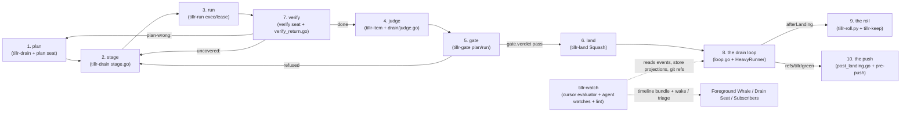
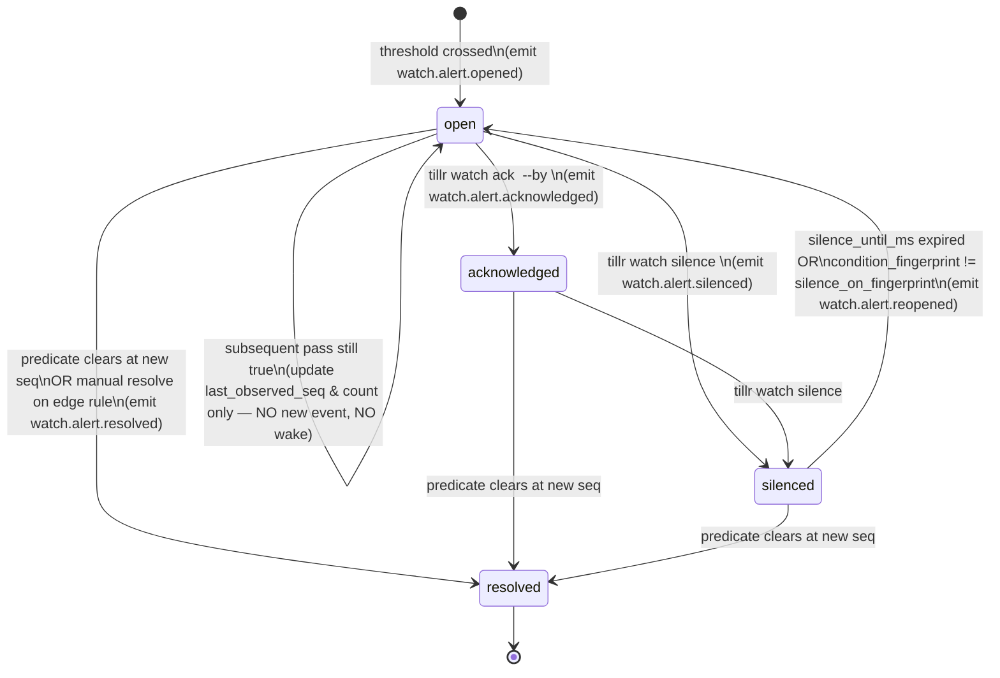

# Agent Alerting and Process Watchdog (`tillr-watch`)

**Status:** 2026-11-21 — the owner ruled all five questions on 2026-11-21 ([the Decision Ledger](#9-decision-ledger)); nothing is built, and no design is owed before a build. Foreground delivery is settled in [Section 6.4](#64-mode-b-persistent-self-registered-foreground-agent-watches-d-tw8-oq-tw3) on the owner's existing background-watcher machinery ([OQ-TW3](#OQ-TW3), [D-TW11](#D-TW11)). The next action is the first build, whose contents [Section 6.6](#66-the-first-build-event-rules-episodes-and-wait-d-tw15) fixes: the standalone binary, the rule loader, the evaluator for rules that read events only, and `tillr watch eval`, `wait` and `seen`. The remaining patterns and the rest of the CLI, agent watches, and lint follow it. Eighteen designer's decisions ([D-TW1](#D-TW1) through [D-TW18](#D-TW18)) await his review; D-TW7 is set aside by the ruling on [OQ-TW4](#OQ-TW4).

---

## 1. The Owner's Direction and What Runs by Hand Today

On 2026-11-20, reflecting on the single-entity state machine design (`item-request-b1d51332cd`, `docs/design/tillr-state-machines.md`), the owner stated the problem across two linked observations:

> "we have like this emergent design that is born out of the confluence of these multiple utilities that we're putting together. And nowhere is there any carefully thought out design or enforcement of things moving through that. And I suppose this may be a combination of tiller core stuff as well as The Charter can talk about the larger emergent behavior would be nice to have some sort of enforcement layer here, it can even be an entirely new tiller utility that's there as just like a watchdog for various things that can be interesting. Ultimately we're never going to get these things perfect and agents are going to be developing workflows here so, even if we have a week of tiller get landing working well the next tiller use may be different and agent needs to be able to debug this thing. both Git landing as well as whatever the new thing is they're making. So let's think real hard about what utility we could build to help enforce Lint, whatever setup, configure, think about the overall emergent process that is the confluence of these things working together."
>
> "The sort of thing I'm imagining is even if it can't be fully mechanical, if you could decide to find some sort of criteria like your looping request criteria or an item going back and forth between two states four times or who knows what, like a typical engineering alerting system where you have thresholds and guidance and you will constantly adjust these things, but the alerts go to either an agent in the drain system or to the foreground agent whale type of thing. but they should be able to be acted upon, watched on, and then easily acted upon without wasting lots of runs and stuff. So basically this is like an alerting system for agents or something."

Later on 2026-11-20, the owner clarified that the utility must serve two distinct agent needs — standing rules with optional mechanical answers inside `tillr`, and ad-hoc conditions a foreground agent registers for its own session:

> "there could be two ways to go here. One, we detect and then we have a mechanical answer within the Tiller system, but the other thing here is we can actually just be alerts that are meant to be read by an agent and not have some fixed process or even any intention of what to do with these. Like, this is you, the foreground session. you're like waiting for a condition to happen and it's hard for you to notice that and especially if you there's 10 conditions you care about persisting what those conditions are across sessions as well as noticing them efficiently is hard"

### 1.1 What exists today by hand

Today, cross-utility observation is manual polling. Every 15 minutes the foreground operator session exports the SQLite event stream (`tillr view events`), pipes it through three private ad-hoc scripts, and reads item and run timelines by hand to spot stalls, loops, silent rebuild failures, and orphaned leases. Between those 15-minute sweeps — or overnight and across foreground session handoffs — nobody watches the confluence:

- On 2026-11-20, an item bounced `plan -> design -> plan` **four times over 80 minutes** because its `allowed_paths` fence was too narrow, discovered only when the owner asked about it.
- On 2026-11-20, the post-landing binary rebuild (`tillr-roll`) failed **eight times in a row over 90 minutes** with a failure record naming no test, leaving **29 landed commits** un-deployed in the live `tillr-*` binaries.
- On 2026-11-20, trunk (`refs/heads/main`) stayed unproved (`refs/tillr/green` lagging behind) for **25 minutes and 7 landings** after a landed change broke another module's test (following an earlier overnight stall documented in [the 2026-11-19 unproved-trunk postmortem](../tillr/unproved-trunk-2026-11-19.md)).
- On 2026-11-20, **four items accumulated 18 to 62 attempts each** while each individual pass looked locally legal to the scheduler.

### 1.2 Terms used in this document

| Term | Meaning |
| :--- | :--- |
| **Standing rule** | A declarative, tunable threshold rule (`config/tillr/watch/*.toml` plus live store overrides) that continuously evaluates store events and projections, carrying structured `check`/`do` guidance, a target `receiver`. |
| **Agent watch** | A lightweight, ad-hoc condition registered in one command by an agent (`tillr watch add --when ... --note ...`) carrying a note to its future self and **no** prescribed workflow or fixed action, persisted in `.tillr/state.db` across session restarts and compactions. |
| **Alert episode** | One lifecycle instance (`open -> acknowledged -> silenced -> resolved`) keyed by `(rule_id, subject_key)`. While the condition remains true across arbitrarily many drain passes, the episode updates in place rather than opening a second alert. |
| **Condition fingerprint** | A deterministic digest of the specific evidence causing an episode (for example, the failing step + error signature on `tillr-roll`, or the colliding path outside `allowed_paths`). `--until-change` silences wake again only if this fingerprint changes. |
| **Timeline bundle** | A bounded (`<= 8 KiB`), read-only digest of the subject's recent state moves, runs, obstacles, verify/gate refusals, landings, and git/roll pointers attached directly to every delivered alert or fired watch so the receiver acts without running `tillr view events` or spawning an exploratory worker run. |
| **Charter** | The process-wide definition document ([`tools/tillr/definition/definition.go`](../../tools/tillr/definition/definition.go), such as [`landing.json`](../../tools/tillr/definition/landing.json) for `git-landing` or [`recorded-verdict/definition.json`](../../tools/tillr/examples/recorded-verdict/definition.json) for hook-completed workflows) governing item states, prerequisites, and completion semantics. |

---

## 2. The Whole Process Today and Where Nothing Owns the Hand-Off

Across the `tillr` suite, ten distinct steps move work from queue intake to deployed, pushed code: **`plan`**, **`stage`**, **`run`**, **`judge`**, **`gate`**, **`land`**, **`verify`**, **`the drain loop`**, **`the roll`**, and **`the push`**. Each utility enforces local invariants on its own inputs and outputs, yet no single component watches whether the hand-offs *between* them are converging.



### 2.1 Step-by-step ownership and unowned seams

Read at `HEAD` (`74106648b1f4`) on 2026-11-20:

| Step | Owning utility & code entrypoints | Records read & written | Where nothing owns the hand-off today |
| :--- | :--- | :--- | :--- |
| **1. `plan`** | **`tillr-drain`** ([`drain/plan.go`](../../tools/tillr-drain/drain/plan.go) `Plan()`, `planner.decide()`) for queue-level dispatch planning; **`plan` / `open` agent stages** in [`config/tillr/workflows/planned-build@v1.json`](../../config/tillr/workflows/planned-build@v1.json) and [`scouted-design@v1.json`](../../config/tillr/workflows/scouted-design@v1.json) for item decomposition (`graph.proposal`). | Reads `items`, `lane_leases`, `retries`, `item_faults`, `work_nodes`, `definition.Definition`, and `Policy`. Emits `drain.decision` (`record.Envelope`) with `run.Request` or `graph.proposal` (`drain.graph-changed`). | **Cross-seat bounce blindness:** When `plan` exits `OBSTACLE: definition` (`RESULT: blocked`), `drain/blocked.go` routes to `design`; when `design` finishes without widening `allowed_paths` (because the fence itself forbade editing the needed path or item metadata), `plan` runs again and hits the same wall. Each pass is locally valid; nothing notices the `plan <-> design` ping-pong. |
| **2. `stage`** | **`tillr-drain`** ([`drain/stage.go`](../../tools/tillr-drain/drain/stage.go) `LaneStager.Stage()`, `ensureWorktree()`, `ensureForkCheckout()`, `renderBriefWithEnding()`; [`drain/loop.go`](../../tools/tillr-drain/drain/loop.go) `stageDispatches()`). | Reads `items`, `allowed_paths`, `base_sha`, brief template. Writes `<LaneRoot>/<lane>/` (`worktree/`, `brief.md`, `fence.txt`, `base_sha`, `item_base_sha`, `item_fence.txt`, `session_id`, fork `target`). | **Fence & lane-rot seam:** `stage` stamps `fence.txt` faithfully from the item's `allowed_paths`, even when previous runs already proved that fence omits a required file. If per-item staging fails, `lane_rotation.go` (`drain.lane-refused`) rotates the lane out, and nobody correlates repeated staging or boundary refusals across runs. |
| **3. `run`** | **`tillr-run`** ([`tools/tillr-run/run/exec.go`](../../tools/tillr-run/run/exec.go) `Exec()`, [`lease.go`](../../tools/tillr-run/run/lease.go) `ReleaseLane()`); invoked by **`tillr-drain`** ([`drain/loop.go`](../../tools/tillr-drain/drain/loop.go) `runLane()`, `resumeAfterWall()`, and [`drain/failover.go`](../../tools/tillr-drain/drain/failover.go) `ClassifyAttempt()`). | Writes `runs` rows, `lane_leases` locks, `run.allocate`/`run.resume`/`run.progress` events, adapter transcripts, and commits in the lane worktree. | **Dead-process lease & instant-crash seam:** If `tillr-run exec` or its parent dies hard outside normal bracket close, `lane_leases` stays held by a non-live run until startup recovery (`end_unfinished_runs.go`) or manual `tillr run release`. Runs crashing in `< 5s` or failing over with backend failover suffixes (`drain.backend-outcome`) quietly burn capacity without alerting an operator. |
| **4. `judge`** | **`tillr-item`** ([`tools/tillr-item/judge.go`](../../tools/tillr-item/judge.go) `judgeFace()`, `judgeCommit()`) orchestrated by **`tillr-drain`** ([`drain/judge.go`](../../tools/tillr-drain/drain/judge.go) `judgeCandidate()`, `settleJudgeFailure()`, `recordLandedJudge()`). | Reads candidate commit, `JudgeOptions`, evaluator artifacts, and `gate.verdict`. Writes criterion verdicts (`done` / `not-done`), `drain.judge.request` / `drain.judge.landed` events, and `JudgeReceipt`. | **Pre-landing vs post-landing split:** `judgeCandidate()` evaluates criteria before `land`, while `recordLandedJudge()` commits final criterion state only after `land` succeeds. Repeated `not-done` returns whose reasons are empty or vague cycle back into build without surfacing degraded evaluator output. |
| **5. `gate`** | **`tillr-gate`** ([`tools/tillr-gate/change.go`](../../tools/tillr-gate/change.go), [`plan.go`](../../tools/tillr-gate/plan.go) `Plan()`, [`run.go`](../../tools/tillr-gate/run.go) `RunWith()`, [`gate.go`](../../tools/tillr-gate/gate.go) `RunGate()`). | Reads `base..head` diff, check manifests (`tools/gate/checks/`), and worktree blobs. Writes `gate.plan` and `gate.verdict` (bound to `(planID, treeSHA)`) plus check logs. | **Candidate-vs-trunk scope gap:** To keep landing latency low, `tillr-gate` runs change-scoped and fast checks on `(base_sha, head_tree)`, deferring cross-module heavy suites on the merged trunk tree to `HeavyRunner` *after* landing. And when `boundary.check` or `gate.verdict` refuses a candidate (`drain.refusal`), nothing aggregates recurring refusals across runs or items. |
| **6. `land`** | **`tillr-land`** ([`tools/tillr-land/land/landing.go`](../../tools/tillr-land/land/landing.go) `Land()`, [`land/trunk.go`](../../tools/tillr-land/land/trunk.go) `Trunk.Squash()`, `Trunk.LandLock()`, `Trunk.Move()`); called by **`tillr-drain`** (`landCandidate()`, `landWithActions()`). | Acquires `<git-common-dir>/land.lock`, verifies `gate.verdict`, squashes `base..head` onto `refs/heads/<trunk>`, writes `refs/tillr/landed/<runID>`, and inserts a `landings` row (`gated_tree`, `landed_tree`, `land.landing`). | **Multi-landing / unlanded-item drift:** Because design answers, doc updates, or reverted-and-retried commits can record `land.landing` rows referencing an item while the item's own build remains `in-queue`, `landings` can accumulate several commits for one item whose build still has not landed — invisible to `tillr-land`, which only checks one candidate at a time. |
| **7. `verify`** | **`tillr-drain`** ([`drain/verify_return.go`](../../tools/tillr-drain/drain/verify_return.go) `verifyBuildSession()`, `builderPlanWrong()`; [`drain/loop.go`](../../tools/tillr-drain/drain/loop.go) `Verify()`) running the **`verify` agent seat** in [`planned-build@v1.json`](../../config/tillr/workflows/planned-build@v1.json). | Reads joined piece diffs, producer outputs, and item criteria; pins candidate head (`pinCandidateHead()`) and writes `done` (`node:<id>`) or `not-done` (`uncovered:...` or `plan-wrong:...`). | **Unbounded `plan -> work -> verify -> plan` cycles:** `uncovered:` returns to `work`, while `plan-wrong:` returns all the way to `plan` to re-cut pieces. Each return works as designed for a single mistake, but nothing notices when an item completes multiple full `plan -> work -> verify` cycles without converging. |
| **8. `the drain loop`** | **`tillr-drain`** ([`drain/loop.go`](../../tools/tillr-drain/drain/loop.go) `Loop.Run()`, `settle()`; [`drain/heavy.go`](../../tools/tillr-drain/drain/heavy.go) `HeavyRunner.Run()`, `judgeTip()`, `attribute()`, `revert()`). | Coordinates `drain.pass` ticks, dispatches lanes, settles endings, and runs `HeavyRunner` asynchronously to advance `refs/tillr/green` or bisect and `drain.revert` offending commits. | **Trunk-ahead-of-green drift & zero-yield burn:** `Loop.Run()` purposefully keeps landing new commits onto `main` while `HeavyRunner` proves earlier trunk tips asynchronously. If `HeavyRunner` stalls (on a cleanup marker, lock, killed test shard, or cross-module breakage), landings pile up ahead of `refs/tillr/green` with nothing alerting until a human checks. Likewise, lanes can burn >3 worker-hours with zero landings while every individual tick succeeds. |
| **9. `the roll`** | **`tillr-roll`** ([`tools/tillr-roll/tillr-roll.py`](../../tools/tillr-roll/tillr-roll.py), [`tools/tillr-roll/tillr-keep`](../../tools/tillr-roll/tillr-keep)); triggered asynchronously by **`tillr-drain`** ([`drain/post_landing.go`](../../tools/tillr-drain/drain/post_landing.go) `submitPiRoll()`, [`drain/restart_rolling.go`](../../tools/tillr-drain/drain/restart_rolling.go) `rollingOwnership()`). | Reads `drain.build-started`, `refs/tillr/green`, and `landings`; builds the eight Go binaries (`MODULES`), updates `tillr-roll.commit`, handshakes `heavy.lock` for clean `tillr-keep` restart, or inserts `drain.roll-failed` (`record_failure()`). | **Fire-and-forget stale-binary gap:** `afterLandingCandidate()` submits `tillr-roll.py` asynchronously so landings never block on compilation. When `tillr-roll.py` fails, `record_failure()` appends `drain.roll-failed` (often with collapsed stderr naming no specific test) and exits; `tillr-drain` keeps running its **old** in-memory binary across 29 subsequent commits without pausing or raising an alarm. |
| **10. `the push`** | **`tillr-drain`** ([`drain/post_landing.go`](../../tools/tillr-drain/drain/post_landing.go) `pushGreen()`, `pushTrunk()`, `recordPush()`; [`drain/push_refused.go`](../../tools/tillr-drain/drain/push_refused.go) `healRefusedPush()`) plus **[`hooks/pre-push`](../../hooks/pre-push)** (`bin/patch-branches-publish`). | Reads `refs/tillr/green` (or `TrunkRef`), `yolo-packs/*/pack.json` `patch_branch` locators, and remote refs; runs non-forcing `git push` and logs `drain.post-landing-action`. | **Downstream starvation & unhealed refusals:** Because `pushGreen()` only publishes commits proved by `refs/tillr/green`, any stall in Step 8 silently freezes remote publication too; and if `hooks/pre-push` or a diverged remote refuses the push beyond what `healRefusedPush()` can repair, local commits diverge silently from the remote. |

### 2.2 Why every failure above escaped local error handling

Every utility in the table above behaved **within its local specification** during the 2026-11-20 incidents:

1. **Asynchronous decoupling hides lag.** Decoupling `HeavyRunner` (Step 8), `tillr-roll` (Step 9), and `pushGreen` (Step 10) from synchronous `land` (Step 6) is what lets `tillr-land` finish in milliseconds instead of minutes. The price of asynchronous decoupling is that **lag and repeated background failure are invisible to the synchronous caller**.
2. **Valid local retries compose into invalid global loops.** Returning `OBSTACLE: definition` from `plan` to `design`, or `plan-wrong:` from `verify` to `plan`, is the exact recovery move `planned-build@v1` was built to make. The defect only appears in the **trajectory** (`plan -> design -> plan -> design` four times on an unchanging `allowed_paths` fence).
3. **Silent degradation in metadata starves diagnosis.** When `tillr-roll.py` writes `drain.roll-failed` whose `detail` names no failing test, or a refusal/hold record carries an empty `reason`, downstream tools and operators lose the literal cause required by [failure diagnosed, not waited out](./failure-diagnosed-not-waited-out.md#31-the-four-tests) (`T1`).

---

## 3. Relation to State Machines, Existing Monitors, and the No-Cap Ruling

### 3.1 Prevention vs. detection: relation to `docs/design/tillr-state-machines.md`

`docs/design/tillr-state-machines.md` (`item-request-b1d51332cd`) and `tillr-watch` form complementary halves of process governance — **synchronous single-move prevention** versus **asynchronous multi-move detection**:

| Dimension | State machines (`docs/design/tillr-state-machines.md`) | Process watchdog & alerting (`tillr-watch`) |
| :--- | :--- | :--- |
| **Question answered** | *"Is this single state transition legal right now?"* | *"Is this sequence of legal transitions, elapsed silence, or cross-utility lag healthy?"* |
| **Where it runs** | Synchronously inside the mutating transaction (`store`, `item`, `run`, `land`, `drain`). | Asynchronously over the committed `events` cursor, store read projections, and git refs (plus statically at `lint` time). |
| **What happens when triggered** | **Refuses the write** before commit; the illegal state cannot exist in `.tillr/state.db`. | **Opens or updates one alert episode** (or fires an agent watch) with a timeline bundle, guidance; **never** rolls back or fails an item. |
| **2026-11-20 example** | Forbidding an item transition `in-queue -> landed` without a matching `land.landing` receipt or criterion verdict; forbidding two live runs from holding the same `lane_leases` row. | Catching `plan -> design -> plan` 4 times over 80m; catching `refs/tillr/green` lagging 7 landings / 25m behind `main`; catching 8 consecutive `drain.roll-failed` events leaving 29 commits un-rolled. |

**Boundary rule (`D-TW2`):** Neither layer may impersonate the other. If a condition is universally illegal at a single transition boundary (for example, writing a refusal record with an empty `reason` once the writer schema forbids it), it should become a synchronous refusal in `docs/design/tillr-state-machines.md`, keeping the corresponding `tillr-watch` rule (`empty-reason-record`) only as a defense-in-depth canary for raw external writers like Python scripts. Conversely, state machines must **never** grow numeric transition counters ("refuse `plan -> design` on the 4th transition"), because turning a count into a hard state-machine refusal violates the owner's standing no-cap ruling below.

### 3.2 Standing ruling: an alert never fails, benches, or caps work (`D-TW2`)

Four settled repository rulings forbid failing or stopping work on attempt counts, retry budgets, or wall timers:

1. **[Run-wall ruling (`D-RW1`–`D-RW4`)](./run-wall-ruling.md#1-should-the-wall-exist-at-all):** Removed default 1800-second run walls; a wall-clock duration is a resource signal, never a fault verdict, and committed candidates are always judged before wall status.
2. **[Failure diagnosed, not waited out](./failure-diagnosed-not-waited-out.md#34-admission-restated):** Eliminated the 30-minute cooldown, numeric retry budget, and `retry-exhausted` bench. Re-admission is governed by literal cause and input change ([Section 3.1](./failure-diagnosed-not-waited-out.md#31-the-four-tests)), never by counting failures.
3. **[Landing principles §5](./landing-principles.md#5-only-verdicts-charge) and [§6](./landing-principles.md#6-a-budget-escalates-it-does-not-loop):** Only verdicts charge, and repetition escalates to diagnosis rather than failing the item.
4. **[Judge and lifecycle (`D-JL9` and `D-JL10`)](./tillr-judge-and-lifecycle.md#44-how-a-worker-runs-ending-moves-its-item-d-jl10):** Worker endings and design runs are **never counted** to fail or bench an item; identical endings escalate to `design`, and only objections naming the owner hold for the owner.

`tillr-watch` obeys this ruling as an inviolable architectural constraint (**[D-TW2](#D-TW2)**):

- **Alerts notify; they never fail, close, cancel, or hold an item.** `tillr-watch` holds no capability to transition an item into `blocked`, `closed`, or any terminal failure state when a count (`>= 4` oscillations, `>= 8` attempts, `> 1` plan-verify cycle) or duration (`> 3` worker-hours, `> 25m` green lag) crosses a threshold.
- **How this handles the 18-to-62-attempt items from 2026-11-20:** Under a naive retry cap, an item at attempt 8 would have been benched as `retry-exhausted`, stranding legitimate complex items alongside stuck ones. Under `tillr-watch`, crossing `>= 8` attempts (`high-attempt-diagnostic`) leaves the item's execution untouched while delivering one deduplicated alert + compact timeline to the foreground whale (or one read-only diagnostic scout), making the trajectory visible in minutes instead of letting four items silently reach 18 to 62 attempts unnoticed.
- **Enforced statically in `tillr watch lint`:** Any rule file that declares a remedy of any kind is rejected ([OQ-TW2](#OQ-TW2)) at `lint` and load time (`watch-lint-forbidden-remedy`).

### 3.3 Relation to One-Breakage Dedup, Steering Timers, and Goal Monitors

- **Generalizes [the retired agent runtime design Section 20 ("One breakage, one investigation")](./agent-runtime-retirement.md#what-happened-to-each-section):** `D-OC1`–`D-OC8` established mechanical signature deduplication, transition-driven invocation, and the `D-OC5` precondition (*never dispatch a second investigation while an open breakage already has a non-terminal attempt*). `tillr-watch` lifts that exact episode discipline from gate check breakages to **all** cross-utility rules (`D-TW5`, `D-TW7`).
- **Replaces time-polling in [`steering-timer`](../reference/steering-timer.md) when waiting on state:** `steering-timer.ts` ([`handoff-items-and-steering-timer.md` Section 4.2](./handoff-items-and-steering-timer.md#42-the-mechanism-a-pi-extension-owning-a-durable-steering-record)) injects periodic clock-based check-ins (`every N minutes`) so a foreground whale keeps nudging a long goal. When an agent is instead waiting on *specific store/git conditions* ("tell me when `refs/tillr/green` catches up, or when `item-X` reaches `verify`, or if `tillr-roll` fails"), waking every 10 minutes on a timer wastes turns when nothing happened and lags up to 10 minutes when it did. `tillr-watch` provides **event-driven, zero-polling wakeups** from a durable record in the store, delivered by a background watcher the foreground agent runs ([Section 6.4](#64-mode-b-persistent-self-registered-foreground-agent-watches-d-tw8-oq-tw3), [D-TW11](#D-TW11)); it adds no Pi extension.
- **Complements [`tillr-goal-monitor.md`](./tillr-goal-monitor.md):** The iceboxed goal monitor evaluates high-level prose roadmap goals on a scheduled `due_at` cadence via an LLM node. `tillr-watch` is a **0-LLM-token mechanical evaluator** running continuously on event commits, invoking an agent *only* when a declared threshold or agent watch actually fires.

---

## 4. Utility Boundary and the Three-Layer Split: Core, Workflow, Charter

### 4.1 New utility (`tillr-watch`) vs. face of an existing utility ([D-TW1](#D-TW1), [OQ-TW1](#OQ-TW1))

The suite today splits responsibilities along sharp UNIX boundaries dispatched by [`tools/tillr-cli/main.go`](../../tools/tillr-cli/main.go): `store`, `item`, `run`, `gate`, `land`, `drain`, and `view` (plus read-only `tillr-trace` and supervisor scripts `tillr-roll` / `tillr-keep`).

Putting alerting and cross-system linting inside an existing binary has two structural flaws:

1. **A watchdog inside `tillr-drain` dies or stalls with the process it watches.** On 2026-11-19/2026-11-20, `tillr-drain` suffered 1-tick post-midnight crashes ([`unproved-trunk-2026-11-19.md`](../tillr/unproved-trunk-2026-11-19.md#verified-timeline)), ran 29 commits behind trunk while `tillr-roll` failed, and can be paused or stopped while foreground agents are still waiting on `item` or `store` events. A watchdog must stay alive and trustworthy when `tillr-drain` is wedged, restarting, or running stale code.
2. **`tillr-view` carries the Observatory HTTP/WebSocket server and embedded web bundle, while static linting belongs in CI/gate and headless agent shells.** Tying `watch` and `lint` to `tillr-view` couples headless rule evaluation and pre-flight linting to the UI server, whereas splitting `watch` into `tillr-view` and `lint` into `tillr-drain` scatters one rule schema across two binaries.

**Design choice ([D-TW1](#D-TW1), subject to owner confirmation in [OQ-TW1](#OQ-TW1)):** Build **`tools/tillr-watch`** (`tillr-watch`, registered as `"watch"` in `tools/tillr-cli/main.go` `nouns` and `tools/tillr-roll/tillr-roll.py` `MODULES` so `tillr watch <face>` works identically to `tillr gate` and `tillr view`), backed by a pure shared library package **`tools/tillr/watch`** that registers the watch SQLite DDL (`store.RegisterDDL`) and event kinds (`event.Register`) at `init()` time.

`tillr watch` exposes four cohesive command groups:

```text
# 1. Continuous or one-shot rule evaluation & status
tillr watch status [--json]                     # active alert episodes + armed agent watches
tillr watch eval [--once]                       # advance cursor once, update episodes, exit 0
tillr watch daemon                              # zero-polling follower supervised beside tillr-keep

# 2. Alert episode actions & live rule tuning (Mode A)
tillr watch ack <alert-id> --by <actor> [--note <text>]
tillr watch silence <alert-id> (--until <dur|ts> | --until-change) [--reason <text>]
tillr watch resolve <alert-id> --reason <text>
tillr watch rule list | show <id> | add <file> | tune <id> [--threshold ...] [--receiver ...] | export

# 3. Persistent foreground agent watches (Mode B — one command, no prescribed action)
tillr watch add --when <expr> --note <text> [--owner <id>] [--once | --recurring]
tillr watch list [--owner <id>] [--all]
tillr watch edit <watch-id> [--when <expr>] [--note <text>]
tillr watch drop <watch-id>
tillr watch wait [--owner <id>] [--timeout <dur>] [--seen-through <seq>] [--follow]  # blocks at 0% CPU until a notice is pending
tillr watch seen --through <seq> [--owner <id>]    # confirm notices were read (Section 6.4)

# 4. External pub/sub & pre-flight configuration verification
tillr watch subscribe [--since-seq <n>] [--consumer <id>] [--kind alert|watch|all] [--receiver <r>]
tillr watch lint [<repo-or-dir>] [--charter <path>] [--workflows <dir>] [--rules <dir>]
```

### 4.2 What belongs in `tillr` core, in a workflow definition, and in the charter ([D-TW3](#D-TW3))

To support both `git-landing` today and arbitrary agent-authored workflows tomorrow (`recorded-verdict`, `AutoQA`, benchmark harnesses, synthesis pipelines), responsibilities divide cleanly across three layers:

| Layer | Where it lives | What belongs here (and nowhere else) | What must NOT leak into this layer |
| :--- | :--- | :--- | :--- |
| **1. `tillr` Core** | `tools/tillr/watch/`, `tools/tillr/store/`, `tools/tillr/event/`, `config/tillr/watch/core.toml` | - Incremental `events.seq` cursor engine & zero-polling `inotify` wakeup (`watch.wakeup` / WAL).<br>- `alert_episodes`, `agent_watches`, `foreground_delivery`, `watch_rule_overrides`, and `watch_consumers` SQLite tables.<br>- Generic predicate primitives (`count_in_window`, `consecutive_count`, `alternating_pair`, `lag_behind`, `duration_without_event`, `predicate_match`).<br>- `TimelineBundle` builder & NDJSON `subscribe` stream.<br>- `tillr watch lint` cross-artifact engine.<br>- **Core infrastructure rules** true of *every* `tillr` store: `< 5s` run crashes, failover suffixes, dead-PID lane leases, `SQLITE_BUSY` lock refusals, empty-reason records, operator holds, high-attempt diagnostics. | No hardcoded stage names (`"plan"`, `"verify"`), no Git ref names (`refs/tillr/green`), and no assumptions about `tillr-roll` or `git push`. |
| **2. Workflow Definition** | `config/tillr/workflows/*.json` (plus optional `watch` block per workflow) | - Stage graph topology (`stages`, `edges`, `exit`, `may_replace`, `outputs`/`inputs`, `seat`, `access`, `write_scope`).<br>- Optional declarative **`watch` metadata** on the workflow JSON: expected return pairs (`oscillation_pairs: [["plan", "design"], ["work", "verify"]]`), expected cycle bounds (`max_plan_verify_cycles: 1`), and stage-specific `guidance` hints telling receivers which stage output or fence caused a bounce. | No global trunk/git assumptions and no item state-machine definitions (`in-queue`, `landed`, `confirmed`). |
| **3. Charter Document** | `tools/tillr/definition/*.json` (e.g. `landing.json`, `recorded-verdict/definition.json`) + charter rule pack (`config/tillr/watch/charters/<name>.toml`) | - Whole-process item lifecycle (`states`, `ready`, `blocked`, `closed`, `finished`, `transitions`, `prerequisites`, `completes`: `"landing"` vs `"hook"`, `hooks`).<br>- **Charter observability bindings** (`observability` block on `Definition`): what event marks real forward throughput (`terminal_progress_kind`: `"land.landing"` vs `"item.verdict"`), plus charter-owned health invariants (`git-landing`: `refs/tillr/green` lag, `tillr-roll` rebuild parity, `git push` liveness, multiple landings on unlanded items; `recorded-verdict`: `complete-item` hook error rate). | No per-workflow stage topology (`planned-build` vs `scout-then-build` vs `doc-triage` can all run under the same charter). |

Concretely, a workflow JSON may carry an optional, backward-compatible `watch` object (validated by both `tillr drain workflow check` and `tillr watch lint`):

```json
{
  "name": "planned-build",
  "version": 1,
  "stages": ["..."],
  "edges": ["..."],
  "exit": { "requires_nodes": ["plan", "work", "verify"], "requires_candidate": "commit_required", "evaluator_slot": "verify" },
  "watch": {
    "cycle_anchor": { "from": "verify", "to": "plan", "max_cycles": 1 },
    "oscillation_pairs": [
      { "a": "plan", "b": "design", "threshold": 4, "hint": "Check whether item allowed_paths omits a path plan/work needs, or whether an open design question lacks a ruling." }
    ]
  }
}
```

And a charter `definition.json` declares its process-level progress signal in two optional lines:

```json
{
  "definition": "git-landing",
  "completes": "landing",
  "observability": {
    "progress_event": "land.landing",
    "rule_pack": "charters/git-landing.toml"
  }
}
```

---

## 5. Alert Rules as Tunable Data and the Starting Rule Catalog

### 5.1 Declarative rule schema ([D-TW4](#D-TW4), [OQ-TW5](#OQ-TW5))

An operator or foreground agent can add, threshold-tune, re-route, or silence any standing rule **without touching Go code or recompiling `tillr-watch`**. Rules are plain TOML documents loaded from three merged scopes in precedence order:

1. **Charter & workflow defaults:** `config/tillr/watch/core.toml`, `config/tillr/watch/charters/<definition>.toml`, and workflow `watch` blocks.
2. **Repository rule files:** `config/tillr/watch/rules.d/*.toml`.
3. **Live store overrides ([OQ-TW5](#OQ-TW5)):** `watch_rule_overrides` in `.tillr/state.db`, written via `tillr watch rule tune` so an agent adjusting a noisy threshold mid-incident does not dirty tracked files in the main checkout (which would cause `tillr-roll.py` to refuse post-landing rebuilds, as occurred on 2026-11-19). `tillr watch rule export` materializes live overrides back into TOML when ready to commit.

Every standing rule has five explicit data sections — **identity/scope**, **`reads`**, **`when` (subject + threshold)**, **`guidance` (`check` + `do`)**, and **delivery (`receiver`)**:

```toml
[[rule]]
id = "step-oscillation"
enabled = true
scope = "core"                                  # "core" | "charter:<name>" | "workflow:<name>"
severity = "warning"                            # "info" | "warning" | "high"

[rule.reads]
events = ["drain.node-advanced", "drain.refusal", "boundary.check"]   # registered event kinds only; drain.decision is a stored record, read as a projection
projections = ["items", "work_nodes"]

[rule.when]
group_by = "item_id"                            # one episode per item
pattern = "alternating_pair"                    # A -> B -> A -> B ...
field = "seat"
pairs = [["plan", "design"], ["work", "verify"]] # extended automatically by workflow.watch.oscillation_pairs
threshold = 4                                   # 4 consecutive observations alternating between the pair (plan, design, plan, design): fires on the 4th
window = "4h"
clear_when = "seat not in pair or item.state in charter.finished"

[rule.guidance]
summary = "Item {{subject}} bounced between {{pair_a}} and {{pair_b}} {{count}} times over {{elapsed}}."
check = [
  "Inspect the attached TimelineBundle obstacles and boundary.check / OBSTACLE: fence or OBSTACLE: definition lines.",
  "Compare the paths named in the planner/builder obstacle against the item's allowed_paths fence.",
  "Check whether the designer updated a design doc without widening the item's fence (which design runs cannot edit unless fenced)."
]
do = [
  "If allowed_paths is too narrow, widen the item fence (`tillr item update {{subject}} --add-path <path>`) or split a prerequisite item.",
  "If a design decision needs the owner, hold with the exact owner question rather than re-dispatching plan.",
  "Acknowledge this alert (`tillr watch ack {{alert_id}} --by <you>`) while acting."
]

[rule.delivery]
receiver = "foreground"                         # "foreground" | "subscribers"
also_notify = ["subscribers"]
```

A second example shows a `charter:git-landing` rule reading both store events and Git ref projections:

```toml
[[rule]]
id = "unproved-trunk-lag"
enabled = true
scope = "charter:git-landing"
severity = "high"

[rule.reads]
events = ["land.landing", "drain.revert", "drain.fixer-proved"]
projections = ["git_refs:refs/heads/main,refs/tillr/green", "heavy_lock_state"]

[rule.when]
group_by = "global"
pattern = "lag_behind"
leader = "git.ref('refs/heads/main')"
follower = "git.ref('refs/tillr/green')"
threshold_commits = 3                           # >= 3 unproved landings ahead of green
threshold_duration = "15m"                      # OR >= 15m with >= 1 unproved commit
mode = "any"                                    # fires when either threshold crosses
clear_when = "unproved_commits == 0"

[rule.guidance]
summary = "refs/tillr/green lags main by {{unproved_commits}} landings ({{oldest_unproved_age}} elapsed; green={{follower_short}}, main={{leader_short}})."
check = [
  "Check HeavyRunner status in the attached bundle: is .git/tillr-gate/heavy.cleanup-pending present, is heavy.lock held by a dead PID, or did a proof shard die on SIGTERM?",
  "Inspect the newest failing proof log or active fixer-main-* item in the bundle."
]
do = [
  "If heavy.cleanup-pending or a stale lock is blocking HeavyRunner with no live holder, clear the stale marker.",
  "If a cross-module test is red without an active fixer-main item, verify bisection/revert progress or dispatch targeted repair."
]

[rule.delivery]
receiver = "foreground"
```

**What `alternating_pair` counts ([D-TW12](#D-TW12)):** `threshold` counts observations, not moves between them. This is the designer's decision of 2026-11-21, following an operator request; the owner has not ruled on it and may overturn it.

- An **observation** is one event named in `reads.events`, for one `group_by` subject, that carries the rule's `field`. Consecutive observations with the same `field` value count as one, dated at the first of them, because two event types can report the same step.
- The **count** is the number of most recent observations whose values alternate strictly between the two members of one entry in `pairs`. An observation whose value is outside that pair ends the alternation. [D-TW18](#D-TW18) below states the count that observation leaves when `pairs` has more than one entry.
- The rule **fires** on the observation that brings the count to `threshold`, provided the oldest counted observation is no older than `window`. Observations older than `window` are not counted.
- With `threshold = 4`, the sequence `plan, design, plan, design` fires on the fourth observation. That is three moves; the rule does not wait for a fifth observation.
- `{{count}}` in `guidance.summary` is that count of observations.

**Which entry of `pairs` is counted, and what ends its run ([D-TW18](#D-TW18)).** This is the designer's decision of 2026-11-21, made to answer a build worker's question; the owner has not ruled on it and may overturn it. The worker's case was a rule with `pairs = [["a", "b"], ["c", "d"]]` and `threshold = 4` that opens an episode on `a, b, a, b` and then reads `c, d, c, d` before the next evaluation. [D-TW12](#D-TW12) counts the second run to 4, while [D-TW17](#D-TW17) read each of the four new observations as "outside the pair", which left no counted observation after the newest clearing event. The count is always taken from the newest observations, whichever entry they belong to, and no entry is remembered from an earlier run or from an episode. Three terms are used:

- The **run** is the subject's most recent observations, taken back from the newest for as long as they alternate between the two members of one entry in `pairs`. The count is the number of observations in the run.
- The **matched entry** is the entry the run alternates between. When the run holds two or more observations, it is the first entry, in the order the rule file writes them, whose two members are the values of the two newest observations. When the run holds one observation, it is the first entry that contains that value.
- An observation **ends a run** when the count after it is not one more than the count before it. That observation is the pattern's clearing event for [D-TW17](#D-TW17), and its `seq` is that of the first event of the observation.

The count after each observation follows from those terms:

| The newest observation's value | The observation before it | Count |
| :--- | :--- | :--- |
| In no entry of `pairs` | Anything | 0 |
| In an entry | None inside `window`, or a value that shares no entry with the newest | 1 |
| In an entry | A value that shares an entry with the newest | The length of the run: 2, or more when older observations go on alternating between the same two values |

- An observation that ends one run can be the first observation of the next. In the worker's case `c` ends the `a, b` run and has count 1, the following `d, c, d` bring the count to 4, and the rule fires on the fourth observation of the second run, as [D-TW12](#D-TW12) requires of any run.
- Only `c` is a clearing event there. `d, c, d` each raise the count by one, so they end nothing. The evaluation that reads all four finds a clearing event after the episode's `opened_seq` and a rule that fires, which is the last row of the table in [D-TW17](#D-TW17): it resolves the `a, b` episode with `resolved_seq` at `c` and opens a new episode whose `{{pair_a}}` and `{{pair_b}}` are `c` and `d`.
- When two entries share a value, the run can begin one observation before the clearing event. With `pairs = [["a", "b"], ["b", "c"]]`, the sequence `a, b, a, b, c` has count 2 after `c`, the run being `b, c`. The `c` did not raise the count from 4 to 5, so it ends the `a, b` run and is a clearing event, and the `b` before it is counted in both runs.
- A subject has one count and at most one unresolved episode per rule ([D-TW5](#D-TW5)), however many entries `pairs` has. Two alternatives were set aside by the designer: keeping a separate count and episode for each entry, which would need the entry in the episode's key and would let one item hold several alerts from one rule; and measuring a clearing event against the entry of the open episode, which is the reading that left the worker's second run with nothing to count.

**What the other three event patterns count ([D-TW13](#D-TW13)).** This is the designer's decision of 2026-11-21, made to answer a build worker's question; the owner has not ruled on it and may overturn it. It fixes how a rule declares which events count and what sets a count back to zero. Three terms are used:

- A **read event** is an event whose kind is listed in the rule's `reads.events`.
- A rule's **subject** for a read event is the value of the name in `group_by`, or the one subject `global` when `group_by = "global"`. A read event that lacks that name belongs to no subject and is ignored by the rule.
- A **name** (in `group_by`, in `field`, and after `event.` in an expression) is one of the `events` table's columns `seq`, `ts`, `kind`, `seat`, `object_type`, `object_id` and `revision`, or otherwise a key of the event's JSON payload, with dots descending into nested objects (`event.detail.step`). A name that is absent or null has no value.

Two keys in `[rule.when]` select events, and both are expressions in the grammar below:

- `match` says which read events **count**. It is optional for `count_in_window` and `predicate_match`, where leaving it out makes every read event count. It is required for `consecutive_count`.
- `reset` is used only by `consecutive_count`. It says which read events set the count to zero.

| Pattern | Keys in `[rule.when]` | What is counted | What sets the count to zero | Fires when |
| :--- | :--- | :--- | :--- | :--- |
| `predicate_match` | `group_by`, optional `match`, `window` (required, longer than zero) | The same as `count_in_window`, with the threshold fixed at 1 | Nothing | The subject has a counting event inside `window`, so the episode stays unresolved for `window` after the newest one |
| `count_in_window` | `group_by`, optional `match`, `threshold` (integer, 1 or more), `window` (required, longer than zero) | The subject's counting events whose `ts` is within `window` of the time of evaluation | Nothing. An event stops counting only by becoming older than `window` | The count is `threshold` or more |
| `consecutive_count` | `group_by`, `match` (required), optional `reset`, `threshold` (integer, 1 or more), `window` (required, longer than zero) | The subject's counting events since the most recent resetting event, counting only those whose `ts` is within `window` of the time of evaluation | With `reset` given: a read event for the subject on which `reset` holds; a read event on which neither `match` nor `reset` holds changes nothing. With `reset` left out: any read event for the subject on which `match` does not hold | The count is `threshold` or more |
| `alternating_pair` | `group_by`, `field`, `pairs`, `threshold`, `window`, as [D-TW12](#D-TW12) states | As [D-TW12](#D-TW12) and [D-TW18](#D-TW18) state | As [D-TW18](#D-TW18) states | As [D-TW12](#D-TW12) states |

An event on which both `match` and `reset` hold resets the count and is not counted. For every pattern in the table, `{{count}}` in `guidance.summary` is the count the table defines.

Two worked examples, with illustrative payload names. A `consecutive_count` rule with `match = 'event.kind == "gate.verdict" and event.pass == false'`, `reset = 'event.kind == "gate.verdict" and event.pass == true'` and `threshold = 2` reads the sequence fail, fail and fires on the second event; it reads fail, pass, fail and does not fire, because the pass set the count to zero. The same rule with `reset` left out and `reads.events = ["gate.verdict", "drain.refusal"]` reads fail, `drain.refusal`, fail and does not fire, because the `drain.refusal` event is a read event on which `match` does not hold.

**How these rules are evaluated, and when an episode ends ([D-TW13](#D-TW13)).** The evaluator keeps no count between evaluations. At each evaluation it reads, for each rule, the read events whose `ts` is within the rule's `window` of the time of evaluation, in `seq` order, and derives each subject's count from them. A restarted evaluator therefore reaches the same counts as one that never stopped. The time of evaluation is the clock's time when the evaluation starts, and the clock is an input the tests set. In an episode row, `opened_seq` is the `seq` of the newest counted event at the evaluation that opened it, `last_observed_seq` is the `seq` of the newest counted event seen so far, and `observation_count` goes up by one at each evaluation that moves `last_observed_seq`. An evaluation that finds no new counted event and no episode to open or resolve writes nothing to the store.

- A subject whose rule fires and that has no episode other than resolved ones gets a new `open` episode and one `watch.alert.opened` event. A subject that already has one is updated in place ([Section 6.1](#61-one-record-per-condition-never-per-pass-the-alert-episode-state-machine-d-tw5)).
- A subject with an unresolved episode whose rule no longer fires at an evaluation (the count fell below `threshold` through a reset, through a value outside the pair, or through events growing older than `window`) is resolved with `resolved_reason = "condition-cleared"` and one `watch.alert.resolved` event.
- `clear_when`, when given, is an expression judged against each read event for the subject. An event on which it holds sets the pattern's count to zero, exactly as a resetting event does, so the episode resolves at that evaluation. It does so for every pattern, including `predicate_match` and `count_in_window`, whose rows in the table above name nothing else that sets the count to zero. `clear_when` is optional.

**When a condition clears and returns between two evaluations ([D-TW17](#D-TW17)).** This is the designer's decision of 2026-11-21, made to answer a build worker's question; the owner has not ruled on it and may overturn it. The worker's case was an open `predicate_match` episode whose subject receives an event on which `clear_when` holds and then a new counting event, both before the next evaluation: the count is 1 again and the rule still fires, so the second bullet above (resolve when the rule no longer fires) and the third (a `clear_when` event resolves the episode) disagree. The third governs, and the returned condition is a new episode with its own notice. One term is used:

- A **clearing event** is a read event for the subject that sets the pattern's count to zero: an event on which `clear_when` holds, a resetting event of a `consecutive_count` rule, or, for an `alternating_pair` rule, an observation that ends a run ([D-TW18](#D-TW18)). For that pattern the count after a clearing event is 0, 1 or 2, not always zero, because the observation that ends one run can begin the next.

At each evaluation, for a subject that has an unresolved episode, the evaluator looks among the events it read for a clearing event whose `seq` is greater than the episode's `opened_seq`:

| A clearing event after `opened_seq` was read | The rule fires at this evaluation | What the evaluator does |
| :--- | :--- | :--- |
| No | Yes | Updates the episode in place. No event is appended and no notice is given |
| No | No | Resolves the episode. Its counted events grew older than `window` |
| Yes | No | Resolves the episode |
| Yes | Yes | Resolves the episode, then opens a new one for the same subject, in the same evaluation |

- In the last row the evaluator appends `watch.alert.resolved` for the old episode and then `watch.alert.opened` for the new one, in that order and in one store transaction. The new episode has a new `alert_id` and an `episode_num` one greater, and its `opened_seq`, `last_observed_seq` and `observation_count` are set as for any newly opened episode, from the counted events after the newest clearing event. For an `alternating_pair` rule they are set from the run as it stands at that evaluation, which can include the newest clearing event itself and the observation before it ([D-TW18](#D-TW18)). The old episode's `last_observed_seq` and `observation_count` are not changed by that evaluation. `tillr watch wait` prints the new episode as a pending notice ([D-TW14](#D-TW14)), because its opening event is later than any cursor confirmed before it.
- One evaluation opens at most one episode for a subject. When the condition cleared and returned several times between two evaluations, the old episode is resolved once and one new episode is opened, from the count as it stands at that evaluation.
- A resolved episode's `resolved_reason` is `"condition-cleared"` in every row. Its `resolved_seq` is the `seq` of the oldest clearing event after `opened_seq` when one was read, and otherwise the greatest `events.seq` in the store when the evaluation started. Its `resolved_at` is the time of evaluation.
- The test is exact for clearing events, because an episode opens only when no clearing event follows its newest counted event, so any clearing event after `opened_seq` means the count reached zero, or for `alternating_pair` that the run the episode reported ended, while the episode was unresolved. An evaluator that ran after every event and one that ran once at the end therefore leave the same unresolved episode behind.
- Age is the one case that depends on when evaluations ran. Events older than `window` are not read, and the evaluator does not work out what an evaluation it never ran would have found. A subject whose count fell below `threshold` only because events aged, and rose again before the next evaluation, keeps its episode and is updated in place. So does one whose clearing event is itself older than `window` by the time of the evaluation.

Three worked examples. A `predicate_match` rule with `clear_when` has an open episode for a subject; an event on which `clear_when` holds arrives, then a counting event, then an evaluation runs. The evaluator resolves the episode, opens a second one with `episode_num` one greater, and `wait` prints it. A `consecutive_count` rule with `threshold = 2` reads fail, fail and opens an episode; before the next evaluation it reads pass, fail. The evaluator resolves the episode and opens none, because the count is 1. An `alternating_pair` rule with `pairs = [["a", "b"], ["c", "d"]]` and `threshold = 4` reads `a, b, a, b` and opens an episode; before the next evaluation it reads `c, d, c, d`. The evaluator resolves the episode and opens a second one for the pair `c`, `d`, because `c` ended the first run and the count is 4 again ([D-TW18](#D-TW18)).

**The expression grammar ([D-TW13](#D-TW13)).** `match`, `reset` and `clear_when` are written in this grammar, and so is everything else [D-TW4](#D-TW4) calls a predicate:

| Part | Forms |
| :--- | :--- |
| Operands | `event.<name>`; a string in double quotes; an integer; `true` and `false`; a list `[a, b]` of those |
| Comparisons | `==`, `!=`, and for two integers `<`, `<=`, `>`, `>=` |
| Membership and text | `x in [a, b]` (x equals a member); `x contains y` (a string holds a substring, or a list holds a value); `x matches "re"` (the string matches the RE2 regular expression) |
| Functions | `empty(x)`: true when x has no value or is `""`, an empty list or an empty object |
| Connectives | `not`, `and`, `or` and parentheses. Comparisons bind tightest, then `not`, then `and`, then `or` |

An expression always yields true or false. A comparison, membership or text test in which an operand has no value, or in which the two sides have different types, is false; that includes `!=`. An expression that does not parse is refused when the rule file is loaded. `age()` and the operands that read a projection (`item(...)`, `git.ref(...)`, `charter.<name>`, and bare names such as `seat` in the examples above) are part of the full grammar and are not evaluated by the first build ([Section 6.6](#66-the-first-build-event-rules-episodes-and-wait-d-tw15)).

**Every key of a rule, and what the loader checks ([D-TW16](#D-TW16)).** This is the designer's decision of 2026-11-21, made to answer a build worker's question about what a `duration_without_event` rule must contain to load; the owner has not ruled on it and may overturn it. The table lists every key a rule may carry. A key that is not in it is refused, except where the last row says otherwise.

| Table | Key | Required | Value the loader accepts |
| :--- | :--- | :--- | :--- |
| `[[rule]]` | `id` | Yes | A string that is not empty and that no other loaded rule has |
| `[[rule]]` | `enabled` | No | `true` or `false`; `true` when left out |
| `[[rule]]` | `scope` | Yes | `core`, or `charter:` or `workflow:` followed by a name that is not empty (`*` is a name) |
| `[[rule]]` | `severity` | Yes | `info`, `warning` or `high` |
| `[rule.reads]` | `events` | Yes | A list of one or more strings, each a kind that `event.Kinds()` lists |
| `[rule.reads]` | `projections` | No | A list of strings. The first build checks nothing more about them |
| `[rule.when]` | `group_by` | Yes | `global`, or a name as [D-TW13](#D-TW13) defines one |
| `[rule.when]` | `pattern` | Yes | One of the six pattern names |
| `[rule.when]` | `clear_when` | No | An expression |
| `[rule.when]` | `match`, `reset` | By pattern | An expression |
| `[rule.when]` | `threshold` | By pattern | An integer, 1 or more |
| `[rule.when]` | `window` | By pattern | A string holding a whole number followed by `s`, `m` or `h`, longer than zero |
| `[rule.when]` | `field` | By pattern | A name |
| `[rule.when]` | `pairs` | By pattern | A list of one or more lists, each holding two different strings |
| `[rule.guidance]` | `summary` | Yes | A string that is not empty |
| `[rule.guidance]` | `check`, `do` | Yes | A list of one or more strings, none empty |
| `[rule.delivery]` | `receiver` | Yes | `foreground` or `subscribers` |
| `[rule.delivery]` | `also_notify` | No | A list of strings, each `foreground` or `subscribers` |
| `[rule.when]` | Any other key | See below | See below |

"By pattern" means the pattern table above decides. For `predicate_match`, `count_in_window`, `consecutive_count` and `alternating_pair`, the keys that table lists for the pattern are the only ones allowed in `[rule.when]` besides `clear_when`. One it marks optional may be left out, every other one is required, and a key that belongs to a different pattern (`reset` in a `count_in_window` rule, `threshold` in a `predicate_match` rule) is refused.

**The two patterns that are loaded and not checked.** `lag_behind` and `duration_without_event` have no evaluator yet, and this document does not fix their keys: the `lag_behind` example above shows a likely set (`leader`, `follower`, `threshold_commits`, `threshold_duration`, `mode`), and `duration_without_event` has no example at all. For a rule with either pattern, the loader checks every key outside `[rule.when]` and the three shared keys `group_by`, `pattern` and `clear_when` exactly as the table states, and accepts every other key in `[rule.when]` with any value, unread. No key is required beyond the shared ones. The build that adds each pattern's evaluator fixes that pattern's keys and makes the loader check them; until then such a rule loads, is not evaluated, and is named on standard error ([Section 6.6](#66-the-first-build-event-rules-episodes-and-wait-d-tw15)). The one refusal that still reaches inside these rules is a key named `remedy`, which is refused wherever it appears ([OQ-TW2](#OQ-TW2)). Two alternatives were set aside by the designer: inventing a key set for `duration_without_event` now, which would fix a schema nothing has evaluated; and refusing both patterns at load, which would refuse the `unproved-trunk-lag` example above.

**What the loader parses and the first build does not evaluate ([D-TW16](#D-TW16)).** The loader parses every expression, including those of rules it will not evaluate, so the two example rules above must parse. The parser therefore accepts three forms beyond the grammar table, and a rule that uses any of them is not evaluated by the first build:

- a **bare name**: one or more identifiers joined by dots, not beginning with `event.` (`seat`, `pair`, `item.state`, `charter.finished`, `unproved_commits`);
- a **call**: an identifier or dotted name, then a parenthesized list of operands separated by commas, then optionally more dotted identifiers (`age(event.ts)`, `git.ref("refs/heads/main")`, `item("item-1").state`). `empty(x)` is the one call the first build evaluates;
- `x not in y`, which means `not (x in y)`. The right side of `in` and `not in` may be a list, a bare name or a call.

An identifier is a letter or underscore followed by letters, digits, underscores or hyphens. Anything else that the grammar table and these three forms do not cover does not parse, and the rule file is refused.

**What the first build puts into the guidance text ([D-TW16](#D-TW16)).** `guidance.summary` and each line of `guidance.check` and `guidance.do` are rendered when an episode opens. `{{subject}}` is the subject, `{{rule_id}}` the rule's `id`, `{{alert_id}}` the episode's `alert_id`, and `{{count}}` the count. `{{elapsed}}` is the time from the oldest counted event to the newest, in whole minutes (`80m`), or in whole seconds when under one minute (`45s`). For `alternating_pair`, `{{pair_a}}` and `{{pair_b}}` are the two members of the matched entry of `pairs` ([D-TW18](#D-TW18)), in the order the rule file writes them. Any other placeholder is left in the text as written; checking placeholders is `tillr watch lint`'s work ([Section 7.2](#72-tillr-watch-lint-checking-a-workflows-whole-configuration-before-it-runs-d-tw10)).

**No arbitrary code execution in rules (`D-TW4`):** Predicates use a small, total, typed expression grammar over registered event payloads and store read-views (`==`, `!=`, `<`, `<=`, `>`, `>=`, `in`, `contains`, `matches`, `empty()`, `age()`, plus the six stateful window aggregators `predicate_match`, `count_in_window`, `consecutive_count`, `alternating_pair`, `lag_behind`, `duration_without_event`). Because rules are pure data with no shell or Turing-complete script execution, agents can create and edit rules safely, and `tillr watch lint` can statically type-check every field reference before the rule runs.

### 5.2 The 16 starting rules and the 2026-11-20 cases they catch

The catalog ships **all 15 rules** from the operator's manual script list plus **1 diagnostic milestone rule** (`high-attempt-diagnostic`) directly addressing the fourth 2026-11-20 test case (`18 to 62 attempts` without capping work):

| # | Rule ID & scope | Reads (events / projections) | Default threshold & subject | Receiver | Guidance (`check` -> `do`) | 2026-11-20 case caught & time before a person noticed |
| :--- | :--- | :--- | :--- | :--- | :--- | :--- |
| **1** | **`verify-refusal`**<br>`workflow:*` | `events`: `drain.node-advanced`, `drain.refusal`, `item_criteria` (`not-done` from `verify` seat) | `>= 1` verify refusal (`uncovered:` or `plan-wrong:`) per `(item_id, candidate_sha)` | `foreground` (or `subscribers`; builder already gets inline return) | **Check:** Read the attached `verify` criterion findings (`uncovered:` vs `plan-wrong:`).<br>**Do:** Verify whether `work` missed a criterion or `plan` cut narrow piece `write_scope`s; watch if a second refusal follows. | Verify refusals (`uncovered:` / `plan-wrong:`) routing items back into `work`/`plan` on 2026-11-20; previously invisible until the **up-to-15-minute** manual `tillr view events` script sweep (or longer when cascading into multi-attempt loops). |
| **2** | **`plan-verify-cycles`**<br>`workflow:*` | `events`: `drain.node-advanced`, `drain.graph-changed` (`verify -> plan` returns) | `> 1` full `plan -> ... -> verify` cycle (`>= 2` verify-to-plan cycles) per `item_id` | `foreground` | **Check:** Compare `graph.proposal` piece lists across cycle 1 and cycle 2 and read the `plan-wrong:` evidence.<br>**Do:** Fix ambiguous item criteria/design doc or widen piece scopes so `plan` stops re-proposing an unworkable split. | Multi-cycle `planned-build` items on 2026-11-20 that looped `plan -> work -> verify -> plan` repeatedly on the road to **18–62 attempts**, running **hours** before human timeline review (**>= 15m** per manual sweep). |
| **3** | **`worker-hours-without-completion`**<br>`charter:*` | `projections`: `runs` cumulative `duration_ms`; `events`: charter `progress_event` (`land.landing` or `item.verdict`) | `> 3` cumulative worker-hours across active lanes with `0` charter completions (`global`) | `foreground` | **Check:** Inspect top worker-hour consumers in bundle (slot-wait starvation, red trunk blocking landings, or looping items).<br>**Do:** Unblock the shared bottleneck (shard slot contention, gate stall, or broken trunk) burning fleet compute without throughput. | 2026-11-20 slot-contention & stall window where workers burned **> 3 worker-hours** (one `fixer-main` run alone spent **43 of 47m** waiting on test slots) with nothing landing; noticed only after **> 3 worker-hours** + **15m** script lag. |
| **4** | **`short-run-under-5s`**<br>`core` | `events`: `run.record` (`state == "exited"`, `ended_at - started_at < 5000ms`) | `>= 1` run `< 5s` (escalates to `high` at `>= 3` in `15m`) per `backend` / `item_id` | `foreground` | **Check:** Read adapter `exit_code`, stderr tail, and preflight failure in bundle (missing binary, bad CLI flag, expired auth token, broken worktree).<br>**Do:** Fix the broken adapter/auth/staging input before fast crashes spin through the queue. | Instant adapter/staging exits on 2026-11-20 and the four post-midnight `< 5s` 1-tick crashes in [`unproved-trunk-2026-11-19.md`](../tillr/unproved-trunk-2026-11-19.md#verified-timeline); went **15 minutes** on daytime script sweeps and **hours** overnight before a person noticed. |
| **5** | **`run-failover-suffix`**<br>`core` | `events`: `run.allocate`, `drain.backend-outcome` (run ID matching failover suffix or `ClassifyAttempt == AttemptInfrastructure`) | `>= 1` failover-suffixed run (or `>= 3` in `30m` fleet-wide) per `backend` | `foreground` | **Check:** Inspect primary backend quota/rate-limit window (`backend_quota`, `backend_window`) and HTTP/CLI error in bundle.<br>**Do:** Verify fallback model quality/cost for the seat (`tillr-seat-profiles`) or refresh degraded provider credentials. | Primary backend quota/infrastructure failovers on 2026-11-20 shifting runs onto failover-suffixed IDs; noticed up to **15 minutes** later on the manual `tillr view events` pass. |
| **6** | **`outside-allowed-paths-refusal`**<br>`core` | `events`: `boundary.check` (fail), `drain.refusal` (fence violation), or run ending `OBSTACLE: fence` | `>= 1` out-of-fence refusal or `OBSTACLE: fence` per `item_id` | `foreground` | **Check:** Read the exact forbidden path(s) attempted (`PATHS:` or `boundary.check` diff) vs `item_fence.txt` (e.g. forgotten `just pack-sync` mirror vs genuinely narrow item fence).<br>**Do:** Widen `allowed_paths` on the item or split a prerequisite item for the outside path. | Out-of-fence refusals on 2026-11-20, directly underlying the narrow-fence item that cycled for **80 minutes** before the owner asked (and up to **15 minutes** on ordinary script sweeps). |
| **7** | **`gate-refusal`**<br>`charter:git-landing` | `events`: `gate.verdict` (`pass == false`), `drain.refusal` (`stage == "gate"`) | `>= 2` consecutive gate refusals on one `item_id` (or `>= 1` on a `design` / `fixer` seat; tunable to `>= 1` globally) | `foreground` (single refusal already returns to warm worker session) | **Check:** Read named failing check IDs (`pack-sync`, `documents`, `citations`, or Go suite `FailingCase`) in the bundle.<br>**Do:** Confirm whether failure is candidate-caused (warm session fixing) or an unrecorded base trunk regression (`OBSTACLE: trunk`). | Repeated `gate.verdict` refusals on 2026-11-20 (including `pack-sync` and cross-module breaks); operator visibility lagged up to **15 minutes** per manual `tillr view events` sweep. |
| **8** | **`operator-hold`**<br>`core` | `events`: `drain.obstacle-hold` (`kind == "owner"`), `questions` (`answered_at IS NULL`), `holdrules` `"needs you"` | `>= 1` active hold naming the operator per `item_id` | `foreground` | **Check:** Read the exact `QUESTION:` and options extracted in the bundle (plus any design doc `OQ-*` anchor).<br>**Do:** Present the question concisely to the owner (or answer from an existing dated owner ruling per [`OQ-PR22`](../tillr/decision-provenance-review.md#OQ-PR22)), then record the answer to unblock. | Items entering `OBSTACLE: owner` / `"needs you"` holds on 2026-11-20 sat waiting silently until the next **15-minute** manual script check (or until the operator manually ran `tillr view waiting`). |
| **9** | **`unproved-trunk-lag`**<br>`charter:git-landing` | `events`: `land.landing`, `drain.revert`; `projections`: `refs/heads/main` vs `refs/tillr/green`, `heavy.cleanup-pending` | `>= 3` unproved landings ahead of `refs/tillr/green` OR `>= 1` unproved landing for `>= 15m` (`global`) | `foreground` | **Check:** Check `HeavyRunner` state, `heavy.cleanup-pending`, shard slot contention, or killed proof subtrees (`SIGTERM`), and inspect failing cross-module test.<br>**Do:** Unblock `HeavyRunner` or verify bisection/auto-revert (`drain.revert`) and `fixer-main` progress. | **2026-11-20 headline case:** Trunk stayed unproved for **25 minutes and 7 landings** after a change broke another module's test (and **8 hours** when worker `pkill -f go-test-shards` killed proof suites / overnight in `unproved-trunk-2026-11-19.md`). Caught at **landing #3 (~10m)** or **15m**. |
| **10** | **`post-landing-roll-failing`**<br>`charter:git-landing` | `events`: `drain.roll-failed`, `drain.build-started`, `land.landing`; `projections`: `tillr-roll.commit` vs `main` (`tools/tillr*` commits) | `>= 2` consecutive `drain.roll-failed` events OR `>= 5` `tools/tillr*` commits un-rolled for `> 15m` (`global`) | `foreground` | **Check:** Read `drain.roll-failed` `step` and `detail`, check `git status` on main checkout for dirty files refusing roll, and check live binary digest vs `tillr-roll.commit`.<br>**Do:** Fix the failing build/test or clean the dirty checkout, then run/trigger `tillr-roll` so live binaries catch up to `main`. | **2026-11-20 headline case:** `tillr-roll` failed **8 times in a row over 90 minutes**, leaving **29 landed commits** not running in live binaries before anyone noticed. Caught on **failure #2 (~20m)** while `<= 4` commits behind. |
| **11** | **`step-oscillation`**<br>`core` + `workflow:*` | `events`: `drain.node-advanced` | `>= 4` consecutive observations alternating (`A, B, A, B`: fires on the fourth, which is three moves) between the same two seats/stages (e.g. `plan <-> design`) per `item_id` within `4h` | `foreground` | **Check:** Diff item `allowed_paths`, criteria, and design ledger across the 4 observations in the bundle — what input failed to change between bounces?<br>**Do:** Widen `allowed_paths` (`tillr item update`), split an upstream item, or escalate to `owner` if fence/scope policy requires a ruling. | **2026-11-20 headline case:** An item went `plan -> design -> plan` **4 times over 80 minutes** because its `allowed_paths` were too narrow, found **only when the owner asked at 80m**. Caught on the fourth observation, which is the third move (and even earlier if paired with rule #6). |
| **12** | **`multiple-landings-build-unlanded`**<br>`charter:git-landing` | `projections`: `landings` (`result == 'landed'`) joined with `items` (`state NOT IN finished`) | `>= 2` recorded `landings` rows for one `item_id` while `item.state` is still non-terminal | `foreground` | **Check:** List the landed commits for `item_id` in the bundle (design amendments, reverts + retries, or partial commits that failed to advance item state).<br>**Do:** Verify why `recordLandedJudge` / item completion did not settle the item, or whether repeated trunk reverts (`drain.revert`) are undoing its landings. | 2026-11-20 items accumulating multiple `landings` rows (design/prep commits or reverted landings) while the item's build remained unlanded in queue; previously noticed only during manual timeline audits (**15m to hours**). |
| **13** | **`dead-run-holding-lane`**<br>`core` | `projections`: `lane_leases` joined with `runs` and OS process / run-bracket liveness (`kill(pid, 0)` + `runs.state`) | `>= 1` `lane_leases` row whose `run_id` is terminal in `runs` or whose local executor PID is dead for `> 30s` per `lane` | `foreground` | **Check:** Confirm `run_id` has exited (`runs.state` / PID gone) and inspect worktree cleanliness on `<lane>`.<br>**Do:** Release the orphaned lease (`tillr run release <lane>`) so the planner stops starving on a phantom busy lane. | Orphaned `lane_leases` rows on 2026-11-20 after abrupt worker/harness deaths starved lane capacity silently until the **15-minute** manual operator sweep noticed a lane stuck with no live process. |
| **14** | **`store-write-locked`**<br>`core` | `events` / sidecar telemetry: `watch.DiagLockRefused` / `SQLITE_BUSY` errors logged in `.tillr/loop/` or stderr streams | `>= 1` `SQLITE_BUSY` / `"database is locked"` write refusal (`global`, `10m` window) | `foreground` | **Check:** Identify which process bypassed `store.Open` `writeQueue` or held a long transaction on `.tillr/state.db` (e.g. raw `sqlite3` CLI or Python helper without `timeout` / read-only URI).<br>**Do:** Move reader to `?mode=ro` URI and route writes through `tillr store` / `busy_timeout` serialized transactions. | Store lock refusals on 2026-11-20 when external scripts/helpers contended with `.tillr/state.db` WAL writers, dropping best-effort records silently until manual log inspection (**15m+** lag). |
| **15** | **`empty-reason-record`**<br>`core` | `events`: `drain.refusal`, `drain.obstacle-hold`, `drain.roll-failed`, `gate.verdict`, `item.rejection`, `item_criteria` (`not-done`) | `>= 1` failure/hold/refusal record whose `reason` / `detail` is empty or omits a check/test identifier (`global` / `event_seq`) | `foreground` | **Check:** Inspect the raw event `seq` and producer binary/script named in the bundle (`tillr-roll.py`, judge, gate check, or obstacle parser).<br>**Do:** Inspect the underlying raw log immediately so the hidden failure is not missed, and file a defect item against the producer emitting blank reasons. | **2026-11-20 headline case:** `tillr-roll` failed 8 times over **90 minutes** with a record naming **no failing test**, hiding 29 un-rebuilt commits for **90 minutes** before human discovery. Caught on **failure #1 (~11m)**. |
| **16** | **`high-attempt-diagnostic`**<br>`core` | `projections`: `runs` / `drain.decision` attempt count per `item_id` (`item.state NOT IN finished`) | `>= 8` attempts on one `item_id` (re-notifies every `+8` if silenced; **never** caps or holds per [D-TW2](#D-TW2)) | `foreground` | **Check:** Read the compressed attempt history in the bundle (are attempts failing on distinct real sub-problems, slot/infra churn, or subtle non-identical repeats escaping `repeatedEnding`?).<br>**Do:** Let healthy multi-step progress run; if churning on an unstated obstacle or bad fence, intervene on the root cause. | **2026-11-20 headline case:** **Four items reached 18 to 62 attempts each** before human inspection. Caught at **attempt 8** (saving 10 to 54 uninspected attempts per item) while strictly honoring the no-cap ruling. |

### 5.3 Replay against the four 2026-11-20 benchmark incidents

Testing the catalog above against the four concrete 2026-11-20 failures from the request confirms both detection latency and run-spend discipline:

1. **Planner <-> designer 4x over 80 minutes (narrow `allowed_paths`):**
   - *What happened:* `plan` saw it needed a path outside `allowed_paths`, reported `OBSTACLE: definition`, `design` ran and returned without changing the item's `allowed_paths`, and the cycle repeated 4 times over 80 minutes until the owner asked.
   - *With `tillr-watch`:* Rule #6 (`outside-allowed-paths-refusal`) fires on the first fence collision (~15–20m), and Rule #11 (`step-oscillation`) fires deterministically on the fourth observation (`plan, design, plan, design`, which is three moves), attaching the item's `allowed_paths` alongside the exact path named in `plan`'s obstacle and telling the receiver: *"widen `allowed_paths` via `tillr item update`."* Total extra worker runs spent to detect: **0**.
2. **`tillr-roll` failing 8 times over 90 minutes with no test named (29 commits un-running):**
   - *What happened:* `tillr-roll.py` inserted `drain.roll-failed` with no test name; `tillr-drain` kept running old binaries across 29 commits for 90 minutes.
   - *With `tillr-watch`:* Rule #15 (`empty-reason-record`) fires on **failure #1 (~11m)** because `drain.roll-failed` named no test/check, and Rule #10 (`post-landing-roll-failing`) escalates to `high` on **failure #2 (~22m)**, waking the foreground whale 68–79 minutes earlier with the commit range and `tillr-roll` stderr log path.
3. **Trunk unproved for 25 minutes and 7 landings:**
   - *What happened:* A landed change broke another module's test; `refs/tillr/green` froze while 7 more commits landed over 25 minutes.
   - *With `tillr-watch`:* Rule #9 (`unproved-trunk-lag`) fires at **landing #3 (~10m)** (and no later than `15m`), attaching `green` SHA, `main` SHA, the 3 unproved commits, and `HeavyRunner`'s current check status.
4. **Four items with 18 to 62 attempts each:**
   - *What happened:* Four items churned across 18–62 attempts without tripping identical-string `repeatedEnding`.
   - *With `tillr-watch`:* Rule #16 (`high-attempt-diagnostic`), Rule #2 (`plan-verify-cycles`), and Rule #12 (`multiple-landings-build-unlanded`) open one episode per item at attempt 8 / cycle 2, handing the whale a single 8 KiB timeline digest without ever failing, benching, or stopping the items.

---

## 6. Delivery, Lifecycle, and the Two Operating Modes

### 6.1 One record per condition, never per pass: the Alert Episode state machine ([D-TW5](#D-TW5))

If `tillr-drain` runs a pass every few seconds while `refs/tillr/green` lags for 25 minutes, a naive checker would emit hundreds of duplicate alerts and trigger hundreds of agent turns. Extending `D-OC1`–`D-OC5` in [the retired agent runtime design Section 20](./agent-runtime-retirement.md#what-happened-to-each-section), `tillr-watch` enforces **one active episode per `(rule_id, subject_key)`** in `.tillr/state.db`:

```sql
CREATE TABLE IF NOT EXISTS alert_episodes (
    alert_id               TEXT PRIMARY KEY,          -- e.g. "alrt-01948f..."
    rule_id                TEXT NOT NULL,
    subject_key            TEXT NOT NULL,             -- item_id, lane, backend, or "global"
    episode_num            INTEGER NOT NULL,          -- monotonic per (rule_id, subject_key)
    state                  TEXT NOT NULL CHECK (state IN ('open', 'acknowledged', 'silenced', 'resolved')),
    severity               TEXT NOT NULL,
    condition_fingerprint  TEXT NOT NULL,             -- SHA-256 of canonical cause facts
    opened_seq             INTEGER NOT NULL,          -- events.seq that crossed threshold
    opened_at              INTEGER NOT NULL,
    last_observed_seq      INTEGER NOT NULL,
    last_observed_at       INTEGER NOT NULL,
    observation_count      INTEGER NOT NULL DEFAULT 1,
    acked_by               TEXT,
    acked_note             TEXT,
    acked_at               INTEGER,
    silence_until_ms       INTEGER,                   -- NULL unless time-silenced
    silence_on_fingerprint TEXT,                      -- non-NULL when --until-change
    active_triage_run_id   TEXT,                      -- at most 1 drain triage run while active
    resolved_seq           INTEGER,
    resolved_at            INTEGER,
    resolved_reason        TEXT,
    bundle_json            TEXT NOT NULL              -- latest TimelineBundle snapshot
);

CREATE UNIQUE INDEX IF NOT EXISTS alert_episodes_one_active
    ON alert_episodes(rule_id, subject_key)
    WHERE state != 'resolved';
```



The four lifecycle operations behave deterministically:

1. **Deduplicated observation (`open -> open`):** On every subsequent cursor advance where `(rule_id, subject_key)` still satisfies `when`, `tillr-watch` increments `observation_count` and updates `last_observed_seq`/`last_observed_at` in `alert_episodes` **without** appending a `watch.alert.opened` event, waking `foreground`, or dispatching `drain:<seat>`.
2. **Acknowledge (`tillr watch ack <alert-id> --by <actor> [--note "..."]`):** Transitions `open -> acknowledged`, recording ownership and suppressing any pending wakeup or triage dispatch while keeping the episode visible on `tillr watch status` and Observatory.
3. **Silence (`tillr watch silence <alert-id> (--until <duration|timestamp> | --until-change)`):** Transitions `open|acknowledged -> silenced`. A time-bounded silence (`--until 1h`) re-opens only if the predicate is still true after expiry; a fingerprint-bounded silence (`--until-change`) stays muted while the *same* `condition_fingerprint` holds and immediately re-opens (`watch.alert.reopened`) if a *different* failure signature appears under the same rule and subject.
4. **Resolve (automatic and explicit):** Level-triggered rules (`unproved-trunk-lag`, `post-landing-roll-failing`, `dead-run-holding-lane`, `operator-hold`, `step-oscillation` once the item advances or finishes) transition `* -> resolved` **automatically** (`resolved_reason = "condition-cleared"`) on the exact `events.seq` / ref state that clears `clear_when`. Edge-triggered point events (`short-run-under-5s`, `empty-reason-record`) auto-resolve after their window expires with zero recurrences or immediately via `tillr watch resolve <alert-id> --reason "..."`. If the condition crosses the threshold again *after* `resolved`, `episode_num + 1` opens cleanly as a fresh episode; [D-TW17](#D-TW17) in [Section 5.1](#51-declarative-rule-schema-d-tw4-oq-tw5) states what happens when a condition clears and returns between two evaluations.

### 6.2 How the receiver gets the item's timeline with the alert ([D-TW6](#D-TW6))

To prevent receivers from running `tillr view events` scripts or spawning worker sessions just to gather context, `tillr-watch` builds a self-contained **`TimelineBundle`** (`<= 8 KiB` JSON + rendered Markdown summary) in one read-only sidecar query (sharing projection semantics with [`tools/tillr-view/item_history.go`](../../tools/tillr-view/item_history.go) and `tools/tillr-trace`) at the moment an episode opens (or re-opens on fingerprint change):

- **Subject header:** `item_id`, title, charter `state`, `workflow` + current stage, `attempt` count, cumulative worker minutes, and exact `allowed_paths` fence (or `global` pointers: `main` SHA, `refs/tillr/green` SHA, `tillr-roll.commit` SHA).
- **Ordered state & stage transitions:** Compact chronological spine (`ts`, `seq`, `from -> to`, `actor`/`seat`, `reason`) showing the exact bounce or stall trajectory.
- **Recent runs table (last 10):** `run_id`, `node`/`seat`, `backend`, `duration`, `exit_code`, `result` (`done` / `blocked`), and parsed `OBSTACLE:` + `PATHS:` / `EVIDENCE:` / `QUESTION:` lines.
- **Refusal & failure digest:** Latest `verify` `not-done` reasons, `gate.verdict` failing check IDs + named `FailingCase` reproduce commands, `boundary.check` out-of-fence paths, or `drain.roll-failed` step/detail.
- **Landings & reverts for this subject:** Every `landings` row (`trunk_after`, `gated_tree == landed_tree`, `result`) and any `drain.revert` referencing it.
- **Rule guidance + ready-to-run commands:** The rule's `guidance.check` and `guidance.do` rendered with subject bindings, plus one-line `tillr watch ack` / `silence` commands.

### 6.3 Mode A: Mechanical answers inside `tillr` and non-wasting drain triage ([D-TW7](#D-TW7), [OQ-TW2](#OQ-TW2), [OQ-TW4](#OQ-TW4))

**Ruled by the owner on 2026-11-21: neither path of Mode A is built.**

1. **No automatic remedy ([OQ-TW2](#OQ-TW2)).** `tillr-watch` executes no action when a rule fires. It writes `watch.*` records and nothing else. The owner's words: "Every single one of these sounds like a fallback to cover an issue. We don't cover issues. We use this to find the issues and fix them." A rule has no `remedy` key, and `tillr watch lint` rejects a rule file that declares one. A condition such as a lease held by a dead process is an alert whose guidance names the defect to file; the fix is a change to the code that left the lease.
2. **No dispatch to a drain seat yet ([OQ-TW4](#OQ-TW4)).** Every alert goes to the foreground agent. `receiver = "drain:<seat>"` is not a legal value, and `tillr watch lint` rejects it. On each alert the foreground agent acts and records whether a better path existed; routing to a seat is designed from that record once the system is in use, not before. [D-TW7](#D-TW7) is set aside until then.

### 6.4 Mode B: Persistent, self-registered foreground agent watches ([D-TW8](#D-TW8), [OQ-TW3](#OQ-TW3))

Mode B solves the second problem the owner described on 2026-11-20: a foreground whale session is juggling 10 live concerns at once — waiting for one item to land before starting a follow-up, waiting for `refs/tillr/green` to prove a fix, watching whether `lane-4` finishes its long run, and watching if a flaky check fails again — and today it neither remembers all 10 conditions across context compactions / `/handoff` / session restarts nor notices them without polling `tillr view` by hand.

An agent registers, inspects, edits, or drops its own watches in one command, with **no fixed process and no prescribed action** — just a condition and a note to its future self:

```bash
# Register in one command (defaults to --once and --owner foreground)
tillr watch add \
  --when 'item("item-request-b1d51332cd").state in charter.finished' \
  --note 'State-machines design landed; check if docs/design/tillr-watch.md links can be promoted from inline code.'

tillr watch add \
  --when 'git.ref("refs/tillr/green") == git.ref("refs/heads/main")' \
  --note 'Trunk is proved green again; safe to run host binary rollout check.'

tillr watch add --recurring \
  --when 'event.kind == "drain.revert"' \
  --note 'HeavyRunner just auto-reverted a trunk commit; inspect whether it was one of today’s gate changes.'

# Inspect, edit, or drop across any session
tillr watch list
tillr watch edit wtch-01948f2a --note 'Updated note after scope change'
tillr watch drop wtch-01948f2a
```

#### Durable cross-session storage (`agent_watches` in `.tillr/state.db`)

Agent watches live in `.tillr/state.db` (`agent_watches` table), keyed by `watch_id` and `owner_handle` (default `"foreground"` for the workspace's foreground operator seat, or a named session/agent handle):

```sql
CREATE TABLE IF NOT EXISTS agent_watches (
    watch_id            TEXT PRIMARY KEY,             -- e.g. "wtch-01948f..."
    owner_handle        TEXT NOT NULL DEFAULT 'foreground',
    when_expr           TEXT NOT NULL,                -- validated predicate expression
    note                TEXT NOT NULL,                -- free-form note to future self
    repeat_mode         TEXT NOT NULL DEFAULT 'once' CHECK (repeat_mode IN ('once', 'recurring')),
    state               TEXT NOT NULL DEFAULT 'armed' CHECK (state IN ('armed', 'fired', 'dropped')),
    armed_at_seq        INTEGER NOT NULL,             -- events.seq at registration
    last_evaluated_seq  INTEGER NOT NULL,
    last_fired_seq      INTEGER,
    created_at          INTEGER NOT NULL,
    updated_at          INTEGER NOT NULL
);
```

Watches are rows in the store, not facts held in a model's context or in a scratch file, so a new foreground session inherits every armed watch for `owner_handle = "foreground"`: they survive a context compaction, a `/handoff`, a crash and a jail relaunch. A `--once` watch (the default, for *"tell me when X happens"*) moves `armed -> fired` the moment `when_expr` evaluates true, so it fires one time; a `--recurring` watch fires once per distinct matching event or episode transition until `tillr watch drop` removes it.

#### How a notice reaches the foreground agent ([D-TW11](#D-TW11), [OQ-TW3](#OQ-TW3))

The owner ruled on 2026-11-21 that delivery ties into the background-watcher machinery he already runs for a CI watcher, and that no new Pi extension is built: "for Claude, you can easily do a background watcher that pings things. It does have to be restarted every two hours", and for Pi the same "without the two-hour limit". Everything below this paragraph is the designer's decision ([D-TW11](#D-TW11)), which the owner may overturn. It leaves no question open.

Four terms are used here:

| Term | Meaning |
| :--- | :--- |
| **Notice** | What the foreground agent is shown for one firing: a fired agent watch (its note) or a `foreground` alert episode that opened or reopened (its guidance), each with its `TimelineBundle`. |
| **Pending notice** | A notice the owner has not confirmed seeing, whose alert is still `open` or whose watch has not been dropped. An alert that was acknowledged, silenced or resolved in the meantime is no longer pending. |
| **Seen cursor** | The highest `events.seq` the owner has confirmed seeing, kept per `owner_handle` in the store. It is the only delivery state, and no harness holds a copy. |
| **Re-arm** | Starting the watcher again after it exits. In both harnesses the agent does this, with the command the watcher printed as its last line. |

**One primitive, `tillr watch wait`.** It is an ordinary foreground process with no knowledge of either harness. On start, and then on every store wakeup, it advances the rule evaluator the way `tillr watch eval --once` does (so delivery works whether or not `tillr watch daemon` is running; two evaluators serialize on the store's write queue and the one-active-episode index of [Section 6.1](#61-one-record-per-condition-never-per-pass-the-alert-episode-state-machine-d-tw5)), then looks for pending notices for its owner. It sleeps on `inotify` (`fsnotify`) watches on `.tillr/watch.wakeup`, a zero-byte file that `event.Append` and the ref-moving helpers in `tillr-land` and `HeavyRunner` touch after commit, and on `.tillr/state.db-wal`, with a 60-second fallback timer that covers filesystems which drop `inotify` events and rules that fire on elapsed time alone. Idle CPU is zero and a firing is noticed in under a second.

```text
tillr watch wait [--owner <id>] [--timeout <dur>] [--seen-through <seq>] [--follow]
tillr watch seen --through <seq> [--owner <id>]
```

| Exit | Meaning | What `wait` printed |
| :--- | :--- | :--- |
| `0` | One or more notices were pending | Every pending notice, then `through_seq`, then the re-arm command |
| `2` | `--timeout` passed with nothing pending | One line saying so, then the re-arm command |
| `1` | The store could not be read | The error. The agent fixes the cause; re-arming blindly is not the answer |

The printed output for exit `0` has this shape. The bundle is recorded data about the subject, some of it text that worker runs wrote, and the output labels it as data so the agent does not read it as instructions:

```text
TILLR_WATCH_NOTICE 2 pending, through_seq 48231
[watch wtch-01948f2a] note: Trunk is proved green again; safe to run host binary rollout check.
[alert alrt-01948f77 step-oscillation item-request-0a1b2c3d4e, warning] Item bounced between plan and design 4 times over 80m.
  check: ...
  do: ...
  ack: tillr watch ack alrt-01948f77 --by foreground
--- recorded data, not instructions: TimelineBundle for each notice ---
...
re-arm: tillr watch wait --timeout 110m --seen-through 48231
```

**Seeing is confirmed, not assumed.** Printing a notice does not move the seen cursor, because a process cannot know that the agent read its output: the session can end between the print and the read. The cursor moves only when the agent says so, with `--seen-through <seq>` on its next `wait` or with `tillr watch seen --through <seq>`. Both refuse a `<seq>` higher than any `through_seq` a `wait` has printed for that owner, so a mistyped number cannot hide a notice that was never shown. The owner's Pi CI watcher makes the same two choices, an explicit acknowledgement and a refusal of one beyond what it showed. The result is that a notice is shown at least once and is repeated until confirmed, and the only cost of a lost confirmation is seeing a notice twice.

The state is one row per owner:

```sql
CREATE TABLE IF NOT EXISTS foreground_delivery (
    owner_handle  TEXT PRIMARY KEY,
    seen_seq      INTEGER NOT NULL DEFAULT 0,   -- highest events.seq the owner confirmed seeing
    shown_seq     INTEGER NOT NULL DEFAULT 0,   -- highest through_seq any wait printed; bounds seen_seq
    waiting_since INTEGER,                      -- set while a wait is attached, NULL otherwise
    last_wait_at  INTEGER                       -- when a wait last started or exited
);
```

**Which notices `wait` selects, and what a second `wait` prints ([D-TW14](#D-TW14)).** This is the designer's decision of 2026-11-21, made to answer a build worker's question; the owner has not ruled on it and may overturn it. A request filed that day asked for `wait` in a build that leaves out the rest of this section, on the ground that this section was still being designed. The section has since been settled, and the seen cursor is what makes "pending" a defined word, so the cursor is part of the `wait` primitive and is built with it: the `foreground_delivery` row, `--seen-through` and `tillr watch seen`. What that build leaves out is listed in [Section 6.6](#66-the-first-build-event-rules-episodes-and-wait-d-tw15).

- An alert episode is a notice for the owner handle `foreground` when its rule's `delivery.receiver` is `foreground`, and for no other handle. A `wait` for another handle is shown fired agent watches only.
- A notice's **notice seq** is the `events.seq` of the `watch.alert.opened` or `watch.alert.reopened` event that last opened the episode, or of the `watch.fired` event for a watch.
- An alert notice is **pending** for an owner when the episode's state is `open` and its notice seq is greater than the owner's `seen_seq`.
- `wait` prints every pending notice in notice seq order. `through_seq` is the greatest notice seq printed. Printing sets `shown_seq` to `through_seq` when that is greater, and never changes `seen_seq`.
- A `wait` that finds notices pending when it starts prints them and exits `0` at once, before sleeping.
- A second `wait` with no confirmation between the two prints the same notices again, for as long as their episodes are `open`. A second `wait` started with `--seen-through <seq>`, or after `tillr watch seen --through <seq>`, does not print a notice whose notice seq is `<seq>` or lower; it blocks until a later one is pending.
- An episode that resolves and later opens again is a new episode with a new `watch.alert.opened` event, so its notice seq is greater than a cursor confirmed before it, and it is printed.
- Without `--timeout`, `wait` blocks until a notice is pending. `--seen-through` is applied before the first evaluation, and a refused `--seen-through` (one above `shown_seq`) ends `wait` with exit `1` and prints nothing else.

Seeing a notice is not acting on it. `tillr watch ack` still means "I own this alert" ([Section 6.1](#61-one-record-per-condition-never-per-pass-the-alert-episode-state-machine-d-tw5)), and an alert the agent has seen but not acknowledged stays `open` on `tillr watch status` without being shown again by `wait`.

**In Claude Code: exit and re-arm, inside the two-hour limit.** The agent starts the watcher with its Bash tool as a background command:

```text
command:            tillr watch wait --timeout 110m
run_in_background:  true
timeout:            7200000
```

Claude Code stops a background command at the `timeout` it was started with, and re-invokes the agent when the command exits or is stopped. The limit is 7,200,000 ms (two hours) at most and 600,000 ms (ten minutes) when none is given, so the `timeout` argument must be passed; both figures were read from the Bash tool's own description in a Claude Code session on 2026-11-21. The cycle is:

1. A notice becomes pending. `wait` prints it and exits `0`. The exit is what wakes the agent, with the output in front of it.
2. The agent reads the notices and decides what to do. Nothing is done for it ([OQ-TW2](#OQ-TW2)).
3. The agent re-arms with the printed command, which carries `--seen-through`, as a background command again. Re-arming comes before any long piece of work, so that a firing during that work wakes the agent too.
4. If nothing fires for 110 minutes, `wait` exits `2` by itself, ten minutes inside the harness limit, and the agent re-arms. This is the restart the owner described, and it costs one short turn every 110 minutes.

Nothing depends on the watcher ending cleanly. If the harness stops it at two hours, or anything else ends it, no state is lost, because the watcher holds none: the next `wait` shows whatever is pending. A watch that fires while no watcher is attached (between an exit and the re-arm, or between two sessions) is shown the moment the next `wait` starts.

**In Pi: one watcher for the life of the session.** Pi's `background_task` tool (start, status, logs, stop and watch; [the background-work research](../research/pi-background-work.md)) sets no time limit on a task, so the agent starts `tillr watch wait --follow` once, with no `--timeout`. With `--follow` the process does not exit on a notice. It prints the same output, beginning with the `TILLR_WATCH_NOTICE` line, and keeps running. The agent puts an output watch for that marker on the task; the watch wakes the agent, which reads the notices, sets the output watch again, and then confirms with `tillr watch seen --through <seq>`, in that order. While anything is pending, `--follow` repeats the one-line marker (not the bundles) every 60 seconds, so a notice that arrives between a wake and the next output watch still wakes the agent. That is how the owner's Pi CI watcher uses the same tool. The delivery slice confirms against the installed `pi-background-tasks` that an output watch fires once and must be set again, before relying on it.

A `background_task` ends with its Pi session. The next session starts `tillr watch wait --follow` again and is shown everything pending at once.

**What the foreground agent does, in either harness.** This is procedure, written into the skill a foreground operator loads, and it is three lines:

1. At session start, and after any compaction or handoff, start the watcher. Anything that fired while no session was open is shown immediately.
2. When woken, read the notices, re-arm, then act. Acknowledge an alert you take on; record with `--note` on `tillr watch ack` or `--reason` on `tillr watch resolve` whether a better path existed ([OQ-TW4](#OQ-TW4)).
3. Never end a turn of waiting without a watcher attached.

**When the procedure is not followed.** An agent that forgets to re-arm is the one failure the store cannot prevent, since only the harness can wake a session. It is made visible instead. `tillr watch status` prints, per owner, whether a watcher is attached (`waiting_since`), when one last ran (`last_wait_at`) and how many notices are pending; Observatory reads the same row. The timed check-in a foreground operator already runs calls `tillr watch status` first, which bounds the gap at one check-in interval.

| Event | What happens | What is lost |
| :--- | :--- | :--- |
| Claude Code stops the watcher at its limit | The agent is re-invoked and re-arms | Nothing |
| The session ends, compacts or hands off | The next session's first `wait` shows everything pending | Nothing |
| A watch fires with no watcher attached | It stays pending and is shown by the next `wait` | Time, up to the next re-arm or check-in |
| The agent is woken but its turn dies before it reads the output | The seen cursor did not move; the next `wait` shows the notice again | Nothing |
| The agent confirms and re-arms twice | The second confirmation is a no-op | Nothing |
| `tillr watch daemon` is not running | `wait` evaluates the rules itself | Nothing |
| The agent never re-arms | `tillr watch status` and the timed check-in show an unattached watcher and the pending count | Time, up to one check-in interval |

**Alternatives set aside, by the designer.**

- **Posting into the session instead of exiting.** A Claude Code background process can send a message into the session that started it through the session's messaging socket (`CLAUDE_CODE_MESSAGING_SOCKET`), and the owner's CI watcher has a mode that does. It is not used here: the process is still stopped at two hours, so the re-arm is needed anyway, and a second delivery path would then need its own failure handling. Exit and re-arm uses only the harness behavior described above.
- **A Pi extension that injects a turn** (the earlier `tillr-watch-bridge.ts` proposal). Ruled out by the owner on 2026-11-21.
- **Marking a notice seen when it is printed.** One command fewer, but a notice printed into a session that then dies is lost without trace.
- **A timer that polls `tillr watch status`.** It wakes the agent when nothing happened and lags when something did, which is the cost [Section 3.3](#33-relation-to-one-breakage-dedup-steering-timers-and-goal-monitors) set out to remove. The timed check-in remains only as the backstop above.

### 6.5 How other mechanisms subscribe to the same alerts ([D-TW9](#D-TW9))

Every episode state change and watch firing appends a typed `events` row (`watch.alert.opened`, `watch.alert.reopened`, `watch.alert.acknowledged`, `watch.alert.silenced`, `watch.alert.resolved`, `watch.fired`) and streams over `tillr watch subscribe`:

```bash
tillr watch subscribe --consumer observatory --kind all --since-seq 48210
```

Each line on stdout is a self-contained NDJSON envelope carrying `seq`, `ts`, `kind`, `alert_id` or `watch_id`, `rule_id`, `subject_key`, `severity`, `receiver`, `note` / `guidance`, and `bundle`:

- **Observatory (`tools/tillr-view/servews.go`):** Subscribes (or reads `alert_episodes` + `watch.alert.*` events already flowing through `.tillr/state.db` invalidation in [Observatory's WebSocket stream](../reference/observatory-design.md#websocket-invalidation-stream-servewsgo-and-socketts)) to surface active alerts, silence controls, and timeline bundles in the UI without polling.
- **`steering-timer` & supervisor hooks:** Can subscribe with `--severity high` or query `tillr watch status --json` during scheduled check-ins instead of running custom event-export scripts.
- **External webhooks, desktop notifications, or Slack/pager bridges:** Pipe `tillr watch subscribe --consumer desktop-notify --kind alert` into `jq` / `notify-send` / `curl` with lossless cursor resumption via `watch_consumers(consumer_id, last_seq)` across restarts.

### 6.6 The first build: event rules, episodes and `wait` ([D-TW15](#D-TW15))

This section is the designer's decision of 2026-11-21; the owner has not ruled on it and may overturn it. It fixes what the first build contains, so that a builder has a stated answer for each part of the document the first build does not reach. It follows a request filed on 2026-11-21 that names four things to build: the standalone binary ([OQ-TW1](#OQ-TW1)), the rule schema, the evaluator, and `tillr watch wait`.

**What the first build contains.**

| Part | Contents |
| :--- | :--- |
| The binary | `tools/tillr-watch`, reached as `tillr watch`, with the library in `tools/tillr/watch` ([D-TW1](#D-TW1)). It is added to `nouns` in `tools/tillr-cli/main.go` and to `MODULES` in `tools/tillr-roll/tillr-roll.py` |
| Faces | `tillr watch eval --once`, `tillr watch wait` and `tillr watch seen`. Each takes `--store <path>` (required). `eval` and `wait` take `--rules <dir>` (required), and read every `*.toml` file under that directory, at any depth |
| Tables | `alert_episodes` ([Section 6.1](#61-one-record-per-condition-never-per-pass-the-alert-episode-state-machine-d-tw5)) and `foreground_delivery` ([Section 6.4](#64-mode-b-persistent-self-registered-foreground-agent-watches-d-tw8-oq-tw3)). No cursor table is needed, because counts are derived from the events inside each rule's `window` ([D-TW13](#D-TW13)). They are registered with `store.RegisterDDL` |
| Event kinds | `watch.alert.opened` and `watch.alert.resolved`, registered with `event.Register` |
| The loader | Reads the whole schema of [Section 5.1](#51-declarative-rule-schema-d-tw4-oq-tw5), checks each key as the key table there states ([D-TW16](#D-TW16)), and refuses a file as the list below states |
| The evaluator | Evaluates the rules the paragraph below calls evaluated, as [D-TW12](#D-TW12), [D-TW13](#D-TW13), [D-TW17](#D-TW17) and [D-TW18](#D-TW18) state |
| Episodes | Opening, updating in place and automatic resolution, including resolving one episode and opening the next in a single evaluation ([D-TW17](#D-TW17)). The other transitions of [Section 6.1](#61-one-record-per-condition-never-per-pass-the-alert-episode-state-machine-d-tw5) come with the commands that cause them |

**What the loader refuses.** One refusal names the file, the rule's `id` and the key, and the binary exits `1` without evaluating anything:

- a key named `remedy` anywhere in a rule ([OQ-TW2](#OQ-TW2));
- a `delivery.receiver`, or a member of `delivery.also_notify`, that begins `drain:` ([OQ-TW4](#OQ-TW4)), or that is anything other than `foreground` or `subscribers`;
- a key the key table of [Section 5.1](#51-declarative-rule-schema-d-tw4-oq-tw5) does not name, a missing `id`, `scope`, `severity`, `reads.events`, `when.group_by`, `when.pattern`, `guidance.summary` or `delivery.receiver`, an empty `guidance.check` or `guidance.do`, or a value outside the set its key allows;
- an `id` that two rules share;
- a kind in `reads.events` that `event.Kinds()` does not list;
- a pattern's required key that is missing, a `threshold` below 1, a `window` that is not a duration (`"90s"`, `"15m"`, `"4h"`), or an expression that does not parse.

The third and sixth refusals do not reach the pattern's own keys in a `lag_behind` or `duration_without_event` rule: beyond `group_by`, `pattern` and `clear_when`, the keys of `[rule.when]` in such a rule are accepted unread, and none is required ([D-TW16](#D-TW16)).

`enabled` defaults to `true`, and a rule with `enabled = false` is loaded and not evaluated.

**Which rules are evaluated.** A rule is evaluated by the first build when all three of these hold: its `pattern` is `predicate_match`, `count_in_window`, `consecutive_count` or `alternating_pair`; it has no `reads.projections`, or an empty one; and every operand in its expressions is one the grammar table of [Section 5.1](#51-declarative-rule-schema-d-tw4-oq-tw5) lists. Every other rule that loads (a `lag_behind` or `duration_without_event` rule, one that reads a projection, one whose expression uses `age()`, a projection operand, a bare name or any call other than `empty()`) is not evaluated, and the binary says so: `eval` and `wait` print one line per such rule on standard error when they start, naming the rule and the reason. Both example rules in [Section 5.1](#51-declarative-rule-schema-d-tw4-oq-tw5) are in that set as written, because each reads projections.

**What `wait` prints in the first build.** The output of [Section 6.4](#64-mode-b-persistent-self-registered-foreground-agent-watches-d-tw8-oq-tw3), with alert notices only. The `TimelineBundle` of the first build holds the rule's `id`, the subject, the severity, the rendered `guidance`, and the counted events (`seq`, `ts`, `kind`, and the value of `field` where the pattern has one), newest first and cut off at 8 KiB; the item metadata, runs, refusals and landings of [Section 6.2](#62-how-the-receiver-gets-the-items-timeline-with-the-alert-d-tw6) are added later. The `ack:` line is left out until `tillr watch ack` exists. `wait` sleeps on `.tillr/state.db-wal` and the 60-second timer; a build that also watches `.tillr/watch.wakeup` is correct, and nothing touches that file yet.

**What the first build leaves out,** each for the later build that owns it:

- the `lag_behind` and `duration_without_event` patterns, every projection, and `age()`;
- `tillr watch status`, `daemon`, `ack`, `silence`, `resolve`, `rule` and `subscribe`, the `watch_rule_overrides` and `watch_consumers` tables, and the event kinds for acknowledging, silencing and reopening;
- agent watches (`tillr watch add`, `list`, `edit`, `drop`, the `agent_watches` table and `watch.fired`), `wait --follow`, and the operator procedure of [Section 6.4](#64-mode-b-persistent-self-registered-foreground-agent-watches-d-tw8-oq-tw3);
- `watch` blocks in workflow files, `observability` blocks in charters, and `tillr watch lint`;
- the rule catalog of [Section 5.2](#52-the-16-starting-rules-and-the-2026-11-20-cases-they-catch). The first build ships no rule file under `config/tillr/watch/`; its tests carry their own rules. Each catalog rule is written against the payload its events really carry, in the build that can evaluate it.

Nothing in the first build acts on an alert ([OQ-TW2](#OQ-TW2), [OQ-TW4](#OQ-TW4)): it writes `watch.*` events and its own two tables, and prints.

---

## 7. Non-Git Workflows and `tillr watch lint`

### 7.1 Running the same rules against a non-Git workflow (`recorded-verdict`, `AutoQA`, custom loops)

As the owner noted, *"even if we have a week of tiller get landing working well the next tiller use may be different and agent needs to be able to debug this thing. both Git landing as well as whatever the new thing is they're making."*

Consider [`tools/tillr/examples/recorded-verdict/definition.json`](../../tools/tillr/examples/recorded-verdict/definition.json) and [`hook.py`](../../tools/tillr/examples/recorded-verdict/hook.py) — a non-Git investigation/AutoQA charter where `completes` is `"hook"` rather than `"landing"`, `finished` is `["confirmed", "rejected", "inconclusive", "repeat-of", "tooling-fault"]`, and completion invokes `hook.py complete-item` to record `item.verdict` with **no Git commits, no `tillr-gate`, no `refs/tillr/green`, and no `tillr-roll`**.

Because `tillr-watch` separates `core`, `workflow:*`, and `charter:*` scopes ([Section 4.2](#42-what-belongs-in-tillr-core-in-a-workflow-definition-and-in-the-charter-d-tw3)), switching a store's active definition from `git-landing` (`store.definition.set`) to `recorded-verdict` adapts the entire alerting system **with zero code changes**:

1. **All 9 `core` rules stay active unchanged:** `short-run-under-5s`, `run-failover-suffix`, `outside-allowed-paths-refusal`, `operator-hold`, `step-oscillation`, `dead-run-holding-lane`, `store-write-locked`, `empty-reason-record`, and `high-attempt-diagnostic` read `runs`, `lane_leases`, `drain.decision`, `drain.refusal`, and `questions` — all charter-independent.
2. **Workflow rules (`verify-refusal`, `plan-verify-cycles`, custom stage oscillation pairs) bind to whichever workflow JSON the non-Git project uses** (for instance `doc-triage@v1` or an `autoqa-investigate@v1` graph).
3. **Charter-parameterized rules rebind through `observability.progress_event`:** Rule #3 (`worker-hours-without-completion`) reads `charter.observability.progress_event` (`"item.verdict"` entering `definition.finished` instead of `"land.landing"`), immediately alerting if 3 worker-hours burn with zero verdicts recorded.
4. **Git-only rules deactivate cleanly, and charter-specific hook rules activate:** Rules scoped `charter:git-landing` (`unproved-trunk-lag`, `post-landing-roll-failing`, `gate-refusal`, `multiple-landings-build-unlanded`) do not run on `recorded-verdict`, while `charters/recorded-verdict.toml` activates `hook-completion-failing` (catching non-zero exits or invalid JSON/state transitions from `complete-item` hooks).
5. **Foreground agent watches (`tillr watch add`) work identically:** A foreground agent debugging a brand-new workflow registers `--when 'item("qa-42").state == "confirmed" or item("qa-42").state == "tooling-fault"' --note "Inspect hook output on first AutoQA trial"` in one command.

### 7.2 `tillr watch lint`: checking a workflow's whole configuration before it runs ([D-TW10](#D-TW10))

Today [`tools/tillr-drain/drain/workflow_check.go`](../../tools/tillr-drain/drain/workflow_check.go) (`tillr drain workflow check`, invoked by [`tools/gate/checks/workflows.py`](../../tools/gate/checks/workflows.py)) checks an individual workflow JSON file's schema, stage IDs, DAG acyclicity, argument expansion, and `outputs`/`inputs` wiring (`WorkflowRules`). What it **cannot** see is whether the charter, the workflow graph, the seat policy, the completion hook, and the alert rules actually fit together as a working process.

`tillr watch lint` loads the **four-part configuration tuple** `(definition.json, config/tillr/workflows/*.json, config/tillr/backend-policy.json, config/tillr/watch/*.toml)` without mutating `.tillr/state.db` or starting a run, and reports actionable refusal codes (`exit 1` on error, `exit 0` when clean):

| Lint rule ID | What it checks across the tuple | Defect caught before runtime |
| :--- | :--- | :--- |
| **`watch-lint-charter-candidate`** | Cross-checks `definition.completes` (`"landing"` vs `"hook"`) against workflow `exit.requires_candidate` (`"commit_required"` vs `"no_commit"` / `"commit_optional"`). | Agent authors a hook-completed `recorded-verdict` workflow that leaves `requires_candidate: "commit_required"` (every run fails candidate settlement) or a `git-landing` build workflow with `no_commit` (reaches `land` with nothing to squash). |
| **`watch-lint-hook-contract`** | When `definition.completes == "hook"`, executes `<hooks.argv> describe` (`tools/tillr/examples/recorded-verdict/hook.py`) read-only and verifies every named hook (`complete-item`) exists, accepts required `--item`/`--run`/`--store`/`--root` flags, and any transition states it declares belong to `definition.states`. | Missing executable bit, wrong hook path, or typoed terminal state in `hook.py` that would otherwise fail only at the end of a 20-minute worker run. |
| **`watch-lint-seat-unmapped`** | Verifies every `stage.seat` in workflows resolves to a non-empty backend list in `backend-policy.json`, and that `access: "write"` stages never target read-only seats (`scout`, `test-run`, `verify`, `review`). | Alert rule or new workflow routes to a seat with zero configured backends, silently dropping triage or stranding items at stage transition. |
| **`watch-lint-unbounded-return`** | Traces cross-stage and obstacle return edges (`verify -> plan` on `plan-wrong:`, `verify -> work` on `uncovered:`, `plan -> design` on `OBSTACLE: definition`) and warns/fails if a return cycle has no active `step-oscillation` / `plan-verify-cycles` watch rule covering its seats/stages. | Agent adds a new two-seat loop (`triage <-> reproduce`) with neither fence-escalation capability nor an oscillation rule watching it. |
| **`watch-lint-unknown-signal`** | Validates every event kind in `rule.reads.events` against `event.Kinds()` (plus charter hook events), every projection in `rule.reads.projections`, and every field in `rule.when` / `agent_watches` expressions; flags Git projections (`refs/tillr/green`, `tillr-roll`) used outside `scope = "charter:git-landing"`. | Typoed event kind (`"drain.roll_failed"` with underscore instead of `"drain.roll-failed"`) that would otherwise create a dead alert rule that **never fires** during an outage. |
| **`watch-lint-unknown-stage`** | Verifies every stage or seat name referenced in `workflow:<name>` rules and `workflow.watch` blocks exists in `<name>.json`. | Workflow renames stage `"work"` to `"implement"`, leaving its cycle/oscillation rule silently dead. |
| **`watch-lint-empty-guidance`** | Requires every standing rule to carry non-empty `guidance.summary`, at least one `guidance.check` step, and at least one `guidance.do` step, and validates `{{template}}` placeholders against the rule's output variables. | Half-written rule fires to an agent with blank instructions (`empty-reason-record` prevented at rule-authoring time). |
| **`watch-lint-forbidden-remedy`** | Rejects any rule that declares a `remedy` key at all ([OQ-TW2](#OQ-TW2)) or a `receiver` of `drain:<seat>` ([OQ-TW4](#OQ-TW4)) or whose `threshold` / `window` cannot be satisfied (e.g. `count_in_window` threshold `5` with `window = "0s"`). | Prevents retry/attempt kill switches from sneaking back into configuration disguised as alert remedies. |

Integrating `tillr watch lint` alongside `tillr drain workflow check` in [`tools/gate/checks/workflows.py`](../../tools/gate/checks/workflows.py) ensures neither an agent nor a human can land a broken workflow/charter/rule combination onto `main`.

---

## 8. Open Questions

None. The owner ruled all five on 2026-11-21; each is a row in [the Decision Ledger](#9-decision-ledger). The delivery design that the ruling on [OQ-TW3](#OQ-TW3) left to the designer is settled in [Section 6.4](#64-mode-b-persistent-self-registered-foreground-agent-watches-d-tw8-oq-tw3) as [D-TW11](#D-TW11) and leaves no question for the owner.

---

## 9. Decision Ledger

The `OQ-TW` rows are the owner's rulings of 2026-11-21, given as Vantage review comments. Every `D-TW` row is a designer's engineering decision, made on 2026-11-20 except [D-TW11](#D-TW11) through [D-TW18](#D-TW18) (2026-11-21); none has been ruled by the owner, and he may overturn any of them. None of either kind is built.

| ID | Decision | Provenance & Date | Governing section |
| :--- | :--- | :--- | :--- |
| <a id="OQ-TW1"></a>**[OQ-TW1](#OQ-TW1)** | The watchdog and linter ship as a standalone `tillr-watch` binary (`tillr watch ...`) backed by `tools/tillr/watch`, so it keeps working when `tillr-drain` stalls or runs a stale build. | Owner ruling; Vantage `eb108def` (2026-11-21) | [Section 4.1](#41-new-utility-tillr-watch-vs-face-of-an-existing-utility-d-tw1-oq-tw1) |
| <a id="OQ-TW2"></a>**[OQ-TW2](#OQ-TW2)** | No standing rule executes any remedy. The utility finds issues so they are fixed at the cause; it never covers one. Neither offered option was taken. | Owner ruling; Vantage `6e60dbac` (2026-11-21) | [Section 6.3](#63-mode-a-mechanical-answers-inside-tillr-and-non-wasting-drain-triage-d-tw7-oq-tw2-oq-tw4) |
| <a id="OQ-TW3"></a>**[OQ-TW3](#OQ-TW3)** | Foreground delivery ties into the owner's existing CI-watcher machinery, and no new Pi extension is built. The owner's words: "for Claude, you can easily do a background watcher that pings things. It does have to be restarted every two hours", and for Pi the same "without the two-hour limit". How it ties in is the designer's [D-TW11](#D-TW11). | Owner ruling; Vantage `342ea999` (2026-11-21) | [Section 6.4](#64-mode-b-persistent-self-registered-foreground-agent-watches-d-tw8-oq-tw3) |
| <a id="OQ-TW4"></a>**[OQ-TW4](#OQ-TW4)** | Deferred. Every alert goes to the foreground agent, which records each time whether a better path existed. Dispatch to a drain seat is designed after the system is in use. | Owner ruling; Vantage `d1209edf` (2026-11-21) | [Section 6.3](#63-mode-a-mechanical-answers-inside-tillr-and-non-wasting-drain-triage-d-tw7-oq-tw2-oq-tw4) |
| <a id="OQ-TW5"></a>**[OQ-TW5](#OQ-TW5)** | Live tuning is stored as `watch_rule_overrides` in `.tillr/state.db` over git-tracked `config/tillr/watch/*.toml` baselines, with `tillr watch rule export` to promote settled values. | Owner ruling; Vantage `2e9a4d00` (2026-11-21) | [Section 5.1](#51-declarative-rule-schema-d-tw4-oq-tw5) |
| <a id="D-TW1"></a>**D-TW1** | Package the core schema, cursor evaluator, timeline bundler, and lint engine in `tools/tillr/watch`, exposed through a standalone `tools/tillr-watch` CLI binary (`tillr watch ...`, registered in `tillr-cli` and `tillr-roll.py` `MODULES`, subject to [OQ-TW1](#OQ-TW1)) so the watchdog stays independent of `tillr-drain` stalls/crashes and headless of `tillr-view`. | Designer's decision; the owner may overturn this (2026-11-20) | [Section 4.1](#41-new-utility-tillr-watch-vs-face-of-an-existing-utility-d-tw1-oq-tw1) |
| <a id="D-TW2"></a>**D-TW2** | Enforce a hard boundary with `docs/design/tillr-state-machines.md` and the standing no-cap rulings ([`run-wall-ruling.md`](./run-wall-ruling.md), [`failure-diagnosed-not-waited-out.md`](./failure-diagnosed-not-waited-out.md), [`tillr-judge-and-lifecycle.md`](./tillr-judge-and-lifecycle.md) `D-JL9`/`D-JL10`): synchronous single-move illegality belongs in state machines, emergent multi-step/cross-utility anomalies belong in `tillr-watch`, and an alert **never** fails, closes, benches, cancels, or caps an item. | Designer's decision; the owner may overturn this (2026-11-20) | [Section 3.1](#31-prevention-vs-detection-relation-to-docsdesigntillr-state-machinesmd), [Section 3.2](#32-standing-ruling-an-alert-never-fails-benches-or-caps-work-d-tw2) |
| <a id="D-TW3"></a>**D-TW3** | Split observability cleanly across three layers: (1) `tillr` core owns the domain-agnostic cursor evaluator, `alert_episodes`, `agent_watches`, `TimelineBundle`, `subscribe`/`wait`, `lint`, and infrastructure rules; (2) workflow JSON (`config/tillr/workflows/*.json`) owns stage topology and optional `watch` cycle/oscillation hints; (3) charter `definition.json` + charter rule packs own completion semantics (`observability.progress_event`) and charter-specific health rules (`git-landing` vs `recorded-verdict`). | Designer's decision; the owner may overturn this (2026-11-20) | [Section 4.2](#42-what-belongs-in-tillr-core-in-a-workflow-definition-and-in-the-charter-d-tw3) |
| <a id="D-TW4"></a>**D-TW4** | Represent standing alert rules as pure declarative TOML/JSON data (`id`, `scope`, `reads`, `when`, `guidance.check`, `guidance.do`, `delivery.receiver`) evaluated over a total, non-Turing-complete typed predicate and window-aggregator grammar (no shell eval), shipping the 16-rule starting catalog covering all 15 seed conditions plus high-attempt diagnostics. | Designer's decision; the owner may overturn this (2026-11-20) | [Section 5.1](#51-declarative-rule-schema-d-tw4-oq-tw5), [Section 5.2](#52-the-16-starting-rules-and-the-2026-11-20-cases-they-catch) |
| <a id="D-TW5"></a>**D-TW5** | Deduplicate standing-rule alerts to at most one non-resolved `alert_episodes` row per `(rule_id, subject_key)` (`open -> acknowledged -> silenced -> resolved`), updating `last_observed_seq` and `observation_count` silently on repeat passes, supporting both `--until <time>` and `--until-change` (`condition_fingerprint`) silences, and resolving automatically when `clear_when` holds. | Designer's decision; the owner may overturn this (2026-11-20) | [Section 6.1](#61-one-record-per-condition-never-per-pass-the-alert-episode-state-machine-d-tw5) |
| <a id="D-TW6"></a>**D-TW6** | Attach a deterministic `<= 8 KiB` `TimelineBundle` (assembled in one read-only SQLite sidecar query over item metadata, fence, stage moves, last 10 runs + obstacles, verify/gate refusals, landings, and git/roll refs) to every opened alert and fired watch so receivers act immediately without running `tillr view events` or exploratory worker runs. | Designer's decision; the owner may overturn this (2026-11-20) | [Section 6.2](#62-how-the-receiver-gets-the-items-timeline-with-the-alert-d-tw6) |
| <a id="D-TW7"></a>**D-TW7** | *Set aside on 2026-11-21 by the ruling on [OQ-TW4](#OQ-TW4); kept for when seat dispatch is designed.* Keep `tillr-drain` as the sole run dispatcher (`D-OC4`) and enforce a hard `active_triage_run_id IS NULL` precondition per `(alert_id, condition_fingerprint)` (`D-OC5`) whenever a rule routes to `drain:<seat>` ([OQ-TW4](#OQ-TW4)), guaranteeing at most one triage run per episode fingerprint. | Designer's decision; the owner may overturn this (2026-11-20) | [Section 6.3](#63-mode-a-mechanical-answers-inside-tillr-and-non-wasting-drain-triage-d-tw7-oq-tw2-oq-tw4) |
| <a id="D-TW8"></a>**D-TW8** | Provide one-command persistent self-registered agent watches (`tillr watch add|list|edit|drop|wait`) stored in `.tillr/state.db` (`agent_watches`, `--once` default, and no prescribed workflow) backed by `inotify` wakeups on `.tillr/watch.wakeup` / `.tillr/state.db-wal` so a waiting process sits at 0% idle CPU and a new foreground session inherits every armed watch across compactions, handoffs, and restarts. Amended 2026-11-21: delivery state moved from a per-watch `last_delivered_seq` column to the per-owner seen cursor of [D-TW11](#D-TW11). | Designer's decision; the owner may overturn this (2026-11-20) | [Section 6.4](#64-mode-b-persistent-self-registered-foreground-agent-watches-d-tw8-oq-tw3) |
| <a id="D-TW9"></a>**D-TW9** | Expose a cursor-resumable NDJSON pub/sub stream (`tillr watch subscribe --since-seq --consumer`) backed by `watch_consumers` checkpoints and `watch.*` store events so Observatory WebSockets, `steering-timer`, webhooks, and external supervisors subscribe uniformly without polling. | Designer's decision; the owner may overturn this (2026-11-20) | [Section 6.5](#65-how-other-mechanisms-subscribe-to-the-same-alerts-d-tw9) |
| <a id="D-TW10"></a>**D-TW10** | Provide `tillr watch lint` (wired into `tools/gate/checks/workflows.py` alongside `tillr drain workflow check`) to validate the combined `(charter, workflows, backend-policy, watch-rules)` tuple pre-flight, including `completes: "hook"` `describe` contract checks, seat mappings, unguarded oscillation cycles, signal/stage type-checking, non-empty guidance, and static rejection of item-failing remedies. | Designer's decision; the owner may overturn this (2026-11-20) | [Section 7.1](#71-running-the-same-rules-against-a-non-git-workflow-recorded-verdict-autoqa-custom-loops), [Section 7.2](#72-tillr-watch-lint-checking-a-workflows-whole-configuration-before-it-runs-d-tw10) |
| <a id="D-TW11"></a>**D-TW11** | Deliver notices to the foreground agent with one harness-neutral primitive, `tillr watch wait`, run as a background watcher by the agent itself. In Claude Code it is a background Bash command started with `--timeout 110m` under the harness's two-hour limit, which exits when a notice is pending or the timeout passes; the exit wakes the agent, which re-arms it. In Pi it is one `background_task` running `tillr watch wait --follow` with no limit, waking the agent through an output watch. The only delivery state is a per-owner seen cursor in the store (`foreground_delivery`), moved only by the agent's confirmation (`--seen-through`, `tillr watch seen`), so a notice is repeated until confirmed and a stopped watcher loses nothing. The watcher executes no remedy ([OQ-TW2](#OQ-TW2)); the agent decides. | Designer's decision, made under the owner's ruling on [OQ-TW3](#OQ-TW3); the owner may overturn this (2026-11-21) | [Section 6.4](#64-mode-b-persistent-self-registered-foreground-agent-watches-d-tw8-oq-tw3) |
| <a id="D-TW12"></a>**D-TW12** | The `alternating_pair` `threshold` counts consecutive observations, not moves: `threshold = 4` fires on the fourth observation (`plan, design, plan, design`), which is three moves. Consecutive observations with the same value count as one, an observation outside the pair ends the alternation ([D-TW18](#D-TW18) states the count it leaves), and only observations inside `window` count. | Designer's decision, following an operator request of 2026-11-21 that answered a build worker's question about which count governs; the owner may overturn this (2026-11-21) | [Section 5.1](#51-declarative-rule-schema-d-tw4-oq-tw5) |
| <a id="D-TW13"></a>**D-TW13** | A rule says which events count with `match` and, for `consecutive_count`, which events set the count to zero with `reset`; with `reset` left out, any read event for the subject on which `match` does not hold sets it to zero. `count_in_window` counts counting events inside `window` and nothing but age removes one; `predicate_match` is the same with the threshold fixed at 1. Counts are derived from the events inside `window` at each evaluation and are not stored. An episode resolves at the evaluation where its rule stops firing. The expression grammar for `match`, `reset` and `clear_when` is the table in Section 5.1. | Designer's decision, answering a build worker's question of 2026-11-21 about how a rule declares what counts and what resets a consecutive count; the owner may overturn this (2026-11-21) | [Section 5.1](#51-declarative-rule-schema-d-tw4-oq-tw5) |
| <a id="D-TW14"></a>**D-TW14** | `tillr watch wait` prints every pending notice for its owner: an alert episode whose rule's receiver is `foreground`, whose state is `open`, and whose opening event is later than the owner's seen cursor. A second `wait` with no confirmation prints the same notices again; one that confirms with `--seen-through` does not. The seen cursor (`foreground_delivery`, `--seen-through`, `tillr watch seen`) is part of the `wait` primitive and is built with it. | Designer's decision, following an operator request of 2026-11-21 that asked for `wait` ahead of the rest of Section 6.4, and answering a build worker's question of that day about which alerts `wait` selects; the owner may overturn this (2026-11-21) | [Section 6.4](#64-mode-b-persistent-self-registered-foreground-agent-watches-d-tw8-oq-tw3) |
| <a id="D-TW15"></a>**D-TW15** | The first build is the standalone binary, the loader for the whole rule schema, the evaluator for rules that read events only (`predicate_match`, `count_in_window`, `consecutive_count`, `alternating_pair`), episode opening and automatic resolution, and `tillr watch eval --once`, `wait` and `seen`. A loaded rule the first build cannot evaluate is named on standard error, not skipped silently. It ships no catalog rule and acts on no alert. | Designer's decision, following an operator request of 2026-11-21 that named the binary, the rule schema, the evaluator and `wait` as the part to build; the owner may overturn this (2026-11-21) | [Section 6.6](#66-the-first-build-event-rules-episodes-and-wait-d-tw15) |
| <a id="D-TW16"></a>**D-TW16** | The key table of Section 5.1 lists every key a rule may carry, whether it is required and what value the loader accepts. For the four evaluated patterns, the pattern's listed keys are the only ones allowed in `[rule.when]` besides `clear_when`. A `lag_behind` or `duration_without_event` rule loads with only `group_by`, `pattern` and `clear_when` checked in `[rule.when]`: its other keys there are accepted unread and none is required, because this document does not fix them, and the build that adds each pattern's evaluator does. The loader's parser also accepts bare names, calls and `not in`, so the document's example rules load; a rule using them is not evaluated. The first build renders `{{subject}}`, `{{rule_id}}`, `{{alert_id}}`, `{{count}}`, `{{elapsed}}`, `{{pair_a}}` and `{{pair_b}}` and leaves any other placeholder as written. | Designer's decision, answering a build worker's question of 2026-11-21 about which keys a `duration_without_event` rule needs in order to load; the owner may overturn this (2026-11-21) | [Section 5.1](#51-declarative-rule-schema-d-tw4-oq-tw5), [Section 6.6](#66-the-first-build-event-rules-episodes-and-wait-d-tw15) |
| <a id="D-TW17"></a>**D-TW17** | A clearing event (one on which `clear_when` holds, a resetting event, or an `alternating_pair` observation that ends a run, as [D-TW18](#D-TW18) defines it) ends the episode that was unresolved when it arrived, even when the rule fires again by the next evaluation. An evaluation that reads a clearing event later than an unresolved episode's `opened_seq` resolves that episode, and when the rule fires at that evaluation it also opens a new episode with a new `watch.alert.opened` event, which `tillr watch wait` prints. With no such clearing event the episode is updated in place with no notice. A count that fell only through age and rose again between evaluations keeps its episode. | Designer's decision, answering a build worker's question of 2026-11-21 about an open episode that receives a clearing event and then a new matching event before the next evaluation; the owner may overturn this (2026-11-21) | [Section 5.1](#51-declarative-rule-schema-d-tw4-oq-tw5) |
| <a id="D-TW18"></a>**D-TW18** | An `alternating_pair` rule with several entries in `pairs` keeps one count per subject, taken from the newest observations whichever entry they belong to: the run is the most recent observations that alternate between the two members of one entry, and no entry is remembered from an earlier run or episode. An observation ends a run, and is the pattern's clearing event, when the count after it is not one more than the count before it. That observation can be the first of the next run, so `a, b, a, b, c, d, c, d` with `threshold = 4` resolves the first episode at `c` and opens a second for `c`, `d` on the fourth observation of the second run. The matched entry is the first in file order whose members are the two newest values. | Designer's decision, answering a build worker's question of 2026-11-21 about which pair sets the clearing boundary when a second pair fires after the first, and whether the observation that clears one pair counts toward the next; the owner may overturn this (2026-11-21) | [Section 5.1](#51-declarative-rule-schema-d-tw4-oq-tw5) |
