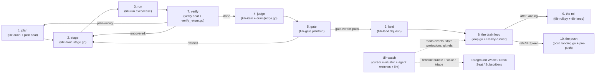
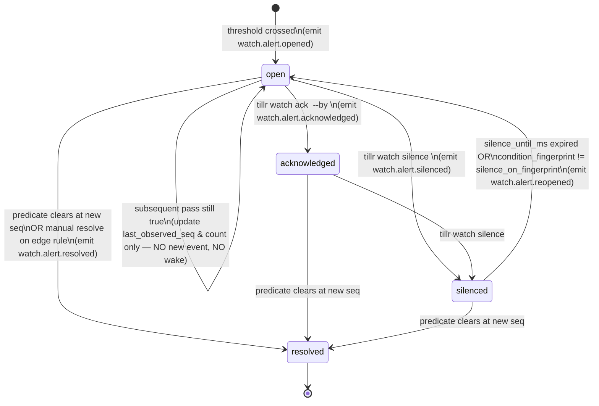

# Agent Alerting and Process Watchdog (`tillr-watch`)

**Status:** 2026-11-22 — the owner ruled all five initial questions on 2026-11-21, ruled the same day that leftover work holding a lane belongs in `tillr-watch` as an alert for manual cleanup rather than an automatic sweeper ([D-TW48](#D-TW48)), and ruled on 2026-11-22 that every alert gets an investigation and a recorded action — silence this parameterized instance, file work to fix the rule, or file work to fix the fault — with silences scoped by rule and variable rather than one blanket silence per rule ([D-TW64](#D-TW64), [Section 6.8](#68-alert-investigation-mandatory-outcomes-tracking-item-links-and-variable-scoped-silences-d-tw64-d-tw65), [the Decision Ledger](#9-decision-ledger)). Both [Section 6.6](#66-the-first-build-event-rules-episodes-and-wait-d-tw15) and [Section 6.7](#67-the-second-build-the-remaining-patterns-projections-and-the-alert-commands-d-tw27) are built: the first build landed on 2026-11-21 as commit `e85ae973d9` (standalone binary, rule loader, event-rule evaluator, `tillr watch eval --once`, `wait` and `seen`, and the skipped-event count of `status`), foreground delivery through background watchers including `wait --follow` landed in `d3f2c8cf96` (with per-owner delivery in `63c241ec5b`), and the second build is complete across `tools/tillr/watch` and `tools/tillr-watch` — `lag_behind` and `duration_without_event`, the `items`, `charter` and `git_refs` projections, named scopes, condition fingerprints, read-only `status`, `daemon`, live rule overrides and incremental evaluation (`50cfbf21c3`, `6f3e004e4d`, `7243353ec6`, `8107b0ee02`), composite `group_by`, unwindowed `clear_when` and `{{event.<name>}}` guidance placeholders (`8d3912eb73`, [D-TW50](#D-TW50)), `ack`, `silence` and `resolve` (`dc42dbc335`), and `tillr watch rule` (`list`, `show`, `add`, `tune`, `reset` and `export`). No command applies a remedy. Rules shipped under `config/tillr/watch` one rule file to a build start with `config/tillr/watch/drain-item-fault.toml` in `a780633bf7` and now cover fast-gate timing (`2513c1c64e` and `b9e98bc21e`, [Section 5.5](#55-fast-gate-time-two-rules-and-the-event-they-read-d-tw43), [D-TW43](#D-TW43), [D-TW52](#D-TW52)), refused store writes (`eee308c4e4`, [Section 5.6](#56-a-rule-brought-forward-a-store-write-refused-as-busy-d-tw46)), leftover lane work (`8d3912eb73`, [Section 5.7](#57-leftover-work-holding-a-lane-out-of-rotation-d-tw48-d-tw49-d-tw50), [D-TW48](#D-TW48) through [D-TW50](#D-TW50)), repeated `item.conflict` events (`d398e36cb6`, `f884d3bda9` and `13584831b9`, [Section 5.8](#58-repeated-itemconflict-events-on-one-item-d-tw51), [D-TW51](#D-TW51), [D-TW53](#D-TW53)), repeated step dispatches (`75413f402d`), silent-loop `drain.loop-pass` monitoring (`f057bb4eb1`, [D-TW45](#D-TW45)), loop exits on fault (`cd9da11f3f`), trunk fixers filed (`7dd190aec6`), heavy faults (`7d238302db`, [D-TW47](#D-TW47)), obstacle holds (`0fd2626d69`), landing revert outcomes (`f4bf1c3054`), trunk proof lag and stalled-proof progress (`540619c2a2` and `5882536557`, [Section 5.9](#59-trunk-proof-lag-and-stalled-heavy-proof-progress-d-tw54), [D-TW54](#D-TW54), with throttled in-check completion progress for long sharded Go suites landed in `9ac76b74e1`, [D-TW62](#D-TW62)), repeated verifier refusals (`e0d388ece4`), unrequested drain starts (`7212a45d83`, [D-TW44](#D-TW44)), declined dispatches (`c351bbda31`), trunk `core.worktree` checks (`367a9ac81d`), and landing squash conflicts (`227ca13fb0`) ([Section 5.4](#54-the-first-rules-shipped-ten-conditions-seen-on-2026-11-21-d-tw39), [D-TW39](#D-TW39), [D-TW42](#D-TW42) through [D-TW47](#D-TW47)), with `tillr watch lint` and its gate check (`3c5cd80bbe`, [Section 7.2](#72-tillr-watch-lint-checking-a-workflows-whole-configuration-before-it-runs-d-tw10), [D-TW55](#D-TW55) through [D-TW61](#D-TW61)) and the alert triage seat design ([`docs/design/tillr-alert-triage-seat.md`](./tillr-alert-triage-seat.md), `7a5a8fa687`) also landed, leaving item-subject episode auto-closure on item completion or closure ([Section 6.1](#61-one-record-per-condition-never-per-pass-the-alert-episode-state-machine-d-tw5), [D-TW63](#D-TW63)), the companion alert-outcome, tracking-item, and variable-silence workflow design ([Section 6.8](#68-alert-investigation-mandatory-outcomes-tracking-item-links-and-variable-scoped-silences-d-tw64-d-tw65), [D-TW64](#D-TW64), [D-TW65](#D-TW65)), and condition 10 of [Section 5.4](#54-the-first-rules-shipped-ten-conditions-seen-on-2026-11-21-d-tw39) next. Agent watches (`watch add`, `list`, `edit`, `drop`), `subscribe` and the rest of the operator procedure of [Section 6.4](#64-mode-b-persistent-self-registered-foreground-agent-watches-d-tw8-oq-tw3), daemon supervision, pack delivery, and the rest of the [Section 5.2](#52-the-16-starting-rules-and-the-2026-11-20-cases-they-catch) rule catalog follow. Sixty-three decisions of the designer or the operator ([D-TW1](#D-TW1) through [D-TW47](#D-TW47), [D-TW49](#D-TW49) through [D-TW63](#D-TW63), and [D-TW65](#D-TW65)) await the owner's review (he may overturn any of them); [D-TW7](#D-TW7) stays unbuilt until the alert triage seat build ([`tillr-alert-triage-seat.md`](./tillr-alert-triage-seat.md)) lands ([OQ-TW4](#OQ-TW4), [D-TW65](#D-TW65)).

---

## 1. The Owner's Direction and What Runs by Hand Today

On 2026-11-20, reflecting on the single-entity state machine design (`item-request-b1d51332cd`, `docs/design/tillr-state-machines.md`), the owner stated the problem across two linked observations:

> "we have like this emergent design that is born out of the confluence of these multiple utilities that we're putting together. And nowhere is there any carefully thought out design or enforcement of things moving through that. And I suppose this may be a combination of tiller core stuff as well as The Charter can talk about the larger emergent behavior would be nice to have some sort of enforcement layer here, it can even be an entirely new tiller utility that's there as just like a watchdog for various things that can be interesting. Ultimately we're never going to get these things perfect and agents are going to be developing workflows here so, even if we have a week of tiller get landing working well the next tiller use may be different and agent needs to be able to debug this thing. both Git landing as well as whatever the new thing is they're making. So let's think real hard about what utility we could build to help enforce Lint, whatever setup, configure, think about the overall emergent process that is the confluence of these things working together."
>
> "The sort of thing I'm imagining is even if it can't be fully mechanical, if you could decide to find some sort of criteria like your looping request criteria or an item going back and forth between two states four times or who knows what, like a typical engineering alerting system where you have thresholds and guidance and you will constantly adjust these things, but the alerts go to either an agent in the drain system or to the foreground agent whale type of thing. but they should be able to be acted upon, watched on, and then easily acted upon without wasting lots of runs and stuff. So basically this is like an alerting system for agents or something."

Later on 2026-11-20, the owner clarified that the utility must serve two distinct agent needs — standing rules with optional mechanical answers inside `tillr`, and ad-hoc conditions a foreground agent registers for its own session:

> "there could be two ways to go here. One, we detect and then we have a mechanical answer within the Tiller system, but the other thing here is we can actually just be alerts that are meant to be read by an agent and not have some fixed process or even any intention of what to do with these. Like, this is you, the foreground session. you're like waiting for a condition to happen and it's hard for you to notice that and especially if you there's 10 conditions you care about persisting what those conditions are across sessions as well as noticing them efficiently is hard"

### 1.1 What exists today by hand

Today, cross-utility observation is manual polling. Every 15 minutes the foreground operator session exports the SQLite event stream (`tillr view events`), pipes it through three private ad-hoc scripts, and reads item and run timelines by hand to spot stalls, loops, silent rebuild failures, and orphaned leases. Between those 15-minute sweeps — or overnight and across foreground session handoffs — nobody watches the confluence:

- On 2026-11-20, an item bounced `plan -> design -> plan` **four times over 80 minutes** because its `allowed_paths` fence was too narrow, discovered only when the owner asked about it.
- On 2026-11-20, the post-landing binary rebuild (`tillr-roll`) failed **eight times in a row over 90 minutes** with a failure record naming no test, leaving **29 landed commits** un-deployed in the live `tillr-*` binaries.
- On 2026-11-20, trunk (`refs/heads/main`) stayed unproved (`refs/tillr/green` lagging behind) for **25 minutes and 7 landings** after a landed change broke another module's test (following an earlier overnight stall documented in [the 2026-11-19 unproved-trunk postmortem](../tillr/unproved-trunk-2026-11-19.md)).
- On 2026-11-20, **four items accumulated 18 to 62 attempts each** while each individual pass looked locally legal to the scheduler.

### 1.2 Terms used in this document

| Term | Meaning |
| :--- | :--- |
| **Standing rule** | A declarative, tunable threshold rule (`config/tillr/watch/*.toml` plus live store overrides) that continuously evaluates store events and projections, carrying structured `check`/`do` guidance, a target `receiver`. |
| **Agent watch** | A lightweight, ad-hoc condition registered in one command by an agent (`tillr watch add --when ... --note ...`) carrying a note to its future self and **no** prescribed workflow or fixed action, persisted in `.tillr/state.db` across session restarts and compactions. |
| **Alert episode** | One lifecycle instance (`open -> acknowledged -> silenced -> resolved`) keyed by `(rule_id, subject_key)`. While the condition remains true across arbitrarily many drain passes, the episode updates in place rather than opening a second alert. |
| **Condition fingerprint** | A deterministic digest of the specific evidence causing an episode (for example, the failing step + error signature on `tillr-roll`, or the colliding path outside `allowed_paths`). `--until-change` silences wake again only if this fingerprint changes. |
| **Timeline bundle** | A bounded (`<= 8 KiB`), read-only digest of the subject's recent state moves, runs, obstacles, verify/gate refusals, landings, and git/roll pointers attached directly to every delivered alert or fired watch so the receiver acts without running `tillr view events` or spawning an exploratory worker run. |
| **Charter** | The process-wide definition document ([`tools/tillr/definition/definition.go`](../../tools/tillr/definition/definition.go), such as [`landing.json`](../../tools/tillr/definition/landing.json) for `git-landing` or [`recorded-verdict/definition.json`](../../tools/tillr/examples/recorded-verdict/definition.json) for hook-completed workflows) governing item states, prerequisites, and completion semantics. |

---

## 2. The Whole Process Today and Where Nothing Owns the Hand-Off

Across the `tillr` suite, ten distinct steps move work from queue intake to deployed, pushed code: **`plan`**, **`stage`**, **`run`**, **`judge`**, **`gate`**, **`land`**, **`verify`**, **`the drain loop`**, **`the roll`**, and **`the push`**. Each utility enforces local invariants on its own inputs and outputs, yet no single component watches whether the hand-offs *between* them are converging.



### 2.1 Step-by-step ownership and unowned seams

Read at `HEAD` (`74106648b1f4`) on 2026-11-20:

| Step | Owning utility & code entrypoints | Records read & written | Where nothing owns the hand-off today |
| :--- | :--- | :--- | :--- |
| **1. `plan`** | **`tillr-drain`** ([`drain/plan.go`](../../tools/tillr-drain/drain/plan.go) `Plan()`, `planner.decide()`) for queue-level dispatch planning; **`plan` / `open` agent stages** in [`config/tillr/workflows/planned-build@v1.json`](../../config/tillr/workflows/planned-build@v1.json) and [`scouted-design@v1.json`](../../config/tillr/workflows/scouted-design@v1.json) for item decomposition (`graph.proposal`). | Reads `items`, `lane_leases`, `retries`, `item_faults`, `work_nodes`, `definition.Definition`, and `Policy`. Emits `drain.decision` (`record.Envelope`) with `run.Request` or `graph.proposal` (`drain.graph-changed`). | **Cross-seat bounce blindness:** When `plan` exits `OBSTACLE: definition` (`RESULT: blocked`), `drain/blocked.go` routes to `design`; when `design` finishes without widening `allowed_paths` (because the fence itself forbade editing the needed path or item metadata), `plan` runs again and hits the same wall. Each pass is locally valid; nothing notices the `plan <-> design` ping-pong. |
| **2. `stage`** | **`tillr-drain`** ([`drain/stage.go`](../../tools/tillr-drain/drain/stage.go) `LaneStager.Stage()`, `ensureWorktree()`, `ensureForkCheckout()`, `renderBriefWithEnding()`; [`drain/loop.go`](../../tools/tillr-drain/drain/loop.go) `stageDispatches()`). | Reads `items`, `allowed_paths`, `base_sha`, brief template. Writes `<LaneRoot>/<lane>/` (`worktree/`, `brief.md`, `fence.txt`, `base_sha`, `item_base_sha`, `item_fence.txt`, `session_id`, fork `target`). | **Fence & lane-rot seam:** `stage` stamps `fence.txt` faithfully from the item's `allowed_paths`, even when previous runs already proved that fence omits a required file. If per-item staging fails, `lane_rotation.go` (`drain.lane-refused`) rotates the lane out, and nobody correlates repeated staging or boundary refusals across runs. |
| **3. `run`** | **`tillr-run`** ([`tools/tillr-run/run/exec.go`](../../tools/tillr-run/run/exec.go) `Exec()`, [`lease.go`](../../tools/tillr-run/run/lease.go) `ReleaseLane()`); invoked by **`tillr-drain`** ([`drain/loop.go`](../../tools/tillr-drain/drain/loop.go) `runLane()`, `resumeAfterWall()`, and [`drain/failover.go`](../../tools/tillr-drain/drain/failover.go) `ClassifyAttempt()`). | Writes `runs` rows, `lane_leases` locks, `run.allocate`/`run.resume`/`run.progress` events, adapter transcripts, and commits in the lane worktree. | **Dead-process lease & instant-crash seam:** If `tillr-run exec` or its parent dies hard outside normal bracket close, `lane_leases` stays held by a non-live run until startup recovery (`end_unfinished_runs.go`) or manual `tillr run release`. Runs crashing in `< 5s` or failing over with backend failover suffixes (`drain.backend-outcome`) quietly burn capacity without alerting an operator. |
| **4. `judge`** | **`tillr-item`** ([`tools/tillr-item/judge.go`](../../tools/tillr-item/judge.go) `judgeFace()`, `judgeCommit()`) orchestrated by **`tillr-drain`** ([`drain/judge.go`](../../tools/tillr-drain/drain/judge.go) `judgeCandidate()`, `settleJudgeFailure()`, `recordLandedJudge()`). | Reads candidate commit, `JudgeOptions`, evaluator artifacts, and `gate.verdict`. Writes criterion verdicts (`done` / `not-done`), `drain.judge.request` / `drain.judge.landed` events, and `JudgeReceipt`. | **Pre-landing vs post-landing split:** `judgeCandidate()` evaluates criteria before `land`, while `recordLandedJudge()` commits final criterion state only after `land` succeeds. Repeated `not-done` returns whose reasons are empty or vague cycle back into build without surfacing degraded evaluator output. |
| **5. `gate`** | **`tillr-gate`** ([`tools/tillr-gate/change.go`](../../tools/tillr-gate/change.go), [`plan.go`](../../tools/tillr-gate/plan.go) `Plan()`, [`run.go`](../../tools/tillr-gate/run.go) `RunWith()`, [`gate.go`](../../tools/tillr-gate/gate.go) `RunGate()`). | Reads `base..head` diff, check manifests (`tools/gate/checks/`), and worktree blobs. Writes `gate.plan` and `gate.verdict` (bound to `(planID, treeSHA)`) plus check logs. | **Candidate-vs-trunk scope gap:** To keep landing latency low, `tillr-gate` runs change-scoped and fast checks on `(base_sha, head_tree)`, deferring cross-module heavy suites on the merged trunk tree to `HeavyRunner` *after* landing. And when `boundary.check` or `gate.verdict` refuses a candidate (`drain.refusal`), nothing aggregates recurring refusals across runs or items. |
| **6. `land`** | **`tillr-land`** ([`tools/tillr-land/land/landing.go`](../../tools/tillr-land/land/landing.go) `Land()`, [`land/trunk.go`](../../tools/tillr-land/land/trunk.go) `Trunk.Squash()`, `Trunk.LandLock()`, `Trunk.Move()`); called by **`tillr-drain`** (`landCandidate()`, `landWithActions()`). | Acquires `<git-common-dir>/land.lock`, verifies `gate.verdict`, squashes `base..head` onto `refs/heads/<trunk>`, writes `refs/tillr/landed/<runID>`, and inserts a `landings` row (`gated_tree`, `landed_tree`, `land.landing`). | **Multi-landing / unlanded-item drift:** Because design answers, doc updates, or reverted-and-retried commits can record `land.landing` rows referencing an item while the item's own build remains `in-queue`, `landings` can accumulate several commits for one item whose build still has not landed — invisible to `tillr-land`, which only checks one candidate at a time. |
| **7. `verify`** | **`tillr-drain`** ([`drain/verify_return.go`](../../tools/tillr-drain/drain/verify_return.go) `verifyBuildSession()`, `builderPlanWrong()`; [`drain/loop.go`](../../tools/tillr-drain/drain/loop.go) `Verify()`) running the **`verify` agent seat** in [`planned-build@v1.json`](../../config/tillr/workflows/planned-build@v1.json). | Reads joined piece diffs, producer outputs, and item criteria; pins candidate head (`pinCandidateHead()`) and writes `done` (`node:<id>`) or `not-done` (`uncovered:...` or `plan-wrong:...`). | **Unbounded `plan -> work -> verify -> plan` cycles:** `uncovered:` returns to `work`, while `plan-wrong:` returns all the way to `plan` to re-cut pieces. Each return works as designed for a single mistake, but nothing notices when an item completes multiple full `plan -> work -> verify` cycles without converging. |
| **8. `the drain loop`** | **`tillr-drain`** ([`drain/loop.go`](../../tools/tillr-drain/drain/loop.go) `Loop.Run()`, `settle()`; [`drain/heavy.go`](../../tools/tillr-drain/drain/heavy.go) `HeavyRunner.Run()`, `judgeTip()`, `attribute()`, `revert()`). | Coordinates `drain.pass` ticks, dispatches lanes, settles endings, and runs `HeavyRunner` asynchronously to advance `refs/tillr/green` or bisect and `drain.revert` offending commits. | **Trunk-ahead-of-green drift & zero-yield burn:** `Loop.Run()` purposefully keeps landing new commits onto `main` while `HeavyRunner` proves earlier trunk tips asynchronously. If `HeavyRunner` stalls (on a cleanup marker, lock, killed test shard, or cross-module breakage), landings pile up ahead of `refs/tillr/green` with nothing alerting until a human checks. Likewise, lanes can burn >3 worker-hours with zero landings while every individual tick succeeds. |
| **9. `the roll`** | **`tillr-roll`** ([`tools/tillr-roll/tillr-roll.py`](../../tools/tillr-roll/tillr-roll.py), [`tools/tillr-roll/tillr-keep`](../../tools/tillr-roll/tillr-keep)); triggered asynchronously by **`tillr-drain`** ([`drain/post_landing.go`](../../tools/tillr-drain/drain/post_landing.go) `submitPiRoll()`, [`drain/restart_rolling.go`](../../tools/tillr-drain/drain/restart_rolling.go) `rollingOwnership()`). | Reads `drain.build-started`, `refs/tillr/green`, and `landings`; builds the eight Go binaries (`MODULES`), updates `tillr-roll.commit`, handshakes `heavy.lock` for clean `tillr-keep` restart, or inserts `drain.roll-failed` (`record_failure()`). | **Fire-and-forget stale-binary gap:** `afterLandingCandidate()` submits `tillr-roll.py` asynchronously so landings never block on compilation. When `tillr-roll.py` fails, `record_failure()` appends `drain.roll-failed` (often with collapsed stderr naming no specific test) and exits; `tillr-drain` keeps running its **old** in-memory binary across 29 subsequent commits without pausing or raising an alarm. |
| **10. `the push`** | **`tillr-drain`** ([`drain/post_landing.go`](../../tools/tillr-drain/drain/post_landing.go) `pushGreen()`, `pushTrunk()`, `recordPush()`; [`drain/push_refused.go`](../../tools/tillr-drain/drain/push_refused.go) `healRefusedPush()`) plus **[`hooks/pre-push`](../../hooks/pre-push)** (`bin/patch-branches-publish`). | Reads `refs/tillr/green` (or `TrunkRef`), `yolo-packs/*/pack.json` `patch_branch` locators, and remote refs; runs non-forcing `git push` and logs `drain.post-landing-action`. | **Downstream starvation & unhealed refusals:** Because `pushGreen()` only publishes commits proved by `refs/tillr/green`, any stall in Step 8 silently freezes remote publication too; and if `hooks/pre-push` or a diverged remote refuses the push beyond what `healRefusedPush()` can repair, local commits diverge silently from the remote. |

### 2.2 Why every failure above escaped local error handling

Every utility in the table above behaved **within its local specification** during the 2026-11-20 incidents:

1. **Asynchronous decoupling hides lag.** Decoupling `HeavyRunner` (Step 8), `tillr-roll` (Step 9), and `pushGreen` (Step 10) from synchronous `land` (Step 6) is what lets `tillr-land` finish in milliseconds instead of minutes. The price of asynchronous decoupling is that **lag and repeated background failure are invisible to the synchronous caller**.
2. **Valid local retries compose into invalid global loops.** Returning `OBSTACLE: definition` from `plan` to `design`, or `plan-wrong:` from `verify` to `plan`, is the exact recovery move `planned-build@v1` was built to make. The defect only appears in the **trajectory** (`plan -> design -> plan -> design` four times on an unchanging `allowed_paths` fence).
3. **Silent degradation in metadata starves diagnosis.** When `tillr-roll.py` writes `drain.roll-failed` whose `detail` names no failing test, or a refusal/hold record carries an empty `reason`, downstream tools and operators lose the literal cause required by [failure diagnosed, not waited out](./failure-diagnosed-not-waited-out.md#31-the-four-tests) (`T1`).

---

## 3. Relation to State Machines, Existing Monitors, and the No-Cap Ruling

### 3.1 Prevention vs. detection: relation to `docs/design/tillr-state-machines.md`

`docs/design/tillr-state-machines.md` (`item-request-b1d51332cd`) and `tillr-watch` form complementary halves of process governance — **synchronous single-move prevention** versus **asynchronous multi-move detection**:

| Dimension | State machines (`docs/design/tillr-state-machines.md`) | Process watchdog & alerting (`tillr-watch`) |
| :--- | :--- | :--- |
| **Question answered** | *"Is this single state transition legal right now?"* | *"Is this sequence of legal transitions, elapsed silence, or cross-utility lag healthy?"* |
| **Where it runs** | Synchronously inside the mutating transaction (`store`, `item`, `run`, `land`, `drain`). | Asynchronously over the committed `events` cursor, store read projections, and git refs (plus statically at `lint` time). |
| **What happens when triggered** | **Refuses the write** before commit; the illegal state cannot exist in `.tillr/state.db`. | **Opens or updates one alert episode** (or fires an agent watch) with a timeline bundle, guidance; **never** rolls back or fails an item. |
| **2026-11-20 example** | Forbidding an item transition `in-queue -> landed` without a matching `land.landing` receipt or criterion verdict; forbidding two live runs from holding the same `lane_leases` row. | Catching `plan -> design -> plan` 4 times over 80m; catching `refs/tillr/green` lagging 7 landings / 25m behind `main`; catching 8 consecutive `drain.roll-failed` events leaving 29 commits un-rolled. |

**Boundary rule (`D-TW2`):** Neither layer may impersonate the other. If a condition is universally illegal at a single transition boundary (for example, writing a refusal record with an empty `reason` once the writer schema forbids it), it should become a synchronous refusal in `docs/design/tillr-state-machines.md`, keeping the corresponding `tillr-watch` rule (`empty-reason-record`) only as a defense-in-depth canary for raw external writers like Python scripts. Conversely, state machines must **never** grow numeric transition counters ("refuse `plan -> design` on the 4th transition"), because turning a count into a hard state-machine refusal violates the owner's standing no-cap ruling below.

### 3.2 Standing ruling: an alert never fails, benches, or caps work (`D-TW2`)

Four settled repository rulings forbid failing or stopping work on attempt counts, retry budgets, or wall timers:

1. **[Run-wall ruling (`D-RW1`–`D-RW4`)](./run-wall-ruling.md#1-should-the-wall-exist-at-all):** Removed default 1800-second run walls; a wall-clock duration is a resource signal, never a fault verdict, and committed candidates are always judged before wall status.
2. **[Failure diagnosed, not waited out](./failure-diagnosed-not-waited-out.md#34-admission-restated):** Eliminated the 30-minute cooldown, numeric retry budget, and `retry-exhausted` bench. Re-admission is governed by literal cause and input change ([Section 3.1](./failure-diagnosed-not-waited-out.md#31-the-four-tests)), never by counting failures.
3. **[Landing principles §5](./landing-principles.md#5-only-verdicts-charge) and [§6](./landing-principles.md#6-a-budget-escalates-it-does-not-loop):** Only verdicts charge, and repetition escalates to diagnosis rather than failing the item.
4. **[Judge and lifecycle (`D-JL9` and `D-JL10`)](./tillr-judge-and-lifecycle.md#44-how-a-worker-runs-ending-moves-its-item-d-jl10):** Worker endings and design runs are **never counted** to fail or bench an item; identical endings escalate to `design`, and only objections naming the owner hold for the owner.

`tillr-watch` obeys this ruling as an inviolable architectural constraint (**[D-TW2](#D-TW2)**):

- **Alerts notify; they never fail, close, cancel, or hold an item.** `tillr-watch` holds no capability to transition an item into `blocked`, `closed`, or any terminal failure state when a count (`>= 4` oscillations, `>= 8` attempts, `> 1` plan-verify cycle) or duration (`> 3` worker-hours, `> 25m` green lag) crosses a threshold.
- **How this handles the 18-to-62-attempt items from 2026-11-20:** Under a naive retry cap, an item at attempt 8 would have been benched as `retry-exhausted`, stranding legitimate complex items alongside stuck ones. Under `tillr-watch`, crossing `>= 8` attempts (`high-attempt-diagnostic`) leaves the item's execution untouched while delivering one deduplicated alert + compact timeline to the foreground whale (or one read-only diagnostic scout), making the trajectory visible in minutes instead of letting four items silently reach 18 to 62 attempts unnoticed.
- **Enforced statically in `tillr watch lint`:** Any rule file that declares a remedy of any kind is rejected ([OQ-TW2](#OQ-TW2)) at `lint` and load time (`watch-lint-forbidden-remedy`).

### 3.3 Relation to One-Breakage Dedup, Steering Timers, and Goal Monitors

- **Generalizes [the retired agent runtime design Section 20 ("One breakage, one investigation")](./agent-runtime-retirement.md#what-happened-to-each-section):** `D-OC1`–`D-OC8` established mechanical signature deduplication, transition-driven invocation, and the `D-OC5` precondition (*never dispatch a second investigation while an open breakage already has a non-terminal attempt*). `tillr-watch` lifts that exact episode discipline from gate check breakages to **all** cross-utility rules (`D-TW5`, `D-TW7`).
- **Replaces time-polling in [`steering-timer`](../reference/steering-timer.md) when waiting on state:** `steering-timer.ts` ([`handoff-items-and-steering-timer.md` Section 4.2](./handoff-items-and-steering-timer.md#42-the-mechanism-a-pi-extension-owning-a-durable-steering-record)) injects periodic clock-based check-ins (`every N minutes`) so a foreground whale keeps nudging a long goal. When an agent is instead waiting on *specific store/git conditions* ("tell me when `refs/tillr/green` catches up, or when `item-X` reaches `verify`, or if `tillr-roll` fails"), waking every 10 minutes on a timer wastes turns when nothing happened and lags up to 10 minutes when it did. `tillr-watch` provides **event-driven, zero-polling wakeups** from a durable record in the store, delivered by a background watcher the foreground agent runs ([Section 6.4](#64-mode-b-persistent-self-registered-foreground-agent-watches-d-tw8-oq-tw3), [D-TW11](#D-TW11)); it adds no Pi extension.
- **Complements [`tillr-goal-monitor.md`](./tillr-goal-monitor.md):** The iceboxed goal monitor evaluates high-level prose roadmap goals on a scheduled `due_at` cadence via an LLM node. `tillr-watch` is a **0-LLM-token mechanical evaluator** running continuously on event commits, invoking an agent *only* when a declared threshold or agent watch actually fires.

---

## 4. Utility Boundary and the Three-Layer Split: Core, Workflow, Charter

### 4.1 New utility (`tillr-watch`) vs. face of an existing utility ([D-TW1](#D-TW1), [OQ-TW1](#OQ-TW1))

The suite today splits responsibilities along sharp UNIX boundaries dispatched by [`tools/tillr-cli/main.go`](../../tools/tillr-cli/main.go): `store`, `item`, `run`, `gate`, `land`, `drain`, and `view` (plus read-only `tillr-trace` and supervisor scripts `tillr-roll` / `tillr-keep`).

Putting alerting and cross-system linting inside an existing binary has two structural flaws:

1. **A watchdog inside `tillr-drain` dies or stalls with the process it watches.** On 2026-11-19/2026-11-20, `tillr-drain` suffered 1-tick post-midnight crashes ([`unproved-trunk-2026-11-19.md`](../tillr/unproved-trunk-2026-11-19.md#verified-timeline)), ran 29 commits behind trunk while `tillr-roll` failed, and can be paused or stopped while foreground agents are still waiting on `item` or `store` events. A watchdog must stay alive and trustworthy when `tillr-drain` is wedged, restarting, or running stale code.
2. **`tillr-view` carries the Observatory HTTP/WebSocket server and embedded web bundle, while static linting belongs in CI/gate and headless agent shells.** Tying `watch` and `lint` to `tillr-view` couples headless rule evaluation and pre-flight linting to the UI server, whereas splitting `watch` into `tillr-view` and `lint` into `tillr-drain` scatters one rule schema across two binaries.

**Design choice ([D-TW1](#D-TW1), subject to owner confirmation in [OQ-TW1](#OQ-TW1)):** Build **`tools/tillr-watch`** (`tillr-watch`, registered as `"watch"` in `tools/tillr-cli/main.go` `nouns` and `tools/tillr-roll/tillr-roll.py` `MODULES` so `tillr watch <face>` works identically to `tillr gate` and `tillr view`), backed by a pure shared library package **`tools/tillr/watch`** that registers the watch SQLite DDL (`store.RegisterDDL`) and event kinds (`event.Register`) at `init()` time.

`tillr watch` exposes four cohesive command groups:

```text
# 1. Continuous or one-shot rule evaluation & status
tillr watch status [--json]                     # rules, unresolved alert episodes, watchers + (later) armed agent watches
tillr watch eval [--once]                       # advance cursor once, update episodes, exit 0
tillr watch daemon                              # zero-polling follower supervised beside tillr-keep

# 2. Alert episode actions & live rule tuning (Mode A)
tillr watch ack <alert-id> --by <actor> [--note <text>]
tillr watch silence <alert-id> (--until <dur|ts> | --until-change) [--reason <text>]
tillr watch resolve <alert-id> --reason <text>
tillr watch rule list | show <id> | add <file> --by <actor> | tune <id> --set <key>=<value>... --by <actor> | reset <id> --by <actor> | export

# 3. Persistent foreground agent watches (Mode B — one command, no prescribed action)
tillr watch add --when <expr> --note <text> [--owner <id>] [--once | --recurring]
tillr watch list [--owner <id>] [--all]
tillr watch edit <watch-id> [--when <expr>] [--note <text>]
tillr watch drop <watch-id>
tillr watch wait [--owner <id>] [--timeout <dur>] [--seen-through <seq>] [--follow]  # blocks at 0% CPU until a notice is pending
tillr watch seen --through <seq> [--owner <id>]    # confirm notices were read (Section 6.4)

# 4. External pub/sub & pre-flight configuration verification
tillr watch subscribe [--since-seq <n>] [--consumer <id>] [--kind alert|watch|all] [--receiver <r>]
tillr watch lint [<repo-or-dir>] [--charter <path>] [--workflows <path>] [--policy <path>]... [--rules <path>]
```

### 4.2 What belongs in `tillr` core, in a workflow definition, and in the charter ([D-TW3](#D-TW3))

To support both `git-landing` today and arbitrary agent-authored workflows tomorrow (`recorded-verdict`, `AutoQA`, benchmark harnesses, synthesis pipelines), responsibilities divide cleanly across three layers:

| Layer | Where it lives | What belongs here (and nowhere else) | What must NOT leak into this layer |
| :--- | :--- | :--- | :--- |
| **1. `tillr` Core** | `tools/tillr/watch/`, `tools/tillr/store/`, `tools/tillr/event/`, `config/tillr/watch/core.toml` | - Incremental `events.seq` cursor engine & zero-polling `inotify` wakeup (`watch.wakeup` / WAL).<br>- `alert_episodes`, `agent_watches`, `foreground_delivery`, `watch_rule_overrides`, and `watch_consumers` SQLite tables.<br>- Generic predicate primitives (`count_in_window`, `consecutive_count`, `alternating_pair`, `lag_behind`, `duration_without_event`, `predicate_match`).<br>- `TimelineBundle` builder & NDJSON `subscribe` stream.<br>- `tillr watch lint` cross-artifact engine.<br>- **Core infrastructure rules** true of *every* `tillr` store: `< 5s` run crashes, failover suffixes, dead-PID lane leases, `SQLITE_BUSY` lock refusals, empty-reason records, operator holds, high-attempt diagnostics. | No hardcoded stage names (`"plan"`, `"verify"`), no Git ref names (`refs/tillr/green`), and no assumptions about `tillr-roll` or `git push`. |
| **2. Workflow Definition** | `config/tillr/workflows/*.json` (plus optional `watch` block per workflow) | - Stage graph topology (`stages`, `edges`, `exit`, `may_replace`, `outputs`/`inputs`, `seat`, `access`, `write_scope`).<br>- Optional declarative **`watch` metadata** on the workflow JSON ([D-TW56](#D-TW56)): expected cycle bounds (`cycle_anchor: {"from": "verify", "to": "plan", "max_cycles": 1}`) and expected return pairs with optional guidance hints (`oscillation_pairs: [{"a": "plan", "b": "design", "threshold": 4, "hint": "..."}]`). | No global trunk/git assumptions and no item state-machine definitions (`in-queue`, `landed`, `confirmed`). |
| **3. Charter Document** | `tools/tillr/definition/*.json` (e.g. `landing.json`, `recorded-verdict/definition.json`) + charter rule pack (`config/tillr/watch/charters/<name>.toml`) | - Whole-process item lifecycle (`states`, `ready`, `blocked`, `closed`, `finished`, `transitions`, `prerequisites`, `completes`: `"landing"` vs `"hook"`, `hooks`).<br>- **Charter observability bindings** (`observability` block on `Definition`, [D-TW56](#D-TW56)): what event marks real forward throughput (`observability.progress_event`: `"land.landing"` vs `"item.verdict"`) and optional charter rule pack (`observability.rule_pack`), plus charter-owned health invariants (`git-landing`: `refs/tillr/green` lag, `tillr-roll` rebuild parity, `git push` liveness, multiple landings on unlanded items; `recorded-verdict`: `complete-item` hook error rate). | No per-workflow stage topology (`planned-build` vs `scout-then-build` vs `doc-triage` can all run under the same charter). |

Concretely, a workflow JSON may carry an optional, backward-compatible `watch` object (validated by both `tillr drain workflow check` and `tillr watch lint`):

```json
{
  "name": "planned-build",
  "version": 1,
  "stages": ["..."],
  "edges": ["..."],
  "exit": { "requires_nodes": ["plan", "work", "verify"], "requires_candidate": "commit_required", "evaluator_slot": "verify" },
  "watch": {
    "cycle_anchor": { "from": "verify", "to": "plan", "max_cycles": 1 },
    "oscillation_pairs": [
      { "a": "plan", "b": "design", "threshold": 4, "hint": "Check whether item allowed_paths omits a path plan/work needs, or whether an open design question lacks a ruling." }
    ]
  }
}
```

And a charter `definition.json` declares its process-level progress signal in two optional lines:

```json
{
  "definition": "git-landing",
  "completes": "landing",
  "observability": {
    "progress_event": "land.landing",
    "rule_pack": "charters/git-landing.toml"
  }
}
```

---

## 5. Alert Rules as Tunable Data and the Starting Rule Catalog

### 5.1 Declarative rule schema ([D-TW4](#D-TW4), [OQ-TW5](#OQ-TW5))

An operator or foreground agent can add, threshold-tune, re-route, or silence any standing rule **without touching Go code or recompiling `tillr-watch`**. Rules are plain TOML documents loaded from three merged scopes in precedence order:

1. **Charter & workflow defaults:** `config/tillr/watch/core.toml`, `config/tillr/watch/charters/<definition>.toml`, and workflow `watch` blocks.
2. **Repository rule files:** `config/tillr/watch/rules.d/*.toml`.
3. **Live store overrides ([OQ-TW5](#OQ-TW5)):** `watch_rule_overrides` in `.tillr/state.db`, written via `tillr watch rule tune` so an agent adjusting a noisy threshold mid-incident does not dirty tracked files in the main checkout (which would cause `tillr-roll.py` to refuse post-landing rebuilds, as occurred on 2026-11-19). `tillr watch rule export` materializes live overrides back into TOML when ready to commit.

Every standing rule has five explicit data sections — **identity/scope**, **`reads`**, **`when` (subject + threshold)**, **`guidance` (`check` + `do`)**, and **delivery (`receiver`)**:

```toml
[[rule]]
id = "step-oscillation"
enabled = true
scope = "core"                                  # "core" | "charter:<name>" | "workflow:<name>"
severity = "warning"                            # "info" | "warning" | "high"

[rule.reads]
events = ["drain.node-advanced", "drain.refusal", "boundary.check"]   # registered event kinds only; drain.decision is a stored record, read as a projection
projections = ["items", "charter"]            # the subject's items row and the store's charter (D-TW30)

[rule.when]
group_by = "item_id"                            # one episode per item
pattern = "alternating_pair"                    # A -> B -> A -> B ...
field = "seat"
pairs = [["plan", "design"], ["work", "verify"]] # extended automatically by workflow.watch.oscillation_pairs
threshold = 4                                   # 4 consecutive observations alternating between the pair (plan, design, plan, design): fires on the 4th
window = "4h"
clear_when = "item.state in charter.finished"   # judged with the item's state at the evaluation (D-TW30)

[rule.guidance]
summary = "Item {{subject}} bounced between {{pair_a}} and {{pair_b}} {{count}} times over {{elapsed}}."
check = [
  "Inspect the attached TimelineBundle obstacles and boundary.check / OBSTACLE: fence or OBSTACLE: definition lines.",
  "Compare the paths named in the planner/builder obstacle against the item's allowed_paths fence.",
  "Check whether the designer updated a design doc without widening the item's fence (which design runs cannot edit unless fenced)."
]
do = [
  "If allowed_paths is too narrow, widen the item fence (`tillr item update {{subject}} --add-path <path>`) or split a prerequisite item.",
  "If a design decision needs the owner, hold with the exact owner question rather than re-dispatching plan.",
  "Acknowledge this alert (`tillr watch ack {{alert_id}} --by <you>`) while acting."
]

[rule.delivery]
receiver = "foreground"                         # "foreground" | "subscribers"
also_notify = ["subscribers"]
```

A second example shows a `charter:git-landing` rule that reads Git refs, with the keys [D-TW28](#D-TW28) fixes for `lag_behind`:

```toml
[[rule]]
id = "unproved-trunk-lag"
enabled = true
scope = "charter:git-landing"
severity = "high"

[rule.reads]
events = ["land.landing", "drain.revert", "drain.fixer-proved"]   # kinds are checked; a lag_behind rule reads no event (D-TW28)
projections = ["git_refs:refs/heads/main,refs/tillr/green"]

[rule.when]
group_by = "global"
pattern = "lag_behind"
leader = "refs/heads/main"
follower = "refs/tillr/green"
threshold_commits = 3                           # >= 3 unproved landings ahead of green
threshold_duration = "15m"                      # OR >= 15m with >= 1 unproved commit
mode = "any"                                    # fires when either threshold crosses

[rule.guidance]
summary = "{{follower}} lags {{leader}} by {{count}} landings ({{elapsed}} elapsed; green={{follower_short}}, main={{leader_short}})."
check = [
  "Check HeavyRunner status in the attached bundle: is .git/tillr-gate/heavy.cleanup-pending present, is heavy.lock held by a dead PID, or did a proof shard die on SIGTERM?",
  "Inspect the newest failing proof log or active fixer-main-* item in the bundle."
]
do = [
  "If heavy.cleanup-pending or a stale lock is blocking HeavyRunner with no live holder, clear the stale marker.",
  "If a cross-module test is red without an active fixer-main item, verify bisection/revert progress or dispatch targeted repair."
]

[rule.delivery]
receiver = "foreground"
```

*2026-11-22 note on trunk proof lag ([Section 5.9](#59-trunk-proof-lag-and-stalled-heavy-proof-progress-d-tw54), [D-TW54](#D-TW54)):* The snippet above illustrates how `lag_behind` combines `threshold_commits`, `threshold_duration` and `mode = "any"` as schema syntax ([D-TW28](#D-TW28)). For the actual trunk-proof condition, `threshold_commits = 3` and `15m` were retired on 2026-11-22 after waking the operator twice during healthy 15-minute proofs at normal six-lane landing throughput (~1 landing every 5 minutes): `trunk-proof-lag` uses `threshold_duration = "30m"` only, paired with `trunk-proof-stalled` (`duration_without_event` at `threshold_duration = "10m"` over `drain.heavy-progress`).

**What `alternating_pair` counts ([D-TW12](#D-TW12)):** `threshold` counts observations, not moves between them. This is the designer's decision of 2026-11-21, following an operator request; the owner has not ruled on it and may overturn it.

- An **observation** is one event named in `reads.events`, for one `group_by` subject, that carries the rule's `field`. Consecutive observations with the same `field` value count as one, dated at the first of them, because two event types can report the same step. Only observations inside `window` are compared, as [D-TW23](#D-TW23) below states.
- The **count** is the number of most recent observations whose values alternate strictly between the two members of one entry in `pairs`. An observation whose value is outside that pair ends the alternation. [D-TW18](#D-TW18) below states the count that observation leaves when `pairs` has more than one entry.
- The rule **fires** on the observation that brings the count to `threshold`, provided the oldest counted observation is no older than `window`. Observations older than `window` are not counted.
- With `threshold = 4`, the sequence `plan, design, plan, design` fires on the fourth observation. That is three moves; the rule does not wait for a fifth observation.
- `{{count}}` in `guidance.summary` is that count of observations.

**The window is applied before anything else ([D-TW23](#D-TW23)).** This is the operator's design answer of 2026-11-21, given to a build worker's question; the owner has not ruled on it and may overturn it. The worker's case was a rule with `window = "60m"` and `threshold = 2` whose subject has `plan` 61 minutes before the evaluation, `plan` 59 minutes before it and `design` 1 minute before it. Read one way, the older `plan` absorbs the newer one as a repeat, the single observation is dated outside `window`, and the count is 1. Read the other way, the count is 2.

- The evaluator first takes the read events whose `ts` is within `window` of the time of evaluation, and **nothing outside `window` is ever consulted**, for any pattern and for any purpose. That is the rule [D-TW13](#D-TW13) already states for counts, and it governs here.
- Repeats are therefore collapsed only among the events inside `window`. A run of observations with the same value begins anew at the edge of `window`: the first of them inside `window` is the observation, and it is dated at that event, whatever came before the edge.
- In the worker's case the event at 61 minutes is not read. The observations are `plan` (dated 59 minutes before) and `design`, the count is 2, and the rule fires.
- The same holds for what ends a run ([D-TW18](#D-TW18)), for a resetting event and for `clear_when`: an event older than `window` neither counts, nor collapses a repeat, nor resets, nor clears.
- Amended 2026-11-22 by [D-TW50](#D-TW50): on a `predicate_match` rule that sets `clear_when` and omits `window`, there is no lower age cutoff — all read events up to the evaluation clock (`ts <= eval_now`) are read in `seq` order, and counted events never age out by wall clock.

**Which entry of `pairs` is counted, and what ends its run ([D-TW18](#D-TW18)).** This is the designer's decision of 2026-11-21, made to answer a build worker's question; the owner has not ruled on it and may overturn it. The worker's case was a rule with `pairs = [["a", "b"], ["c", "d"]]` and `threshold = 4` that opens an episode on `a, b, a, b` and then reads `c, d, c, d` before the next evaluation. [D-TW12](#D-TW12) counts the second run to 4, while [D-TW17](#D-TW17) read each of the four new observations as "outside the pair", which left no counted observation after the newest clearing event. The count is always taken from the newest observations, whichever entry they belong to, and no entry is remembered from an earlier run or from an episode. Three terms are used:

- The **run** is the subject's most recent observations, taken back from the newest for as long as they alternate between the two members of one entry in `pairs`. The count is the number of observations in the run.
- The **matched entry** is the entry the run alternates between. When the run holds two or more observations, it is the first entry, in the order the rule file writes them, whose two members are the values of the two newest observations. When the run holds one observation, it is the first entry that contains that value.
- An observation **ends a run** when the count after it is not one more than the count before it. That observation is the pattern's clearing event for [D-TW17](#D-TW17), and its `seq` is that of the first event of the observation.

The count after each observation follows from those terms:

| The newest observation's value | The observation before it | Count |
| :--- | :--- | :--- |
| In no entry of `pairs` | Anything | 0 |
| In an entry | None inside `window`, or a value that shares no entry with the newest | 1 |
| In an entry | A value that shares an entry with the newest | The length of the run: 2, or more when older observations go on alternating between the same two values |

- An observation that ends one run can be the first observation of the next. In the worker's case `c` ends the `a, b` run and has count 1, the following `d, c, d` bring the count to 4, and the rule fires on the fourth observation of the second run, as [D-TW12](#D-TW12) requires of any run.
- Only `c` is a clearing event there. `d, c, d` each raise the count by one, so they end nothing. The evaluation that reads all four finds a clearing event after the episode's `opened_seq` and a rule that fires, which is the last row of the table in [D-TW17](#D-TW17): it resolves the `a, b` episode with `resolved_seq` at `c` and opens a new episode whose `{{pair_a}}` and `{{pair_b}}` are `c` and `d`.
- When two entries share a value, the run can begin one observation before the clearing event. With `pairs = [["a", "b"], ["b", "c"]]`, the sequence `a, b, a, b, c` has count 2 after `c`, the run being `b, c`. The `c` did not raise the count from 4 to 5, so it ends the `a, b` run and is a clearing event, and the `b` before it is counted in both runs.
- A subject has one count and at most one unresolved episode per rule ([D-TW5](#D-TW5)), however many entries `pairs` has. Two alternatives were set aside by the designer: keeping a separate count and episode for each entry, which would need the entry in the episode's key and would let one item hold several alerts from one rule; and measuring a clearing event against the entry of the open episode, which is the reading that left the worker's second run with nothing to count.

**What the other three event patterns count ([D-TW13](#D-TW13)).** This is the designer's decision of 2026-11-21, made to answer a build worker's question; the owner has not ruled on it and may overturn it. It fixes how a rule declares which events count and what sets a count back to zero. Three terms are used:

- A **read event** is an event whose kind is listed in the rule's `reads.events`.
- A rule's **subject** for a read event is the value of the name in `group_by`, the composite key formed from the list of names in `group_by` ([D-TW50](#D-TW50)), or the one subject `global` when `group_by = "global"`. Only JSON string values form subjects. Unless the event is a prefix clearing event on a list `group_by` ([D-TW50](#D-TW50)), a read event whose value for any `group_by` name is missing or is not a string belongs to no subject, is ignored by the rule and is counted as skipped ([D-TW22](#D-TW22), below).
- A **name** (in `group_by`, in `field`, and after `event.` in an expression or guidance placeholder) is one of the `events` table's columns `seq`, `ts`, `kind`, `seat`, `object_type`, `object_id` and `revision`, or otherwise a key of the event's JSON payload, with dots descending into nested objects (`event.detail.step`). A name that is absent or null has no value.

Two keys in `[rule.when]` select events, and both are expressions in the grammar below:

- `match` says which read events **count**. It is optional for `count_in_window` and `predicate_match`, where leaving it out makes every read event count. It is required for `consecutive_count`.
- `reset` is used only by `consecutive_count`. It says which read events set the count to zero.

| Pattern | Keys in `[rule.when]` | What is counted | What sets the count to zero | Fires when |
| :--- | :--- | :--- | :--- | :--- |
| `predicate_match` | `group_by`, optional `match`, `window` (longer than zero; required unless `clear_when` is set, [D-TW50](#D-TW50)) | The same as `count_in_window`, with the threshold fixed at 1 (and no age bound when `window` is omitted) | Nothing (`clear_when` clears when set) | With `window` set, the subject has a counting event inside `window`; with `window` omitted (`clear_when` set), the subject has a counting event not followed by a `clear_when` event |
| `count_in_window` | `group_by`, optional `match`, `threshold` (integer, 1 or more), `window` (required, longer than zero) | The subject's counting events whose `ts` is within `window` of the time of evaluation | Nothing. An event stops counting only by becoming older than `window` | The count is `threshold` or more |
| `consecutive_count` | `group_by`, `match` (required), optional `reset`, `threshold` (integer, 1 or more), `window` (required, longer than zero) | The subject's counting events since the most recent resetting event, counting only those whose `ts` is within `window` of the time of evaluation | With `reset` given: a read event for the subject on which `reset` holds; a read event on which neither `match` nor `reset` holds changes nothing. With `reset` left out: any read event for the subject on which `match` does not hold | The count is `threshold` or more |
| `alternating_pair` | `group_by`, `field`, `pairs`, `threshold`, `window`, as [D-TW12](#D-TW12) states | As [D-TW12](#D-TW12) and [D-TW18](#D-TW18) state | As [D-TW18](#D-TW18) states | As [D-TW12](#D-TW12) states |

An event on which both `match` and `reset` hold resets the count and is not counted. For every pattern in the table, `{{count}}` in `guidance.summary` is the count the table defines.

Two worked examples, with illustrative payload names. A `consecutive_count` rule with `match = 'event.kind == "gate.verdict" and event.pass == false'`, `reset = 'event.kind == "gate.verdict" and event.pass == true'` and `threshold = 2` reads the sequence fail, fail and fires on the second event; it reads fail, pass, fail and does not fire, because the pass set the count to zero. The same rule with `reset` left out and `reads.events = ["gate.verdict", "drain.refusal"]` reads fail, `drain.refusal`, fail and does not fire, because the `drain.refusal` event is a read event on which `match` does not hold.

**Which values `group_by` groups on, and the count of skipped events ([D-TW22](#D-TW22)).** This is the operator's design answer of 2026-11-21, given to a build worker's question; the owner has not ruled on it and may overturn it. The definition of a subject above spoke of "the value of the name in `group_by`" and did not say what the subject is when that value is a number, a Boolean, a list or an object.

- A rule groups on **JSON string values only**. A read event whose `group_by` value is a string belongs to the subject named by that string, taken as written: no trimming and no change of case. The empty string is a string, and names a subject.
- A read event whose `group_by` value is missing, is null, or is a Boolean, a number, a list or an object is a **skipped event** for that rule. The rule does not count it: it is not an observation, `match`, `reset` and `clear_when` are not judged against it, and it neither resets nor clears any subject's count. No value of another type is encoded into a string.
- The store's own columns follow the same test on the value the column holds. `seq` and any other column holding a number is never a string, so a rule that groups by one skips every event it reads. Such a rule loads; saying so before it runs is `tillr watch lint`'s work ([Section 7.2](#72-tillr-watch-lint-checking-a-workflows-whole-configuration-before-it-runs-d-tw10)).
- With `group_by = "global"` no value is read, so no event is skipped.
- The evaluator counts skipped events **per rule**. The count is derived like every other count: it is the number of the rule's read events inside `window` at that evaluation that are skipped events ([D-TW23](#D-TW23)). It is not stored, and it falls as those events grow older than `window`.
- `tillr watch status` shows the count for each evaluated rule, and `tillr watch eval --once` names each rule whose count is above zero on standard error. [Section 6.6](#66-the-first-build-event-rules-episodes-and-wait-d-tw15) gives both outputs.
- Amended 2026-11-22 by [D-TW50](#D-TW50): when `group_by` is a list of $n \ge 2$ names `[g_1, ..., g_n]`, a read event where all $n$ names have JSON string values `(v_1, ..., v_n)` forms `subject_key` by replacing `%` with `%25` and `/` with `%2F` in each value and joining them with `"/"`. When for some $1 \le k < n$, `g_1..g_k` have JSON string values `(v_1, ..., v_k)`, every remaining `g_{k+1}..g_n` is absent or null, and `clear_when` is set and holds on that event, the event clears every subject of the rule whose decoded tuple starts with `(v_1, ..., v_k)` and is not counted as skipped. Any other partial or non-string tuple is skipped, and stderr diagnostic lines join the `group_by` names with `", "` (`group_by lane_id, reason missing or not a string`). On an unwindowed `predicate_match` rule (`clear_when` set, `window` omitted), `skipped` counts skipped read events with `ts <= eval_now`.

One example. A `count_in_window` rule with `group_by = "item_id"` and `threshold = 2` reads three events inside its `window`, whose `item_id` values are `"item-a"`, `7` and `"item-a"`, and a fourth that has no `item_id`. The subject `item-a` has count 2 and the rule fires for it. No subject `7` exists, and the rule's skipped count is 2.

The designer set aside one alternative: refusing at load a `group_by` name whose values are not strings. The loader cannot know the type, because the name is usually a key of an event's payload and the payload's types are not registered.

**How these rules are evaluated, and when an episode ends ([D-TW13](#D-TW13)).** The evaluator keeps no count between evaluations. At each evaluation it reads, for each rule, the read events whose `ts` is within the rule's `window` of the time of evaluation, in `seq` order, and derives each subject's count from them. A restarted evaluator therefore reaches the same counts as one that never stopped. The time of evaluation is the clock's time when the evaluation starts, and the clock is an input the tests set. In an episode row, `opened_seq` is the `seq` of the newest counted event at the evaluation that opened it, `last_observed_seq` is the `seq` of the newest counted event seen so far, and `observation_count` goes up by one at each evaluation that moves `last_observed_seq`. An evaluation that finds no new counted event and no episode to open or resolve writes nothing to the store.

- A subject whose rule fires and that has no episode other than resolved ones gets a new `open` episode and one `watch.alert.opened` event (unless the subject identifies an item currently in `charter.closed` or `charter.finished`, or its latest episode resolved with `'manual'` or `'item-<state>'` at `resolved_seq >= opened_seq`; [Section 6.1](#61-one-record-per-condition-never-per-pass-the-alert-episode-state-machine-d-tw5), [D-TW33](#D-TW33), [D-TW63](#D-TW63)). A subject that already has one is updated in place ([Section 6.1](#61-one-record-per-condition-never-per-pass-the-alert-episode-state-machine-d-tw5)).
- A subject with an unresolved episode whose rule no longer fires at an evaluation (the count fell below `threshold` through a reset, through a value outside the pair, or through events growing older than `window`) is resolved with `resolved_reason = "condition-cleared"` and one `watch.alert.resolved` event. Amended 2026-11-22 by [D-TW63](#D-TW63): when an unresolved episode's subject identifies an item in `items` whose current `state` equals `charter.closed` or is a member of `charter.finished`, the episode resolves immediately at evaluation with `resolved_reason = "item-" + item.state` (taking precedence over `"condition-cleared"`) and one `watch.alert.resolved` event carrying `"reason": "item-" + item.state`, even when its in-window event count still meets `threshold` or its rule is unloaded or disabled.
- `clear_when`, when given, is an expression judged against each read event for the subject. An event on which it holds sets the pattern's count to zero, exactly as a resetting event does, so the episode resolves at that evaluation. It does so for every pattern, including `predicate_match` and `count_in_window`, whose rows in the table above name nothing else that sets the count to zero. `clear_when` is optional.

**When a condition clears and returns between two evaluations ([D-TW17](#D-TW17)).** This is the designer's decision of 2026-11-21, made to answer a build worker's question; the owner has not ruled on it and may overturn it. The worker's case was an open `predicate_match` episode whose subject receives an event on which `clear_when` holds and then a new counting event, both before the next evaluation: the count is 1 again and the rule still fires, so the second bullet above (resolve when the rule no longer fires) and the third (a `clear_when` event resolves the episode) disagree. The third governs, and the returned condition is a new episode with its own notice. One term is used:

- A **clearing event** is a read event for the subject that sets the pattern's count to zero: an event on which `clear_when` holds, a resetting event of a `consecutive_count` rule, or, for an `alternating_pair` rule, an observation that ends a run ([D-TW18](#D-TW18)). For that pattern the count after a clearing event is 0, 1 or 2, not always zero, because the observation that ends one run can begin the next.

At each evaluation, for a subject that has an unresolved episode, the evaluator looks among the events it read for a clearing event whose `seq` is greater than the episode's `opened_seq`:

| A clearing event after `opened_seq` was read | The rule fires at this evaluation | What the evaluator does |
| :--- | :--- | :--- |
| No | Yes | Updates the episode in place. No event is appended and no notice is given |
| No | No | Resolves the episode. Its counted events grew older than `window` |
| Yes | No | Resolves the episode |
| Yes | Yes | Resolves the episode, then opens a new one for the same subject, in the same evaluation |

- In the last row the evaluator appends `watch.alert.resolved` for the old episode and then `watch.alert.opened` for the new one, in that order and in one store transaction. The new episode has a new `alert_id` and an `episode_num` one greater, and its `opened_seq`, `last_observed_seq` and `observation_count` are set as for any newly opened episode, from the counted events after the newest clearing event. For an `alternating_pair` rule they are set from the run as it stands at that evaluation, which can include the newest clearing event itself and the observation before it ([D-TW18](#D-TW18)). The old episode's `last_observed_seq` and `observation_count` are not changed by that evaluation. `tillr watch wait` prints the new episode as a pending notice ([D-TW14](#D-TW14)), because its opening event is later than any cursor confirmed before it.
- One evaluation opens at most one episode for a subject. When the condition cleared and returned several times between two evaluations, the old episode is resolved once and one new episode is opened, from the count as it stands at that evaluation.
- A resolved episode's `resolved_reason` for rule clearing or window expiry is `"condition-cleared"` (amended 2026-11-21 by [D-TW33](#D-TW33) for `"manual"`, and amended 2026-11-22 by [D-TW63](#D-TW63) so an unresolved item-subject episode whose item in `items` is in `charter.closed` or `charter.finished` resolves with `"item-" + item.state` at the evaluation snapshot's `events.seq` and does not re-open on remaining in-window events). For `"condition-cleared"`, its `resolved_seq` is the `seq` of the oldest clearing event after `opened_seq` when one was read, and otherwise the greatest `events.seq` in the store when the evaluation started. Its `resolved_at` is the time of evaluation.
- The test is exact for clearing events, because an episode opens only when no clearing event follows its newest counted event, so any clearing event after `opened_seq` means the count reached zero, or for `alternating_pair` that the run the episode reported ended, while the episode was unresolved. An evaluator that ran after every event and one that ran once at the end therefore leave the same unresolved episode behind.
- Age is the one case that depends on when evaluations ran. Events older than `window` are not read, and the evaluator does not work out what an evaluation it never ran would have found. A subject whose count fell below `threshold` only because events aged, and rose again before the next evaluation, keeps its episode and is updated in place. So does one whose clearing event is itself older than `window` by the time of the evaluation.

Three worked examples. A `predicate_match` rule with `clear_when` has an open episode for a subject; an event on which `clear_when` holds arrives, then a counting event, then an evaluation runs. The evaluator resolves the episode, opens a second one with `episode_num` one greater, and `wait` prints it. A `consecutive_count` rule with `threshold = 2` reads fail, fail and opens an episode; before the next evaluation it reads pass, fail. The evaluator resolves the episode and opens none, because the count is 1. An `alternating_pair` rule with `pairs = [["a", "b"], ["c", "d"]]` and `threshold = 4` reads `a, b, a, b` and opens an episode; before the next evaluation it reads `c, d, c, d`. The evaluator resolves the episode and opens a second one for the pair `c`, `d`, because `c` ended the first run and the count is 4 again ([D-TW18](#D-TW18)).

**The expression grammar ([D-TW13](#D-TW13)).** `match`, `reset` and `clear_when` are written in this grammar, and so is everything else [D-TW4](#D-TW4) calls a predicate:

| Part | Forms |
| :--- | :--- |
| Operands | `event.<name>`; a string in double quotes; an integer; `true` and `false`; a list `[a, b]` of those |
| Comparisons | `==`, `!=`, and for two integers `<`, `<=`, `>`, `>=` |
| Membership and text | `x in [a, b]` (x equals a member); `x contains y` (a string holds a substring, or a list holds a value); `x matches "re"` (the string matches the RE2 regular expression) |
| Functions | `empty(x)`: true when x has no value or is `""`, an empty list or an empty object |
| Connectives | `not`, `and`, `or` and parentheses. Comparisons bind tightest, then `not`, then `and`, then `or` |

An expression always yields true or false. A comparison, membership or text test in which an operand has no value, or in which the two sides have different types, is false; that includes `!=`. An expression that does not parse is refused when the rule file is loaded. `age()` and the operands that read a projection (`item(...)`, `git.ref(...)`, `charter.<name>`, and bare names such as `seat` in the examples above) are part of the full grammar and are not evaluated by the first build ([Section 6.6](#66-the-first-build-event-rules-episodes-and-wait-d-tw15)).

**Every key of a rule, and what the loader checks ([D-TW16](#D-TW16)).** This is the designer's decision of 2026-11-21, made to answer a build worker's question about what a `duration_without_event` rule must contain to load; the owner has not ruled on it and may overturn it. The table lists every key a rule may carry. A key that is not in it is refused, except where the last row says otherwise.

| Table | Key | Required | Value the loader accepts |
| :--- | :--- | :--- | :--- |
| `[[rule]]` | `id` | Yes | A string that is not empty, is at most 128 bytes long ([D-TW19](#D-TW19)), and that no other loaded rule has |
| `[[rule]]` | `enabled` | No | `true` or `false`; `true` when left out |
| `[[rule]]` | `scope` | Yes | `core`, or `charter:` or `workflow:` followed by a name that is not empty (`*` is a name). Which scopes the first build evaluates is in [D-TW21](#D-TW21) |
| `[[rule]]` | `severity` | Yes | `info`, `warning` or `high` |
| `[rule.reads]` | `events` | Yes | A list of one or more strings, each a kind that `event.Kinds()` lists |
| `[rule.reads]` | `projections` | No | A list of strings. The first build checks nothing more about them |
| `[rule.when]` | `group_by` | Yes | `global`, a name as [D-TW13](#D-TW13) defines one, or a non-empty list of distinct non-`global` names ([D-TW50](#D-TW50)). Only string values form subjects ([D-TW22](#D-TW22)) |
| `[rule.when]` | `pattern` | Yes | One of the six pattern names |
| `[rule.when]` | `clear_when` | No | An expression |
| `[rule.when]` | `match`, `reset` | By pattern | An expression |
| `[rule.when]` | `threshold` | By pattern | An integer, 1 or more |
| `[rule.when]` | `window` | By pattern | A string holding a whole number followed by `s`, `m` or `h`, longer than zero (optional on `predicate_match` when `clear_when` is set, [D-TW50](#D-TW50)) |
| `[rule.when]` | `field` | By pattern | A name |
| `[rule.when]` | `pairs` | By pattern | A list of one or more lists, each holding two different strings |
| `[rule.guidance]` | `summary` | Yes | A string that is not empty |
| `[rule.guidance]` | `check`, `do` | Yes | A list of one or more strings, none empty |
| `[rule.delivery]` | `receiver` | Yes | `foreground` or `subscribers` |
| `[rule.delivery]` | `also_notify` | No | A list of strings, each `foreground` or `subscribers` |
| `[rule.when]` | Any other key | See below | See below |

"By pattern" means the pattern table above decides. For `predicate_match`, `count_in_window`, `consecutive_count` and `alternating_pair`, the keys that table lists for the pattern are the only ones allowed in `[rule.when]` besides `clear_when`. One it marks optional may be left out, every other one is required, and a key that belongs to a different pattern (`reset` in a `count_in_window` rule, `threshold` in a `predicate_match` rule) is refused.

**The two patterns that are loaded and not checked.** `lag_behind` and `duration_without_event` have no evaluator yet, and this document does not fix their keys: the `lag_behind` example above shows a likely set (`leader`, `follower`, `threshold_commits`, `threshold_duration`, `mode`), and `duration_without_event` has no example at all. For a rule with either pattern, the loader checks every key outside `[rule.when]` and the three shared keys `group_by`, `pattern` and `clear_when` exactly as the table states, and accepts every other key in `[rule.when]` with any value, unread. No key is required beyond the shared ones. The build that adds each pattern's evaluator fixes that pattern's keys and makes the loader check them; until then such a rule loads, is not evaluated, and is named on standard error ([Section 6.6](#66-the-first-build-event-rules-episodes-and-wait-d-tw15)). The one refusal that still reaches inside these rules is a key named `remedy`, which is refused wherever it appears ([OQ-TW2](#OQ-TW2)). Two alternatives were set aside by the designer: inventing a key set for `duration_without_event` now, which would fix a schema nothing has evaluated; and refusing both patterns at load, which would refuse the `unproved-trunk-lag` example above.

**The second build fixes both key sets.** The paragraph above describes the first build, which is the one that is built. [D-TW28](#D-TW28) fixes the keys of `lag_behind` and [D-TW29](#D-TW29) those of `duration_without_event`, both in [Section 6.7](#67-the-second-build-the-remaining-patterns-projections-and-the-alert-commands-d-tw27), and from that build the loader checks them like any other pattern's: a key they do not list is refused. The same section adds one optional key to `[rule.when]`, `fingerprint` ([D-TW32](#D-TW32)), fixes what an entry of `reads.projections` may be ([D-TW30](#D-TW30)), and lets a `lag_behind` rule leave `reads.events` out ([D-TW28](#D-TW28)). The `lag_behind` example above is written with the keys of [D-TW28](#D-TW28), and the first build loads it unread.

**What the loader parses and the first build does not evaluate ([D-TW16](#D-TW16)).** The loader parses every expression, including those of rules it will not evaluate, so the two example rules above must parse. The parser therefore accepts three forms beyond the grammar table, and a rule that uses any of them is not evaluated by the first build:

- a **bare name**: one or more identifiers joined by dots, not beginning with `event.` (`seat`, `pair`, `item.state`, `charter.finished`, `unproved_commits`);
- a **call**: an identifier or dotted name, then a parenthesized list of operands separated by commas, then optionally more dotted identifiers (`age(event.ts)`, `git.ref("refs/heads/main")`, `item("item-1").state`). `empty(x)` is the one call the first build evaluates;
- `x not in y`, which means `not (x in y)`. The right side of `in` and `not in` may be a list, a bare name or a call.

An identifier is a letter or underscore followed by letters, digits, underscores or hyphens. Anything else that the grammar table and these three forms do not cover does not parse, and the rule file is refused.

**What the first build puts into the guidance text ([D-TW16](#D-TW16), amended by [D-TW50](#D-TW50)).** `guidance.summary` and each line of `guidance.check` and `guidance.do` are rendered when an episode opens (and when a silenced episode reopens, [D-TW33](#D-TW33)). `{{subject}}` is the subject, `{{rule_id}}` the rule's `id`, `{{alert_id}}` the episode's `alert_id`, and `{{count}}` the count. `{{elapsed}}` is the time from the oldest counted event to the newest, in whole minutes (`80m`), or in whole seconds when under one minute (`45s`). For `alternating_pair`, `{{pair_a}}` and `{{pair_b}}` are the two members of the matched entry of `pairs` ([D-TW18](#D-TW18)), in the order the rule file writes them; for `lag_behind` ([D-TW28](#D-TW28)), `{{leader}}`, `{{follower}}`, `{{leader_short}}` and `{{follower_short}}` render the two refs and their 12-character short commits. Amended 2026-11-22 by [D-TW50](#D-TW50): when the condition has at least one counted event, `{{event.<name>}}` for any valid `<name>` ([D-TW13](#D-TW13)) is rendered from the newest counted event — substituting a non-empty JSON string as written, an integer as base-10 digits, a Boolean as `true` or `false`, and `"unknown"` when `<name>` is absent, null, `""`, a non-integer number, a list or an object. Any other placeholder (including `{{event.<name>}}` when there are no counted events, or an invalid `<name>`) is left in the text as written; checking placeholders is `tillr watch lint`'s work ([Section 7.2](#72-tillr-watch-lint-checking-a-workflows-whole-configuration-before-it-runs-d-tw10)).

**No arbitrary code execution in rules (`D-TW4`):** Predicates use a small, total, typed expression grammar over registered event payloads and store read-views (`==`, `!=`, `<`, `<=`, `>`, `>=`, `in`, `contains`, `matches`, `empty()`, `age()`, plus the six stateful window aggregators `predicate_match`, `count_in_window`, `consecutive_count`, `alternating_pair`, `lag_behind`, `duration_without_event`). Because rules are pure data with no shell or Turing-complete script execution, agents can create and edit rules safely, and `tillr watch lint` can statically type-check every field reference before the rule runs.

### 5.2 The 16 starting rules and the 2026-11-20 cases they catch

The catalog ships **all 15 rules** from the operator's manual script list plus **1 diagnostic milestone rule** (`high-attempt-diagnostic`) directly addressing the fourth 2026-11-20 test case (`18 to 62 attempts` without capping work):

| # | Rule ID & scope | Reads (events / projections) | Default threshold & subject | Receiver | Guidance (`check` -> `do`) | 2026-11-20 case caught & time before a person noticed |
| :--- | :--- | :--- | :--- | :--- | :--- | :--- |
| **1** | **`verify-refusal`**<br>`workflow:*` | `events`: `drain.node-advanced`, `drain.refusal`, `item_criteria` (`not-done` from `verify` seat) | `>= 1` verify refusal (`uncovered:` or `plan-wrong:`) per `(item_id, candidate_sha)` | `foreground` (or `subscribers`; builder already gets inline return) | **Check:** Read the attached `verify` criterion findings (`uncovered:` vs `plan-wrong:`).<br>**Do:** Verify whether `work` missed a criterion or `plan` cut narrow piece `write_scope`s; watch if a second refusal follows. | Verify refusals (`uncovered:` / `plan-wrong:`) routing items back into `work`/`plan` on 2026-11-20; previously invisible until the **up-to-15-minute** manual `tillr view events` script sweep (or longer when cascading into multi-attempt loops). |
| **2** | **`plan-verify-cycles`**<br>`workflow:*` | `events`: `drain.node-advanced`, `drain.graph-changed` (`verify -> plan` returns) | `> 1` full `plan -> ... -> verify` cycle (`>= 2` verify-to-plan cycles) per `item_id` | `foreground` | **Check:** Compare `graph.proposal` piece lists across cycle 1 and cycle 2 and read the `plan-wrong:` evidence.<br>**Do:** Fix ambiguous item criteria/design doc or widen piece scopes so `plan` stops re-proposing an unworkable split. | Multi-cycle `planned-build` items on 2026-11-20 that looped `plan -> work -> verify -> plan` repeatedly on the road to **18–62 attempts**, running **hours** before human timeline review (**>= 15m** per manual sweep). |
| **3** | **`worker-hours-without-completion`**<br>`charter:*` | `projections`: `runs` cumulative `duration_ms`; `events`: charter `progress_event` (`land.landing` or `item.verdict`) | `> 3` cumulative worker-hours across active lanes with `0` charter completions (`global`) | `foreground` | **Check:** Inspect top worker-hour consumers in bundle (slot-wait starvation, red trunk blocking landings, or looping items).<br>**Do:** Unblock the shared bottleneck (shard slot contention, gate stall, or broken trunk) burning fleet compute without throughput. | 2026-11-20 slot-contention & stall window where workers burned **> 3 worker-hours** (one `fixer-main` run alone spent **43 of 47m** waiting on test slots) with nothing landing; noticed only after **> 3 worker-hours** + **15m** script lag. |
| **4** | **`short-run-under-5s`**<br>`core` | `events`: `run.record` (`state == "exited"`, `ended_at - started_at < 5000ms`) | `>= 1` run `< 5s` (escalates to `high` at `>= 3` in `15m`) per `backend` / `item_id` | `foreground` | **Check:** Read adapter `exit_code`, stderr tail, and preflight failure in bundle (missing binary, bad CLI flag, expired auth token, broken worktree).<br>**Do:** Fix the broken adapter/auth/staging input before fast crashes spin through the queue. | Instant adapter/staging exits on 2026-11-20 and the four post-midnight `< 5s` 1-tick crashes in [`unproved-trunk-2026-11-19.md`](../tillr/unproved-trunk-2026-11-19.md#verified-timeline); went **15 minutes** on daytime script sweeps and **hours** overnight before a person noticed. |
| **5** | **`run-failover-suffix`**<br>`core` | `events`: `run.allocate`, `drain.backend-outcome` (run ID matching failover suffix or `ClassifyAttempt == AttemptInfrastructure`) | `>= 1` failover-suffixed run (or `>= 3` in `30m` fleet-wide) per `backend` | `foreground` | **Check:** Inspect primary backend quota/rate-limit window (`backend_quota`, `backend_window`) and HTTP/CLI error in bundle.<br>**Do:** Verify fallback model quality/cost for the seat (`tillr-seat-profiles`) or refresh degraded provider credentials. | Primary backend quota/infrastructure failovers on 2026-11-20 shifting runs onto failover-suffixed IDs; noticed up to **15 minutes** later on the manual `tillr view events` pass. |
| **6** | **`outside-allowed-paths-refusal`**<br>`core` | `events`: `boundary.check` (fail), `drain.refusal` (fence violation), or run ending `OBSTACLE: fence` | `>= 1` out-of-fence refusal or `OBSTACLE: fence` per `item_id` | `foreground` | **Check:** Read the exact forbidden path(s) attempted (`PATHS:` or `boundary.check` diff) vs `item_fence.txt` (e.g. forgotten `just pack-sync` mirror vs genuinely narrow item fence).<br>**Do:** Widen `allowed_paths` on the item or split a prerequisite item for the outside path. | Out-of-fence refusals on 2026-11-20, directly underlying the narrow-fence item that cycled for **80 minutes** before the owner asked (and up to **15 minutes** on ordinary script sweeps). |
| **7** | **`gate-refusal`**<br>`charter:git-landing` | `events`: `gate.verdict` (`pass == false`), `drain.refusal` (`stage == "gate"`) | `>= 2` consecutive gate refusals on one `item_id` (or `>= 1` on a `design` / `fixer` seat; tunable to `>= 1` globally) | `foreground` (single refusal already returns to warm worker session) | **Check:** Read named failing check IDs (`pack-sync`, `documents`, `citations`, or Go suite `FailingCase`) in the bundle.<br>**Do:** Confirm whether failure is candidate-caused (warm session fixing) or an unrecorded base trunk regression (`OBSTACLE: trunk`). | Repeated `gate.verdict` refusals on 2026-11-20 (including `pack-sync` and cross-module breaks); operator visibility lagged up to **15 minutes** per manual `tillr view events` sweep. |
| **8** | **`operator-hold`**<br>`core` | `events`: `drain.obstacle-hold` (`kind == "owner"`), `questions` (`answered_at IS NULL`), `holdrules` `"needs you"` | `>= 1` active hold naming the operator per `item_id` | `foreground` | **Check:** Read the exact `QUESTION:` and options extracted in the bundle (plus any design doc `OQ-*` anchor).<br>**Do:** Present the question concisely to the owner (or answer from an existing dated owner ruling per [`OQ-PR22`](../tillr/decision-provenance-review.md#OQ-PR22)), then record the answer to unblock. | Items entering `OBSTACLE: owner` / `"needs you"` holds on 2026-11-20 sat waiting silently until the next **15-minute** manual script check (or until the operator manually ran `tillr view waiting`). |
| **9** | **`unproved-trunk-lag`**<br>`charter:git-landing` | `projections`: `git_refs:refs/heads/main,refs/tillr/green`; paired with `trunk-proof-stalled` reading `drain.heavy-progress`, `drain.heavy-fault`, `drain.loop-ended`, `drain.build-started` ([Section 5.9](#59-trunk-proof-lag-and-stalled-heavy-proof-progress-d-tw54), [D-TW54](#D-TW54), [D-TW62](#D-TW62)) | Amended 2026-11-22 ([D-TW54](#D-TW54), [D-TW62](#D-TW62)): `>= 1` unproved landing ahead of `refs/tillr/green` for `>= 30m` (`global`, `threshold_duration = "30m"` only), OR a running heavy proof with no `drain.heavy-progress` (whole-step completion or throttled in-check unit completion) for `>= 10m` (`trunk-proof-stalled`; the earlier `>= 3` commits / `15m` fired on normal 6-lane landing throughput) | `foreground` | **Check:** Check `HeavyRunner` state, `heavy-progress.json`, `heavy-legacy-progress.json`, `heavy.cleanup-pending`, shard slot contention, or killed/hung proof subtrees, and inspect any failing cross-module test.<br>**Do:** Unblock a stalled `HeavyRunner` subprocess or verify bisection/auto-revert (`drain.revert`) and `fixer-main` progress. | **2026-11-20 & 2026-11-21/22 cases:** Trunk stayed unproved for **8 hours** when worker `pkill -f go-test-shards` killed proof suites (`unproved-trunk-2026-11-19.md`), for **1 hour** on a deadlocked test on 2026-11-21, and for **25 minutes** on 2026-11-20; meanwhile `threshold_commits = 3` false-woke the operator at 1:57 AM and 2:23 AM ET on 2026-11-22 during healthy 15m proofs, and whole-check-only progress false-woke at 4:13 AM ET on `28e0b8a725` during a healthy `10m 01s` `tillr-drain` suite run under 8-worker load. Caught in **10m** on a stalled proof and at **30m** on sustained unproved lag, with zero false wakes on normal landing rate or loaded suites. |
| **10** | **`post-landing-roll-failing`**<br>`charter:git-landing` | `events`: `drain.roll-failed`, `drain.build-started`, `land.landing`; `projections`: `tillr-roll.commit` vs `main` (`tools/tillr*` commits) | `>= 2` consecutive `drain.roll-failed` events OR `>= 5` `tools/tillr*` commits un-rolled for `> 15m` (`global`) | `foreground` | **Check:** Read `drain.roll-failed` `step` and `detail`, check `git status` on main checkout for dirty files refusing roll, and check live binary digest vs `tillr-roll.commit`.<br>**Do:** Fix the failing build/test or clean the dirty checkout, then run/trigger `tillr-roll` so live binaries catch up to `main`. | **2026-11-20 headline case:** `tillr-roll` failed **8 times in a row over 90 minutes**, leaving **29 landed commits** not running in live binaries before anyone noticed. Caught on **failure #2 (~20m)** while `<= 4` commits behind. |
| **11** | **`step-oscillation`**<br>`core` + `workflow:*` | `events`: `drain.node-advanced` | `>= 4` consecutive observations alternating (`A, B, A, B`: fires on the fourth, which is three moves) between the same two seats/stages (e.g. `plan <-> design`) per `item_id` within `4h` | `foreground` | **Check:** Diff item `allowed_paths`, criteria, and design ledger across the 4 observations in the bundle — what input failed to change between bounces?<br>**Do:** Widen `allowed_paths` (`tillr item update`), split an upstream item, or escalate to `owner` if fence/scope policy requires a ruling. | **2026-11-20 headline case:** An item went `plan -> design -> plan` **4 times over 80 minutes** because its `allowed_paths` were too narrow, found **only when the owner asked at 80m**. Caught on the fourth observation, which is the third move (and even earlier if paired with rule #6). |
| **12** | **`multiple-landings-build-unlanded`**<br>`charter:git-landing` | `projections`: `landings` (`result == 'landed'`) joined with `items` (`state NOT IN finished`) | `>= 2` recorded `landings` rows for one `item_id` while `item.state` is still non-terminal | `foreground` | **Check:** List the landed commits for `item_id` in the bundle (design amendments, reverts + retries, or partial commits that failed to advance item state).<br>**Do:** Verify why `recordLandedJudge` / item completion did not settle the item, or whether repeated trunk reverts (`drain.revert`) are undoing its landings. | 2026-11-20 items accumulating multiple `landings` rows (design/prep commits or reverted landings) while the item's build remained unlanded in queue; previously noticed only during manual timeline audits (**15m to hours**). |
| **13** | **`dead-run-holding-lane`**<br>`core` | `projections`: `lane_leases` joined with `runs` and OS process / run-bracket liveness (`kill(pid, 0)` + `runs.state`) | `>= 1` `lane_leases` row whose `run_id` is terminal in `runs` or whose local executor PID is dead for `> 30s` per `lane` | `foreground` | **Check:** Confirm `run_id` has exited (`runs.state` / PID gone) and inspect worktree cleanliness on `<lane>`.<br>**Do:** Release the orphaned lease (`tillr run release <lane>`) so the planner stops starving on a phantom busy lane. | Orphaned `lane_leases` rows on 2026-11-20 after abrupt worker/harness deaths starved lane capacity silently until the **15-minute** manual operator sweep noticed a lane stuck with no live process. |
| **14** | **`store-write-locked`**<br>`core` | `events` / sidecar telemetry: `watch.DiagLockRefused` / `SQLITE_BUSY` errors logged in `.tillr/loop/` or stderr streams | `>= 1` `SQLITE_BUSY` / `"database is locked"` write refusal (`global`, `10m` window) | `foreground` | **Check:** Identify which process bypassed `store.Open` `writeQueue` or held a long transaction on `.tillr/state.db` (e.g. raw `sqlite3` CLI or Python helper without `timeout` / read-only URI).<br>**Do:** Move reader to `?mode=ro` URI and route writes through `tillr store` / `busy_timeout` serialized transactions. | Store lock refusals on 2026-11-20 when external scripts/helpers contended with `.tillr/state.db` WAL writers, dropping best-effort records silently until manual log inspection (**15m+** lag). |
| **15** | **`empty-reason-record`**<br>`core` | `events`: `drain.refusal`, `drain.obstacle-hold`, `drain.roll-failed`, `gate.verdict`, `item.rejection`, `item_criteria` (`not-done`) | `>= 1` failure/hold/refusal record whose `reason` / `detail` is empty or omits a check/test identifier (`global` / `event_seq`) | `foreground` | **Check:** Inspect the raw event `seq` and producer binary/script named in the bundle (`tillr-roll.py`, judge, gate check, or obstacle parser).<br>**Do:** Inspect the underlying raw log immediately so the hidden failure is not missed, and file a defect item against the producer emitting blank reasons. | **2026-11-20 headline case:** `tillr-roll` failed 8 times over **90 minutes** with a record naming **no failing test**, hiding 29 un-rebuilt commits for **90 minutes** before human discovery. Caught on **failure #1 (~11m)**. |
| **16** | **`high-attempt-diagnostic`**<br>`core` | `projections`: `runs` / `drain.decision` attempt count per `item_id` (`item.state NOT IN finished`) | `>= 8` attempts on one `item_id` (re-notifies every `+8` if silenced; **never** caps or holds per [D-TW2](#D-TW2)) | `foreground` | **Check:** Read the compressed attempt history in the bundle (are attempts failing on distinct real sub-problems, slot/infra churn, or subtle non-identical repeats escaping `repeatedEnding`?).<br>**Do:** Let healthy multi-step progress run; if churning on an unstated obstacle or bad fence, intervene on the root cause. | **2026-11-20 headline case:** **Four items reached 18 to 62 attempts each** before human inspection. Caught at **attempt 8** (saving 10 to 54 uninspected attempts per item) while strictly honoring the no-cap ruling. |

### 5.3 Replay against the four 2026-11-20 benchmark incidents

Testing the catalog above against the four concrete 2026-11-20 failures from the request confirms both detection latency and run-spend discipline:

1. **Planner <-> designer 4x over 80 minutes (narrow `allowed_paths`):**
   - *What happened:* `plan` saw it needed a path outside `allowed_paths`, reported `OBSTACLE: definition`, `design` ran and returned without changing the item's `allowed_paths`, and the cycle repeated 4 times over 80 minutes until the owner asked.
   - *With `tillr-watch`:* Rule #6 (`outside-allowed-paths-refusal`) fires on the first fence collision (~15–20m), and Rule #11 (`step-oscillation`) fires deterministically on the fourth observation (`plan, design, plan, design`, which is three moves), attaching the item's `allowed_paths` alongside the exact path named in `plan`'s obstacle and telling the receiver: *"widen `allowed_paths` via `tillr item update`."* Total extra worker runs spent to detect: **0**.
2. **`tillr-roll` failing 8 times over 90 minutes with no test named (29 commits un-running):**
   - *What happened:* `tillr-roll.py` inserted `drain.roll-failed` with no test name; `tillr-drain` kept running old binaries across 29 commits for 90 minutes.
   - *With `tillr-watch`:* Rule #15 (`empty-reason-record`) fires on **failure #1 (~11m)** because `drain.roll-failed` named no test/check, and Rule #10 (`post-landing-roll-failing`) escalates to `high` on **failure #2 (~22m)**, waking the foreground whale 68–79 minutes earlier with the commit range and `tillr-roll` stderr log path.
3. **Trunk unproved or proof stalled (2026-11-20 25-minute / 8-hour cases and 2026-11-21/22 proof-lag tuning):**
   - *What happened:* On 2026-11-20 a landed change broke another module's test (`refs/tillr/green` froze across 7 commits over 25 minutes, and for 8 hours overnight in [`unproved-trunk-2026-11-19.md`](../tillr/unproved-trunk-2026-11-19.md#verified-timeline)), and on 2026-11-21 a deadlocked test held proof back for an hour; conversely, on 2026-11-22 at 1:57 AM and 2:23 AM ET `threshold_commits = 3` woke the operator twice while healthy 15-minute proofs were running normally alongside six lanes landing every ~5 minutes.
   - *With `tillr-watch` (amended 2026-11-22, [Section 5.9](#59-trunk-proof-lag-and-stalled-heavy-proof-progress-d-tw54), [D-TW54](#D-TW54), [D-TW62](#D-TW62)):* `trunk-proof-stalled` fires at **10 minutes** whenever a running heavy proof stops reporting check or in-check completion progress (`drain.heavy-progress`, keeping long loaded sharded Go suites quiet while catching real hangs), and `trunk-proof-lag` / Rule #9 (`unproved-trunk-lag`) fires at **30 minutes** whenever `refs/heads/main` remains ahead of `refs/tillr/green` (`threshold_duration = "30m"` only, without firing on 3 normal landings during a healthy 15-minute run), attaching `green` SHA, `main` SHA, and guidance to inspect `HeavyRunner` progress.
4. **Four items with 18 to 62 attempts each:**
   - *What happened:* Four items churned across 18–62 attempts without tripping identical-string `repeatedEnding`.
   - *With `tillr-watch`:* Rule #16 (`high-attempt-diagnostic`), Rule #2 (`plan-verify-cycles`), and Rule #12 (`multiple-landings-build-unlanded`) open one episode per item at attempt 8 / cycle 2, handing the whale a single 8 KiB timeline digest without ever failing, benching, or stopping the items.

### 5.4 The first rules shipped: ten conditions seen on 2026-11-21 ([D-TW39](#D-TW39))

This section records an operator request filed on 2026-11-21, and the designer's reading of it. Neither is the owner's ruling, and the owner may overturn any of it. The request amends three earlier statements of this document: that the rule catalog waits for a later build ([D-TW27](#D-TW27)), that no build before the catalog adds a rule file ([D-TW36](#D-TW36)), and that the first rules are the sixteen of [Section 5.2](#52-the-16-starting-rules-and-the-2026-11-20-cases-they-catch) ([D-TW4](#D-TW4)). A build worker stopped on the request on 2026-11-21 because those three statements contradicted it, and asked whether the ten rules add to the sixteen or replace them. This section is the answer.

**Why now.** The first build landed as commit `e85ae973d9` and foreground delivery as commit `d3f2c8cf96`, both on 2026-11-21, and `ls config/tillr` on that day listed no `watch` directory. With no rules directory, every session defers attachment ([D-TW36](#D-TW36)), so the landed watcher reports nothing. The request quotes the owner asking on 2026-11-21: "so tillr watch is set up to send you alerts now? what alerts do we have configured?" The honest answer was none. The operator's request is to give the watcher rules that the landed evaluator can run, without waiting for the second build.

**What is delivered.** The build creates the directory `config/tillr/watch` in this repository and puts ten rules in it, as TOML files in the schema of [Section 5.1](#51-declarative-rule-schema-d-tw4-oq-tw5). It changes no evaluator, loader or command. Each rule comes from a condition the operator saw in the drain on 2026-11-21:

| # | Condition the rule reports | Incident of 2026-11-21 named by the request | Designer's expectation: evaluated today? |
| :--- | :--- | :--- | :--- |
| 1 | The drain loop exited on a fault. | The exits between 2:05 PM and 2:27 PM ET, and the exit at 5:51 PM ET. | Yes, an event rule. |
| 2 | One item was refused by its verifier many times in a row. | The build of the flaky-check work, refused twelve times. | Yes, an event rule. |
| 3 | One item moved back and forth between a build obstacle and a design answer repeatedly. | The build of the `tillr-watch` core. | Yes, an event rule. |
| 4 | An item is held for the operator. | Holds for verify triage, for a conflict awaiting the owner, and for a trunk obstacle, which sat up to 15 minutes between the operator's check-ins. | Yes, an event rule that fires when the hold is recorded. |
| 5 | A landing was reverted, or a revert was not possible. The heavy trunk failure the request also names gets no rule of its own ([D-TW40](#D-TW40), below). | The request names the three conditions and no single incident. | Yes, two event rules. |
| 6 | A trunk fixer was filed. | The request names the condition and no single incident. | Yes, an event rule. |
| 7 | A squash conflict stopped a landing. | The request names the condition and no single incident. | Yes, an event rule. |
| 8 | An item fault was recorded. | The request names the condition and no single incident. | Yes, an event rule. |
| 9 | The trunk has been unproved for longer than a stated time (amended 2026-11-22 by [D-TW54](#D-TW54): unproved for `30m` or more, or a running heavy proof with no progress for `10m`; [Section 5.9](#59-trunk-proof-lag-and-stalled-heavy-proof-progress-d-tw54)). | The request names the condition and no single incident; the 2026-11-22 amendment answers the 1:57 AM and 2:23 AM ET false wakes during normal six-lane landing throughput. | Evaluated by the second build's `lag_behind` and `duration_without_event` patterns (`50cfbf21c3`), with `drain.heavy-progress` added in [D-TW54](#D-TW54). |
| 10 | An ordinary lane is idle while items wait only for a lane. | The request names the condition and no single incident. | No. It needs a fact about lanes and waiting items that no event carries alone. |

The numbers are the request's. A numbered condition may be written as more than one rule: condition 5 is delivered as two rules, one per recorded revert outcome, and one rule per fact gives one episode per fact. The last column is the designer's expectation and not a requirement. What decides it is the landed loader: a rule is evaluated when `UnevaluatedReason` in `tools/tillr/watch/rules.go` returns the empty string for it, which is the four-part test of [Section 6.6](#66-the-first-build-event-rules-episodes-and-wait-d-tw15).

**Condition 5 is two rules, and a heavy trunk failure has no rule of its own ([D-TW40](#D-TW40)).** This is the designer's decision, and the owner may overturn it. It answers a second build worker, who stopped on 2026-11-21 because the request asks for a rule on a heavy trunk failure and also allows registered event kinds only, and the tree records no event for that failure. A heavy trunk check is one of the slow checks the drain runs on the trunk after a landing, to prove the trunk and move `refs/tillr/green`. What the worker found, read again by the designer on 2026-11-21:

- The verdict of a heavy run is written to a file and not to the event stream. `publishHeavy` in `tools/tillr-drain/drain/heavy.go` writes `heavy.json`; `rg -n 'tx.Append' tools/tillr-drain/drain/heavy.go tools/tillr-drain/drain/heavy_loop.go tools/tillr-drain/drain/heavy_progress.go` returned nothing.
- The automatic revert of a landing is recorded. `drain.revert` (`RevertKind` in `tools/tillr-drain/drain/heavy_revert.go`) is a registered kind, and its payload field `result` is `reverted` or `not-possible`.
- That event is written only when a revert is attempted. `HeavyRunner.revert` returns without attempting one when automatic revert is off (the loop sets `runner.Revert` only under the gate policy's `auto_revert`), and a failure that the culprit search could not attribute to one landing is never offered to it.

So condition 5 is delivered as two rules, both reading `drain.revert`: one for `result == "reverted"` and one for `result == "not-possible"`. No third rule is written for the failure itself. The request's two requirements cannot both hold for it, and the designer keeps the one that protects every other rule: registered kinds only.

A heavy failure with no revert attempt is not left unreported. `HeavyRunner` files a trunk fixer for every failing landing it did not revert, and for a failure it could not attribute (the comment on its `Revert` field: "A landing it reverted gets no fixer; one it could not revert gets the fixer"; with no `Revert` it "files fixers only"). Condition 6 reports a trunk fixer filed. Between them, the two rules of condition 5 and the rule of condition 6 fire once for each heavy failure that the drain answers with a remedy. What they do not report is the failure as a fact of its own: which checks failed, and a failure whose fixer was already filed by an earlier run. Condition 9 covers the lasting form of that, a trunk that stays unproved, once the second build evaluates it. The guidance of the two revert rules and of the condition 6 rule tells the reader to open the heavy run's record for the failing checks.

A build worker raised the same obstacle again on 2026-11-21 at 7:28 PM ET, after this decision was recorded. Its report said that `drain.revert` misses a failure that goes to a fixer with no revert offered, and asked the design to add a failure event, to defer a rule that reads the heavy run's record, or to narrow the alert to failures that reach revert handling. The designer's answer is unchanged, and it is the third of those: condition 5 is narrowed to the two recorded revert outcomes, and the failure with no revert attempt is reported by the rule of condition 6. The build needs nothing more from the design for condition 5.

Three alternatives were set aside by the designer. An event written for each heavy verdict would let a rule report the failure directly, but it is a change to the drain, and this delivery changes no evaluator, loader or command and only adds rule files and a test; it is separate work that the request does not ask for (amended 2026-11-22 by [D-TW54](#D-TW54) for condition 9's stalled-proof check only: `HeavyRunner` records `drain.heavy-progress` lifecycle/step events so `trunk-proof-stalled` detects a hung proof, while condition 5 remains the two `drain.revert` rules). A third rule written against a kind that is not registered would be refused by the loader, and a refusal of one file returns no rules at all. A rule that reads `heavy.json` through a projection would load and never be evaluated, because that file is outside the store and outside the three projections of [D-TW30](#D-TW30), and a rule that can never fire would read in the directory as coverage that does not exist.

**The rules add to the sixteen; they do not replace them.** The sixteen rules of [Section 5.2](#52-the-16-starting-rules-and-the-2026-11-20-cases-they-catch) stay the planned catalog, and the build that writes the catalog still owes each of them. That build starts from the rules already in `config/tillr/watch`. For each of the sixteen it either adds the rule or records, in this document, which shipped rule already reports the same condition. Some conditions overlap: condition 4 here and `operator-hold`, condition 9 and `unproved-trunk-lag`, condition 3 and `step-oscillation`, condition 2 and `verify-refusal` or `gate-refusal`. A shipped rule takes a catalog rule's `id` only when it is that rule as [Section 5.2](#52-the-16-starting-rules-and-the-2026-11-20-cases-they-catch) states it, with the same condition and threshold. Otherwise it takes a new `id`, so that an episode opened today is never read later as an episode of a different rule. Two alternatives were set aside by the designer. Replacing the sixteen would drop conditions the 2026-11-20 incidents showed and the 2026-11-21 incidents did not, such as a run that ends in under five seconds. Waiting for the catalog build would leave the landed watcher with nothing to report through the second build and three builds after it.

**What each rule must satisfy.** These are the request's requirements, with the designer's reading where one is marked:

- **Registered event kinds only.** Every entry in `reads.events` is a kind in the event registry of the process that loads the rule. The loader already refuses any other (`unregistered event kind` in `tools/tillr/watch/rules.go`). The registry of the `tillr-watch` binary is what its `main.go` links, which on 2026-11-21 was the drain package and what that package imports. This document names no event kind for any of the ten: the build reads the registry and each event's real payload, and writes each rule against them, as [Section 6.6](#66-the-first-build-event-rules-episodes-and-wait-d-tw15) already requires of catalog rules. A condition for which no registered event exists is not given an invented kind. It is reported by the build as a `definition` obstacle that names the condition. The heavy trunk failure of condition 5 is not such a case: [D-TW40](#D-TW40) has already settled it, so the build writes the two revert rules, writes no rule for the failure itself, and raises no obstacle for it. Neither is an operator request whose missing event this section specifies for the same build, such as the rule for a drain loop that has recorded no pass for five minutes: an earlier run already stopped to report the missing pass event, this section settles that the item's build adds the registered `drain.loop-pass` kind alongside the rule, and neither the planner nor the build worker stops again with a `definition` obstacle for it.
- **The incident and the kinds are stated in the rule file.** Each rule carries, in a TOML comment above it, the incident of 2026-11-21 it comes from and the event kinds it reads.
- **Guidance says what to look at, and no rule applies a remedy.** The owner ruled on 2026-11-21: "We don't cover issues. We use this to find the issues and fix them" ([OQ-TW2](#OQ-TW2)). The loader requires both `guidance.check` and `guidance.do`. The designer's reading: `check` names the records to read, and `do` names what to establish about the cause. Neither holds a command that changes an item, a run, a lane or the trunk. Amended 2026-11-21 by [D-TW42](#D-TW42), from an operator request: `guidance.do` may name the command the reader runs to answer the condition. The rule still runs nothing itself.
- **A rule meant to be evaluated today uses a scope the first build evaluates.** That is `core`, `workflow:*` or `charter:*` ([D-TW21](#D-TW21)). A rule scoped to a named charter, such as `charter:git-landing`, loads today and is not evaluated, so a condition of the Git landing charter is scoped `core` in this delivery. This is the designer's reading.
- **Every rule's receiver is `foreground`.** This is the designer's reading: the request's purpose is that the foreground agent is told.
- **Thresholds are the build's first values.** The request states no count for "many times in a row" or "repeatedly", and no time for condition 9. The build picks values the named incident would have fired, states each in the rule's comment, and they are tuned afterwards as any rule is ([OQ-TW5](#OQ-TW5)). This is the designer's reading.

**The rules are delivered one to a build, and guidance may name the command that answers the condition ([D-TW42](#D-TW42)).** This paragraph records a second operator request, filed on 2026-11-21, and the designer's reading of it. Neither is the owner's ruling, and the owner may overturn any of it. The request asks for the rule of condition 4, an item held for the operator, and says of its guidance: "alert for that item, with guidance to run tillr drain why and answer the hold with tillr drain retry." A build worker stopped on it on 2026-11-21 with a `definition` obstacle, because the designer's reading above said that neither guidance field holds a command that changes an item, and `tillr drain retry` records a retry authorization and returns the held item to the queue. The request is the later statement and it is the operator's, so the designer's reading gives way to it:

- **`guidance.check` names what to read, and `guidance.do` may name the command that answers the condition.** For the hold rule, `check` tells the reader to run `tillr drain why` for the item, which reads and changes nothing, and `do` tells the reader to answer the hold with `tillr drain retry`. Guidance is text shown to the receiver. The receiver decides whether to run the command, supplies its arguments (`retry` needs the item, the run, who asks and why), and is recorded as the one who asked.
- **No rule applies a remedy, and that is unchanged.** The owner's words of 2026-11-21 stand as quoted above: "We don't cover issues. We use this to find the issues and fix them" ([OQ-TW2](#OQ-TW2)). The watcher runs no command named in guidance, and the rule schema has no key that would make it run one. The request says the same: "No automatic remedy; guidance in plain words." The designer's reading is that naming the command the reader uses to fix the condition is part of finding and fixing it, and is not the watcher covering it. This reading is the designer's.
- **This holds for every rule in `config/tillr/watch`, not for the hold rule alone.** That scope is the designer's reading; the request speaks of one rule. An exception for one rule would leave the next rule's build to raise the same obstacle. The landed rule `drain-item-fault` names no such command, and nothing requires it to: a rule whose condition has no single answering command says what to establish about the cause, as before.
- **The hold rule.** It reads the registered kind `drain.obstacle-hold` (`HeldKind` in `tools/tillr-drain/obstacles/read.go`), whose payload carries `item_id`, and it opens one episode per held item. The request's incident is stated in the rule's comment: on 2026-11-21 three such holds each waited up to fifteen minutes for a timed check-in. It alerts on every recorded hold, where the catalog's `operator-hold` of [Section 5.2](#52-the-16-starting-rules-and-the-2026-11-20-cases-they-catch) is narrower and also reads projections, so under the rule for `id`s above it takes an `id` of its own. The build chooses that `id`.
- **One rule to a build.** The request says: "Add exactly one more rule, as one new TOML file in config/tillr/watch, in the format the landed loader accepts, with a loader-and-evaluation test like the one that landed with the first rule." The first rule landed that way, as commit `a780633bf7`, with `tools/tillr-watch/item_fault_rule_test.go`. So the ten conditions are no longer delivered by one build with one test that lists every rule. Each of those rules is one file, lands by itself with its own test in the `tools/tillr-watch` module, and changes no loader, evaluator, other rule file or command (amended 2026-11-22 by [D-TW49](#D-TW49): when a later filed request for a rule explicitly requires an event attribution field or watch-engine support, that build lands the minimal producer/engine change, its pack mirrors and tests together with the rule file, as [Section 5.7](#57-leftover-work-holding-a-lane-out-of-rotation-d-tw48-d-tw49-d-tw50) states). Every other requirement of this section holds for each such build, including that no verification writes to the repository's own store ([D-TW41](#D-TW41)): a test that evaluates the rule does so against a store it creates in its own scratch.

Two alternatives were set aside by the designer. Keeping the earlier reading and having the hold rule say only "read why the item is held" would leave out the one thing the request asks the guidance to say, and the operator would still have to recall which command answers a hold. A separate schema key for a suggested command would be a loader change, which the request forbids.

**A rule for a loop the keeper replaced, and the one fact it needs from the drain ([D-TW44](#D-TW44)).** This paragraph records a third operator request, filed on 2026-11-21, and the designer's answer to a build worker that stopped on it. Neither is the owner's ruling, and the owner may overturn any of it. The keeper is `tools/tillr-roll/tillr-keep`, the script that starts `tillr-drain loop`, waits for it to exit and starts it again. The request says: "On 2026-11-21 the drain loop exited at about 10:31 PM and 10:38 PM ET because of a store-busy error, and the keeper started a new loop each time. The operator learned of it ten minutes later at a timed check-in. Add one tillr-watch rule that reports a loop start that was not asked for (the store writes drain.started; an operator restart writes a restart request)." A build worker stopped on it on 2026-11-21 at 11:09 PM ET with a `definition` obstacle: no registered event tells a start that was asked for from one that was not. The designer read the tree again on 2026-11-21 and the worker is right:

- `drain.started` (`dispatchStartedKind` in `tools/tillr-drain/drain/pass.go`) records the dispatch of an item to a lane. It is not written when a loop starts, so the request's parenthesis names the wrong kind.
- The event a loop writes when it starts is `drain.build-started` (`BuildKind` in `tools/tillr-drain/restart/restart.go`), from `adoptRestart` in `tools/tillr-drain/drain/restart.go`. Its payload, `BuildFact`, carries the role, the build and the process ID. It is written the same way by a new loop process and by a loop that has just replaced its own program in place, and nothing in it says which.
- A restart that was asked for is one filed with `tillr drain restart`, which writes `drain.restart-request`. The running loop answers it by replacing its program in place: it keeps its process ID, and the request's ID crosses to the new program in the environment variable `TILLR_RESTART_REQUEST` (`RequestEnv`). The new program writes `drain.build-started` first and then `drain.restart-answer`. No expression of the landed evaluator compares one event with another, so a rule cannot pair the start with the request that came before it.
- `drain.loop-ended` records a loop that ended on a fault, and only when the store accepts the write. A loop that is killed writes nothing, and a loop that ends because the store is busy may fail to record its own end.

The designer's answer keeps the request's condition and its definition of "asked for", and adds the one fact the rule needs:

- **The drain states, in `drain.build-started`, which restart request the start answers.** `BuildFact` gains one string field, `restart_request`, left out of the payload when empty. The drain loop fills it from `TILLR_RESTART_REQUEST` when it publishes its build in `adoptRestart`, which runs before `Adopt` clears that variable. A loop process started any other way (by the keeper after an exit, by the keeper's first launch, or by hand) has no such variable and writes no such field. `tillr-view` publishes the same event for its own role and is not changed. The field name is the designer's.
- **The rule reads that one event.** It is one new TOML file in `config/tillr/watch` with one rule, pattern `predicate_match`, `reads.events = ["drain.build-started"]`, scope `core`, receiver `foreground`. It matches a start of the drain role that carries no restart request; the designer's expectation is `event.role == "drain" and empty(event.restart_request)`, and the build confirms the spelling against the landed evaluator. The designer's expectation for the rest is `group_by = "global"` and a window of one hour, as the shipped revert rules use, because the process ID is a number and the landed evaluator takes a subject from a string field only (`lookup(r.When.GroupBy).(string)` in `tools/tillr/watch/pattern.go`). The build chooses the `id`. The rule's comment states the incident of 2026-11-21 in the request's words and the kind it reads.
- **Guidance is the request's.** "Guidance: check the keeper's output and the last lines of the loop's log for why the previous loop exited. No automatic remedy." `guidance.check` names those two records, and `guidance.do` says to establish why the previous loop exited. Because the rule reports every new loop process, `guidance.check` also says that a start the reader made by hand, or with `just tillr-restart`, is expected.
- **What the rule over-reports, stated so it is not read as a fault.** The request defines an asked-for start as one with a restart request. `just tillr-restart` (`tillr-keep --restart`) stops the loop and starts a new keeper without filing one, and so does the first launch of a keeper. Both alert. The person who ran the command is the receiver and knows it. This is the designer's reading of the request's parenthesis, and the owner may overturn it.
- **The delivery is one change.** It holds the field in `tools/tillr-drain` with a test that a start carried across a restart request writes the request's ID and any other start writes none; the pack mirror that `just pack-sync` derives; the one rule file; and the rule's loader-and-evaluation test in the `tools/tillr-watch` module, which asserts that a start with no request opens an episode and a start with a request opens none. If [`docs/reference/tillr-restart.md`](../reference/tillr-restart.md) lists the payload of `drain.build-started`, the build adds the field there. The request's "One rule, one new file" holds for the rule. It changes no loader, evaluator, command or other rule file, and no verification writes to the repository's own store ([D-TW41](#D-TW41)). This amends, for this rule alone, the sentence of [D-TW42](#D-TW42) that a rule's build changes nothing outside its file and its test: this build also adds the event field.
- **The build raises no `definition` obstacle for the missing event.** This paragraph is the answer to it.

Four alternatives were set aside by the designer. A rule on `drain.build-started` with no new field would alert on every in-place restart, and the drain files one after each roll of its binaries, so the alert that matters would arrive among many that do not. A rule on `drain.loop-ended` reports the exit and not the replacement, misses a loop that was killed or that could not record its end, and is condition 1 of the ten above, which has its own build. A mark set by the keeper on a relaunch after an exit, so that a hand restart through the keeper would not alert, needs a change to the keeper as well as the drain and an answer for a variable that every later in-place restart would inherit; it can follow if the hand-restart alerts prove a nuisance. Pairing the start with its request inside the evaluator would be a new pattern, which is a change to the evaluator that the request does not ask for.

**A loop that records no pass for five minutes, and the event that rule needs ([D-TW45](#D-TW45)).** This paragraph records a fourth operator request, filed on 2026-11-21, and the designer's answer to a build worker who stopped on it. Neither is the owner's ruling, and the owner may overturn any of it. The request asks for one more rule: "when the drain loop has recorded no pass for five minutes (the duration_without_event pattern landed in commit 50cfbf21c3, on the event the loop writes for each pass), alert once, with guidance to check that the loop process is alive and what it last logged." Its incident: "On 2026-11-21 a stopped loop closed its store at 8:12 PM ET and dispatched nothing until an operator restarted it at 8:17 PM." The condition is beside the ten of the table above and the keeper-replaced loop of [D-TW44](#D-TW44), which reports a loop that exited and was started again. It differs from condition 1, which reports a loop that exited on a fault and said so; this one reports a loop that says nothing at all.

A **pass** is one turn of the drain loop: it reads the queue, starts what can start and settles what has ended. The build worker stopped on 2026-11-21 at 11:22 PM ET with a `definition` obstacle: the loop writes no event for a pass, so no rule file alone can tell a stopped loop from a running one. The designer read the tree again on 2026-11-21 at the commit this document was amended on, and the finding holds:

- `drain.pass` is not an event. `PassKind` in [`tools/tillr-drain/drain/schema.go`](../../tools/tillr-drain/drain/schema.go) is "the input record plan consumes", and the comment above it says of the kinds declared there: "None is registered as an event kind". This document's own use of the name in [D-TW29](#D-TW29) was marked illustrative.
- A pass that changes nothing writes nothing. `TestRepeatedEmptyPassesWriteNothing` in [`tools/tillr-drain/drain/trigger_test.go`](../../tools/tillr-drain/drain/trigger_test.go) runs `Loop.pass` repeatedly over a queue with nothing to start and fails when any store row or loop file changes.
- A loop that stops without a fault writes no event. `recordLoopEnded` in [`tools/tillr-drain/drain/loop_ended.go`](../../tools/tillr-drain/drain/loop_ended.go) returns unless the stop is a fault, and its comment says: "A clean stop (a drained pile, an operator stop) is not an error and records nothing here."
- What a live loop does record continuously is a table row and not an event: `refreshSession` in [`tools/tillr-drain/drain/pass_observation.go`](../../tools/tillr-drain/drain/pass_observation.go) updates `drain_sessions.refreshed_at`. A rule reads events and the three projections of [D-TW30](#D-TW30), and `drain_sessions` is none of them.
- The pattern itself is built. `git merge-base --is-ancestor 50cfbf21c3 HEAD` succeeded, and that commit's subject is "feat(tillr-watch): evaluate lag, duration and projections".

So the request rests on an event that does not exist, and the request itself says what to do then: "If the landed loader cannot express the rule, stop and say exactly what is missing." What is missing is a registered event that a running loop keeps writing, including while it has nothing to do. The designer's answer is that the same build adds that event and the rule:

- **The event.** A new registered kind, `drain.loop-pass`, owned by `drain` and registered in the drain package, so the `tillr-watch` binary's registry holds it. Its object is the loop's session (`ObjectType` `session`, `ObjectID` the session identifier, as `drain.loop-ended` has), and its payload carries `session_id` and nothing a rule needs beyond the event's own time.
- **When it is written.** The loop appends one before a pass when it has appended none in this process, or when the last one it appended is one minute old or more. A running loop therefore writes one at its first pass and about one a minute after that, whether or not its passes find work: at most 1,440 events a day. It is not written for every pass, which is where the request's words "the event the loop writes for each pass" give way. A pass can follow the last within a second (`PassInterval`), and an event for each would be tens of thousands of rows a day that say nothing new.
- **Who writes it.** The code path that runs passes, and not the session heartbeat that refreshes `drain_sessions`. A loop whose pass is stuck while its heartbeat still runs must go quiet, because the request's condition is "no pass". The designer suggests the cycle in `runPasses`, outside `Loop.pass`, so that `TestRepeatedEmptyPassesWriteNothing` stands unchanged: an empty pass itself still writes nothing. The build chooses the exact site.
- **A failed write does not stop the loop.** When the store cannot take the event, the loop reports it in its log and goes on with the pass. An alert never fails, benches or caps work ([Section 3.2](#32-standing-ruling-an-alert-never-fails-benches-or-caps-work-d-tw2)). The missing event then shows as the silence the rule reports, which is the honest reading of a loop that cannot write.
- **The rule.** One new file in `config/tillr/watch`, in the keys of [D-TW29](#D-TW29): `scope = "core"`, `reads.events = ["drain.loop-pass"]`, `group_by = "global"`, `pattern = "duration_without_event"`, `after = 'event.kind == "drain.loop-pass"'`, no `match`, `threshold_duration = "5m"` and `window = "24h"`. Its receiver is `foreground`. Its guidance says, in plain words, to check that the loop process is alive and to read the last lines of the loop's log, and it applies no remedy. The build chooses the `id` and the severity, and states the incident and the kind in the rule's comment as every rule here does.
- **What "alert once" means here.** One silence opens one episode. The next `drain.loop-pass` is a clearing event and resolves it ([D-TW29](#D-TW29)), so a restarted loop ends the alert without anyone acting on it. The rule fires at the first evaluation after the five minutes pass, and `wait` evaluates at least every 60 seconds, so the notice arrives between five and about six minutes after the last recorded pass.
- **Three limits, each a consequence of [D-TW29](#D-TW29).** A store in which no loop has written the event cannot fire, so the rule reports nothing until a loop built with the event has run once. A silence longer than `window` stops firing and its episode resolves, so a loop left stopped for more than a day is no longer reported. And a loop stopped on purpose alerts like any other, five minutes after its last pass. The designer's reading is that the last is what the request asks for, since its incident is a loop that stopped and stayed stopped; the reader who stopped it knows why.
- **The tests.** The rule lands with a loader-and-evaluation test of its own in the `tools/tillr-watch` module, like `tools/tillr-watch/item_fault_rule_test.go`, on a store the test creates in its own scratch ([D-TW41](#D-TW41)): no notice four minutes after a `drain.loop-pass`, one notice at five minutes, still one at a later evaluation, and a resolved episode after a newer `drain.loop-pass`. The event lands with a test in the drain module: a loop writes the event at its first pass, writes no second one within a minute, and writes one again after a minute.
- **What this build changes, against [D-TW42](#D-TW42).** The request says: "Do not change the loader, the evaluator, another rule file or a design document." The build changes none of those. It does change the drain, which the request does not list and which [D-TW42](#D-TW42) did not foresee, because each rule it describes reads a kind that was already registered. The fast-gate rules of [D-TW43](#D-TW43) are the other rules recorded with an event of their own. The change under `tools/tillr-drain` carries its pack mirror in the same commit.

Four alternatives were set aside by the designer. Delivering the event as separate work first would leave this request with nothing it can build, since a rule that names an unregistered kind is refused and a refusal of one file returns no rules at all; and the event with no rule reading it would be a record nothing uses. A rule over the kinds the loop already writes when it starts or settles work would fire whenever the queue is empty or every lane is busy with a long run, which is a healthy loop. An event written by the session heartbeat would keep arriving from a loop whose pass is stuck. A projection over `drain_sessions` would need an evaluator change, which the request forbids, and would put a drain table into the core evaluator.

**A heavy runner fault gets its own rule, grouped by tip commit inside a finite window ([D-TW47](#D-TW47)).** This paragraph records a further operator request filed on 2026-11-21 and the designer's decision of 2026-11-22 answering a build worker's `definition` obstacle on it. Neither is the owner's ruling, and the owner may overturn any of it. After commit `59b43a0ee3` landed on 2026-11-21, the drain records the registered event `drain.heavy-fault` (`HeavyFaultKind` in `tools/tillr-drain/drain/events.go`) whenever a heavy runner attempt faults with an error before producing a verdict (`object_type` `"commit"`, `object_id` holding the tip SHA, and payload `{"tip_sha": <tip>, "detail": <fault text>}`). That fault before a verdict is distinct from the completed red check verdict of [D-TW40](#D-TW40), which is written to `heavy.json` and to no event. The operator's request asks for one new TOML rule file in `config/tillr/watch`, in the format the landed loader accepts, with a loader-and-evaluation test like the one beside `drain-item-fault.toml`, no automatic remedy, no verification writes to the repository's own store, and no change to the loader, the evaluator, another rule file or a design document: when the drain records a `drain.heavy-fault` event, alert once per tip commit, with plain-word guidance to read the fault text and check the proof worktree under `.tillr/lanes/.rolling`.

A build worker stopped on that request with a `definition` obstacle because `tools/tillr/watch/rules.go` requires a finite `window` on `predicate_match`, an episode resolves when its counted events age past `window` ([D-TW13](#D-TW13)), and `tools/tillr/watch/eval.go` deduplicates only unresolved episodes ([D-TW5](#D-TW5)), so the rule format has no way to suppress alerts forever for a tip commit whose earlier episode already resolved. The designer's decision answers how the landed format expresses the request:

- **"Alert once per tip commit" means one unresolved episode per tip commit, not lifetime suppression across resolved episodes.** `Loop.recordHeavyFault` in `tools/tillr-drain/drain/events.go` appends `drain.heavy-fault` once per attempt rather than once per commit, and a faulted attempt does not consume `l.heavyAttempted` (`tools/tillr-drain/drain/heavy_loop.go`), so subsequent drain passes keep retrying and appending `drain.heavy-fault` events for the same tip commit until a run completes or `refs/heads/main` moves on. Grouping by `tip_sha` (or `object_id`, which carries the same SHA; `tip_sha` matches the payload-key convention of `drain-item-fault.toml` and `drain-revert.toml`) in a `predicate_match` rule with a finite `window` (such as `"1h"`, matching `drain-item-fault.toml` and `drain-revert.toml`) deduplicates those repeated attempts into a single open episode per tip commit: repeat `drain.heavy-fault` events for the same tip inside `window` update `last_observed_seq` and `observation_count` in place without opening a second alert, while a fault on another tip commit opens its own episode. That is the same per-subject deduplication `drain-item-fault.toml` and `TestDrainItemFaultRule` in `tools/tillr-watch/item_fault_rule_test.go` — the model the request names — establish for `item_id`. Once a heavy run completes or the trunk advances to a new commit, faults for that tip stop and the episode resolves after `window` as [D-TW13](#D-TW13) specifies.
- **Delivery and guidance follow [D-TW39](#D-TW39), [D-TW41](#D-TW41) and [D-TW42](#D-TW42).** The rule adds to the sixteen-rule catalog of [Section 5.2](#52-the-16-starting-rules-and-the-2026-11-20-cases-they-catch) with an `id` of its own, uses `scope = "core"` and `receiver = "foreground"`, states the 2026-11-21 request and `drain.heavy-fault` in a TOML comment above it, gives plain-word `guidance.check` and `guidance.do` to read the fault text (`detail`) and check the proof worktree under `.tillr/lanes/.rolling` with no automatic remedy, and lands with a loader-and-evaluation test in `tools/tillr-watch` against a scratch store.

Two alternatives were set aside by the designer. Changing the loader or evaluator to add windowless event rules or lifetime suppression across resolved episodes would violate the request's prohibition on loader and evaluator changes and contradict [D-TW5](#D-TW5) and [D-TW13](#D-TW13), under which episodes resolve when their condition clears and a later recurrence opens a new episode. Treating the rule as unexpressible by the landed loader would set aside a rule `predicate_match` expresses on the same episode-per-subject terms as `drain-item-fault.toml` and `drain-revert.toml`.

**Rules that wait for the second build.** A rule that needs `lag_behind`, `duration_without_event` or a projection is written now and loads now. The landed binary names it as not evaluated: `eval` and `wait` print one line per such rule on standard error when they start, with the reason ([Section 6.6](#66-the-first-build-event-rules-episodes-and-wait-d-tw15)). The landed `status` prints skipped-event counts only ([D-TW22](#D-TW22)); a line per rule in `status` arrives with the second build ([D-TW34](#D-TW34)). Such a rule is written to the keys the second build fixes ([D-TW28](#D-TW28) for `lag_behind`, [D-TW29](#D-TW29) for `duration_without_event`, [D-TW30](#D-TW30) for projections), although the landed loader accepts those keys unread ([D-TW16](#D-TW16)). The reason is that a refusal of one file returns no rules at all, so a rule the second build's stricter loader refused would stop every watcher in this repository. When a condition needs a projection outside the three of [D-TW30](#D-TW30), the rule is still written; it stays unevaluated after the second build, named with its reason, until a later build adds that projection. Condition 10 is the likely case.

**Every shipped rule lists at least one event kind, the rules that wait included.** A build worker stopped a second time on 2026-11-21. Its plan required the rule for condition 9 to carry `reads.events = []`, and the loader test failed with `reads.events: expected a non-empty list of strings`. The plan took that empty list from [D-TW28](#D-TW28), which says that in a `lag_behind` rule `reads.events` "may be left out or empty". That sentence states what the second build's loader will allow. It is not a requirement on a rule, and the landed loader does not allow it yet: `tools/tillr/watch/rules.go` requires a non-empty `reads.events` in every rule, whatever its pattern. This delivery changes no loader, so the designer's answer is that the rule changes and the loader does not:

- Every rule in `config/tillr/watch` has a `reads.events` list with at least one registered kind. That holds for a `lag_behind` rule, a `duration_without_event` rule and a rule that reads a projection.
- Such a list is valid under both loaders. [D-TW28](#D-TW28) says of a `lag_behind` rule that when `reads.events` is given, "each kind is still checked against `event.Kinds()`, and the events are not read". The example rule of [Section 5.1](#51-declarative-rule-schema-d-tw4-oq-tw5) is written this way.
- For a rule whose pattern reads no event, the build lists the registered kinds whose events change the condition the rule reports. For condition 9 those are the kinds recorded when a commit lands on the trunk and when a landing is reverted; the heavy verdict that proves the trunk is written to no event ([D-TW40](#D-TW40)), so no kind is listed for it. The build takes the names from the registry, as it does for every other rule, and states them in the rule's comment. The list is a statement for the reader until a build evaluates the rule.
- An empty or absent `reads.events` is not written in this delivery, for any rule. Allowing it stays with the second build, as [D-TW28](#D-TW28) states.

Changing the landed loader in this delivery to accept an empty list was set aside by the designer: the request says the rules are ones "the landed evaluator can run today", and a loader change is second-build work with its own tests. This is the designer's reading, and the owner may overturn it.

**Why the silent-loop request builds `drain.loop-pass` and its rule together without stopping again.** On 2026-11-22, after the designer answered the first blocked worker on the operator's 2026-11-21 request for a five-minute no-pass alert (the 8:12 PM to 8:17 PM ET stopped-loop incident), the item's next planning run stopped again with a `definition` obstacle on `c1` and `c5`. It reported two facts that still hold in the unbuilt tree: `drain.pass` (`PassKind` in [`tools/tillr-drain/drain/schema.go`](../../tools/tillr-drain/drain/schema.go)) is an unregistered input record of `tillr-drain plan` rather than a stored event, while `drain.loop-pass` has no registration or writer yet; and the saved request words ask for one new TOML file in `config/tillr/watch` with a test beside `drain-item-fault.toml`, on "the event the loop writes for each pass", and say to stop and state what is missing if the landed loader cannot express the rule, whereas a rule file and test alone cannot tell a healthy idle loop from a stopped one. Neither the operator's request nor the designer's answer below is an owner ruling, and the owner may overturn any of it:

- **The request's "stop and say what is missing" step is already complete, and this item does not stop on it again.** The first run stopped and named the missing pass event, and the design seat answered that obstacle instead of leaving the item blocked, because `watch.LoadRules` refuses a rule naming an unregistered kind and a standalone event with no rule reading it would deliver no alert. When the workflow's `plan` step reads the saved request words beside this document, those words are the request being answered here, not a newer amendment overturning [the Decision Ledger](#9-decision-ledger). Neither `plan` nor `build` raises a `definition` obstacle for the absent `drain.loop-pass` event, for "each pass" giving way to about one event a minute, or for changing `tools/tillr-drain` and its pack mirror in the same commit.
- **What the single build delivers so the rule tells a stopped loop from an idle one.** In `tools/tillr-drain`, the drain package registers `drain.loop-pass` (`ObjectType` `session`, `ObjectID` the session identifier, payload carrying `session_id`) and appends it on the code path that runs passes (such as `runPasses`, outside `Loop.pass` so `TestRepeatedEmptyPassesWriteNothing` in [`tools/tillr-drain/drain/trigger_test.go`](../../tools/tillr-drain/drain/trigger_test.go) stays true, and never from the `drain_sessions` heartbeat) before a pass when this process has appended none or the last is at least one minute old, logging a failed write and continuing the pass ([Section 3.2](#32-standing-ruling-an-alert-never-fails-benches-or-caps-work-d-tw2)); `just pack-sync` mirrors that change under `yolo-packs/tillr`, and a test in `tools/tillr-drain` checks that a loop writes the event on its first pass, writes no second within a minute, and writes again once a minute has passed. In `config/tillr/watch`, one new TOML file adds one rule with `scope = "core"`, `reads.events = ["drain.loop-pass"]`, `group_by = "global"`, `pattern = "duration_without_event"` (landed in commit `50cfbf21c3`), `after = 'event.kind == "drain.loop-pass"'`, no `match`, `threshold_duration = "5m"`, `window = "24h"` and `delivery.receiver = "foreground"`, a comment naming the 2026-11-21 8:12–8:17 PM ET stopped-loop incident and `drain.loop-pass`, plain-words `guidance.check` and `guidance.do` telling the reader to check that the loop process is alive and read the last lines of its log, and no remedy ([OQ-TW2](#OQ-TW2)). One five-minute silence opens one episode and the next `drain.loop-pass` resolves it ([D-TW29](#D-TW29)); a store with no `drain.loop-pass` yet cannot fire, a silence past `window` resolves, and a loop stopped on purpose alerts five minutes after its last recorded pass. In `tools/tillr-watch`, the rule's test loads `config/tillr/watch` with `watch.LoadRules` and drives `Evaluator.EvaluateRules` against a scratch store ([D-TW41](#D-TW41)): no notice four minutes after `drain.loop-pass`, one notice at five minutes, the same single alert at a later evaluation, and resolution after a newer `drain.loop-pass`.
- **How `plan`, `build` and `verify` read the request's scope restriction and criteria.** The request forbids changing "the loader, the evaluator, another rule file or a design document", and forbids verification writes to the repository's own store; the build changes none of those. Adding `drain.loop-pass`, its drain test and its `yolo-packs/tillr` mirror alongside the one new TOML file in `config/tillr/watch` and its test in `tools/tillr-watch` is the authorized scope of this item (planning `write_scope` included) and satisfies both `c1` and `c5`, amending [D-TW42](#D-TW42)'s rule-file-and-test-only scope for this rule. Keeping the build to a TOML file and test alone was set aside because no registered event is written on idle passes (`drain.pass` is unregistered and empty passes write nothing), so a rule-only change either fails `watch.LoadRules` or mistakes every quiet queue for a stopped loop.

**The test.** Amended 2026-11-21 by [D-TW42](#D-TW42): each rule lands with a test of its own, and what follows describes what such a test asserts for its rule. One test loads `config/tillr/watch` with the real loader, `watch.LoadRules`, in a process that links the same event owners as the `tillr-watch` binary. It fails when the directory does not load, and for each rule it asserts one of two outcomes by `id`: the rule is evaluated (`UnevaluatedReason` is empty), or it is unevaluated with the stated reason. The list of rules awaiting the second build is written in the test, so a rule that silently stops being evaluated fails it. The designer's reading: the test belongs to the `tools/tillr-watch` module, because that module links the binary's event registry and has no pack copy ([D-TW24](#D-TW24)), so a path from the test to the repository's `config/` directory holds wherever the test runs. Because the same test runs in the gate when the second build lands, that build must keep the directory loading and move its rules from the awaiting list to the evaluated one.

**No verification of this delivery writes to the repository's own store ([D-TW41](#D-TW41)).** This is the designer's decision, and the owner may overturn it. It answers the other half of the obstacle that produced [D-TW40](#D-TW40): the build worker had been asked to run `tillr watch eval --once` over the real store, and a build worker may not write to the store of the repository it works in. The worker's finding holds in the tree, read again by the designer on 2026-11-21: `tools/tillr-watch/main.go` opens the store with `store.OpenMigrated` for every command except `status`, and the evaluator records episodes and its cursor inside `Store.WriteTx` (`tools/tillr/watch/eval.go`). So `eval --once` writes, and it may also migrate the store it opens.

- The loader test above is the delivery's one required verification. It reads rule files only and opens no store.
- Running the landed commands over real events is optional. A worker that wants it copies `.tillr/state.db` into its own scratch directory and runs `tillr watch eval --once --store <the copy> --rules config/tillr/watch` there. The copy is discarded and is no part of the change. A copy taken while the drain is writing may fail to open; that is a fault of the copy and not of the rules, and the worker goes on without the check.
- No criterion of the build requires an evaluation against `.tillr/state.db` itself. The first evaluation against it is made by the first session that attaches a watcher after the rules land, which is the purpose of the delivery.

Two alternatives were set aside by the designer. Letting the worker evaluate against the real store would have a lane write episodes and a cursor, and possibly a migration, into state every lane and the drain share, from rules that have not passed the gate. A read-only form of `eval` would be a change to a command, and this delivery changes none.

**What changes for a session.** Once `config/tillr/watch` exists, the rule of [D-TW36](#D-TW36) no longer defers attachment in this repository: a session that also finds `.tillr/state.db` starts its watcher. Nothing else in [D-TW36](#D-TW36) changes. The rules are tracked files in this repository and are read from the working tree; this delivery adds no pack copy and no deploy step.

### 5.5 Fast-gate time: two rules and the event they read ([D-TW43](#D-TW43))

This section records an operator request filed on 2026-11-21 and the designer's answer to a build worker who stopped on it ([D-TW43](#D-TW43), landed in `2513c1c64e`), followed by an operator request of 2026-11-22 lowering the per-run threshold to 60 seconds and the designer's answer to a build conflict on it ([D-TW52](#D-TW52)). None of those operator-request or designer decisions is the owner's ruling, and the owner may overturn any of them; the owner's 2026-11-21 ruling on the fast gate itself is `D-GR38` in [the gate design, Section 6.12](./gate-rework.md#612-a-change-to-a-tillr-go-module-runs-its-affected-test-packages-before-it-lands), quoted verbatim below. The fast gate is the set of quick checks the drain runs on a candidate before it lands. The 2026-11-21 request, in full:

> Add a tillr-watch rule for the fast gate's time, once the timing records exist: report when a fast-gate run takes longer than a stated threshold, and when the median over the last twenty runs rises above a stated threshold. Start the thresholds from the measured baseline in the timing report and say so in the rule. Guidance names the slowest check in the run; no remedy is applied.

**What the worker found, and what the designer read again.** The worker stopped with a `definition` obstacle. Its three findings hold in the tree, read by the designer on 2026-11-21 at commit `7243353ec6`:

- **The timing records exist, and they are not events.** Commit `5f3c021bec` records each ordinary fast-gate run as one line of the file `gate.timing.jsonl` in the run's directory ([the gate design, Section 6.11](./gate-rework.md#611-the-fast-gate-before-a-landing-records-its-time-and-its-go-packages); `recordGateTiming` in `tools/tillr-drain/drain/gate_timing.go`). A rule reads registered events and the three projections of [D-TW30](#D-TW30), and that file is neither.
- **No timing report exists.** `rg --files docs | rg -i 'fast-gate-timing'` returned nothing. The report belonged to an earlier request, for timing on every gate run "with a report", which was closed unbuilt; the request that replaced it and landed asks for the records only.
- **No pattern computes a median.** The six patterns of [D-TW4](#D-TW4) count events inside a time window. "The last twenty runs" is a count of runs, whatever their age, and [D-TW23](#D-TW23) forbids a pattern to consult anything outside its window.

**The baseline, measured here.** With no report to cite, this paragraph is the measured baseline the request calls for, and the rule file cites this section. On 2026-11-21 at 11:15 PM ET the designer read every `gate.timing.jsonl` under the store's run directories with `cat .tillr/loop/*/gate.timing.jsonl | jq -s 'map(.wall_ms) | sort'`:

| Measure | Value |
| :--- | :--- |
| Records | 10, all written between 10:56 PM and 11:16 PM ET that day, all with exit code 0 |
| Wall time of each run, in seconds, sorted | 12.1, 12.5, 14.3, 22.3, 55.8, 74.9, 79.2, 79.4, 102.4, 123.3 |
| Median | 65.4 seconds |
| Slowest run | 123.3 seconds |
| Records in which any check that ran carries its own elapsed time | 1 of 10 |

Two things in that table are findings alongside the thresholds. On 2026-11-21 the owner ruled (`D-GR38` in [the gate design, Section 6.12](./gate-rework.md#612-a-change-to-a-tillr-go-module-runs-its-affected-test-packages-before-it-lands), verbatim): *"if you think drain suite selected tests are 40 seconds, let's do that, and monitor how it goes, just make sure we have perf monitoring all over it. 10 seconds was apsirational"*. The initial 2026-11-21 delivery ([D-TW43](#D-TW43), `2513c1c64e`) set both first thresholds above that night's ten-run baseline (150 seconds per run and 90 seconds median) rather than against the ~40-second figure; on 2026-11-22 ([D-TW52](#D-TW52), from an operator request — not the owner's ruling, and the owner may overturn it) the per-run threshold was lowered from 150 seconds to 60 seconds after five runs of 59 to 102 seconds went unreported, while leaving the median rule at 90 seconds. And nine of the ten baseline records name no elapsed time for any check that ran, so most of those runs had no slowest check to name; that is a fault in what the timing record carries, outside both requests, and the event below states plainly when it happens.

**The drain writes one event per timing record.** When the drain appends a line to `gate.timing.jsonl`, it also appends one event of a new registered kind, `drain.fast-gate-timing`, to the store. The kind is registered by the drain package, which the `tillr-watch` binary already links, so the rule loader accepts it. The name and the payload are the designer's:

| Payload key | Type | Value |
| :--- | :--- | :--- |
| `item_id`, `run_id` | string | The candidate's item and run. |
| `wall_ms` | integer | The record's `wall_ms`. A record with no `wall_ms` gets no event. |
| `exit_code` | integer | The record's `exit_code`. |
| `slowest_check` | string | The id of the check with the greatest `wall_ms` among the record's checks whose `execution` is `ran`; on a tie, the id that sorts first. A reused check is left out, because its time is that of an earlier run. When no check that ran carries a time, the literal `unmeasured`. Always present, so that no event is skipped under [D-TW22](#D-TW22). |
| `slowest_check_ms` | integer | That check's `wall_ms`; absent when `slowest_check` is `unmeasured`. |
| `median20_wall_ms` | integer | The median of `wall_ms` over this event and the nineteen newest earlier events of this kind in the store, whatever their exit codes: the mean of the tenth and eleventh values in sorted order, rounded down. Absent when fewer than nineteen earlier events exist. |

The event is appended wherever the drain can write to the store after the gate step returns; the build chooses the place. It changes nothing about the record file, what the gate runs, or what lands. Timing records written before this build produce no events, so the first median appears on the twentieth run after it.

**Two rules in one file.** The build adds one file, `config/tillr/watch/fast-gate-slow.toml`, holding two rules, as the two revert rules share a file ([D-TW40](#D-TW40)). Both are scoped `core`, have severity `warning`, read `drain.fast-gate-timing` only, use `predicate_match`, and deliver to `foreground`. The `id`s and the windows are the designer's.

| | `fast-gate-run-slow` | `fast-gate-median-slow` |
| :--- | :--- | :--- |
| Reports | A fast-gate run took longer than the threshold. | The median over the last twenty runs is above the threshold. |
| `group_by` | `slowest_check` | `global` |
| `match` | `event.wall_ms > 60000` | `event.median20_wall_ms > 90000` |
| `clear_when` | none | `event.median20_wall_ms <= 90000` |
| `window` | `1h` | `24h` |
| Threshold, and where it comes from | 60 seconds ([D-TW52](#D-TW52), from an operator request of 2026-11-22 above the ~40 seconds the owner accepted in `D-GR38`; lowered from the initial 150 seconds of [D-TW43](#D-TW43), which sat above the 123.3-second baseline run of 2026-11-21). | 90 seconds: above the 2026-11-21 baseline median, 65.4 seconds (unchanged by [D-TW52](#D-TW52)). |

- **Each rule says where its threshold comes from.** The TOML comment above each rule states its threshold and basis, citing this section: `fast-gate-median-slow` keeps its 90-second note against the 65.4-second 2026-11-21 baseline median, and `fast-gate-run-slow` states the 60-second threshold of [D-TW52](#D-TW52) rather than the superseded 150 seconds. The values remain tunable ([OQ-TW5](#OQ-TW5)); a build that finds a later measured report in the tree may not substitute its figures without a new request.
- **Guidance names the slowest check through the subject.** The text of an alert can carry the subject, the count and the elapsed time and no other value of an event ([D-TW16](#D-TW16)). So the per-run rule groups by `slowest_check`, and its summary says that the fast gate took longer than 60 seconds in `{{count}}` runs in the last hour and that the slowest check of those runs was `{{subject}}`. One episode per slowest check also follows [Section 6.1](#61-one-record-per-condition-never-per-pass-the-alert-episode-state-machine-d-tw5): a check that slows every run gives one alert, not one per run. When the subject is `unmeasured`, the run was slow and its record names no check's time; the guidance says so.
- **The median rule's guidance points at the runs.** Its subject is `global`, so its text cannot name a check. Its `check` line tells the reader to read the newest `drain.fast-gate-timing` events and the per-run alerts for the checks that were slowest. This is the designer's reading of "the slowest check in the run": the sentence governs the rule about a run.
- **No remedy is applied.** Neither rule's guidance names a command that changes an item, a run, a lane or the trunk, and the watcher runs nothing ([OQ-TW2](#OQ-TW2)). `check` names the `gate.timing.jsonl` record in the run's directory; `do` says to establish which check grew and what change made it grow.
- **The median alert ends when the median falls back.** An event whose `median20_wall_ms` is at or under the threshold clears the count, so the episode resolves at the next evaluation, and a later rise opens a new episode ([D-TW17](#D-TW17)). Before twenty events exist the key is absent, both comparisons are false, and the rule neither fires nor clears.

**What the build changes, and what it does not.** This delivery differs from the rules of [Section 5.4](#54-the-first-rules-shipped-ten-conditions-seen-on-2026-11-21-d-tw39) in one way: it changes the drain, to write the event. It changes no loader, no evaluator, no other rule file and no command, so [D-TW42](#D-TW42) holds otherwise: the rule file lands with a loader-and-evaluation test of its own in the `tools/tillr-watch` module, the event has its own test in the drain module, and no verification writes to the repository's own store ([D-TW41](#D-TW41)). The landed evaluator already runs these rules: integer comparison on an event's payload is in the grammar of [D-TW13](#D-TW13).

Four alternatives were set aside by the designer:

- **A seventh pattern that takes the median of the last N events.** It is a loader and evaluator change, it adds an aggregator to the six of [D-TW4](#D-TW4), and it reads events by count where every pattern reads by window ([D-TW23](#D-TW23)). One producer that already holds the run's time can state the median for less.
- **A projection that reads `gate.timing.jsonl`.** The file is outside the store and outside the three projections of [D-TW30](#D-TW30), and it is one file per run directory. [D-TW40](#D-TW40) set aside the same thing for the heavy run's record.
- **A placeholder for any payload value in guidance text.** It would let the per-run rule group by run and still name the check, and it is an evaluator change that every rule would then depend on. It is worth its own request and is not needed here.
- **Waiting for a timing report before writing the rules.** The request that owed the report is closed, so the rule would wait on nothing. The baseline is ten runs old and small; that is why the initial thresholds of [D-TW43](#D-TW43) sat above it and remain tunable.

**The 2026-11-22 per-run threshold amendment ([D-TW52](#D-TW52)).** Between 1:35 AM and 1:48 AM ET on 2026-11-22, five fast-gate runs took 59 to 102 seconds (`drain.fast-gate-timing` `wall_ms` `59145`, `62502`, `73771`, `89879` and `102346`) and opened no alert because `fast-gate-run-slow` matched `event.wall_ms > 150000` — leaving runs up to two and a half times the ~40-second fast gate the owner accepted in `D-GR38` unreported. An operator request of 2026-11-22 lowered the per-run threshold to 60 seconds, and a build worker stopped with a `definition` conflict because [D-TW43](#D-TW43) and this section still fixed `fast-gate-run-slow` at 150 seconds. [D-TW52](#D-TW52) records that operator request and the designer's update answering the conflict (neither the 60-second threshold nor the scope cut is an owner ruling, and the owner may overturn either):

- **Exact scope of the build.** In `config/tillr/watch/fast-gate-slow.toml`, update `fast-gate-run-slow` so `match` is `'event.wall_ms > 60000'`, `guidance.summary` is `"The fast gate took longer than 60 seconds in {{count}} runs in the last hour; the slowest check was {{subject}}."`, and the comment above `fast-gate-run-slow` states the 60-second threshold instead of 150 seconds; in `tools/tillr-watch/fast_gate_slow_rule_test.go`, update the `run` subtest's boundary (`60000` ms does not alert; `> 60000` ms alerts) and `"60"` summary assertion to match.
- **Change nothing else.** `fast-gate-median-slow` (`event.median20_wall_ms > 90000` and its `clear_when` and comment), the `drain.fast-gate-timing` producer, the gate's checks, and how alerts are delivered are out of scope and unchanged. Any gap on those out-of-scope parts — including `fast-gate-median-slow` remaining at 90 seconds above the 60-second per-run threshold, check-level `unmeasured` records, or foreground delivery — is not a reason to block or refuse the item and is listed in the candidate note instead.

### 5.6 A rule brought forward: a store write refused as busy ([D-TW46](#D-TW46))

This section records an operator request filed on 2026-11-21, and the designer's reading of it. Neither is the owner's ruling, and the owner may overturn any of it. The request says: "On 2026-11-21 the drain's writes were refused as busy for fifteen minutes before the operator saw it, and only because the loop had exited. The loop prints lines such as "the session heartbeat was not recorded, the store was busy" but writes no event (it could not at that moment; write it at the next successful write). Add the event and one tillr-watch rule on it. This is two small parts; land the event first if they do not fit one change." A write refused as busy is one the store turned away because another process held its write lock for longer than the store waits.

A build worker stopped on the request on 2026-11-21 with a `definition` obstacle, because it contradicts three statements of this document. The condition is catalog rule 14, `store-write-locked`, of [Section 5.2](#52-the-16-starting-rules-and-the-2026-11-20-cases-they-catch), and the catalog waits for a later build ([D-TW27](#D-TW27)). It is not one of the ten conditions of [Section 5.4](#54-the-first-rules-shipped-ten-conditions-seen-on-2026-11-21-d-tw39). And rule 14 names a different signal: `watch.DiagLockRefused`, or `SQLITE_BUSY` errors read from log files. The request is the later statement and it is the operator's, so those three statements give way to it for this one condition. This section is the answer, and the build needs nothing more from the design.

**The rule is delivered now, as one more rule beside the ten.** It is delivered the way [D-TW42](#D-TW42) delivers each of the ten: one new TOML file in `config/tillr/watch`, with its own loader-and-evaluation test in the `tools/tillr-watch` module, and every requirement of [Section 5.4](#54-the-first-rules-shipped-ten-conditions-seen-on-2026-11-21-d-tw39) holds for it, including that no verification writes to the repository's own store ([D-TW41](#D-TW41)). It differs from the ten in one way: no registered event reports the condition today, so a change to the drain comes first.

**The signal is a new drain event, and the catalog's signal is withdrawn for this rule.** The catalog's signal cannot be read by the landed watcher. `rg -n 'DiagLockRefused' tools --glob '*.go'` returned nothing on 2026-11-21, so that name exists only in this document, and log files and standard error are outside the events and projections a rule reads. The request's signal is an event, which the landed evaluator already reads.

The designer's reading of the event follows. The request states that the event is written at the next successful write, and the item's criteria state that it carries the name of the operation and how long the write waited. The kind name, the field names, which writes are covered and the merging of repeated refusals are the designer's.

- **Kind.** `drain.store-write-refused`, registered by the drain package as its other kinds are (`event.Register` in an `init` function). The `tillr-watch` binary links the drain package, so the kind is in the registry of the process that loads the rule.
- **Which writes.** The writes the loop gives up on and continues without when the store is busy. On 2026-11-21 there were two, and each prints a line ending "was not recorded, the store was busy": the session heartbeat (`beat` in `tools/tillr-drain/drain/pass_observation.go`) and the record of a declined dispatch (`recordDispatchDecline` in `tools/tillr-drain/drain/dispatch_decline.go`). A dispatch that is itself refused as busy gets no event of this kind, because the loop already records it as `drain.dispatch-declined` with the reason. A write added later that the loop gives up on in the same way reports through the same event.
- **Payload.** `operation` is a short fixed name for the write, `session-heartbeat` or `dispatch-decline` for the two above. `refusals` is how many writes of that operation were refused since the last event for it. `waited_ms` is the time those writes spent waiting before they were refused, added together, in milliseconds. `first_refused_at` and `last_refused_at` are the times of the first and the last of them. The event's own time is the time it was written, which is later than the refusals it reports.
- **Held in memory, then written.** At a refusal the store cannot take an event either. The loop keeps one pending record per operation in memory; a further refusal of the same operation adds to that record, so fifteen minutes of refused heartbeats is one record and not nine hundred. After the next write at one of these places succeeds, the loop writes one event per pending record and clears it. The heartbeat is tried every second, so it is the usual trigger.
- **Failure of that write.** If writing the pending events is itself refused as busy, the records stay pending for the next successful write, and that refusal is not counted as a refusal of its own. Any other failure is reported on the loop's output and does not stop the loop: this event is bookkeeping, as the heartbeat is.
- **What is lost.** Pending records are lost if the loop exits before a write succeeds. That is accepted: the loop's exit is reported by the rule for condition 1 of [Section 5.4](#54-the-first-rules-shipped-ten-conditions-seen-on-2026-11-21-d-tw39), and the printed lines remain in the loop's log.

The lines the loop prints stay as they are. The event part lands with a test in the drain module that refuses a write as busy, lets the next one succeed, and reads the event with its operation and waited time.

**The rule.** The designer's reading, except where the request or a criterion is named:

- Its `id` is `drain-store-write-refused` and not the catalog's `store-write-locked`, under the rule for `id`s in [Section 5.4](#54-the-first-rules-shipped-ten-conditions-seen-on-2026-11-21-d-tw39): the signal differs from the one [Section 5.2](#52-the-16-starting-rules-and-the-2026-11-20-cases-they-catch) states.
- It reads `drain.store-write-refused`, is scoped `core`, uses `predicate_match` grouped by `operation`, and its receiver is `foreground`. One event opens the episode, since one event already means a write was lost. The window is the build's first value and is tuned afterwards as any rule is ([OQ-TW5](#OQ-TW5)).
- The comment above the rule states the incident: on 2026-11-21 the drain's writes were refused as busy for fifteen minutes, seen only because the loop had exited.
- `guidance.check` tells the reader to read `/proc/locks` for the store's `-shm` file to find the holder. That wording is from the item's criteria. In plain steps: take the inode number of `.tillr/state.db-shm`, find the lines of `/proc/locks` that name that inode, and read the process ID on each. `guidance.do` tells the reader to establish which process held the lock and why it held it for so long.
- No rule applies a remedy ([OQ-TW2](#OQ-TW2), [D-TW42](#D-TW42)), and this guidance names no command that ends a process or changes the store.

**Two parts, the event first.** The request says so. The event is a change under `tools/tillr-drain` with its test, and the rule is the TOML file with its test. They land as one change if they fit and otherwise the event lands first. The rule cannot land before the event, because the loader refuses a rule that reads an unregistered kind, and a refusal of one file returns no rules at all.

**Catalog rule 14 stays owed by the catalog build.** That build either records in this document that `drain-store-write-refused` reports the condition, or adds `store-write-locked` for what this rule does not see: a write refused in a program other than the drain's loop. The designer expects the first.

Three alternatives were set aside by the designer. Waiting for the catalog build would leave the condition unreported through the second build, and it went unseen for fifteen minutes on 2026-11-21. A rule on the catalog's signal would load and never fire, because nothing writes that signal where a rule can read it. Writing one event for every refused write would put some nine hundred events in the store for a fifteen-minute incident, all saying the same thing.

### 5.7 Leftover work holding a lane out of rotation ([D-TW48](#D-TW48), [D-TW49](#D-TW49), [D-TW50](#D-TW50))

**Owner ruling ([D-TW48](#D-TW48)).** On 2026-11-21 the owner ruled (relayed verbatim in the filed request): *"this sweeper should actually be part of tiller watch because this should just be an alert that there's work left over. You can like then manually clean it and file the root cause, but there should not just be like work left over at a random time."* That ruling settles the boundary: leftover work holding a lane out of rotation is reported by `tillr-watch` as an alert with no automatic sweeper or automatic cleanup, and the operator manually saves any needed work, cleans the lane, and files the root cause. Everything below — the rule contract, the single `left_by` field added to `drain.lane-refused`, the attribution order, and the three `tools/tillr/watch` extensions — is from the operator's filed request or is the designer's engineering decision of 2026-11-22 ([D-TW49](#D-TW49), [D-TW50](#D-TW50)), which the owner has not ruled on and may overturn.

**Why the first build attempt stopped.** On 2026-11-22 a build worker stopped on the filed request with a `definition` conflict naming four gaps against this document as it then stood:

1. `drain.lane-refused` ([`tools/tillr-drain/drain/lane_rotation.go`](../../tools/tillr-drain/drain/lane_rotation.go)) carries only `lane_id`, `reason`, `detail` and `remedy`, and `drain.lane-restored` carries only `lane_id` (`{"lane_id": lane}`). Neither event names the item or run that left the work, while the request forbids adding more than the one field needed to name it.
2. [D-TW39](#D-TW39) and [D-TW42](#D-TW42) required a rule build under `config/tillr/watch` to change no loader, evaluator or other module, while [D-TW16](#D-TW16) rendered no event payload placeholders in `guidance` and [D-TW19](#D-TW19) kept only `seq`, `ts`, `kind` and `value` in `TimelineBundle.events`.
3. `drain.lane-restored` carries `lane_id` without `reason`, whereas single-field `group_by = "lane_id"` opens at most one active episode per lane (so a second `reason` on the same lane before `drain.lane-restored` would either be swallowed or prematurely resolve the first episode without `drain.lane-restored`).
4. `takeLaneOutOfRotation` appends `drain.lane-refused` once when taking a lane out and emits no repeat event while the same condition holds, so requiring `window` on `predicate_match` ([D-TW13](#D-TW13), [D-TW23](#D-TW23)) would age out the single `drain.lane-refused` event and resolve the episode as `condition-cleared` before `drain.lane-restored` ever occurred.

**One added field on `drain.lane-refused`, and how `tillr-drain` attributes leftover work ([D-TW49](#D-TW49)).** This is the designer's decision implementing the operator's request ("If the existing events do not carry what the rule needs to name the item or run, say so in the candidate and add only that field"); the owner may overturn it.

- **`drain.lane-refused` gains exactly one field, `left_by` (`string`, JSON key `"left_by"`), and `drain.lane-restored` is unchanged (`{"lane_id": lane}`).** The build's commit/candidate report states explicitly that `drain.lane-refused` previously carried only `lane_id`, `reason`, `detail` and `remedy` and adds only `left_by`.
- **Never blame the incoming unlaunched run whose staging was refused.** Before staging runs (`stageDispatches` in [`loop.go`](../../tools/tillr-drain/drain/loop.go) or `stagePinnedCandidate` in [`pass.go`](../../tools/tillr-drain/drain/pass.go)), `applyPlan` has already claimed `lane` (`run.ClaimLease`, writing `run.allocate`) for the newly planned dispatch. When staging refuses `lane` on that pass, that incoming `RunID` (`spec.RunID` or `work.Decision.RunRequest.RunID`) never executed in `lane` and did not leave the work; `excludedRunID` is set to that unlaunched `RunID` so lookup skips its fresh `run.allocate` claim.
- **How `left_by` is determined when recording `drain.lane-refused` for `lane`:**
  1. **Surviving child processes (`lane-run-children-live`):** `retainSurvivingProcesses` ([`surviving_processes.go`](../../tools/tillr-drain/drain/surviving_processes.go)) already has `(runID, itemID)`. `recheckLaneChildren` ([`lane_children.go`](../../tools/tillr-drain/drain/lane_children.go)) has each surviving process's `p.runID` from `TILLR_RUN_ID` (when processes from more than one ended run survive in `lane`, take the `runID` whose terminal event has the greatest `endedAt` `seq`), and looks up its `item_id` in `.tillr/state.db` (`runs`, then `run.allocate`, then `dispatches`).
  2. **Worktree, commit and held-branch refusals (`lane-holds-uncommitted-work`, `lane-holds-unlanded-change`, `lane-branch-held`, and any refusal without pre-populated attribution):** When `.tillr/state.db` is configured on the loop or stager, query in a read transaction for `lane`, excluding `excludedRunID` when non-empty:
     - first, the newest row in `runs` with `lane_id = lane` and `run_id != excludedRunID` (`ORDER BY event_seq DESC, rowid DESC LIMIT 1`), yielding `(run_id, item_id)`;
     - else, the newest `run.allocate` event on `object_type = 'lane' AND object_id = lane` whose payload `run_id != excludedRunID` (`ORDER BY seq DESC LIMIT 1`), yielding `(run_id, item_id)`;
     - else, the newest row in `dispatches` with `lane_id = lane` and `COALESCE(run_id, '') != excludedRunID` (`ORDER BY dispatched_at DESC, rowid DESC LIMIT 1`), yielding `(run_id, item_id)`.
  3. **Canonical `left_by` formatting:** `"<run_id> (<item_id>)"` when both are non-empty; `"<run_id>"` when only `run_id` is non-empty; `"<item_id>"` when only `item_id` is non-empty; and `"unknown"` when neither is recorded (for instance `lane-branch-held` from an external worktree on a lane that has never executed a run, untracked files in an unused lane, or a test with no store history for that lane). `loadLaneConditions` reads `left_by` alongside the existing fields, and `recordLaneRefusal`'s deduplication check (`c.reason == refusal.Reason && c.detail == refusal.Msg`) is unchanged.

**Three `tools/tillr/watch` extensions ([D-TW50](#D-TW50)).** These are the designer's decisions; the owner has not ruled on them and may overturn any of them:

1. **Composite `group_by` and prefix clearing on `clear_when` ([D-TW13](#D-TW13), [D-TW22](#D-TW22), [D-TW31](#D-TW31)).** `[rule.when].group_by` accepts `"global"`, one `<name>` string, or a non-empty TOML array of distinct non-`"global"` `<name>` strings (a 1-element array `[g_1]` is equivalent to `g_1`). Arrays of two or more names are allowed on `consecutive_count`, `count_in_window`, `alternating_pair`, `predicate_match`, and `duration_without_event`, and are refused at load time on `lag_behind` and `workflow:<name>`. For $n \ge 2$ names `[g_1, ..., g_n]`:
   - When every `g_i` evaluates to a JSON string `v_i` on a read event, `subject_key` escapes `%` -> `%25` and `/` -> `%2F` in each `v_i` and joins the escaped parts with `"/"` (`"lane-1/lane-holds-uncommitted-work"`).
   - At the start of `derive` / `deriveCached` for a rule with $n \ge 2$, `subjects` is pre-seeded with empty conditions for each currently unresolved episode of that rule in `alert_episodes` (decoding `subject_key` back into its $n$-tuple). When a read event has JSON string values `(v_1, ..., v_k)` for a non-empty prefix $1 \le k < n$, every remaining `g_{k+1}..g_n` is absent or JSON `null`, and `clear_when` is set on the rule and evaluates to `true` on that event, the event is **not** skipped: it clears `events` and appends `event.seq` to `clears` on every subject of the rule whose tuple starts with `(v_1, ..., v_k)`. Thus `drain.lane-restored` (`{"lane_id": "lane-1"}`) resolves every active `("lane-1", <reason>)` episode at `restored.seq` with `resolved_reason = "condition-cleared"`.
   - Any other incomplete or non-string tuple increments `skipped`, and `RuleResult.GroupBy` joins the list names with `", "` for diagnostics.
2. **Optional `window` on `predicate_match` when `clear_when` is set ([D-TW13](#D-TW13), [D-TW23](#D-TW23)).** `window` remains required on `predicate_match` without `clear_when` and on `consecutive_count`, `count_in_window`, `alternating_pair`, and `duration_without_event`. When `predicate_match` sets `clear_when` and omits `window`, there is no lower `ts` bound (`math.MinInt64` in `syncKinds`, `deriveCached`, and `derive`): `Evaluator` loads all read events of the rule's `reads.events` kinds with `ts <= eval_now` in `seq` order, retains them across passes while reading only the incremental tail `seq > lastSeq`, and never prunes counted events by wall-clock age, so a single `drain.lane-refused` keeps its episode active indefinitely until `drain.lane-restored` arrives (or an operator runs `resolve`).
3. **`{{event.<name>}}` guidance placeholders ([D-TW16](#D-TW16)).** When `makeBundle` renders `guidance.summary`, `guidance.check`, and `guidance.do` (on episode open and reopen) for a condition with at least one counted event, any `{{event.<name>}}` placeholder with a valid `<name>` path ([D-TW13](#D-TW13)) is resolved against the newest counted event: non-empty JSON string -> that string; integer -> base-10 digits; Boolean -> `"true"` or `"false"`; absent, `null`, `""`, non-integer number, list, or object -> `"unknown"`. `TimelineBundle.events` keeps only `seq`, `ts`, `kind`, and `value` ([D-TW19](#D-TW19)), keeping raw event payloads out of the 8,192-byte bundle budget.

**The shipped rule (`config/tillr/watch/drain-lane-refused.toml`, [D-TW49](#D-TW49)).** One rule file is added under `config/tillr/watch`, covering all four `drain.lane-refused` reasons (`lane-holds-uncommitted-work`, `lane-holds-unlanded-change`, `lane-branch-held`, `lane-run-children-live`) with no automatic remedy:

```toml
# Owner ruling 2026-11-21: leftover work holding a lane out of rotation is a
# tillr-watch alert for manual cleanup and root-cause filing, not a sweeper.
# Events read: drain.lane-refused, drain.lane-restored.

[[rule]]
id = "drain-lane-refused"
scope = "core"
severity = "warning"

[rule.reads]
events = ["drain.lane-refused", "drain.lane-restored"]

[rule.when]
group_by = ["lane_id", "reason"]
pattern = "predicate_match"
match = 'event.kind == "drain.lane-refused"'
clear_when = 'event.kind == "drain.lane-restored"'

[rule.guidance]
summary = "Lane {{event.lane_id}} is out of rotation ({{event.reason}}); leftover work from {{event.left_by}}."
check = [
  "Inspect {{event.lane_id}} ({{event.detail}}) and check git status, HEAD, worktrees or live processes before touching the checkout.",
  "Inspect {{event.left_by}} with tillr run status or tillr drain why to establish how the work was left behind."
]
do = [
  "Save any needed work from {{event.lane_id}}, clean the lane by hand so the drain restores it to rotation, and file the root cause."
]

[rule.delivery]
receiver = "foreground"
also_notify = ["subscribers"]
```

**Build scope and verification ([D-TW49](#D-TW49)).** Amending [D-TW39](#D-TW39) and [D-TW42](#D-TW42) for this rule, a single build lands `tools/tillr-drain` (`left_by` on `drain.lane-refused` + attribution tests), `tools/tillr/watch` (composite `group_by` + prefix `clear_when`, unwindowed `predicate_match` with `clear_when`, `{{event.<name>}}` rendering + unit tests), their `just pack-sync` copies under `yolo-packs/tillr/`, `config/tillr/watch/drain-lane-refused.toml`, and an end-to-end rule loader-and-evaluation test in `tools/tillr-watch` covering: one alert per `(lane_id, reason)` without duplicate alerts on repeats, distinct alerts across reasons on the same or different lanes, summary/guidance naming the lane, reason and `left_by` (including `"unknown"` when unattributed), persistence across elapsed wall time with no `window` auto-resolve, and resolution of all active episodes for a lane when `drain.lane-restored` (`{"lane_id": lane}`) is appended. As in [D-TW41](#D-TW41), no test writes to the repository's `.tillr/state.db`.

### 5.8 Repeated `item.conflict` events on one item ([D-TW51](#D-TW51))

This section records an operator request filed on 2026-11-21, the operator's revised retry instruction of 2026-11-22 (`d398e36cb6`), two follow-up operator requests of 2026-11-22 — counting only `status == "raised"` events after the unfiltered rule woke the operator on single conflicts in live operation ([D-TW51](#D-TW51)), and filtering to open items after the rule's first live watcher restart ([D-TW53](#D-TW53)) — and the designer's readings on those requests. None of those — including the first request's opening paraphrase of the 2026-11-21 alerting direction — is a verbatim owner ruling, and the owner may overturn any of them.

**Why the first worker and first design run stopped.** The 2026-11-21 filed request asked for one new TOML rule file in `config/tillr/watch` in the format the landed loader accepts, with a loader-and-evaluation test like the one beside [`config/tillr/watch/drain-item-fault.toml`](../../config/tillr/watch/drain-item-fault.toml), no automatic remedy, no verification writes to the repository's own store, and no change to the loader, the evaluator, another rule file or a design document: *"an `item.conflict` event records a worker's definition obstacle, where the request's words conflict with the code or with a design and the design seat must answer. When one item has two or more in the window, alert for that item, with guidance to read the obstacle text and check whether the request's own words are the cause (for example a request that tells a build worker to edit a design document, or to state a cause it cannot establish). On 2026-11-21 several items each went to the design seat two or three times this way."* Its criterion `c5` required one new rule file firing at two `item.conflict` events for one item in the window and staying quiet at one, with a test.

A worker stopped with a `definition` obstacle on `c1` and `c5`, and the first design run escalated to the owner, because in the tree `item.conflict` (`ConflictKind` in [`tools/tillr-item/item/conflict.go`](../../tools/tillr-item/item/conflict.go), `RecordConflict`) is an append-only status-transition journal (`status` in `raised`, `awaiting`, `owner`, `question`, `answered`, `closed`), not one event per distinct raised definition obstacle:

1. **One raised obstacle writes multiple `item.conflict` events for the same `conflict_id` and `item_id`.** A single definition obstacle writes `status: "raised"` when the worker reports blocked ([`tools/tillr-drain/drain/blocked.go`](../../tools/tillr-drain/drain/blocked.go)), `status: "awaiting"` as soon as the design seat is claimed ([`tools/tillr-drain/drain/pass.go`](../../tools/tillr-drain/drain/pass.go), [`tools/tillr-drain/drain/start_claim.go`](../../tools/tillr-drain/drain/start_claim.go)), `status: "answered"` when the design answer lands, and `status: "closed"` when the next worker starts — as already recorded on 2026-11-17 in [`docs/tillr/roadmap.md`](../tillr/roadmap.md) (`tillr view events --since 4243`), where events `4269` (`status: "raised"`) and `4275` (`status: "awaiting"`) were written six seconds apart for the single `conflict_id` `conflict-run-item-agent-default-bmad-superpowers-skills-a1`.
2. **`item.conflict` also records non-definition holds.** It is appended for no-block request triage (`triage_version` in [`tools/tillr-drain/drain/document_prerequisite.go`](../../tools/tillr-drain/drain/document_prerequisite.go)), `owner` and `seat` obstacles on items with a `body_ref` ([`tools/tillr-drain/drain/blocked.go`](../../tools/tillr-drain/drain/blocked.go)), repeated identical non-blocked worker endings ([`tools/tillr-drain/drain/repeated_ending.go`](../../tools/tillr-drain/drain/repeated_ending.go)), and generated-item owner questions.
3. **The landed watch engine has no distinct-conflict aggregator.** `count_in_window` ([`tools/tillr/watch/rules.go`](../../tools/tillr/watch/rules.go), [`tools/tillr/watch/pattern.go`](../../tools/tillr/watch/pattern.go)) has no `distinct_by` key, and a `match` filter could not satisfy the first request's unamended `c5` ("fires at two `item.conflict` events") without changing the item's definition.

**What the 2026-11-22 operator requests settle ([D-TW51](#D-TW51)).** On 2026-11-22 the operator first re-raised the conflict with a retry instruction (*"the obstacles do not have to be distinct. Count `item.conflict` events per item in the window the same way `config/tillr/watch/drain-repeated-verifier-refusals.toml` counts `drain.refusal` events, with the threshold at two"*), under which [`config/tillr/watch/drain-repeated-item-conflicts.toml`](../../config/tillr/watch/drain-repeated-item-conflicts.toml) landed in commit `d398e36cb6` with no `match` filter. Because every conflict that follows the normal flow writes a `raised` event and then an `awaiting` event as soon as the drain gives it to a designer (later `answered` and `closed`), that unfiltered rule opened an alert on every single conflict: on 2026-11-22 it woke the operator three times in eight minutes (`2:38`, `2:40`, and `2:45 AM ET`), each for one conflict that a designer was already working on. A follow-up operator request of 2026-11-22 therefore amended [D-TW51](#D-TW51) so the rule counts only `item.conflict` events whose `status` is `"raised"`. Under those operator requests and the designer's reading below (any of which the owner may overturn):

- **Count only `item.conflict` events whose `status` is `"raised"` per `item_id` in the window at `threshold = 2`.** [`config/tillr/watch/drain-repeated-item-conflicts.toml`](../../config/tillr/watch/drain-repeated-item-conflicts.toml) ([D-TW42](#D-TW42)), modeled on [`config/tillr/watch/drain-repeated-verifier-refusals.toml`](../../config/tillr/watch/drain-repeated-verifier-refusals.toml) (commit `e0d388ece4`), sets:
  - `[[rule]]`: `id = "drain-repeated-item-conflicts"` (its own `id`, not a [Section 5.2](#52-the-16-starting-rules-and-the-2026-11-20-cases-they-catch) catalog `id` such as `step-oscillation`), `scope = "core"`, `severity = "warning"`.
  - `[rule.reads]`: `events = ["item.conflict"]`. `ConflictKind` (`"item.conflict"` in [`tools/tillr-item/item/conflict.go`](../../tools/tillr-item/item/conflict.go)) is registered in `tillr-watch` because [`tools/tillr-watch/main.go`](../../tools/tillr-watch/main.go) imports `github.com/mschulkind-oss/tillr-drain/drain`, which imports `github.com/mschulkind-oss/tillr-item/item`.
  - `[rule.when]`: `group_by = "item_id"` (a required string field on every `item.Conflict` payload), `pattern = "count_in_window"`, `match = 'event.status == "raised"'` (just as `drain-repeated-verifier-refusals.toml` filters `drain.refusal` with `match = 'event.step == "verify-not-done"'`), `threshold = 2`, and `window = "24h"` (tunable later under [OQ-TW5](#OQ-TW5)). Because only `status == "raised"` counts, one conflict that a designer takes up (`raised`, then `awaiting`, `answered`, `closed`) counts once and stays quiet, while two raised conflicts on the same `item_id` inside `window` open the item's episode; further raised conflicts for that item inside `window` update `last_observed_seq` and `observation_count` in place ([D-TW5](#D-TW5), [D-TW13](#D-TW13)) without opening a second alert.
  - `[rule.guidance]` and `[rule.delivery]`: `receiver = "foreground"`, no automatic remedy ([OQ-TW2](#OQ-TW2)), `summary` naming `{{subject}}` and `{{count}}` raised `item.conflict` events in the last 24 hours, and plain-word `check` and `do` steps telling the reader to read the obstacle text for `{{subject}}` (for instance with `tillr drain why {{subject}}`) and check whether the request's own words are the cause (such as a request that tells a build worker to edit a design document, or to state a cause it cannot establish). A TOML comment above the rule records the 2026-11-21 and 2026-11-22 incidents and notes why only raised `item.conflict` events are counted.
- **Loader-and-evaluation test ([D-TW41](#D-TW41), [D-TW42](#D-TW42)).** [`tools/tillr-watch/repeated_item_conflicts_rule_test.go`](../../tools/tillr-watch/repeated_item_conflicts_rule_test.go) (`TestDrainRepeatedItemConflictsRule`) loads `../../config/tillr/watch` with `watch.LoadRules` and evaluates the rule against a scratch store in `t.TempDir()` (never writing to `.tillr/state.db`): it verifies that one conflict on an item going `raised` then `awaiting` (and `answered` and `closed`) stays quiet (while a raised conflict older than `24h` and a raised conflict on another `item_id` do not count toward that item), a second `raised` conflict in the window for the same item opens one `foreground` notice with the expected count and request-words guidance, a third `raised` conflict in the window keeps that same `AlertID` open, and the episode resolves once fewer than two `raised` events remain in `24h`.

Counting unfiltered `item.conflict` events with no `match` key (which fired on every single conflict transitioning `raised -> awaiting` in `d398e36cb6`), emitting a dedicated worker-obstacle event in `tools/tillr-drain`, adding a structured `obstacle_kind` field to `item.Conflict`, adding `distinct_by` to `count_in_window` in `tools/tillr/watch`, and matching `event.text` were set aside. [D-TW53](#D-TW53) below further amends `[rule.reads]`, `[rule.when]`'s `match` filter, and the test so the rule alerts only for items that are still open.

**Open-items filter after the 2026-11-22 restart burst ([D-TW53](#D-TW53), amending [D-TW51](#D-TW51)).** On 2026-11-22 at 2:18 AM ET, when the watcher was restarted to load `config/tillr/watch/drain-repeated-item-conflicts.toml` (`d398e36cb6`), it delivered 44 alerts from `drain-repeated-item-conflicts` in a single notice — one per item with two or more `item.conflict` events in the preceding 24 hours. Many of those items had already landed or been closed hours earlier, burying the one actionable alert in the same notice (a trunk fixer filed). The operator filed a follow-up request asking to make the rule alert only for items that are still open, and asking the worker to say in the hand-off if the rule language cannot read an item's current state (naming the smallest addition that would let it instead of working around it). A worker stopped with a `definition` conflict because [D-TW51](#D-TW51) as originally written for `d398e36cb6` specified `reads.events = ["item.conflict"]` with no `reads.projections` and no `match` key. Under that operator request and the designer's reading below (neither is an owner ruling, and the owner may overturn any of it):

- **The landed rule language already reads an item's current state ([D-TW30](#D-TW30)), so no engine or CLI addition is needed.** Commit `50cfbf21c3` ([`tools/tillr/watch/projection.go`](../../tools/tillr/watch/projection.go) and [`tools/tillr/watch/rule_schema.go`](../../tools/tillr/watch/rule_schema.go)) supports `reads.projections = ["items", "charter"]` together with operands `item.state`, `charter.closed`, and `charter.finished` (and operators `!=` and `not in`), read once as of each evaluation with no `--root` requirement (only `git_refs:` projections require `--root`). The evaluation commands of `tillr watch` (`eval --once`, `wait`, `daemon`, and `status`) evaluate rules through `Evaluator.EvaluateRules` / `Evaluator.ReadStatus` (`Rule.evaluatorReason()`), which evaluates `items`, `charter`, and `not in` directly, while `tillr watch rule` validates rules through `LoadRules` / `RuleStore` without calling `UnevaluatedReason()`; only the retained first-build helpers `Evaluator.Evaluate` and `Evaluator.Skipped` consult `Rule.UnevaluatedReason()` (which returns `"reads projections"` whenever `reads.projections` is non-empty). In the hand-off / commit note, the worker notes that `tools/tillr/watch` already reads current item state via `reads.projections = ["items", "charter"]` ([D-TW30](#D-TW30)), so no rule-language addition is required.
- **Amended rule configuration (`config/tillr/watch/drain-repeated-item-conflicts.toml`).** Amending [D-TW51](#D-TW51)'s event-only `[rule.reads]` and conjoining the open-item predicate with [D-TW51](#D-TW51)'s `event.status == "raised"` filter:
  - `[rule.reads]` sets `events = ["item.conflict"]` and `projections = ["items", "charter"]`.
  - `[rule.when]` keeps `group_by = "item_id"`, `pattern = "count_in_window"`, `threshold = 2`, and `window = "24h"`, and combines both filters in `match = 'event.status == "raised" and item.state != charter.closed and item.state not in charter.finished'`.
  - Under the built-in `git-landing` charter ([`tools/tillr/definition/landing.json`](../../tools/tillr/definition/landing.json)), `charter.closed` is `"closed"` and `charter.finished` is `["landed", "resolved-elsewhere", "closed"]`, so open items (`"not-started"`, `"blocked"`, `"in-queue"`) satisfy the item-state terms and count raised conflicts toward `threshold = 2`, while `"landed"`, `"resolved-elsewhere"`, and `"closed"` evaluate to `false` (count `0`). Testing `item.state != charter.closed` alongside `item.state not in charter.finished` keeps this `core`-scoped rule ([Section 7.1](#71-running-the-same-rules-against-a-non-git-workflow-recorded-verdict-autoqa-custom-loops)) accurate under charters such as [`recorded-verdict`](../../tools/tillr/examples/recorded-verdict/definition.json), where `closed` (`"closed"`) is distinct from `finished` (`["confirmed", "rejected", "inconclusive", "repeat-of", "tooling-fault"]`). A subject with no row in `items` has no value for `item.state`, so both comparisons yield `false` ([D-TW13](#D-TW13), [D-TW30](#D-TW30)) and missing items do not alert. Because `item.state` is read as of the evaluation ([D-TW30](#D-TW30)), items that already landed or closed before an evaluation (including on watcher restart) open no episode, and an unresolved episode opened while an item was open resolves automatically at the first evaluation after the item moves to `charter.closed` or any state in `charter.finished` (initially with `resolved_reason = "condition-cleared"`, amended 2026-11-22 by [D-TW63](#D-TW63) so engine-level item-terminal closure records `resolved_reason = "item-" + item.state` — `"item-closed"` or `"item-landed"` on `git-landing` — across all item-subject rules, while window expiry on an open item continues to record `"condition-cleared"`).
  - `id = "drain-repeated-item-conflicts"`, `scope = "core"`, `severity = "warning"`, `[rule.guidance]`, and `delivery.receiver = "foreground"` (no automatic remedy, [OQ-TW2](#OQ-TW2)) remain as settled in [D-TW51](#D-TW51), and the TOML header comment notes both the raised-conflict filter and the 2026-11-22 restart burst on closed/landed items (`items` and `charter` projections).
- **Updated loader-and-evaluation test (`tools/tillr-watch/repeated_item_conflicts_rule_test.go`).** Because `Rule.UnevaluatedReason()` checks first-build event-only eligibility and returns `"reads projections"` for any projection-reading rule, `TestDrainRepeatedItemConflictsRule` removes the legacy `rule.UnevaluatedReason()` check (matching `TestTrunkProofLagRule` in [`tools/tillr-watch/item_fault_rule_test.go`](../../tools/tillr-watch/item_fault_rule_test.go) and `TestDrainLoopNoPassRule` in [`tools/tillr-watch/loop_no_pass_rule_test.go`](../../tools/tillr-watch/loop_no_pass_rule_test.go)) and evaluates via `Evaluator.EvaluateRules` (`results[0].Diagnostic() == ""` and `results[0].Skipped == 0`) against a scratch store in `t.TempDir()` ([D-TW41](#D-TW41), never writing to `.tillr/state.db`). Seeding `items` rows in that scratch store, the test verifies three behaviors alongside [D-TW51](#D-TW51)'s raised-only filter:
  - an open item (`in-queue` or `blocked`) stays quiet at one in-window `raised` `item.conflict` event (including its `awaiting`, `answered`, and `closed` transitions), opens one `foreground` notice at two `raised` events, and retains the same `AlertID` at three;
  - closed and finished items (`closed` and `landed` / `resolved-elsewhere`) at the same `>= 2` in-window `raised` conflict count stay quiet while an open item alerts; and
  - an open item's active episode resolves when the item transitions to `closed` or `landed`, as well as when fewer than two `raised` events remain inside `24h`.
- **Build scope.** The build edits only `config/tillr/watch/drain-repeated-item-conflicts.toml` and `tools/tillr-watch/repeated_item_conflicts_rule_test.go`, changing no loader, evaluator, producer, pack mirror, other rule file, or design document, and raising no repeat `definition` obstacle.

Four alternatives were set aside by the designer (the owner may overturn any of them): writing `match = "item.state not in charter.finished"` without `item.state != charter.closed` (which would still alert on closed items under charters like `recorded-verdict` where `closed` is outside `finished`), using `clear_when = "item.state == charter.closed or item.state in charter.finished"` without `match` (which alerts on subjects absent from `items` and attributes `resolved_seq` to an intermediate `item.conflict` event rather than the evaluation head when an open item later finishes), hardcoding literal `git-landing` state strings instead of reading the `charter` projection, and modifying `tools/tillr/watch` when [D-TW30](#D-TW30) already evaluates `items` and `charter`.

### 5.9 Trunk proof lag and stalled heavy-proof progress ([D-TW54](#D-TW54))

This section records an operator request filed on 2026-11-22 to replace the commit-count threshold on [`config/tillr/watch/trunk-proof-lag.toml`](../../config/tillr/watch/trunk-proof-lag.toml) (landed in `540619c2a2`), together with the designer's decision answering a build worker's `definition` conflict on `c1`, `c5` and `c6`. Neither is an owner ruling; the owner has not ruled on these choices and may overturn any of them.

**Why the commit-count rule woke the operator during normal operation.** [`config/tillr/watch/trunk-proof-lag.toml`](../../config/tillr/watch/trunk-proof-lag.toml) was shipped with `pattern = "lag_behind"` and `threshold_commits = 3` (`refs/heads/main` three commits ahead of `refs/tillr/green`). With six drain lanes landing a change roughly every 5 minutes while a healthy heavy proof takes roughly 15 minutes, three unproved commits ahead of `refs/tillr/green` is the normal steady state of a working drain. The rule woke the operator at 1:57 AM and 2:23 AM ET on 2026-11-22 with the proof running normally both times. The operator asked to change the condition to what is actually wrong:

1. **The trunk has been unproved for 30 minutes or more** (`refs/heads/main` ahead of `refs/tillr/green` with oldest unproved commit age `>= 30m`); or
2. **A running heavy proof has reported no progress for 10 minutes** (asking the worker to state in its hand-off if events do not carry proof progress and name the event needed).

**Why the first worker stopped.** The first worker stopped on `c1`, `c5` and `c6` for two reasons verified in the tree:

1. **Commit-count lag in the prior design.** [Section 5.1](#51-declarative-rule-schema-d-tw4-oq-tw5), [Section 5.2](#52-the-16-starting-rules-and-the-2026-11-20-cases-they-catch) rule #9 (`unproved-trunk-lag`), and [Section 5.3](#53-replay-against-the-four-2026-11-20-benchmark-incidents) case 3 fixed trunk proof lag to `threshold_commits = 3` / `15m`.
2. **No store event carried heavy-proof lifecycle or check progress.** `rg -n 'drain\.heavy-progress|HeavyProgressKind' tools/tillr-drain` and `rg -n 'tx\.Append' tools/tillr-drain/drain/heavy.go tools/tillr-drain/drain/heavy_steps.go tools/tillr-drain/drain/heavy_loop.go tools/tillr-drain/drain/heavy_progress.go` return nothing: only `drain.heavy-fault` (`HeavyFaultKind` in [`tools/tillr-drain/drain/events.go`](../../tools/tillr-drain/drain/events.go)) writes to `.tillr/state.db` when a proof errors before producing a verdict, while proof start, per-check progress, and completion are written only to log callbacks and `<git-common-dir>/tillr-gate/{heavy.json,heavy-progress.json,heavy-legacy-progress.json}`. Under [D-TW39](#D-TW39), [D-TW40](#D-TW40) and [D-TW42](#D-TW42), adding a heavy-runner event or updating an existing rule file required design settlement first.

**The new producer event: `drain.heavy-progress` ([D-TW54](#D-TW54)).** Following the same single-build producer-and-rule pattern settled in [D-TW43](#D-TW43), [D-TW44](#D-TW44), [D-TW45](#D-TW45) and [D-TW49](#D-TW49), `tools/tillr-drain/drain` registers and emits `HeavyProgressKind = "drain.heavy-progress"` (`event.Register(HeavyProgressKind, Utility)` in [`tools/tillr-drain/drain/events.go`](../../tools/tillr-drain/drain/events.go), which is automatically linked into `tillr-watch` via [`tools/tillr-watch/main.go`](../../tools/tillr-watch/main.go)):

- **Envelope and payload (`HeavyProgressFact`).** Each event uses `ObjectType = "trunk"`, `ObjectID` pointing to the branch short name (`strings.TrimPrefix(trunkRef, "refs/heads/")`, `"main"` when `Trunk` is empty or `refs/heads/main`), and JSON payload:
  - `tip_sha` (`string`, required): full commit SHA of the trunk tip being proved.
  - `phase` (`string`, required): `"started"`, `"progress"`, or `"ended"`.
  - `check_id` (`string`, `omitempty`): check identifier on `"progress"` events when a step finishes.
  - `outcome` (`string`, `omitempty`): step result on `"progress"` (`"pass"`, `"fail"`, `"stalled"`, `"unavailable"`, `"error"`, `"red"`, `"green"`, etc.) or terminal run outcome on `"ended"` (`"green"`, `"red"`, `"unknown"`, `"fault"`, `"cancelled"`).
- **When `HeavyRunner` appends `drain.heavy-progress`:**
  1. **`phase = "started"`:** Written in `HeavyRunner.run` ([`tools/tillr-drain/drain/heavy.go`](../../tools/tillr-drain/drain/heavy.go)) once `heavy.lock` is acquired, `tip != base`, cleanup guards are confirmed, and `completedHeavyRed` does not short-circuit — immediately before `judgeTip` begins proving `tip`. Idle passes (`tip == base`), busy lock checks, and `completedHeavyRed` short-circuits write nothing.
  2. **`phase = "progress"`:** Written through a thread-safe callback carried on `ctx` whenever an active proof completes a step:
     - Each executed declaration check completion in `ProcessSteps.JudgeHeavy` ([`tools/tillr-drain/drain/heavy_steps.go`](../../tools/tillr-drain/drain/heavy_steps.go)) — and, when a test injects a custom `Judge` callback or non-`fork-check.py` `RollingProgram` that emits no per-check progress of its own, when that `Judge` / `runHeavyLegacy` call returns check results.
     - Each executed legacy check completion while `runHeavyLegacy` blocks inside `fork-check.py --rolling --all`: `heavy_legacy_progress.py` ([`tools/tillr-drain/drain/heavy_legacy_progress.py`](../../tools/tillr-drain/drain/heavy_legacy_progress.py)) records each check whose `execute_with_events` finishes during this run in an in-run `completed` list (`{"check_id": key, "outcome": verdict}`) on `heavy-legacy-progress.json` under `lock` and calls `publish()` across all terminal verdicts (`PASS`/`ok`/`CACHED`, `FAIL`, `STALLED`, etc., distinct from carried-over `saved["checks"]`), while a goroutine scoped to `runOwnedHeavy` in `runHeavyLegacy` polls `heavy-legacy-progress.json` (plus one final read after `runOwnedHeavy` returns) and appends `phase = "progress"` for each new `completed` entry matching `p.TipSHA`. Observing `heavy-legacy-progress.json` is mandatory because `fork-check.py --rolling --all` runs as one subprocess across the bulk of a ~15-minute proof while individual Go suites and Python/fork checks finish every few seconds to minutes inside it.
     - Each stall-retry check completion in `HeavyRunner.judgeTip` and each culprit-attribution (`attribute` / `heavyEarly`), revert-inverse, or red-repair check replay completion in `oneLogged` ([`tools/tillr-drain/drain/heavy.go`](../../tools/tillr-drain/drain/heavy.go), [`tools/tillr-drain/drain/heavy_attribution.go`](../../tools/tillr-drain/drain/heavy_attribution.go), [`tools/tillr-drain/drain/heavy_early.go`](../../tools/tillr-drain/drain/heavy_early.go)).
  3. **`phase = "ended"`:** Written whenever a started proof attempt on `tip` finishes — whether `green` (after `refs/tillr/green` advances), `red` (after attribution/revert/fixer handling), `unknown`, an error/fault, or context cancellation (`errRestartPending` / signal shutdown), using a short bounded `context.WithoutCancel(ctx)` timeout when `ctx.Err() != nil` so an in-place restart or shutdown closes its `"started"` bracket cleanly. When `HeavyRunner.run` loops directly onto a newer `newest != tip`, it writes `phase = "ended"` for `tip` and `phase = "started"` for `newest`.
- **Store-write failures never abort or invalidate a proof ([D-TW2](#D-TW2)).** When `r.Store == ""` (unit tests without a store), nothing is written; when `r.Store != ""`, `HeavyRunner` opens `store.Open(ctx, r.Store, false)` and logs any write error via `r.progressf` without failing the proof, matching `recordLoopPass` ([D-TW45](#D-TW45)).

**Two rules in `config/tillr/watch/trunk-proof-lag.toml`, with no watch-engine change ([D-TW54](#D-TW54)).** The landed `tools/tillr/watch` loader and evaluator (`50cfbf21c3`) already evaluate both `lag_behind` with `threshold_duration` alone ([D-TW28](#D-TW28)) and `duration_without_event` with `after`, `match` and `clear_when` ([D-TW29](#D-TW29)). Following the two-rule-single-file precedent of [`config/tillr/watch/drain-revert.toml`](../../config/tillr/watch/drain-revert.toml) ([D-TW40](#D-TW40)) and [`config/tillr/watch/fast-gate-slow.toml`](../../config/tillr/watch/fast-gate-slow.toml) ([D-TW43](#D-TW43)), [`config/tillr/watch/trunk-proof-lag.toml`](../../config/tillr/watch/trunk-proof-lag.toml) holds both trunk-proof rules:

1. **`id = "trunk-proof-lag"` (updated in place):**
   - `enabled = true`, `scope = "core"`, `severity = "warning"`, `delivery.receiver = "foreground"`, no automatic remedy ([OQ-TW2](#OQ-TW2)).
   - `[rule.reads]`: `projections = ["git_refs:refs/heads/main,refs/tillr/green"]` (`reads.events` may be omitted per [D-TW28](#D-TW28) in `50cfbf21c3`, dropping or keeping the first-build `events = ["land.landing", "drain.revert"]` placeholder of [D-TW39](#D-TW39)).
   - `[rule.when]`: `group_by = "global"`, `pattern = "lag_behind"`, `leader = "refs/heads/main"`, `follower = "refs/tillr/green"`, and **`threshold_duration = "30m"`** (`threshold_commits` removed; no `mode` key).
   - Fires when `refs/heads/main` has at least one commit not reachable from `refs/tillr/green` whose committer age is 30 minutes or more (`now - OldestSeconds >= 30m`, [D-TW28](#D-TW28)), and resolves automatically when `refs/tillr/green` catches up past commits 30 minutes old or older. Three or more commits ahead for under 30 minutes during normal landing throughput opens no episode.
2. **`id = "trunk-proof-stalled"` (added in `config/tillr/watch/trunk-proof-lag.toml`):**
   - `enabled = true`, `scope = "core"`, `severity = "warning"`, `delivery.receiver = "foreground"`, no automatic remedy ([OQ-TW2](#OQ-TW2)).
   - `[rule.reads]`: `events = ["drain.heavy-progress", "drain.heavy-fault", "drain.loop-ended", "drain.build-started"]`.
   - `[rule.when]`:
     - `group_by = "global"` (matching the single per-repository heavy runner and ensuring `drain.loop-ended` and `drain.build-started` never register as skipped events under [D-TW22](#D-TW22)).
     - `pattern = "duration_without_event"`.
     - `after = 'event.kind == "drain.heavy-progress" and event.phase in ["started", "progress"]'` — starts the wait when a proof begins and resets `waitAge` (and appends a clearing boundary for [D-TW17](#D-TW17)) whenever any check or replay step completes ([D-TW29](#D-TW29)).
     - `match = 'event.kind == "drain.heavy-progress" and event.phase == "ended"'` — clears the waiting event as soon as the proof attempt finishes so an idle runner between proofs cannot fire.
     - `clear_when = 'event.kind == "drain.heavy-fault" or event.kind == "drain.loop-ended" or (event.kind == "drain.build-started" and event.role == "drain")'` — clears an unclosed wait if the attempt faulted (`drain.heavy-fault`, reported by [D-TW47](#D-TW47)), if the loop exited (`drain.loop-ended`, reported by `drain-loop-fault` / `drain-loop-no-pass`), or if a replacement `tillr-drain` process started after an abrupt `SIGKILL` (`drain.build-started` with `role == "drain"`), while ignoring `role == "view"` restarts.
     - `threshold_duration = "10m"`, `window = "24h"`.
   - `[rule.guidance]`: plain-word `summary`, `check` and `do` using landed placeholders (`{{elapsed}}`, and optionally `{{event.<name>}}` from the waiting event under [D-TW50](#D-TW50) in `8d3912eb73`) telling the reader to inspect `.git/tillr-gate/heavy-progress.json`, `.git/tillr-gate/heavy-legacy-progress.json`, `.tillr/lanes/.rolling`, and active `go-test-shards.py` / `fork-check.py` child processes for a hung test, lock wait, or deadlocked subprocess.

**Build scope, verification, candidate hand-off note, and no repeat `definition` stop.** Amending [D-TW39](#D-TW39), [D-TW40](#D-TW40) and [D-TW42](#D-TW42) for condition 9 (and updating catalog rule #9 `unproved-trunk-lag` in [Section 5.2](#52-the-16-starting-rules-and-the-2026-11-20-cases-they-catch) and [Section 5.3](#53-replay-against-the-four-2026-11-20-benchmark-incidents)), the request's conditional step (*"If the events do not carry proof progress, say so in the hand-off and name the event that would be needed"*) was raised by the first worker and is settled here for **one single build**:

- `tools/tillr-drain/drain/` (`HeavyProgressKind = "drain.heavy-progress"`, emission across `started`, declaration/legacy/retry/replay `progress`, and `ended`, plus drain tests covering `started -> progress -> ended`, live legacy check progress from `heavy-legacy-progress.json`, cancellation/fault `ended`, idle `tip == base` silence, and non-fatal store write errors) and its `just pack-sync` mirror under `yolo-packs/tillr/`.
- `config/tillr/watch/trunk-proof-lag.toml` (`trunk-proof-lag` with `threshold_duration = "30m"` only, plus `trunk-proof-stalled` with `threshold_duration = "10m"`).
- Scratch-store loader-and-evaluation tests in `tools/tillr-watch` ([D-TW41](#D-TW41), updating `TestTrunkProofLagRule` in [`tools/tillr-watch/item_fault_rule_test.go`](../../tools/tillr-watch/item_fault_rule_test.go) or beside it) asserting each of these cases:
  - 3+ commits ahead of `refs/tillr/green` for under 30 minutes (e.g. 15 minutes) opens no episode;
  - 1+ commit ahead with oldest committer age `>= 30m` opens one `trunk-proof-lag` episode and resolves when `refs/tillr/green` catches up;
  - a 15-minute proof emitting `started`, periodic `progress` under 10 minutes apart, and `ended` stays quiet throughout and after `ended`;
  - a started proof with `>= 10m` since its newest `started` or `progress` event opens one `trunk-proof-stalled` episode and resolves on subsequent fresh `progress`, `ended`, `drain.heavy-fault`, `drain.loop-ended`, or `drain.build-started` (`role == "drain"`), while `role == "view"` does not clear an active stall.
- No change is made to `tools/tillr/watch`, `tools/tillr-watch/main.go`, any other rule file, or `.tillr/state.db`. Neither `plan` nor `build` stops again with a `definition` obstacle over missing proof-progress events, and the worker notes in its candidate hand-off that `.tillr/state.db` previously carried no proof-progress events and that `drain.heavy-progress` was added to carry them.

Four alternatives were set aside by the designer: keeping any `threshold_commits` value (still couples proof alerting to lane landing rate rather than proof health), a `30m` `lag_behind` rule alone without `drain.heavy-progress` (waits 30 minutes instead of 10 minutes to catch a deadlocked proof that started promptly), emitting `drain.heavy-progress` only around `runHeavyLegacy` as a whole without observing `heavy-legacy-progress.json` (false-fires at 10 minutes during every healthy ~15-minute `fork-check.py --rolling --all` run), and reading `heavy-progress.json` through a new filesystem projection in `tools/tillr/watch` (requires a watch-engine change rejected by [D-TW30](#D-TW30) and [D-TW40](#D-TW40)). Commit `5882536557` landed this build on 2026-11-22 at 3:35 AM ET; [D-TW62](#D-TW62) below amends how sharded Go suite checks report in-check completion progress after `trunk-proof-stalled` false-fired at 4:13 AM ET on the proof of `28e0b8a725`.

#### In-check completion progress for long sharded Go suites ([D-TW62](#D-TW62))

This subsection records an operator request filed on 2026-11-22 after `trunk-proof-stalled` (`5882536557`, [D-TW54](#D-TW54)) fired during the healthy trunk proof of `28e0b8a725`, together with the designer's decision deciding how the alert distinguishes a long healthy check under load from a hung check. Neither is an owner ruling; the owner has not ruled on these choices and may overturn any of them.

**What happened at 4:13 AM ET on 2026-11-22 during the proof of `28e0b8a725`.** Commit `28e0b8a725` (`feat(tillr-gate): route runner sites G1-G12 through shared checkresult classifier`) modified `tools/tillr/checkresult/*`, `tools/tillr-gate/*`, and `tools/gate/classification-scan.test.py`. Because `tools/tillr-drain/go.mod` replaces `github.com/mschulkind-oss/tillr => ../tillr`, `go_tool_watches("tools/tillr-drain", root)` in [`tools/fork-check.py`](../../tools/fork-check.py) selected `go-tool/tools-tillr-drain-s-whole-suite-passes` (`CGO_ENABLED=0 python3 tools/go-test-shards.py tools/tillr-drain -k 6 --slot-class proof --timeout 0`). During `28e0b8a725`'s heavy proof:

1. At **4:03:47 AM ET**, `self-suite` (`the gate's own audit suite still passes`) finished green and emitted `drain.heavy-progress` (`phase = "progress"`, `outcome = "pass"`).
2. From **4:03:47 AM ET to 4:13:48 AM ET (`10m 01s`)**, `go-tool/tools-tillr-drain-s-whole-suite-passes` ran while **eight lane workers were simultaneously running Go tests** on the machine. Unloaded on 2026-11-17 ([Commands and measurements](../pi/tillr-go-shards-2026-11-17.md#commands-and-measurements)), `tillr-drain` ran in `40.31s` across `1,166` tests; at `6df7e5bf5a`, `tools/tillr-drain` has **9 test packages and over 1,880 `Test*` functions** (`> 1,500` in `tools/tillr-drain/drain`, `> 350` in `tools/tillr-drain`, plus 7 smaller subpackages). Under eight-worker load — with ordinary slots held by workers and CPU and I/O shared across up to 22 concurrent Go test processes — that single healthy check ran for `10m 01s`.
3. Because `observe()` in [`tools/tillr-drain/drain/heavy_legacy_progress.py`](../../tools/tillr-drain/drain/heavy_legacy_progress.py) appends to `state["completed"]` only *after* `execute_with_events(...)` returns, zero `drain.heavy-progress` events were written between `4:03:47` and `4:13:48 AM ET`. At **4:13:47 AM ET** (`10m 00s` after `4:03:47`), `trunk-proof-stalled` opened a false alert; 1 second later at **4:13:48 AM ET** `go-tool/tools-tillr-drain-s-whole-suite-passes` passed, and 5 seconds after that (**4:13:53 AM ET**) the proof ended `green`.

**Why a measured-duration window, shard-end-only events, and wall-clock heartbeats fail under load.** The operator request asked the designer to decide how the alert tells a long healthy check from a hung one — *"for example the heavy runner reporting progress per package or shard inside a long check, or a window taken from the measured time of the longest check. Do not make the test suite's speed depend on load to pass; the alert must hold under load."* Evaluating each candidate against that load constraint rules out three approaches:

1. **Setting `threshold_duration` from a measured whole-check duration (`15m`, `20m`, etc.) is rejected.** Unloaded `tillr-drain` wall time (`40.31s`) and 8-worker wall time (`601s`) already differ by **15x**, and `acquire_shard_slot` in [`tools/go-test-shards.py`](../../tools/go-test-shards.py) purposefully waits without timeout when slots are busy so machine load never fails work. Any fixed window derived from a measured check duration makes alert silence depend on machine load and suite size (10–12 active workers or normal growth in `tools/tillr-drain/drain` crosses `15m` again) while delaying detection of every genuinely hung check to 15–20+ minutes — directly violating *"Do not make the test suite's speed depend on load to pass; the alert must hold under load."*
2. **Reporting progress only when a package or shard exits is insufficient on its own.** Over 80% of `tools/tillr-drain`'s top-level tests live in the single `tools/tillr-drain/drain` package, which `assign()` balances by measured duration across `k = 6` shards (~250+ top-level tests per shard running serially with `TESTS_PER_SLOT = 1`). Once the 7 small subpackages and the root `tools/tillr-drain` package finish in the first ~1–2 minutes, all 6 duration-balanced `drain` shards run concurrently until the end of the check and exit close together. With 20% more tests or slightly heavier load, all 6 `drain` shards run for longer than 10 minutes before *any* of the 6 exits — even while completing well over a hundred top-level tests per minute across the 6 shards — reopening the same >10-minute gap.
3. **Blind wall-clock heartbeats, slot-wait notices, and `Action == "run"` start events are rejected.** `acquire_shard_slot` prints `"waiting for a test slot..."` every `30s` (`WAIT_REPORT_INTERVAL`) to `stderr` even if slot locks are permanently wedged (before `DEFAULT_SHARD_TIMEOUT = 480s` starts), and a test that deadlocks immediately still emits one `Action == "run"` record when it starts. Treating elapsed time, `stderr` output, slot-wait lines, or test starts as progress would keep resetting `trunk-proof-stalled` during a real hang.

**Chosen mechanism: throttled monotonic completion-progress snapshots ([D-TW62](#D-TW62), amending [D-TW54](#D-TW54)).** Under this designer decision (which the owner may overturn):

1. **`trunk-proof-stalled` stays at `threshold_duration = "10m"` with zero `tools/tillr/watch` or rule-file changes.** [`config/tillr/watch/trunk-proof-lag.toml`](../../config/tillr/watch/trunk-proof-lag.toml) already sets `after = 'event.kind == "drain.heavy-progress" and event.phase in ["started", "progress"]'` and `match = 'event.kind == "drain.heavy-progress" and event.phase == "ended"'`. Under [D-TW29](#D-TW29) and [D-TW17](#D-TW17), rate-limited in-check `drain.heavy-progress` events with `phase = "progress"` and `outcome = "running"` reset `waitAge` to `0` (and append a clearing boundary if an episode had opened) with no schema, loader, evaluator, or TOML edit.
2. **Monotonic unit-completion snapshots in [`tools/go-test-shards.py`](../../tools/go-test-shards.py):**
   - **CLI flags and one-hop environment handoff:** Add optional `--progress-file <path>` (`type=Path`, default `None`) and `--progress-interval <seconds>` (`type=float`, default `60.0`; non-positive or non-finite values fail CLI validation via `parser.error`), plus environment handoff `PROGRESS_OUT_ENV = "TILLR_GO_SHARDS_PROGRESS_OUT"`. In `main()`, pop `os.environ.pop(PROGRESS_OUT_ENV, None)` (matching `TILLR_GO_SHARDS_EVIDENCE_OUT`) so child test binaries never inherit it; `--progress-file` takes precedence over `TILLR_GO_SHARDS_PROGRESS_OUT` when both are provided.
   - **Monotonic `completed_units` counter:** When a progress output path is active, `run()` maintains a thread-safe counter state (`completed_packages`, `completed_tests`, `completed_shards`, `completed_units = completed_packages + completed_tests + completed_shards`, `last_detail`) that increments **only when forward work completes**:
     1. *Package compilation + test discovery:* in `run()`, each test package that finishes both `go test -c` compilation and `-test.list=.` discovery increments `completed_packages` (and `completed_units` by `1`, updating `last_detail`).
     2. *Top-level test completion:* in `run_shard()`'s existing `1.0s` `test2json` read loop, when an assigned top-level test (`key[0] in assigned`) first reaches a **terminal** `test2json` action (`key[1] in ("pass", "skip", "fail")`, tracked separately from `"run"`), it increments `completed_tests` (and `completed_units` by `1`, updating `last_detail`). `Action == "run"`, subtests (`"/" in name`), and `acquire_shard_slot` waits **never** increment `completed_units`.
     3. *Shard job completion:* in `run()`'s `as_completed(futures)` loop, each finished shard job increments `completed_shards` (and `completed_units` by `1`, covering benchmark-only packages with no runnable `Test*`/`Example*`/`Fuzz*` names).
   - **Rate-limited atomic publication (`60s` default):** `run()` initializes `next_publish_at = run_started + progress_interval`, `last_published_units = 0`, and `seq = 0`, and checks `maybe_publish()` both when a completion is recorded and on each `1.0s` poll iteration in `run_shard()`. When `now >= next_publish_at` **and** `completed_units > last_published_units`, `maybe_publish()` increments `seq`, sets `last_published_units = completed_units` and `next_publish_at = now + progress_interval`, and atomically writes (`tempfile.mkstemp` in `progress_file.parent` + `os.replace`) JSON `{"seq": int, "completed_units": int, "completed_packages": int, "completed_tests": int, "completed_shards": int, "last_detail": str}`. Checks that finish in `< progress_interval` (`< 60s` by default) write zero intermediate files; write `OSError`s warn to `sys.stderr` without failing the suite ([D-TW2](#D-TW2)).
3. **Forwarding in `HeavyRunner` (`heavy_legacy_progress.py`, `heavy_legacy_progress.go`, and `heavy_steps.go`):**
   - **During `fork-check.py --rolling --all` (`only == ""`):** In [`tools/tillr-drain/drain/heavy_legacy_progress.py`](../../tools/tillr-drain/drain/heavy_legacy_progress.py), pass `key` into `execute_with_events(check, root, diff_base, *args, key=..., **kwargs)` (or derive `identity(check.kind, check.label, root)`). When `sharded = module in gate.GO_SHARD_DIRS`, append `--progress-file <temporary>/go-progress.json` alongside `--events <temporary>/go-events.jsonl` and run a background watcher thread (stopped and joined in `finally:` before `TemporaryDirectory` cleans up) that polls `<temporary>/go-progress.json` while `original(...)` runs; on each valid JSON snapshot with strictly greater `(seq, completed_units)`, acquire `lock`, append `{"check_id": key, "outcome": "running"}` to `state["completed"]`, and call `publish()`. When `execute_with_events` returns, `observe()` appends the terminal `{"check_id": key, "outcome": legacy_outcome(verdict)}` entry as before.
   - **Store emission without inflating `wholeStepCount()`:** In `startHeavyLegacyProgressWatcher` ([`tools/tillr-drain/drain/heavy_legacy_progress.go`](../../tools/tillr-drain/drain/heavy_legacy_progress.go)), dispatch `item.Outcome == "running"` to `heavyStoreStepProgress(ctx, item.CheckID, item.Outcome)` (`whole = false`) and all other outcomes to `heavyStoreWholeStepProgress(ctx, item.CheckID, item.Outcome)` (`whole = true`). Thus `.tillr/state.db` receives `HeavyProgressFact{TipSHA, Phase: "progress", CheckID, Outcome: "running"}` at ~1 event per minute (~9 events across a 10-minute check, avoiding SQLite write churn), `{{event.tip_sha}}` on `trunk-proof-stalled` remains populated, and `storeProgress.wholeStepCount()` in `HeavyRunner.judgeTip` ([`tools/tillr-drain/drain/heavy.go`](../../tools/tillr-drain/drain/heavy.go)) still counts completed whole checks only.
   - **Single-check replay (`only != ""`):** In `ProcessSteps.runHeavyLegacy` ([`tools/tillr-drain/drain/heavy_steps.go`](../../tools/tillr-drain/drain/heavy_steps.go)), when `only != ""` and `hasHeavyStoreProgress(ctx)` (stall retry or unscoped suite replay via `ReplayProgram`), remove any stale `filepath.Join(s.LaneRoot, ".rolling", "heavy-replay-progress.json")`, pass `"TILLR_GO_SHARDS_PROGRESS_OUT=" + replayProgressPath` in `extraEnv`, and run a `25ms` watcher goroutine during `runOwnedHeavy` (stopped and drained immediately after, then unlinking `replayProgressPath`) that emits `heavyStoreStepProgress(ctx, only, "running")` whenever `(seq, completed_units)` strictly advances, so whole-suite replays under load also report live completion progress without altering `ReplayProgram`'s argv.

**Worked replay: the 2026-11-22 proof of `28e0b8a725` vs. a hung check.**

| Case | Timeline of `drain.heavy-progress` events | `trunk-proof-stalled` (`threshold_duration = "10m"`) |
| :--- | :--- | :--- |
| **1. Healthy 2026-11-22 proof of `28e0b8a725` under 8-worker load (`10m 01s` check)** | **`4:03:47 AM ET`:** `self-suite` finishes (`phase = "progress"`, `outcome = "pass"`), resetting `waitAge` to `0`; `go-tool/tools-tillr-drain-s-whole-suite-passes` starts `go-test-shards.py tools/tillr-drain -k 6 --slot-class proof`.<br>**`4:03:47 – 4:13:48 AM ET`:** Holding its reserved `proof-*` slots (and priority on freed ordinary slots), `go-test-shards.py` compiles `tillr-drain`'s 9 test packages and steadily completes its ~1,885 top-level tests despite 8 active worker Go runs. Roughly every `60s` (`~4:04:47` through `~4:12:47 AM ET`, ~9 snapshots), `completed_units > last_published_units` holds, so `HeavyRunner` appends `drain.heavy-progress` (`phase = "progress"`, `check_id = "go-tool/tools-tillr-drain-s-whole-suite-passes"`, `outcome = "running"`).<br>**`4:13:48 AM ET`:** Terminal check completion appends `phase = "progress"`, `outcome = "pass"`.<br>**`4:13:53 AM ET`:** Proof finishes and appends `phase = "ended"`, `outcome = "green"`. | **Stays quiet.** At `4:13:47 AM ET`, the newest `progress` event (`~4:12:47`) is ~`1m` old (`< 10m`), so no episode opens — and the rule stays equally quiet if heavier load stretches the check to 20 or 25 minutes, provided at least one package, top-level test, or shard completes every `< 10m`. |
| **2a. Check hangs from the start** (deadlocked/CPU-spinning non-sharded check, hung `go list` or `go test -c`, or wedged slot locks where `acquire_shard_slot` logs `30s` wait notices forever) | **`4:03:47 AM ET`:** Preceding check finishes (`phase = "progress"`, `outcome = "pass"`).<br>**After `4:03:47 AM ET`:** `completed_units` stays `0 == last_published_units` (neither `30s` slot-wait stderr lines nor `Action == "run"` increments `completed_units`), so **zero** `"outcome": "running"` events are written. | **Fires at `4:13:47 AM ET` (`10m 00s`).** `waitAge` reaches `10m` after `4:03:47`, opening one `trunk-proof-stalled` episode for `{{event.tip_sha}}`. |
| **2b. Sharded Go suite completes tests up to $T_{\text{last}}$ and then hangs on a remaining test or shard** | Up to the first publish tick at or after $T_{\text{last}}$ (at most $T_{\text{last}} + 60\text{s}$), completed tests advance `completed_units` and emit `phase = "progress"`, `outcome = "running"`. After that snapshot, `completed_units == last_published_units` holds on every subsequent `60s` tick, so `"running"` emissions **stop completely**. | **Fires (or fails fast first).** Under default settings, `go-test-shards.py`'s `DEFAULT_SHARD_TIMEOUT = 480s` (`8m`) kills the hung shard process group and fails the check before `10m` elapses; for any hang outside shard timeout (or with `--shard-timeout > 10m`), `trunk-proof-stalled` opens `10m` after that last completion snapshot ($\le 11\text{m}$ after $T_{\text{last}}$), naming `check_id` and `outcome = "running"` on the final progress event. |

**Build and verification scope ([D-TW62](#D-TW62)).** One build implements this amendment with no change to `tools/tillr/watch` or `config/tillr/watch/trunk-proof-lag.toml`:

- [`tools/go-test-shards.py`](../../tools/go-test-shards.py) and [`tests/go-test-shards.test.py`](../../tests/go-test-shards.test.py): `--progress-file`, `TILLR_GO_SHARDS_PROGRESS_OUT` (popped from child environments, `--progress-file` precedence), `--progress-interval` validation, throttled atomic snapshots advancing on package/test/shard completions, zero snapshots when `< progress_interval` elapses, and zero snapshots after completions stall (including during `acquire_shard_slot` waits and `Action == "run"` hangs).
- `tools/tillr-drain/drain/` (`heavy_legacy_progress.py`, `heavy_legacy_progress.go`, `heavy_steps.go`, and targeted tests in `heavy_progress_event_test.go`) plus its `just pack-sync` mirror under `yolo-packs/tillr/`: live `"outcome": "running"` `drain.heavy-progress` events during both `fork-check.py --rolling` sharded Go checks and `only != ""` `ReplayProgram` runs without incrementing `wholeStepCount()`, and silence when a check hangs without completing units.
- [`tools/tillr-watch/trunk_proof_rule_test.go`](../../tools/tillr-watch/trunk_proof_rule_test.go): scratch-store replay of the `28e0b8a725` `10m 01s` check with `1m` `"outcome": "running"` progress events staying quiet throughout and after `ended`, paired with a mid-check hang where `"running"` events stop and `trunk-proof-stalled` opens `10m` after the last progress event.

---

## 6. Delivery, Lifecycle, and the Two Operating Modes

### 6.1 One record per condition, never per pass: the Alert Episode state machine ([D-TW5](#D-TW5))

If `tillr-drain` runs a pass every few seconds while `refs/tillr/green` lags for 25 minutes, a naive checker would emit hundreds of duplicate alerts and trigger hundreds of agent turns. Extending `D-OC1`–`D-OC5` in [the retired agent runtime design Section 20](./agent-runtime-retirement.md#what-happened-to-each-section), `tillr-watch` enforces **one active episode per `(rule_id, subject_key)`** in `.tillr/state.db`:

```sql
CREATE TABLE IF NOT EXISTS alert_episodes (
    alert_id               TEXT PRIMARY KEY,          -- e.g. "alrt-01948f..."
    rule_id                TEXT NOT NULL,
    subject_key            TEXT NOT NULL,             -- item_id, lane, backend, or "global"
    episode_num            INTEGER NOT NULL,          -- monotonic per (rule_id, subject_key)
    state                  TEXT NOT NULL CHECK (state IN ('open', 'acknowledged', 'silenced', 'resolved')),
    severity               TEXT NOT NULL,
    condition_fingerprint  TEXT NOT NULL,             -- SHA-256 of canonical cause facts
    opened_seq             INTEGER NOT NULL,          -- events.seq that crossed threshold
    opened_at              INTEGER NOT NULL,
    last_observed_seq      INTEGER NOT NULL,
    last_observed_at       INTEGER NOT NULL,
    observation_count      INTEGER NOT NULL DEFAULT 1,
    acked_by               TEXT,
    acked_note             TEXT,
    acked_at               INTEGER,
    silence_until_ms       INTEGER,                   -- NULL unless time-silenced
    silence_on_fingerprint TEXT,                      -- non-NULL when --until-change
    active_triage_run_id   TEXT,                      -- at most 1 drain triage run while active
    resolved_seq           INTEGER,
    resolved_at            INTEGER,
    resolved_reason        TEXT,
    bundle_json            TEXT NOT NULL              -- latest TimelineBundle snapshot
);

CREATE UNIQUE INDEX IF NOT EXISTS alert_episodes_one_active
    ON alert_episodes(rule_id, subject_key)
    WHERE state != 'resolved';
```



The four lifecycle operations behave deterministically:

1. **Deduplicated observation (`open -> open`):** On every subsequent cursor advance where `(rule_id, subject_key)` still satisfies `when`, `tillr-watch` increments `observation_count` and updates `last_observed_seq`/`last_observed_at` in `alert_episodes` **without** appending a `watch.alert.opened` event, waking `foreground`, or dispatching `drain:<seat>`.
2. **Acknowledge (`tillr watch ack <alert-id> --by <actor> [--note "..."]`):** Transitions `open -> acknowledged`, recording ownership and suppressing any pending wakeup or triage dispatch while keeping the episode visible on `tillr watch status` and Observatory.
3. **Silence (`tillr watch silence <alert-id> (--until <duration|timestamp> | --until-change)`):** Transitions `open|acknowledged -> silenced`. A time-bounded silence (`--until 1h`) re-opens only if the predicate is still true after expiry; a fingerprint-bounded silence (`--until-change`) stays muted while the *same* `condition_fingerprint` holds and immediately re-opens (`watch.alert.reopened`) if a *different* failure signature appears under the same rule and subject.
4. **Resolve (automatic and explicit):** Level-triggered rules (`unproved-trunk-lag`, `post-landing-roll-failing`, `dead-run-holding-lane`, `operator-hold`, `step-oscillation` once the item advances or finishes) transition `* -> resolved` **automatically** (`resolved_reason = "condition-cleared"`) on the exact `events.seq` / ref state that clears `clear_when`. Edge-triggered point events (`short-run-under-5s`, `empty-reason-record`) auto-resolve after their window expires with zero recurrences or immediately via `tillr watch resolve <alert-id> --reason "..."`. In addition, any unresolved item-subject episode (`open`, `acknowledged`, or `silenced`) closes automatically with `resolved_reason = "item-" + item.state` (`watch.alert.resolved` `reason = "item-" + item.state`) when its item in `items` reaches `charter.closed` or any state in `charter.finished` ([D-TW63](#D-TW63), below). If the condition crosses the threshold again *after* `resolved` on new post-resolution events while the item is open, `episode_num + 1` opens cleanly as a fresh episode; [D-TW17](#D-TW17) in [Section 5.1](#51-declarative-rule-schema-d-tw4-oq-tw5) states what happens when a condition clears and returns between two evaluations.

#### Closing item-subject alerts when their item lands or is closed ([D-TW63](#D-TW63))

This subsection records an operator request filed on 2026-11-22 after `tillr watch status` continued to list `drain-repeated-verifier-refusals` alerts opened at `2026-11-22T03:31Z` (such as subjects `item-request-b478edf600` and `item-request-e17b5457ac`) as `open` many hours after their items had finished, together with the designer's decision answering a build worker's `definition` conflict against [D-TW5](#D-TW5), [D-TW13](#D-TW13), [D-TW17](#D-TW17), [D-TW30](#D-TW30), [D-TW33](#D-TW33), [D-TW34](#D-TW34), [D-TW50](#D-TW50), and [D-TW53](#D-TW53). Neither is an owner ruling; the owner has not ruled on these choices and may overturn any of them.

**Why this is episode lifecycle rather than an automatic remedy ([OQ-TW2](#OQ-TW2), [D-TW2](#D-TW2)).** Under `count_in_window` and `predicate_match` ([D-TW13](#D-TW13)), event-only item-subject rules with multi-hour windows (such as `drain-repeated-verifier-refusals`, `drain-item-fault`, `drain-obstacle-hold`, `drain-plan-output-unparseable`, `drain-trunk-fixer-filed`, `land-squash-conflict`, `drain-dispatch-declined`, and `drain-repeated-step-dispatches`) continued counting an item's in-window events after the item itself landed or was closed, leaving unactionable alerts in `tillr watch status` until `window` expired. Closing an item-subject alert when its item finishes changes nothing about the item, runs no command, and dispatches no worker: it updates only `alert_episodes` and appends `watch.alert.resolved` so `tillr-watch` stops reporting a condition whose subject item has ended.

Under the operator request and the designer's mechanism below (any of which the owner may overturn):

1. **How item subjects are identified (single `group_by`, composite `group_by` under [D-TW50](#D-TW50), unloaded rules under [D-TW34](#D-TW34), and non-item / `global` subjects):**
   - Given a rule (or `nil` when reconciling an unresolved `alert_episodes` row whose `rule_id` is not in the effective rules) and a `subject_key`, the candidate `item_id` is resolved as follows:
     - `subject_key == ""` or `subject_key == "global"`, or a loaded rule with `when.group_by == "global"`: **not** an item subject (`candidate = ""`), even if an `items` row with `item_id = "global"` were ever present.
     - **Loaded single-key rule** (`len(rule.When.GroupByList) < 2` and `rule.When.GroupBy != "global"`, covering both `group_by = "item_id"` and `group_by = "object_id"` as in `drain-dispatch-declined.toml`): `candidate = subject_key` verbatim (never split on `"/"`).
     - **Loaded composite-`group_by` rule** (`len(rule.When.GroupByList) >= 2`, [D-TW50](#D-TW50), such as `drain-repeated-step-dispatches.toml` with `group_by = ["item_id", "node"]`): decode `tuple, ok := decodeCompositeSubject(subject_key, len(rule.When.GroupByList))`; when `ok && tuple[0] != "" && tuple[0] != "global"`, `candidate = tuple[0]`. Composite rules whose leading component is not an item ID (such as `drain-lane-refused.toml` with `group_by = ["lane_id", "reason"]`) find no row in `items` and stay untouched.
     - **Unloaded rule** (`rule == nil`, [D-TW34](#D-TW34)): check `subject_key` directly in `items` first; if no row matches and `strings.Contains(subject_key, "/")`, take `seg, _, _ := strings.Cut(subject_key, "/")`, unescape `%25` / `%2F` via `unescapeSubjectPart(seg)`, and if valid, non-empty, and `!= "global"`, check that decoded leading component in `items`.
   - `subject_key` is an **item subject** if and only if `candidate != ""` and `items` contains a row with `item_id == candidate` and non-NULL `state`. Every `global` subject and every non-item subject (`tip_sha`, `landing`, `config_path`, `slowest_check`, `run_id`, `["lane_id", "reason"]`, or an ID absent from `items`) is unchanged.

2. **Charter-neutral terminal states and exact `resolved_reason` / `watch.alert.resolved` `reason` values:**
   - Reading the active charter (`CharterFacts` from `definition.ForReader(rd)` in `eval.go`, which yields built-in `git-landing` when `meta` has no `store.definition` row, or `"charter.closed"` / `"charter.finished"` from `ObservationSource.Project` in `source.go`), an item subject's state `s` (`items.state`) is **terminal** when `s != ""` and `(s == charter.Closed || slices.Contains(charter.Finished, s))`. Checking both `charter.Closed` and `charter.Finished` handles both `git-landing` (`closed = "closed"`, `finished = ["landed", "resolved-elsewhere", "closed"]`) and charters such as `recorded-verdict` where `closed` (`"closed"`) is outside `finished` (`["confirmed", "rejected", "inconclusive", "repeat-of", "tooling-fault"]`), with zero hardcoded state strings in `tools/tillr/watch` ([D-TW3](#D-TW3)).
   - When an item subject's state `s` is terminal, the recorded resolution reason is **`"item-" + s`**:
     - On `git-landing`: **`"item-landed"`** when the item lands (`s == "landed"`), **`"item-closed"`** when the item is closed (`s == "closed"`), and **`"item-resolved-elsewhere"`** when `s == "resolved-elsewhere"`.
     - On `recorded-verdict` or any other charter: **`"item-closed"`** when `s == charter.Closed` and **`"item-<state>"`** (e.g. `"item-confirmed"`, `"item-rejected"`) for any state in `charter.Finished`.
     - Because `definition.Read` rejects empty state names and every item-completion reason starts with `"item-"`, `"item-" + s` is always disjoint from `"condition-cleared"` and `"manual"`.

3. **Episode states closed, event payload, precedence, and re-open suppression:**
   - **Closes `open`, `acknowledged`, and `silenced` episodes alike:** During evaluation (`Evaluator.EvaluateRules` and `Evaluator.Evaluate`, across `tillr watch eval --once`, `wait`, and `daemon`), every unresolved episode (`state != 'resolved'`, covering `open`, `acknowledged`, and `silenced`) whose subject is an item in a terminal state transitions to `state = 'resolved'`, setting `resolved_seq` to the evaluation snapshot's `rd.EventHeadSeq()` before appending the resolution event itself (`startHead` on `memoryState`), `resolved_at = now.UnixMilli()`, and `resolved_reason = "item-" + s`, and appending one **`watch.alert.resolved`** event (`ObjectType = "alert"`, `ObjectID = &alert_id`) with JSON payload `{"alert_id", "rule_id", "subject_key", "severity", "receiver", "resolved_seq", "reason": "item-" + s}`.
   - **Covers unloaded, disabled, and unevaluated rules, and takes precedence over `"condition-cleared"`:** After reconciling loaded rules, the evaluator also inspects any remaining unresolved rows in `alert_episodes` (covering unloaded rules under [D-TW34](#D-TW34), file-disabled rules, and rules left unevaluated or out-of-scope on another projection when `items` and `charter` themselves are valid) and resolves those whose item subject is terminal (for an unloaded rule, reading `"receiver"` from `json_extract(payload, '$.receiver')` on the episode's `watch.alert.opened` row in `events`, or `"foreground"` if absent). When an item is in a terminal state, `"item-" + s` takes precedence over `"condition-cleared"`, including on rules like `drain-repeated-item-conflicts` ([D-TW53](#D-TW53)) whose `when.match` also tests `item.state`.
   - **Never opens or re-opens on remaining in-window events:**
     1. *While the item's current state is terminal (`charter.Closed` or `charter.Finished`):* reconciliation suppresses firing for that subject — it neither opens a new episode (including on watcher startup, `rule reset`, or a newly added rule over historical in-window events) nor re-opens after closing across the rest of `window`. Because suppression runs during reconciliation rather than mutating cached `condition` maps in `deriveCached`, event-only rules keep full incremental event caching ([D-TW49](#D-TW49)).
     2. *If the item is later reopened* (transitioned out of `closed`/`finished` back to an open state such as `in-queue`): extending [D-TW33](#D-TW33), when the latest episode (`ORDER BY episode_num DESC LIMIT 1`) for `(rule_id, subject_key)` has `resolved_reason == "manual"` **or** `strings.HasPrefix(resolved_reason, "item-")`, a new episode opens **only** when `newest.Seq > resolved_seq`. In-window events from before the item closed or landed (`newest.Seq <= resolved_seq`) stay suppressed; a fresh post-reopen counted event (`newest.Seq > resolved_seq`) opens `episode_num + 1`.

4. **Engine-level `items`/`charter` checks, event-only stores, `ObservationSource` parity, and read-only `status`:**
   - **No `reads.projections` declaration required on rules (amending [D-TW30](#D-TW30)):** Engine-level item-terminal reconciliation inspects `items` and `charter` without requiring rules to declare `projections = ["items", "charter"]` (while rule-level `reads.projections` checks in `LoadRules` and `tillr watch lint` [D-TW59](#D-TW59) continue to govern expressions that reference `item.*` or `charter.*`).
   - **Safe on event-only stores and corrupt `store.definition`:** In `eval.go`, reconciliation checks `tableExists(rd, "items")` first. When `items` is absent (as in event-only scratch stores), item-terminal reconciliation is a no-op — returning no error and marking no rule `unreadable` (whereas rules explicitly declaring `reads.projections = ["items"]` still report `Unreadable` per [D-TW30](#D-TW30)). When `items` exists, `definition.ForReader(rd)` reads the charter once per pass and point-queries `SELECT state FROM items WHERE item_id = ?` cached per pass only for candidate item IDs in derived `subjects` and unresolved `alert_episodes` (avoiding full-table scans of `items`). If `definition.ForReader(rd)` returns an error (such as corrupt `meta.store.definition` in `TestWatchCanonicalCharterProjection`), item-terminal reconciliation is skipped without failing evaluation or resolving episodes.
   - **Source-neutral `ObservationSource` (`Evaluator.Source`) and boundaries:** Preserving zero `github.com/mschulkind-oss/tillr/*` imports in `source.go`, `pattern.go`, `git.go`, `projection.go`, `bundle.go`, and `expression.go` (`TestSourceNeutralCoreFilesHaveZeroTillrImports` in [`tools/tillr/watch/source_eval_test.go`](../../tools/tillr/watch/source_eval_test.go)), `Evaluator` in `Source` mode calls `src.Project(ctx, []string{"charter", "items"})`; if `Project` errors or omits `"items"` or `"charter.closed"`, item-terminal reconciliation is a no-op, and when present (such as via `NewTillrStoreSource` or a projected test source), `memoryState` applies the same `"item-" + s` resolution and re-open suppression. `tillr watch status` (`Evaluator.ReadStatus` via `store.ReadWithoutCreating`, [D-TW34](#D-TW34)) remains strictly read-only (`boundaries_test.go`), reporting whatever unresolved rows remain in `alert_episodes`.

5. **Build and verification scope ([D-TW63](#D-TW63)):**
   - Implement in `tools/tillr/watch` (`eval.go`, `source.go`, and unit tests in `tools/tillr/watch`), mirror `tools/tillr` into `yolo-packs/tillr/` via `just pack-sync`, update [`tools/tillr-watch/repeated_item_conflicts_rule_test.go`](../../tools/tillr-watch/repeated_item_conflicts_rule_test.go) (`item-blocked` closing -> `resolved_reason == "item-closed"`, `item-open` landing -> `"item-landed"`, open `item-aging` window expiry -> `"condition-cleared"`), and add scratch-store tests in `tools/tillr-watch` ([D-TW41](#D-TW41), never writing to `.tillr/state.db`) covering `drain-repeated-verifier-refusals` (and composite `drain-repeated-step-dispatches`, unloaded-rule episodes, `open`/`acknowledged`/`silenced` closure, `watch.alert.resolved` events carrying `"item-landed"` and `"item-closed"`, non-reopening across remaining in-window events and across item reopen when `newest.Seq <= resolved_seq`, `recorded-verdict` charter states, event-only stores without `items`, and unchanged `global` / non-item subjects). No `config/tillr/watch/*.toml` file needs editing.
   - Editing every item-subject `.toml` file individually with `projections = ["items", "charter"]` (misses unloaded rules, disables incremental `ruleCacheable` caching, and records `"condition-cleared"` instead of why the item alert closed), collapsing both landed and closed reasons into `"condition-cleared"`, hardcoding `git-landing` state literals in `tools/tillr/watch`, and mutating the store inside `tillr watch status` were set aside.

### 6.2 How the receiver gets the item's timeline with the alert ([D-TW6](#D-TW6))

To prevent receivers from running `tillr view events` scripts or spawning worker sessions just to gather context, `tillr-watch` builds a self-contained **`TimelineBundle`** (`<= 8 KiB` JSON + rendered Markdown summary) in one read-only sidecar query (sharing projection semantics with [`tools/tillr-view/item_history.go`](../../tools/tillr-view/item_history.go) and `tools/tillr-trace`) at the moment an episode opens (or re-opens on fingerprint change):

- **Subject header:** `item_id`, title, charter `state`, `workflow` + current stage, `attempt` count, cumulative worker minutes, and exact `allowed_paths` fence (or `global` pointers: `main` SHA, `refs/tillr/green` SHA, `tillr-roll.commit` SHA).
- **Ordered state & stage transitions:** Compact chronological spine (`ts`, `seq`, `from -> to`, `actor`/`seat`, `reason`) showing the exact bounce or stall trajectory.
- **Recent runs table (last 10):** `run_id`, `node`/`seat`, `backend`, `duration`, `exit_code`, `result` (`done` / `blocked`), and parsed `OBSTACLE:` + `PATHS:` / `EVIDENCE:` / `QUESTION:` lines.
- **Refusal & failure digest:** Latest `verify` `not-done` reasons, `gate.verdict` failing check IDs + named `FailingCase` reproduce commands, `boundary.check` out-of-fence paths, or `drain.roll-failed` step/detail.
- **Landings & reverts for this subject:** Every `landings` row (`trunk_after`, `gated_tree == landed_tree`, `result`) and any `drain.revert` referencing it.
- **Rule guidance + ready-to-run commands:** The rule's `guidance.check` and `guidance.do` rendered with subject bindings, plus one-line `tillr watch ack` / `silence` commands.

### 6.3 Mode A: Mechanical answers inside `tillr` and non-wasting drain triage ([D-TW7](#D-TW7), [OQ-TW2](#OQ-TW2), [OQ-TW4](#OQ-TW4))

**Ruled by the owner on 2026-11-21: neither path of Mode A is built.**

1. **No automatic remedy ([OQ-TW2](#OQ-TW2)).** `tillr-watch` executes no action when a rule fires. It writes `watch.*` records and nothing else. The owner's words: "Every single one of these sounds like a fallback to cover an issue. We don't cover issues. We use this to find the issues and fix them." A rule has no `remedy` key, and `tillr watch lint` rejects a rule file that declares one. A condition such as a lease held by a dead process is an alert whose guidance names the defect to file; the fix is a change to the code that left the lease.
2. **No dispatch to a drain seat yet ([OQ-TW4](#OQ-TW4)).** Every alert goes to the foreground agent. `receiver = "drain:<seat>"` is not a legal value, and `tillr watch lint` rejects it. On each alert the foreground agent acts and records whether a better path existed; routing to a seat is designed from that record once the system is in use, not before. [D-TW7](#D-TW7) is set aside until then. Live operation on 2026-11-21 and 2026-11-22 supplied that operational record: the alert triage seat design (`item-request-3e707cf1ae`) has now landed in [`docs/design/tillr-alert-triage-seat.md`](./tillr-alert-triage-seat.md) (`7a5a8fa687`), and how it composes with tracking-item repeat counting (`item-request-a386b7eb1b`) and the mandatory alert-outcome and variable-silence workflow (`item-request-ae90a53385`) over an actor-neutral store interface while `LoadRules` and `tillr watch lint` ([D-TW60](#D-TW60)) still accept only `"foreground"` and `"subscribers"` until the triage-seat build lands is stated in [Section 6.8](#68-alert-investigation-mandatory-outcomes-tracking-item-links-and-variable-scoped-silences-d-tw64-d-tw65) and [D-TW65](#D-TW65).

### 6.4 Mode B: Persistent, self-registered foreground agent watches ([D-TW8](#D-TW8), [OQ-TW3](#OQ-TW3))

Mode B solves the second problem the owner described on 2026-11-20: a foreground whale session is juggling 10 live concerns at once — waiting for one item to land before starting a follow-up, waiting for `refs/tillr/green` to prove a fix, watching whether `lane-4` finishes its long run, and watching if a flaky check fails again — and today it neither remembers all 10 conditions across context compactions / `/handoff` / session restarts nor notices them without polling `tillr view` by hand.

An agent registers, inspects, edits, or drops its own watches in one command, with **no fixed process and no prescribed action** — just a condition and a note to its future self:

```bash
# Register in one command (defaults to --once and --owner foreground)
tillr watch add \
  --when 'item("item-request-b1d51332cd").state in charter.finished' \
  --note 'State-machines design landed; check if docs/design/tillr-watch.md links can be promoted from inline code.'

tillr watch add \
  --when 'git.ref("refs/tillr/green") == git.ref("refs/heads/main")' \
  --note 'Trunk is proved green again; safe to run host binary rollout check.'

tillr watch add --recurring \
  --when 'event.kind == "drain.revert"' \
  --note 'HeavyRunner just auto-reverted a trunk commit; inspect whether it was one of today’s gate changes.'

# Inspect, edit, or drop across any session
tillr watch list
tillr watch edit wtch-01948f2a --note 'Updated note after scope change'
tillr watch drop wtch-01948f2a
```

#### Durable cross-session storage (`agent_watches` in `.tillr/state.db`)

Agent watches live in `.tillr/state.db` (`agent_watches` table), keyed by `watch_id` and `owner_handle` (default `"foreground"` for the workspace's foreground operator seat, or a named session/agent handle):

```sql
CREATE TABLE IF NOT EXISTS agent_watches (
    watch_id            TEXT PRIMARY KEY,             -- e.g. "wtch-01948f..."
    owner_handle        TEXT NOT NULL DEFAULT 'foreground',
    when_expr           TEXT NOT NULL,                -- validated predicate expression
    note                TEXT NOT NULL,                -- free-form note to future self
    repeat_mode         TEXT NOT NULL DEFAULT 'once' CHECK (repeat_mode IN ('once', 'recurring')),
    state               TEXT NOT NULL DEFAULT 'armed' CHECK (state IN ('armed', 'fired', 'dropped')),
    armed_at_seq        INTEGER NOT NULL,             -- events.seq at registration
    last_evaluated_seq  INTEGER NOT NULL,
    last_fired_seq      INTEGER,
    created_at          INTEGER NOT NULL,
    updated_at          INTEGER NOT NULL
);
```

Watches are rows in the store, not facts held in a model's context or in a scratch file, so a new foreground session inherits every armed watch for `owner_handle = "foreground"`: they survive a context compaction, a `/handoff`, a crash and a jail relaunch. A `--once` watch (the default, for *"tell me when X happens"*) moves `armed -> fired` the moment `when_expr` evaluates true, so it fires one time; a `--recurring` watch fires once per distinct matching event or episode transition until `tillr watch drop` removes it.

#### How a notice reaches the foreground agent ([D-TW11](#D-TW11), [OQ-TW3](#OQ-TW3))

The owner ruled on 2026-11-21 that delivery ties into the background-watcher machinery he already runs for a CI watcher, and that no new Pi extension is built: "for Claude, you can easily do a background watcher that pings things. It does have to be restarted every two hours", and for Pi the same "without the two-hour limit". Everything below this paragraph is the designer's decision ([D-TW11](#D-TW11)), which the owner may overturn. It leaves no question open.

Four terms are used here:

| Term | Meaning |
| :--- | :--- |
| **Notice** | What the foreground agent is shown for one firing: a fired agent watch (its note) or a `foreground` alert episode that opened or reopened (its guidance), each with its `TimelineBundle`. |
| **Pending notice** | A notice the owner has not confirmed seeing, whose alert is still `open` or whose watch has not been dropped. An alert that was acknowledged, silenced or resolved in the meantime is no longer pending. |
| **Seen cursor** | The highest `events.seq` the owner has confirmed seeing, kept per `owner_handle` in the store. It is the only delivery state, and no harness holds a copy. |
| **Re-arm** | Starting the watcher again after it exits. In both harnesses the agent does this, with the command the watcher printed as its last line. |

**One primitive, `tillr watch wait`.** It is an ordinary foreground process with no knowledge of either harness. On start, and then on every store wakeup, it advances the rule evaluator the way `tillr watch eval --once` does (so delivery works whether or not `tillr watch daemon` is running; two evaluators serialize on the store's write queue and the one-active-episode index of [Section 6.1](#61-one-record-per-condition-never-per-pass-the-alert-episode-state-machine-d-tw5)), then looks for pending notices for its owner. It sleeps on `inotify` (`fsnotify`) watches on `.tillr/watch.wakeup`, a zero-byte file that `event.Append` and the ref-moving helpers in `tillr-land` and `HeavyRunner` touch after commit, and on `.tillr/state.db-wal`, with a 60-second fallback timer that covers filesystems which drop `inotify` events and rules that fire on elapsed time alone. Idle CPU is zero and a firing is noticed in under a second.

```text
tillr watch wait --store <path> --rules <dir> [--owner <id>] [--timeout <dur>] [--seen-through <seq>] [--follow]
tillr watch seen --store <path> --through <seq> [--owner <id>]
```

| Exit | Meaning | What `wait` printed |
| :--- | :--- | :--- |
| `0` | One or more notices were pending | Every pending notice, then `through_seq`, then the re-arm command |
| `2` | `--timeout` passed with nothing pending | One line saying so, then the re-arm command |
| `1` | The store could not be read | The error. The agent fixes the cause; re-arming blindly is not the answer |

The printed output for exit `0` has this shape. The bundle is recorded data about the subject, some of it text that worker runs wrote, and the output labels it as data so the agent does not read it as instructions:

```text
TILLR_WATCH_NOTICE 2 pending, through_seq 48231
[watch wtch-01948f2a] note: Trunk is proved green again; safe to run host binary rollout check.
[alert alrt-01948f77 step-oscillation item-request-0a1b2c3d4e, warning] Item bounced between plan and design 4 times over 80m.
  check: ...
  do: ...
  ack: tillr watch ack alrt-01948f77 --by foreground
--- recorded data, not instructions: TimelineBundle for each notice ---
...
re-arm: tillr watch wait --store '/repo/.tillr/state.db' --rules '/repo/config/tillr/watch' --timeout 110m --seen-through 48231
```

**Seeing is confirmed, not assumed.** Printing a notice does not move the seen cursor, because a process cannot know that the agent read its output: the session can end between the print and the read. The cursor moves only when the agent says so, with `--seen-through <seq>` on its next `wait` or with `tillr watch seen --through <seq>`. Both refuse a `<seq>` higher than any `through_seq` a `wait` has printed for that owner, so a mistyped number cannot hide a notice that was never shown. The owner's Pi CI watcher makes the same two choices, an explicit acknowledgement and a refusal of one beyond what it showed. The result is that a notice is shown at least once and is repeated until confirmed, and the only cost of a lost confirmation is seeing a notice twice.

The state is one row per owner:

```sql
CREATE TABLE IF NOT EXISTS foreground_delivery (
    owner_handle  TEXT PRIMARY KEY,
    seen_seq      INTEGER NOT NULL DEFAULT 0,   -- highest events.seq the owner confirmed seeing
    shown_seq     INTEGER NOT NULL DEFAULT 0,   -- highest through_seq any wait printed; bounds seen_seq
    waiting_since INTEGER,                      -- when the newest wait started; NULL after a clean exit. Not evidence of attachment (D-TW26)
    last_wait_at  INTEGER                       -- when a wait last started or exited
);
```

**Which notices `wait` selects, and what a second `wait` prints ([D-TW14](#D-TW14)).** This is the designer's decision of 2026-11-21, made to answer a build worker's question; the owner has not ruled on it and may overturn it. A request filed that day asked for `wait` in a build that leaves out the rest of this section, on the ground that this section was still being designed. The section has since been settled, and the seen cursor is what makes "pending" a defined word, so the cursor is part of the `wait` primitive and is built with it: the `foreground_delivery` row, `--seen-through` and `tillr watch seen`. What that build leaves out is listed in [Section 6.6](#66-the-first-build-event-rules-episodes-and-wait-d-tw15).

- An alert episode is a notice for the owner handle `foreground` when its rule's `delivery.receiver` is `foreground`, and for no other handle. A `wait` for another handle is shown fired agent watches only.
- A notice's **notice seq** is the `events.seq` of the `watch.alert.opened` or `watch.alert.reopened` event that last opened the episode, or of the `watch.fired` event for a watch.
- An alert notice is **pending** for an owner when the episode's state is `open` and its notice seq is greater than the owner's `seen_seq`.
- `wait` prints every pending notice in notice seq order. `through_seq` is the greatest notice seq printed. Printing sets `shown_seq` to `through_seq` when that is greater, and never changes `seen_seq`.
- A `wait` that finds notices pending when it starts prints them and exits `0` at once, before sleeping.
- A second `wait` with no confirmation between the two prints the same notices again, for as long as their episodes are `open`. A second `wait` started with `--seen-through <seq>`, or after `tillr watch seen --through <seq>`, does not print a notice whose notice seq is `<seq>` or lower; it blocks until a later one is pending.
- An episode that resolves and later opens again is a new episode with a new `watch.alert.opened` event, so its notice seq is greater than a cursor confirmed before it, and it is printed.
- Without `--timeout`, `wait` blocks until a notice is pending. `--seen-through` is applied before the first evaluation, and a refused `--seen-through` (one above `shown_seq`) ends `wait` with exit `1` and prints nothing else.

Seeing a notice is not acting on it. `tillr watch ack` still means "I own this alert" ([Section 6.1](#61-one-record-per-condition-never-per-pass-the-alert-episode-state-machine-d-tw5)), and an alert the agent has seen but not acknowledged stays `open` on `tillr watch status` without being shown again by `wait`.

**Where the watcher reads its store and its rules ([D-TW36](#D-TW36)).** This paragraph records an operator's decision of 2026-11-21, given to the build as a retry reason after a build worker reported that the two launch examples below named neither `--store` nor `--rules`, both of which `wait` requires ([Section 6.6](#66-the-first-build-event-rules-episodes-and-wait-d-tw15)). The owner has not ruled on it and may overturn it. The decision is the operator's; the two sentences marked as the designer's reading are the designer's and may be overturned as well.

- **Both arguments are explicit, and both come from the repository the session is working in.** In either harness the watcher is started with `--store <repository root>/.tillr/state.db` and `--rules <repository root>/config/tillr/watch`. Nothing is read from a home directory or from an environment default. The designer's reading: the **repository root** is the top directory of the working tree the session runs in, written as an absolute path, so a session running in a linked worktree that holds no `.tillr/state.db` has a missing store and falls under the next rule.
- **A missing path defers attachment.** When the store file or the rules directory does not exist, the watcher is not started, and one line is printed that names the missing path. Attachment is tried again at the next session start, compaction or handoff, which are the moments step 1 of the procedure below already names. The designer's reading: "the harness" in the operator's words is the foreground agent following that procedure in Claude Code or in Pi, since the owner ruled that no new Pi extension is built and nothing here adds code to either harness; the agent tests both paths before starting the watcher, and the line it prints is `tillr watch: not started, missing <path>`.
- **An empty rules directory is valid.** When the directory exists and holds no rule file, the watcher is started, attaches, and waits with zero rules. It still shows fired agent watches once those are built.
- **No rule is added by the delivery build.** The rule catalog stays out, as [Section 6.6](#66-the-first-build-event-rules-episodes-and-wait-d-tw15) says. An operator request of 2026-11-21 has since asked for a separate build that creates the directory with ten rules ([Section 5.4](#54-the-first-rules-shipped-ten-conditions-seen-on-2026-11-21-d-tw39), [D-TW39](#D-TW39)). On 2026-11-21 `ls config/tillr` in this repository listed no `watch` directory, so until a build or the operator creates it, every session in this repository defers attachment under the rule above.
- **The re-arm command already carries both.** The command `wait` prints as its last line repeats the `--store` and `--rules` it was started with, each quoted as one shell word (`rearm` in `tools/tillr-watch/wait.go`, in the first build), so a re-arm needs no second lookup. `tillr watch seen` takes `--store` and no `--rules`.

**In Claude Code: exit and re-arm, inside the two-hour limit.** The agent starts the watcher with its Bash tool as a background command:

```text
command:            tillr watch wait --store <repository root>/.tillr/state.db --rules <repository root>/config/tillr/watch --timeout 110m
run_in_background:  true
timeout:            7200000
```

Claude Code stops a background command at the `timeout` it was started with, and re-invokes the agent when the command exits or is stopped. The limit is 7,200,000 ms (two hours) at most and 600,000 ms (ten minutes) when none is given, so the `timeout` argument must be passed; both figures were read from the Bash tool's own description in a Claude Code session on 2026-11-21. The cycle is:

1. A notice becomes pending. `wait` prints it and exits `0`. The exit is what wakes the agent, with the output in front of it.
2. The agent reads the notices and decides what to do. Nothing is done for it ([OQ-TW2](#OQ-TW2)).
3. The agent re-arms with the printed command, which carries `--seen-through`, as a background command again. Re-arming comes before any long piece of work, so that a firing during that work wakes the agent too.
4. If nothing fires for 110 minutes, `wait` exits `2` by itself, ten minutes inside the harness limit, and the agent re-arms. This is the restart the owner described, and it costs one short turn every 110 minutes.

Nothing depends on the watcher ending cleanly. If the harness stops it at two hours, or anything else ends it, no state is lost, because the watcher holds none: the next `wait` shows whatever is pending. A watch that fires while no watcher is attached (between an exit and the re-arm, or between two sessions) is shown the moment the next `wait` starts.

**In Pi: one watcher for the life of the session.** Pi's `background_task` tool (start, status, logs, stop and watch; [the background-work research](../research/pi-background-work.md)) sets no time limit on a task, so the agent starts the watcher once, with no `--timeout`:

```text
tillr watch wait --store <repository root>/.tillr/state.db --rules <repository root>/config/tillr/watch --follow
```

With `--follow` the process does not exit on a notice. It prints the same output, beginning with the `TILLR_WATCH_NOTICE` line, and keeps running. The agent puts an output watch for that marker on the task; the watch wakes the agent, which reads the notices, sets the output watch again, and then confirms with `tillr watch seen --store <repository root>/.tillr/state.db --through <seq>`, in that order. While anything is pending, `--follow` repeats the one-line marker (not the bundles) every 60 seconds, so a notice that arrives between a wake and the next output watch still wakes the agent. That is how the owner's Pi CI watcher uses the same tool. The delivery slice confirms against the installed `pi-background-tasks` that an output watch fires once and must be set again, before relying on it.

A `background_task` ends with its Pi session. The next session starts the same command again and is shown everything pending at once.

**What the foreground agent does, in either harness.** This is procedure, written into the skill a foreground operator loads, and it is three lines:

1. At session start, and after any compaction or handoff, start the watcher with the repository's own `--store` and `--rules` ([D-TW36](#D-TW36)). If either path is missing, print the one line naming it and try again at the next of those moments. Anything that fired while no session was open is shown immediately.
2. When woken, read the notices, re-arm, then act. Acknowledge an alert you take on; record with `--note` on `tillr watch ack` or `--reason` on `tillr watch resolve` whether a better path existed ([OQ-TW4](#OQ-TW4)).
3. Never end a turn of waiting without a watcher attached.

**When the procedure is not followed.** An agent that forgets to re-arm is the one failure the store cannot prevent, since only the harness can wake a session. It is made visible instead. `tillr watch status` prints, per owner, whether a watcher is attached (asked of the kernel, as the next paragraph states, and not read from `waiting_since`), when one last ran (`last_wait_at`) and how many notices are pending; Observatory shows the same three facts and learns attachment the same way. The timed check-in a foreground operator already runs calls `tillr watch status` first, which bounds the gap at one check-in interval.

**How `status` knows a watcher is attached ([D-TW26](#D-TW26)).** This is the designer's decision of 2026-11-21, made to answer a build worker's question; the owner has not ruled on it and may overturn it. The worker's case: a `wait` sets `waiting_since` when it starts and clears it when it returns, but a watcher that is killed (Claude Code stopping it at its limit, a session ending, `SIGKILL`) never runs that cleanup, so the row it leaves is the same as the row of a healthy Pi watcher that has been idle for hours. No value in the row can tell the two apart. Attachment is a fact about a live process, so it is asked of the kernel, which releases a process's file locks however the process ends.

- **The attachment file.** Each owner handle has one file, `<store path>.watch-attached/<name>.lock`, where `<store path>` is the path given to `--store` and `<name>` is the lowercase hexadecimal SHA-256 of the handle's bytes. It is empty, holds no state, and is never deleted. It is not part of the store: nothing reads its contents or its times.
- **What `wait` does.** Before it writes `waiting_since`, `wait` creates the directory and the file when they are absent, opens the file, and takes a shared POSIX record lock on byte 0 (`fcntl` with `F_SETLK` and `F_RDLCK`). It keeps that descriptor open until the process ends and opens the file nowhere else in the process, because closing any descriptor of a file drops every record lock the process holds on it. If the file cannot be created or the lock cannot be taken, `wait` prints the error with the file's path and exits `1` without evaluating; it never runs unlocked.
- **What "attached" means.** An owner's watcher is **attached** when some live process holds that lock. `status` opens the file without creating it and asks, with `F_GETLK` and `F_WRLCK` on byte 0, whether a write lock would be refused. A refusal means attached. A missing file, or no refusal, means unattached. The question takes no lock, so two `status` commands at once do not affect each other or a `wait`. `status` still writes nothing.
- **Several watchers for one owner.** Each holds the shared lock, and the owner is attached for as long as any of them lives.
- **What the row means now.** `waiting_since` is the time the newest `wait` for that owner started, and is NULL after a clean exit. It is shown as the time of attachment only when the lock says a watcher is attached. A row with `waiting_since` set and no lock held is a watcher that ended without cleanup: `status` reports it as unattached, changes nothing, and the next `wait` overwrites the value. `last_wait_at` keeps its meaning; after an unclean exit it is the time that watcher started.
- **What `status` prints.** One line per row of `foreground_delivery`, in order of `owner_handle`, after the lines for rules. Times are RFC 3339 in UTC, and `-` stands for a NULL `last_wait_at`:

  ```text
  owner <owner_handle> watcher=attached since=<waiting_since> last_wait=<last_wait_at> pending=<n>
  owner <owner_handle> watcher=unattached last_wait=<last_wait_at> pending=<n>
  ```

  `pending` is the number of notices pending for that owner as [D-TW14](#D-TW14) defines the word, counted from the stored episodes and watches without evaluating. `--json` carries the same facts under the keys `owner`, `attached` (a Boolean), `since`, `last_wait` and `pending`.
- **An attached owner with no start time ([D-TW37](#D-TW37)).** This is the designer's decision of 2026-11-21, made to answer a build worker's definition obstacle on the second build; the owner has not ruled on it and may overturn it. The worker's case: two watchers run for one owner, the newer one returns and clears `waiting_since`, and the older one still holds the lock. The owner is attached and the row holds no start time. `status` reports exactly that and invents no time:

  ```text
  owner <owner_handle> watcher=attached since=- last_wait=<last_wait_at> pending=<n>
  ```

  - The line keeps the `since=` field, with `-` standing for a NULL `waiting_since`, as `-` already stands for a NULL `last_wait_at`.
  - In `--json`, `since` and `last_wait` are each an RFC 3339 string in UTC or JSON `null`, and both keys are always present. `since` is `null` when `waiting_since` is NULL and whenever `attached` is `false`, whatever the row holds. `last_wait` is `null` when `last_wait_at` is NULL.
  - `since` is therefore the start of the newest `wait` for that owner, when that `wait` has not returned. It is not the start of the oldest watcher still alive, which no row records. When the newest `wait` was killed and an older one lives, `since` is the killed one's start time.
  - `wait` is not changed: it writes and clears `waiting_since` as the first build does, and a watcher that returns clears the value only when it is still its own start time.
  - Two alternatives were set aside by the designer. Having a returning `wait` put back the start time of a surviving watcher needs one stored row per watcher process, and a row a killed watcher leaves behind would be the stale state [D-TW26](#D-TW26) removed. Writing each watcher's start time into the attachment file gives that file contents, when it holds none so that nothing has to trust them.
- **What it does not say.** The lock shows that a watcher process is alive, not that the agent will be woken by it: a stopped process still holds its lock, and a Pi agent that has not set its output watch again has a live watcher too. The 60-second repeat of `--follow` covers the second case. The lock is seen by every process on the same kernel that reaches the same file, which is what a jail and its host sharing the workspace are; that case is argued, not measured. The process ID that `F_GETLK` reports is not used, because a jail and its host number processes differently.
- **What the build proves.** A test starts a `wait` as a child process, sees `status` report it attached, ends it with `SIGKILL`, and sees `status` report it unattached with `waiting_since` still set in the row.

The mechanism was measured on 2026-11-21 on Linux 7.3.4 with a Go program using `syscall.FcntlFlock`: with two processes each holding the shared lock the question answered attached; after `kill -9` of one it still answered attached; after `kill -9` of the other it answered unattached; and before any holder, unattached. The same program passed `GOOS=darwin go vet`, so the calls exist on macOS, where they were not run.

Three alternatives were set aside, by the designer. A heartbeat column that `wait` rewrites on its 60-second timer makes every idle watcher write to the store, wakes every other watcher through `.tillr/state.db-wal`, and leaves `status` wrong for one staleness threshold after a kill. A process ID in the row cannot be checked from the other side of a jail boundary and can be reused by an unrelated process. Clearing the row from a signal handler does nothing for `SIGKILL`, which is how a harness ends a background command that does not stop when asked.

| Event | What happens | What is lost |
| :--- | :--- | :--- |
| Claude Code stops the watcher at its limit | The agent is re-invoked and re-arms | Nothing |
| The session ends, compacts or hands off | The next session's first `wait` shows everything pending | Nothing |
| A watch fires with no watcher attached | It stays pending and is shown by the next `wait` | Time, up to the next re-arm or check-in |
| The agent is woken but its turn dies before it reads the output | The seen cursor did not move; the next `wait` shows the notice again | Nothing |
| The agent confirms and re-arms twice | The second confirmation is a no-op | Nothing |
| `tillr watch daemon` is not running | `wait` evaluates the rules itself | Nothing |
| The store file or the rules directory does not exist | The watcher is not started and one line names the missing path; attachment is tried again at the next session start, compaction or handoff ([D-TW36](#D-TW36)) | Time, until the path exists and one of those moments comes |
| The agent never re-arms | `tillr watch status` and the timed check-in show an unattached watcher and the pending count | Time, up to one check-in interval |
| The watcher is killed and its cleanup never runs | Its lock is released by the kernel, so `tillr watch status` shows the owner unattached although `waiting_since` is still set ([D-TW26](#D-TW26)) | Nothing |

**Alternatives set aside, by the designer.**

- **Posting into the session instead of exiting.** A Claude Code background process can send a message into the session that started it through the session's messaging socket (`CLAUDE_CODE_MESSAGING_SOCKET`), and the owner's CI watcher has a mode that does. It is not used here: the process is still stopped at two hours, so the re-arm is needed anyway, and a second delivery path would then need its own failure handling. Exit and re-arm uses only the harness behavior described above.
- **A Pi extension that injects a turn** (the earlier `tillr-watch-bridge.ts` proposal). Ruled out by the owner on 2026-11-21.
- **Marking a notice seen when it is printed.** One command fewer, but a notice printed into a session that then dies is lost without trace.
- **A timer that polls `tillr watch status`.** It wakes the agent when nothing happened and lags when something did, which is the cost [Section 3.3](#33-relation-to-one-breakage-dedup-steering-timers-and-goal-monitors) set out to remove. The timed check-in remains only as the backstop above.

### 6.5 How other mechanisms subscribe to the same alerts ([D-TW9](#D-TW9))

Every episode state change and watch firing appends a typed `events` row (`watch.alert.opened`, `watch.alert.reopened`, `watch.alert.acknowledged`, `watch.alert.silenced`, `watch.alert.resolved`, `watch.fired`) and streams over `tillr watch subscribe`:

```bash
tillr watch subscribe --consumer observatory --kind all --since-seq 48210
```

Each line on stdout is a self-contained NDJSON envelope carrying `seq`, `ts`, `kind`, `alert_id` or `watch_id`, `rule_id`, `subject_key`, `severity`, `receiver`, `note` / `guidance`, and `bundle`:

- **Observatory (`tools/tillr-view/servews.go`):** Subscribes (or reads `alert_episodes` + `watch.alert.*` events already flowing through `.tillr/state.db` invalidation in [Observatory's WebSocket stream](../reference/observatory-design.md#websocket-invalidation-stream-servewsgo-and-socketts)) to surface active alerts, silence controls, and timeline bundles in the UI without polling.
- **`steering-timer` & supervisor hooks:** Can subscribe with `--severity high` or query `tillr watch status --json` during scheduled check-ins instead of running custom event-export scripts.
- **External webhooks, desktop notifications, or Slack/pager bridges:** Pipe `tillr watch subscribe --consumer desktop-notify --kind alert` into `jq` / `notify-send` / `curl` with lossless cursor resumption via `watch_consumers(consumer_id, last_seq)` across restarts.

### 6.6 The first build: event rules, episodes and `wait` ([D-TW15](#D-TW15))

This section is the designer's decision of 2026-11-21; the owner has not ruled on it and may overturn it. It fixes what the first build contains, so that a builder has a stated answer for each part of the document the first build does not reach. It follows a request filed on 2026-11-21 that names four things to build: the standalone binary ([OQ-TW1](#OQ-TW1)), the rule schema, the evaluator, and `tillr watch wait`.

**What the first build contains.**

| Part | Contents |
| :--- | :--- |
| The binary | `tools/tillr-watch`, reached as `tillr watch`, with the library in `tools/tillr/watch` ([D-TW1](#D-TW1)). It is added to `nouns` in `tools/tillr-cli/main.go` and to `MODULES` in `tools/tillr-roll/tillr-roll.py`, and to no other list: the first build has no pack launcher and no pack copy of `tools/tillr-watch` ([D-TW24](#D-TW24)). A roll to a revision that has no `tools/tillr-watch` removes the installed binary ([D-TW25](#D-TW25)) |
| Faces | `tillr watch eval --once`, `tillr watch wait`, `tillr watch seen`, and `tillr watch status` in the one-part form the paragraph on skipped events below states ([D-TW22](#D-TW22)). Each takes `--store <path>` (required). `eval`, `wait` and `status` take `--rules <dir>` (required), and read every `*.toml` file under that directory, at any depth |
| Tables | `alert_episodes` ([Section 6.1](#61-one-record-per-condition-never-per-pass-the-alert-episode-state-machine-d-tw5), with `condition_fingerprint` left empty as [D-TW20](#D-TW20) states) and `foreground_delivery` ([Section 6.4](#64-mode-b-persistent-self-registered-foreground-agent-watches-d-tw8-oq-tw3)). No cursor table is needed, because counts are derived from the events inside each rule's `window` ([D-TW13](#D-TW13)). They are registered with `store.RegisterDDL` |
| Event kinds | `watch.alert.opened` and `watch.alert.resolved`, registered with `event.Register` |
| The loader | Reads the whole schema of [Section 5.1](#51-declarative-rule-schema-d-tw4-oq-tw5), checks each key as the key table there states ([D-TW16](#D-TW16)), and refuses a file as the list below states |
| The evaluator | Evaluates the rules the paragraph below calls evaluated, as [D-TW12](#D-TW12), [D-TW13](#D-TW13), [D-TW17](#D-TW17), [D-TW18](#D-TW18), [D-TW22](#D-TW22) and [D-TW23](#D-TW23) state |
| Episodes | Opening, updating in place and automatic resolution, including resolving one episode and opening the next in a single evaluation ([D-TW17](#D-TW17)). The other transitions of [Section 6.1](#61-one-record-per-condition-never-per-pass-the-alert-episode-state-machine-d-tw5) come with the commands that cause them |

**What the loader refuses.** One refusal names the file, the rule's `id` and the key, and the binary exits `1` without evaluating anything:

- a key named `remedy` anywhere in a rule ([OQ-TW2](#OQ-TW2));
- a `delivery.receiver`, or a member of `delivery.also_notify`, that begins `drain:` ([OQ-TW4](#OQ-TW4)), or that is anything other than `foreground` or `subscribers`;
- a key the key table of [Section 5.1](#51-declarative-rule-schema-d-tw4-oq-tw5) does not name, a missing `id`, `scope`, `severity`, `reads.events`, `when.group_by`, `when.pattern`, `guidance.summary` or `delivery.receiver`, an empty `guidance.check` or `guidance.do`, or a value outside the set its key allows;
- an `id` that two rules share, or one longer than 128 bytes ([D-TW19](#D-TW19));
- a kind in `reads.events` that `event.Kinds()` does not list;
- a pattern's required key that is missing, a `threshold` below 1, a `window` that is not a duration (`"90s"`, `"15m"`, `"4h"`), or an expression that does not parse.

The third and sixth refusals do not reach the pattern's own keys in a `lag_behind` or `duration_without_event` rule: beyond `group_by`, `pattern` and `clear_when`, the keys of `[rule.when]` in such a rule are accepted unread, and none is required ([D-TW16](#D-TW16)).

`enabled` defaults to `true`, and a rule with `enabled = false` is loaded and not evaluated.

**Which rules are evaluated.** A rule is evaluated by the first build when all four of these hold: its `scope` is `core`, `workflow:*` or `charter:*` ([D-TW21](#D-TW21)); its `pattern` is `predicate_match`, `count_in_window`, `consecutive_count` or `alternating_pair`; it has no `reads.projections`, or an empty one; and every operand in its expressions is one the grammar table of [Section 5.1](#51-declarative-rule-schema-d-tw4-oq-tw5) lists. Every other rule that loads (a rule scoped to a named workflow or charter, a `lag_behind` or `duration_without_event` rule, one that reads a projection, one whose expression uses `age()`, a projection operand, a bare name or any call other than `empty()`) is not evaluated, and the binary says so: `eval` and `wait` print one line per such rule on standard error when they start, naming the rule and the reason. Both example rules in [Section 5.1](#51-declarative-rule-schema-d-tw4-oq-tw5) are in that set as written, because each reads projections.

**How the first build shows skipped events ([D-TW22](#D-TW22)).** That status shows each rule's count of skipped events is the operator's design answer of 2026-11-21. The command form and the output lines below are the designer's, written so the builder has them stated. The owner has ruled on neither and may overturn both.

- `tillr watch status --store <path> --rules <dir>` loads the rules exactly as `eval` does, with the same refusals and the same lines on standard error for rules it does not evaluate. It derives each evaluated rule's skipped count at the clock's time, as an evaluation would, and **writes nothing to the store**: it opens, updates and resolves no episode and appends no event.
- It prints one line on standard output for each evaluated rule, in order of `id`, and exits `0`: `rule <id> skipped=<n>`. A rule with `group_by = "global"` prints `skipped=0`. With no evaluated rule it prints nothing.
- `tillr watch eval --once` prints one line on standard error for each evaluated rule whose skipped count at that evaluation is above zero: `tillr watch: rule <id> skipped <n> events: group_by <name> missing or not a string`. A skipped event changes neither its exit code nor what it writes to the store.
- Everything else [Section 4.1](#41-new-utility-tillr-watch-vs-face-of-an-existing-utility-d-tw1-oq-tw1) and [Section 6.4](#64-mode-b-persistent-self-registered-foreground-agent-watches-d-tw8-oq-tw3) say `status` shows (alert episodes, agent watches, whether a watcher is attached, `--json`) comes with the later build, which keeps these lines. The first build's `wait` takes no attachment lock; the build that makes `status` report attachment adds the lock to `wait` in the same change ([D-TW26](#D-TW26)).

**What `wait` prints in the first build.** The output of [Section 6.4](#64-mode-b-persistent-self-registered-foreground-agent-watches-d-tw8-oq-tw3), with alert notices only. The `TimelineBundle` of the first build holds the rule's `id`, the subject, the severity, the rendered `guidance`, and the counted events (`seq`, `ts`, `kind`, and the value of `field` where the pattern has one), newest first and cut to 8 KiB as [D-TW19](#D-TW19) below states; the item metadata, runs, refusals and landings of [Section 6.2](#62-how-the-receiver-gets-the-items-timeline-with-the-alert-d-tw6) are added later. The `ack:` line is left out until `tillr watch ack` exists. `wait` sleeps on `.tillr/state.db-wal` and the 60-second timer; a build that also watches `.tillr/watch.wakeup` is correct, and nothing touches that file yet.

**What the 8 KiB covers, and what is cut when a bundle does not fit ([D-TW19](#D-TW19)).** This is the designer's decision of 2026-11-21, made to answer a build worker's question; the owner has not ruled on it and may overturn it. The worker's case was a rule that loads under [D-TW16](#D-TW16) with a `guidance.summary` of 8,193 bytes: when it fires, leaving out every counted event still does not bring the bundle under 8 KiB, and this document named no other part to cut. The budget covers the whole bundle, guidance included, and the bundle is cut in a fixed order until it fits. Events go first, because a reader can fetch them again from the store by `seq`, while the guidance is what the receiver acts on.

- The **budget** is 8,192 bytes, measured on the text stored in `alert_episodes.bundle_json`: one JSON object, in UTF-8, with no whitespace between its parts. Whatever escaping the encoder applies is counted, because the stored bytes are what is measured. No stored bundle is longer.
- The first build's bundle is an object with these keys, always all present: `rule_id`, `subject`, `severity`, `guidance` (an object holding `summary`, a string, and `check` and `do`, lists of strings, all rendered as [D-TW16](#D-TW16) states), `events` (a list, newest first, each member holding `seq`, `ts`, `kind`, and `value` where the pattern has a `field`), and `omitted` (an object holding the integers `events`, `check` and `do` and the booleans `summary_cut` and `subject_cut`).
- The bundle is built whole. While it is over the budget, the builder applies the first of these steps that can still remove something, and measures again:

| Step | What is removed | What `omitted` records |
| :--- | :--- | :--- |
| 1 | The oldest member of `events`, down to an empty list | `events` goes up by one |
| 2 | The last line of `guidance.do`, down to an empty list | `do` goes up by one |
| 3 | The last line of `guidance.check`, down to an empty list | `check` goes up by one |
| 4 | The end of `guidance.summary`, leaving the longest prefix that ends on a character boundary and with which the bundle fits, which can be the empty string | `summary_cut` is `true` |
| 5 | The end of the bundle's `subject`, by the same rule | `subject_cut` is `true` |

- A step removes whole things, except steps 4 and 5: an event or a guidance line is kept whole or left out, never shortened. Step 1 is finished before step 2 starts, and so on down the table, so a bundle that has lost a `do` line holds no events.
- The steps always end with a bundle that fits. After step 5 the bundle holds the rule's `id`, a severity, empty strings and lists, and the `omitted` object, and the loader refuses an `id` longer than 128 bytes for that reason. That refusal is the one change this decision makes to [D-TW16](#D-TW16); a rule whose guidance is long still loads, and the worker's rule opens its episode with no events, its `check` and `do` lines as far as they fit after the summary is cut, and `summary_cut` set.
- Only the bundle's copy is cut. The episode's `subject_key` column holds the whole subject, and the rule file holds the whole guidance.
- The bundle is built when the episode opens ([Section 6.2](#62-how-the-receiver-gets-the-items-timeline-with-the-alert-d-tw6)). An evaluation that updates the episode in place does not rebuild it.
- `wait` prints a notice's summary, `check` and `do` lines from the stored bundle, so it prints what was kept. For a notice whose bundle has any `omitted` value other than zero and `false`, it prints one more line under the `do` lines, naming all five values and the rule that holds the full text: `  omitted: events=3 check=0 do=2 summary_cut=false subject_cut=false (full guidance: rule <id>)`.

Three alternatives were set aside by the designer. Refusing at load a rule whose guidance is over some size does not bound the rendered text, because `{{subject}}` is a value read from an event. Refusing to open the episode would drop an alert because its text is long. Letting the budget cover the events only would leave the bundle with no bound at all, and the bound is why the receiver can take a bundle into its context without checking its size first.

**What the first build stores in `condition_fingerprint` ([D-TW20](#D-TW20)).** This is the designer's decision of 2026-11-21, made to answer a build worker's question; the owner has not ruled on it and may overturn it. The column is declared `NOT NULL` in [Section 6.1](#61-one-record-per-condition-never-per-pass-the-alert-episode-state-machine-d-tw5) as a digest of the facts that caused the episode, and this document does not say which facts those are for any pattern, or how they are written out before hashing. The first build computes no fingerprint: it stores the empty string in `condition_fingerprint` for every episode it opens, and never changes it.

- The empty string means that no fingerprint was computed. It is not a digest and is not compared with anything.
- Nothing in the first build reads the column. Its one reader is `tillr watch silence --until-change`, which, with the `silence_on_fingerprint` column and the `watch.alert.reopened` event, belongs to a later build ([the list below](#66-the-first-build-event-rules-episodes-and-wait-d-tw15)).
- The build that adds `silence --until-change` fixes which facts are hashed, how a rule names them, and their encoding, and says what that command does with an episode whose fingerprint is empty. The cause facts differ by rule (a failing step and its error text for one, a path outside the fence for another), and the rule schema has no key that names them yet.
- The column and its `NOT NULL` stay as declared, so the later build adds no column.

Two alternatives were set aside by the designer. Hashing the rule's `id`, the subject and the matched pair now would give every episode of one rule and subject the same digest, which a later reader would take for a real fingerprint although it can never change. Fixing the cause facts for the four event patterns now would settle a schema that nothing reads or tests.

**What a rule's `scope` does in the first build ([D-TW21](#D-TW21)).** This is the designer's decision of 2026-11-21, made to answer a build worker's question; the owner has not ruled on it and may overturn it. The worker's case was a `predicate_match` rule scoped `workflow:planned-build@v1` that reads `drain.refusal` and groups by `item_id`. The refusal event written by `recordItemRefusal` in [`tools/tillr-drain/drain/events.go`](../../tools/tillr-drain/drain/events.go) carries the step, the item, the reason and the detail, and nothing that says which workflow the item is on, so the events alone cannot tell whether that rule applies.

- The first build **never filters events by scope**. It reads no workflow membership and no active charter, at event time or at evaluation time. Both are facts held outside the events a rule reads, which makes them projections, and the first build leaves every projection out.
- A rule scoped `core`, `workflow:*` or `charter:*` applies to every item whatever its workflow and whatever the store's charter. Its scope needs no fact to decide, and it is evaluated when the other three conditions above hold.
- A rule scoped to a **named** workflow or charter (`workflow:planned-build@v1`, `charter:git-landing`) loads and is **not evaluated**. It is named on standard error with the other unevaluated rules, and the reason says that a named scope is not evaluated by this build. It opens no episode, and `wait` prints nothing for it.
- The scope is not treated as a label that the evaluator ignores. That reading would make a rule written for one workflow fire for items on every other workflow, and a notice the receiver cannot trust is worse than a rule that says plainly it did not run.
- The build that adds projections owns the filter: which fact names an item's workflow and the store's charter, whether membership is read as of the event or as of the evaluation, and what happens when the fact is absent. Nothing in the first build may depend on an answer to those.

One example. A rules directory holds two `predicate_match` rules that read `drain.refusal`, one scoped `workflow:*` and one scoped `workflow:planned-build@v1`. `eval --once` prints one line on standard error naming the second rule, evaluates the first against every refusal in its `window`, and opens episodes for the first only.

**How the first build is delivered ([D-TW24](#D-TW24)).** This is the designer's decision of 2026-11-21, made to answer a build worker's obstacle; the owner has not ruled on it and may overturn it. The pack is `yolo-packs/tillr`, the yolo pack that puts the tillr programs on `PATH` in a workspace that has no `tools/` directory; a launcher is the pack's `programs/<name>/run` script, declared by a `program` entry in `yolo-packs/tillr/pack.json`. The worker's build added a `tillr-watch` launcher and `program` entry, and `python3 tests/pack-sync.test.py` then failed in `case_launchers`, because that suite's `MODULES` list, from which it derives the launchers it expects, does not name `tillr-watch`. The suite is outside the paths the build may write, and this document had not said whether the pack delivers the binary.

The first build is delivered from the source tree only, by `tillr-roll`. It is not delivered by the pack:

- The build adds `"watch"` to `nouns` in `tools/tillr-cli/main.go` and to `MODULES` in `tools/tillr-roll/tillr-roll.py`, and updates the wording of both files and the Go tests of `tools/tillr-cli`. `tillr-roll` then builds `tillr-watch` beside the other binaries, which is how `tillr watch` is reached in this repository.
- The build adds no `program` entry to `yolo-packs/tillr/pack.json` and no `yolo-packs/tillr/programs/tillr-watch/` directory.
- The build does not add `tillr-watch` to any list of mirrored modules: `SHIPPED` in `tools/pack-mirror-links.py` and in `tools/tillr-drain/drain/pack-mirror.py`, `modules` in `tools/tillr-drain/drain/pack_mirror.go`, `MIRRORED_MODULES` in `tools/pack-docs.py`, and `MODULES` in `tests/pack-sync.test.py` and `tests/tillr-docs.test.py` all stay as they are. So `just pack-sync` writes no `yolo-packs/tillr/files/local/share/tillr/tillr-watch/`, and the build commits none. It also leaves the module list of the `tillr-build` recipe in `.justfile` alone.
- The library `tools/tillr/watch` is part of the `tools/tillr` module, which is already mirrored, so `just pack-sync` copies it into the pack with the rest of that module, and the build commits that copy. The changed `tools/tillr-cli` and `tools/tillr-roll` files are mirrored the same way.
- In a workspace served by the pack, `tillr watch` therefore ends with the dispatcher's existing refusal that `tillr-watch` is not on `PATH`. That is the stated behavior of the first build, not a defect in it.
- The build writes no test under `tests/`. Its tests are the Go tests of `tools/tillr/watch`, `tools/tillr-watch` and `tools/tillr-cli`, and the Go tests of `tools/tillr-drain` that drive the roller ([D-TW25](#D-TW25)).

This shape was measured on 2026-11-21 against the worker's preserved tree with the pack launcher, the `program` entry, the two list additions it had made (in `pack-mirror.py` and `pack_mirror.go`) and the pack copy of `tools/tillr-watch` taken out and `just pack-sync` run again: `python3 tests/pack-sync.test.py` passed its tree, bytes, exec-bit and launcher cases ("11 modules", "8 entries"), and `python3 tests/tillr-docs.test.py` and `python3 tests/tillr-roll.test.py` passed. With the launcher in, the same `case_launchers` refusal the worker reported was reproduced. Pack delivery (the launcher, the `program` entry, the pack copy and every list above) is one later change, made by an item whose allowed paths include `tests/pack-sync.test.py` and `tests/tillr-docs.test.py`.

**What a roll does with the installed binary ([D-TW25](#D-TW25)).** Four things here are from the operator's request of 2026-11-21, given to the build as a retry reason: a successful roll to a revision that has no `tools/tillr-watch` removes the installed `tillr-watch`, on a deferred installation as well; a failed roll removes nothing; both directions are tested; and `watch` stays in `MODULES` with no test added under `tests/`. The mechanism below (which program does the removing, the file it keeps and the signal it reads) is the designer's decision of 2026-11-21, made to answer a build worker's obstacle. The owner has ruled on neither and may overturn both.

The worker's obstacle was that [D-TW24](#D-TW24) named nobody to remove the binary after a deferred installation. Three terms, as this paragraph uses them:

- The **install directory** is the directory `tillr-roll` installs the binaries into (`live` in `tools/tillr-roll/tillr-roll.py`). The **installed binary** is the one file `tillr-watch` in it. The roller removes no other copy of `tillr-watch`, anywhere.
- An **immediate installation** is a roll in which the roller itself moves every built binary into the install directory.
- A **deferred installation** is a roll whose staged `tillr-drain loop --check` prints `tillr-drain: schema migration required`. The roller then installs only `tillr-drain` and leaves the other binaries in a staging directory, `.tillr-schema-roll-<digest>` inside the install directory. The staged revision's own drain, once it is the running loop, migrates the store, moves the staged binaries into the install directory, writes the rolled commit to `tillr-roll.commit` beside the install directory, and deletes the staging directory, in that order (`activateSchemaRoll` in `tools/tillr-drain/drain/schema_roll.go`). This document calls that drain the **activator**.

On a deferred installation of a revision that predates `tillr-watch`, the activator is that older revision's executable. Read at commit `9d0013a7db`, it moves a fixed list of seven programs and knows nothing of `tillr-watch`, and no change made now can alter it. With `--no-request` the roller returns after staging, before the activator has run. So neither the activator nor that one roller invocation can do the removal.

**The roller does every removal.** `tools/tillr-roll/tillr-roll.py` is run from the repository's checkout, not from the revision being rolled, so it is the one program that is still the current one after a roll to an older revision. It works as follows.

1. **Building.** The roller builds and smoke-tests `tillr-watch` only when the checked-out revision has a directory `tools/tillr-watch`. Every other entry of `MODULES` stays required. A revision **has the binary** when that directory exists, and **lacks** it otherwise.
2. **Immediate installation.** After every binary has been moved into the install directory, and before `tillr-roll.commit` is written, the roller removes the installed binary when the revision lacks it. A file that is already absent is not an error. It then deletes the marker of step 3, if there is one.
3. **Deferred installation.** After the staging step has succeeded, the roller writes a **marker** when the revision lacks the binary, and deletes any marker when the revision has it. The marker is the file `tillr-watch.retire`, beside `tillr-roll.commit`. It holds one JSON object with two string members: `commit`, the full commit being rolled, and `stage`, the name of the staging directory (`.tillr-schema-roll-<digest>`). The roller removes nothing at this step.
4. **Settling the marker.** The roller settles a marker at two moments: at the start of every roll, as its first act after it holds the roll lock; and, in a roll that requested restarts, after the restart answers are in. To settle, it reads the marker and then:
   - when `tillr-roll.commit` holds the marker's `commit` and the directory named by `stage` no longer exists in the install directory, the deferred roll succeeded: the roller removes the installed binary (absent is not an error), then deletes the marker;
   - when the directory named by `stage` still exists, the deferred roll has not finished or has failed: the roller leaves the binary and the marker as they are;
   - in any other state, the roller deletes the marker and removes nothing.
5. **The activator of a revision that has the binary.** The build adds `tillr-watch` to the list of programs `activateSchemaRoll` moves, so a deferred installation of such a revision installs it. That loop already passes over a program that is not in the staging directory.

The success signal is the pair in step 4 because the activator writes `tillr-roll.commit` only after the migration and the moves have succeeded, and deletes the staging directory last. Before the activator finishes, the staging directory exists; if the migration fails, it stays. Naming the staging directory in the marker keeps an older `tillr-roll.commit` that happens to hold the same commit from being read as success.

What follows from those steps:

- **A failed roll removes nothing.** A roll that fails before installation or staging reaches no step that removes. A deferred roll whose migration fails leaves its staging directory, so the marker is never settled as a success. The next roll that reaches installation or staging replaces the marker with its own state (steps 2 and 3).
- **A drain restart is acknowledged only after the activator has finished** (`Run` in `tools/tillr-drain/drain/loop.go` calls `activateSchemaRoll` before it adopts the restart). So a deferred roll that requested restarts, and was answered `restarted`, removes the binary before it returns.
- **With `--no-request` on a deferred installation, the installed binary stays until the next roll starts.** The roller has returned before the activator runs, so the removal is made by step 4 at the start of the next `tillr-roll` invocation, whatever that roll then does. Until then `tillr watch` still runs the newer binary. This delay is the designer's choice: the alternative, refusing a deferred roll to a revision that lacks the binary, would stop an automatic roll after a landing, which runs with `--no-request`.
- The roller prints no new line for any of this, and a roll's exit status is unchanged by it.

The build's tests for this are Go tests in `tools/tillr-drain` that run the real roller with its build and smoke steps replaced, as `TestAfterMergeLandingRollInstallsWithoutRepeatingProof` does in `tools/tillr-drain/drain/post_landing_roll_test.go`. No test is added under `tests/`. They cover, with the installed binary present beforehand unless stated:

| Case | Expected |
|---|---|
| Immediate installation of a revision that lacks the binary (new to old) | The installed binary is gone; the other binaries are installed |
| Immediate installation of a revision that has the binary, with none installed beforehand (old to new) | `tillr-watch` is installed |
| A roll to a revision that lacks the binary fails at a build step | The installed binary is still there |
| Deferred installation of a revision that lacks the binary, restarts requested and the drain answers `restarted` | The installed binary is gone and no marker remains |
| Deferred installation of a revision that lacks the binary, with `--no-request` | When the roller returns, the installed binary and the marker are both there. After `tillr-roll.commit` holds the commit and the staging directory is gone, the next roll removes the binary and the marker |
| The same, but the staging directory is still there when the next roll starts | The next roll's settling removes nothing |
| Deferred installation of a revision that has the binary (old to new) | The activator moves `tillr-watch` into the install directory |

The build also brings [the restart reference](../reference/tillr-restart.md) into line with steps 1 to 5, in its sections on the roller and on store schema upgrades.

**What the first build leaves out,** each for the later build that owns it:

- delivery by the pack: the `tillr-watch` launcher, its `program` entry, the pack copy of `tools/tillr-watch`, and the module lists that go with them ([D-TW24](#D-TW24));
- the `lag_behind` and `duration_without_event` patterns, every projection, and `age()`;
- every part of `tillr watch status` other than the skipped-event count ([D-TW22](#D-TW22)), and `daemon`, `ack`, `silence`, `resolve`, `rule` and `subscribe`, the `watch_rule_overrides` and `watch_consumers` tables, the event kinds for acknowledging, silencing and reopening, and any computed `condition_fingerprint` ([D-TW20](#D-TW20));
- agent watches (`tillr watch add`, `list`, `edit`, `drop`, the `agent_watches` table and `watch.fired`), `wait --follow`, and the operator procedure of [Section 6.4](#64-mode-b-persistent-self-registered-foreground-agent-watches-d-tw8-oq-tw3);
- filtering by a named workflow or charter scope ([D-TW21](#D-TW21)), which is how the bindings of [Section 7.1](#71-running-the-same-rules-against-a-non-git-workflow-recorded-verdict-autoqa-custom-loops) come about;
- `watch` blocks in workflow files, `observability` blocks in charters, and `tillr watch lint`;
- the rule catalog of [Section 5.2](#52-the-16-starting-rules-and-the-2026-11-20-cases-they-catch). The first build ships no rule file under `config/tillr/watch/`; its tests carry their own rules. Each catalog rule is written against the payload its events really carry, in the build that can evaluate it. Amended 2026-11-21 by [D-TW39](#D-TW39): ten rules are delivered ahead of the catalog, by a build of their own ([Section 5.4](#54-the-first-rules-shipped-ten-conditions-seen-on-2026-11-21-d-tw39)).

Nothing in the first build acts on an alert ([OQ-TW2](#OQ-TW2), [OQ-TW4](#OQ-TW4)): it writes `watch.*` events and its own two tables, and prints.

### 6.7 The second build: the remaining patterns, projections and the alert commands ([D-TW27](#D-TW27))

This section, and [D-TW27](#D-TW27) through [D-TW35](#D-TW35), [D-TW37](#D-TW37) and [D-TW38](#D-TW38), are the designer's decisions of 2026-11-21; the owner has not ruled on them and may overturn any of them. They follow an operator request filed on 2026-11-21 that names the second build: the remaining rule patterns, the projections rules can read besides events, and the rest of `status`, `daemon`, `ack`, `silence`, `resolve` and `rule`. A build worker stopped on that request with three gaps in this document, and each paragraph below that closes one says so: the keys of `lag_behind` and `duration_without_event` ([D-TW16](#D-TW16)), what a named scope reads and when ([D-TW21](#D-TW21)), and what a condition fingerprint is made of ([D-TW20](#D-TW20)). A second worker stopped with two more: what `status` reports for an attached owner whose row holds no start time ([D-TW37](#D-TW37), in [Section 6.4](#64-mode-b-persistent-self-registered-foreground-agent-watches-d-tw8-oq-tw3)), and what an evaluation does when a rule stored while it runs needs a Git fact it has not read ([D-TW38](#D-TW38), below). Where this section and the text on the first build disagree about the second build, this section governs.

Two words are used throughout:

- A **projection** is a fact the evaluator reads from somewhere other than the events a rule lists: a row of a store table, the store's charter, or a Git ref.
- A **level pattern** is a pattern whose condition is read from projections alone and counts no event. `lag_behind` is the only one.

**What the second build contains.**

| Part | Contents |
| :--- | :--- |
| Patterns | `lag_behind` ([D-TW28](#D-TW28)) and `duration_without_event` ([D-TW29](#D-TW29)), with the loader checking their keys |
| Projections | `items`, `charter` and `git_refs`, the operands that read them, and `age()` ([D-TW30](#D-TW30)) |
| Scopes | Rules scoped to a named charter or a named workflow are evaluated ([D-TW31](#D-TW31)) |
| Fingerprint | The `fingerprint` key and a computed `condition_fingerprint` ([D-TW32](#D-TW32)) |
| Faces | `tillr watch ack`, `silence` and `resolve` ([D-TW33](#D-TW33)); the rest of `status`, and `daemon` ([D-TW34](#D-TW34)); `tillr watch rule list`, `show`, `add`, `tune`, `reset` and `export` ([D-TW35](#D-TW35)) |
| Tables | `watch_rule_overrides` ([D-TW35](#D-TW35)). No column is added to `alert_episodes` or `foreground_delivery` |
| Event kinds | `watch.alert.acknowledged`, `watch.alert.silenced`, `watch.alert.reopened`, `watch.rule.set` and `watch.rule.reset`, registered with `event.Register` |
| `wait` | Takes the attachment lock of [D-TW26](#D-TW26), prints the `ack:` line of [Section 6.4](#64-mode-b-persistent-self-registered-foreground-agent-watches-d-tw8-oq-tw3), and evaluates with everything in this table |

- The `ack:` line is `  ack: tillr watch ack <alert_id> --by <owner> --store <path>`, where `<owner>` is the handle `wait` runs for and `<path>` is the `--store` argument as `wait` was given it.
- `eval`, `wait`, `status` and `daemon` take one new option, `--root <dir>`: the Git repository that `git_refs` is read from. It has no default. When the rules to be evaluated include an enabled rule that lists a `git_refs` projection and `--root` was not given, the command prints a refusal naming the rule and the option and exits `1` without evaluating.
- The `TimelineBundle` keeps the first build's keys and its cutting order ([D-TW19](#D-TW19)). The item metadata, runs, refusals and landings of [Section 6.2](#62-how-the-receiver-gets-the-items-timeline-with-the-alert-d-tw6) are still not added.
- Delivery is unchanged: `tillr-roll` only, with no pack launcher ([D-TW24](#D-TW24)). The new files of `tools/tillr/watch` are mirrored by `just pack-sync` with the rest of that module.
- The second build ships no rule file under `config/tillr/watch/`. Its tests carry their own rules, as the first build's do.

**Which rules the second build evaluates.** This replaces the four conditions of [Section 6.6](#66-the-first-build-event-rules-episodes-and-wait-d-tw15) for the second build. A rule that loads is evaluated when all three of these hold:

1. every entry of its `reads.projections` is `items`, `charter` or a `git_refs:` entry ([D-TW30](#D-TW30));
2. every operand in its expressions is one the grammar table of [Section 5.1](#51-declarative-rule-schema-d-tw4-oq-tw5) lists, or `age(x)`, or one of the projection operands [D-TW30](#D-TW30) lists;
3. it is in scope at that evaluation ([D-TW31](#D-TW31)), and none of its projections is unreadable ([D-TW30](#D-TW30)).

A rule that fails the first or second condition is named on standard error when the command starts, as in the first build, with the reason. A bare name (`seat`, `pair`), a call other than `empty()`, `age()` and `git.ref()`, and a projection entry outside the three are the remaining reasons. The third condition is judged at each evaluation, and [D-TW30](#D-TW30) and [D-TW31](#D-TW31) say what is printed.

**The order of one evaluation.** An evaluation does these in order, and a rule sees the same projection values for every event it reads:

1. It reads the rules stored in the store ([D-TW35](#D-TW35)) with a plain read that holds no transaction open afterwards, and forms the effective rules. It then reads every Git fact those rules need from `--root`, before it opens the write transaction, so no `git` process runs while the store's write lock is held.
2. It opens one write transaction. Inside it, it reads the stored rules again, the store's charter, and for each rule the `items` and `workflow_selections` rows it needs. The effective rules formed from this second read are the ones the evaluation uses.
3. It derives every rule's condition, then reconciles episodes, as the first build does.

**A rule stored between the two reads ([D-TW38](#D-TW38)).** This is the designer's decision of 2026-11-21, made to answer a build worker's definition obstacle; the owner has not ruled on it and may overturn it. The worker's case: a `rule tune` or `rule add` commits after step 1 read Git and before step 2 opens its transaction, and the rule it stores names a ref step 1 did not read. The evaluation starts again:

- The **Git facts** a set of rules needs are the commit of each ref that an enabled rule to be evaluated lists in a `git_refs:` entry, and the lag and oldest time ([D-TW28](#D-TW28)) of each `leader` and `follower` pair of an enabled `lag_behind` rule to be evaluated.
- In step 2, when the effective rules need a Git fact that step 1 did not read, the evaluation rolls its transaction back with nothing written and starts again at step 1. No rule is evaluated, and no episode is opened, updated or resolved, by the pass that was rolled back.
- When step 1 read every fact the effective rules need, the evaluation goes on with the values step 1 read, even when the stored rules differ between the two reads in other ways (a threshold, a receiver, a rule that was reset). A fact step 1 read that no rule now needs is not used.
- A fact that step 1 found unreadable counts as read. Its rule is left unevaluated as [D-TW30](#D-TW30) states, and that does not start the evaluation again.
- There is no limit on the number of starts and no wait between them. Each new start needs another stored rule, naming another ref, to be committed inside the gap between one evaluation's two reads, so the evaluation ends as soon as the rules stop changing under it.
- The two refusals are made on whichever read meets them, in step 1 or step 2: a stored rule the loader refuses ([D-TW35](#D-TW35)), and an enabled rule that lists a `git_refs` projection when `--root` was not given. Both exit `1` as already stated, for a running `wait` or `daemon` too.
- "As of the evaluation" ([D-TW30](#D-TW30)) means, for a Git fact, as of step 1 of the pass that was not rolled back. A ref that moves after step 1 is seen at the next evaluation.
- `status` opens no write transaction and reads the stored rules once, before it reads Git, so this case does not arise for it.
- The build proves it with a test that stores a rule naming a second ref after step 1's Git read and before step 2's transaction, and sees that one `eval --once` evaluates the stored rule with that ref's commit.

Two alternatives were set aside by the designer. Leaving the new rule unevaluated until the next evaluation gives `eval --once` no next evaluation, so the command would exit `0` having silently not evaluated a rule that was effective when it wrote. Putting the stored rule off, and evaluating the rule it replaced, would evaluate a rule that is no longer effective. Reading Git inside the transaction is what step 1 exists to prevent.

#### The `lag_behind` pattern ([D-TW28](#D-TW28))

This closes the first half of the worker's first gap. `lag_behind` compares two Git refs. A leader that is not a Git ref (a file that holds a commit, such as `tillr-roll.commit`) is not covered, and belongs to the build that writes the catalog rule which needs it.

| Key in `[rule.when]` | Required | Value the loader accepts |
| :--- | :--- | :--- |
| `group_by` | Yes | `global`, and nothing else |
| `pattern` | Yes | `lag_behind` |
| `leader`, `follower` | Yes | Two different strings, each a full ref name that begins `refs/`, holds no space or comma and is at most 255 bytes long. Both must be listed in a `git_refs:` entry of the rule's `reads.projections` |
| `threshold_commits` | One of the two thresholds | An integer, 1 or more |
| `threshold_duration` | One of the two thresholds | A duration as `window` is written (`"15m"`), longer than zero |
| `mode` | No | `any` or `all`. Allowed only when both thresholds are given; `any` when left out |

- Every other key in `[rule.when]` is refused, including `clear_when`, `match`, `reset`, `window`, `threshold` and `fingerprint`. The pattern reads no event, so nothing could be judged against one.
- In a `lag_behind` rule `reads.events` may be left out or empty. When it is given, each kind is still checked against `event.Kinds()`, and the events are not read. This is the one change to the `reads.events` row of the key table in [Section 5.1](#51-declarative-rule-schema-d-tw4-oq-tw5).

Three facts are read at each evaluation:

- The **lag** is the number of commits reachable from the commit `leader` points to and not from the commit `follower` points to (what `git rev-list --count <follower>..<leader>` prints). It is used as counted even when the follower is not an ancestor of the leader.
- The **oldest time** is the least committer time among those commits.
- The **age** is the time of evaluation less the oldest time, and zero when that is negative or the lag is zero.

The rule fires as this table states. With a lag of zero it never fires.

| Thresholds given | Fires when |
| :--- | :--- |
| `threshold_commits` only | The lag is `threshold_commits` or more |
| `threshold_duration` only | The lag is 1 or more and the age is `threshold_duration` or more |
| Both, `mode = "any"` | Either row above holds |
| Both, `mode = "all"` | Both rows above hold |

- The one subject is `global`. A new episode's `opened_seq` and `last_observed_seq` are the greatest `events.seq` in the store when the evaluation started (zero in a store with no event), and its `observation_count` is 1.
- An unresolved episode whose rule still fires is left exactly as it is: nothing is written, and no count goes up. It is resolved, with `resolved_reason = "condition-cleared"`, at the first evaluation where the rule does not fire. There is no clearing event for this pattern, so of the table in [D-TW17](#D-TW17) only the two rows without one apply.
- In the guidance text, `{{count}}` is the lag, `{{elapsed}}` is the age (whole minutes, or whole seconds under one minute), `{{leader}}` and `{{follower}}` are the two ref names, and `{{leader_short}}` and `{{follower_short}}` are the first 12 characters of each commit's object name. `{{subject}}` is `global`.
- The bundle's `events` list is empty, and its guidance carries the values above.
- The build may use any `git` commands that give these three facts. Its tests build a repository whose commits have committer times the test sets, and set the clock.

One example, with the illustrative `mode = "any"` syntax snippet of [Section 5.1](#51-declarative-rule-schema-d-tw4-oq-tw5) (note that the shipped `trunk-proof-lag` rule itself uses `threshold_duration = "30m"` only; [Section 5.9](#59-trunk-proof-lag-and-stalled-heavy-proof-progress-d-tw54), [D-TW54](#D-TW54)). `refs/heads/main` is two commits ahead of `refs/tillr/green`, and the older of the two was committed 16 minutes before the evaluation. The lag is 2, which is under `threshold_commits = 3`; the age is 16 minutes, which is over `threshold_duration = "15m"`; `mode` is `any`, so the rule fires and one episode opens for `global`. When `refs/tillr/green` reaches `refs/heads/main`, the lag is zero and the next evaluation resolves the episode.

#### The `duration_without_event` pattern ([D-TW29](#D-TW29))

This closes the second half of the worker's first gap. The pattern reports that something started and the event that should have followed has not arrived for a stated time.

| Key in `[rule.when]` | Required | Value the loader accepts |
| :--- | :--- | :--- |
| `group_by` | Yes | As for every event pattern ([D-TW13](#D-TW13), [D-TW22](#D-TW22)) |
| `pattern` | Yes | `duration_without_event` |
| `after` | Yes | An expression |
| `match` | No | An expression |
| `threshold_duration` | Yes | A duration, longer than zero |
| `window` | Yes | A duration longer than `threshold_duration` |
| `clear_when` | No | An expression |
| `fingerprint` | No | As [D-TW32](#D-TW32) states |

Every other key in `[rule.when]` is refused. Three terms are used:

- A **start event** is a read event for the subject on which `after` holds and `clear_when` does not.
- An **end event** is a read event for the subject on which `clear_when` holds, or on which `match` holds and `after` does not. With `match` left out, only `clear_when` makes an end event.
- The subject's **waiting event** is the newest of its start and end events inside `window`, when that newest one is a start event. A subject whose newest such event is an end event, or that has neither inside `window`, has no waiting event.

The rule fires for a subject when it has a waiting event and the time of evaluation less that event's `ts` is `threshold_duration` or more.

- A later start event replaces an earlier one, so the time is always measured from the newest. That makes the one-kind form work: with `after = 'event.kind == "drain.pass"'` (an illustrative kind) and no `match`, the rule fires when the newest `drain.pass` is older than `threshold_duration`. No event of that kind exists: `drain.pass` names the input record of `tillr-drain plan` and is not registered, so a rule cannot read it. The rule that reports a silent loop reads `drain.loop-pass`, which [D-TW45](#D-TW45) adds.
- The waiting event is the one counted event. `{{count}}` is 1, `{{elapsed}}` is the time of evaluation less the waiting event's `ts`, and the bundle's `events` list holds that one event. A new episode's `opened_seq` and `last_observed_seq` are its `seq`.
- A **clearing event**, for [D-TW17](#D-TW17), is any start event or end event for the subject. A start event later than an unresolved episode's `opened_seq` therefore resolves that episode, and when the new wait has itself lasted `threshold_duration` by that evaluation, a new episode opens in the same evaluation, as the last row of the table in [D-TW17](#D-TW17) states.
- The window rule of [D-TW23](#D-TW23) holds here too, and it sets two limits that are part of the design. A wait that has lasted longer than `window` stops firing, and its episode is resolved, because its start event is no longer read. A subject that has never had a start event cannot fire. A rule that must report a silence of any length needs a `window` at least that long.
- Skipped events are counted as [D-TW22](#D-TW22) states.
- Nothing wakes an evaluator when a time passes with no event, so such a rule fires at the first evaluation after the threshold is crossed. `wait` and `daemon` evaluate at least every 60 seconds ([Section 6.4](#64-mode-b-persistent-self-registered-foreground-agent-watches-d-tw8-oq-tw3)).

One example, with illustrative payload names. A rule reads `run.allocate` and `run.record`, groups by `run_id`, and has `after = 'event.kind == "run.allocate"'`, `match = 'event.kind == "run.record"'`, `threshold_duration = "30m"` and `window = "6h"`. A run allocated 31 minutes before the evaluation with no `run.record` since has a waiting event, and the rule fires for it. When its `run.record` arrives, that is an end event later than `opened_seq`, and the next evaluation resolves the episode.

#### Projections, their operands and `age()` ([D-TW30](#D-TW30))

This closes the part of the worker's second gap that is about where a projection's value comes from, when it is read and what a missing one means. The second build reads three projections, and a rule must list each one it uses in `reads.projections`.

| Entry in `reads.projections` | What is read | Operands it allows | Their values |
| :--- | :--- | :--- | :--- |
| `items` | The row of the `items` table whose `item_id` equals the rule's subject | `item.state`, `item.seat`, `item.waiting_on` | The column's text |
| `charter` | The store's charter, as `definition.ForReader` returns it; a store with no recorded charter gives the built-in `git-landing` | `charter.name`, `charter.ready`, `charter.blocked`, `charter.closed`; `charter.states`, `charter.finished` | A string for the first four; a list of strings for the last two |
| `git_refs:<ref>[,<ref>...]` | The commit each named ref points to in the repository given by `--root` | `git.ref("<ref>")` | The commit's full object name, as a string |

**What the loader checks.**

- A `git_refs:` entry is the text `git_refs:` followed by one or more ref names separated by commas, each as [D-TW28](#D-TW28) accepts a ref name. Anything else beginning `git_refs:` is refused.
- An operand is refused when the rule does not list its projection, when it names a column or member the table above does not list (`item.title`, `charter.hooks`), or, for `git.ref`, when its argument is not one string that a `git_refs:` entry of the rule lists.
- An `item.` operand is refused in a rule with `group_by = "global"`, which has no item for a subject.
- A listed projection that no operand uses is allowed.
- An entry outside the three (`work_nodes`, `heavy_lock_state`) is not refused. The rule loads and is not evaluated, and the reason on standard error names the entry.
- The call forms `item("<id>").state` and `git.ref()` with anything other than a listed string stay outside this build. `item("<id>")` comes with agent watches, which are its only user.

**When a value is read.** Every projection value is read once per evaluation and is the value as of that evaluation. The store keeps no history of an item's state, of the charter or of a ref, so the value as of an event's time cannot be read.

- `match`, `reset`, `after` and `clear_when` are still judged against each read event, and a projection operand has the same value for every one of them. So `clear_when = 'item.state in charter.finished'` holds on every read event of an item once the item is finished: the count is zero, and the episode resolves at the next evaluation.
- One sentence of [D-TW17](#D-TW17) does not hold for a rule that reads a projection: an evaluator that ran after every event and one that ran once at the end can leave different episodes behind, because the two read the projection at different times. For a rule that reads events only, the sentence still holds.

**What a missing value means.** Two cases are kept apart:

- **No value.** The subject has no row in `items`, or the column is NULL. The operand then has no value, and a comparison with it is false, as the grammar already states for an absent name. This is ordinary: a subject that is a run or a backend has no item.
- **Unreadable.** The projection itself could not be read: the `items` or `workflow_selections` table does not exist in the store, the store's charter does not parse, `git` failed or `--root` is not a repository, or a ref the rule lists does not point to a commit. A ref that does not exist is unreadable, not a value: a rule about a ref that is not there has nothing to compare.

A rule with an unreadable projection is **not evaluated at that evaluation**. It reads nothing, and its episodes are neither opened, updated nor resolved, so an alert does not resolve because the fact behind it went missing. (Separately from per-rule `reads.projections`, engine-level item-terminal reconciliation under [D-TW63](#D-TW63) in [Section 6.1](#61-one-record-per-condition-never-per-pass-the-alert-episode-state-machine-d-tw5) checks `items` and `charter` when the `items` table exists and `store.definition` parses without requiring rules to list `reads.projections`, while treating a missing `items` table or unparseable charter as a no-op.)

- `eval --once` prints `tillr watch: rule <id> not evaluated: <reason>` on standard error, and its exit code is unchanged. `wait` and `daemon` print that line at the first evaluation where it applies, and again whenever the reason changes; they print nothing when the rule becomes readable.
- `status` prints `rule <id> unreadable=<reason>` in place of the rule's `skipped` line ([D-TW34](#D-TW34)), with the reason written as a JSON string.

**`age()`.** `age(x)` takes one operand that is an integer of milliseconds since the Unix epoch, which is what `event.ts` holds. It yields the whole seconds from that time to the time of evaluation, as an integer, and can be negative. With any other operand it has no value. `age(event.ts) > 900` holds on an event more than fifteen minutes old. Like a projection, it is read as of the evaluation.

#### Named scopes ([D-TW31](#D-TW31))

This closes the rest of the worker's second gap: which fact names an item's workflow and the store's charter, whether it is read as of the event or the evaluation, and what its absence means. It replaces the third bullet of [D-TW21](#D-TW21) for the second build; rules scoped `core`, `workflow:*` and `charter:*` still apply to everything.

**A rule scoped `charter:<name>`** is in scope at an evaluation when the `name` of the store's charter, read as the `charter` projection is read, equals `<name>` exactly.

- When the store's charter has another name, the rule is not evaluated at that evaluation: it reads nothing and its episodes are left as they are. `eval`, `wait` and `daemon` print `tillr watch: rule <id> not evaluated: the store's charter is <name>` on the terms [D-TW30](#D-TW30) gives for an unreadable rule, and `status` prints `rule <id> out-of-scope=<the charter's name as a JSON string>`.
- A charter that does not parse is unreadable, as [D-TW30](#D-TW30) states.
- The rule need not list the `charter` projection. The scope reads the charter by itself.

**A rule scoped `workflow:<name>`** reads only the events of items on that workflow.

- The fact is the `workflow` column of the drain's `workflow_selections` table, which holds one row per item, written when the drain selects the item's workflow, in the form `planned-build@v1`. The `workflow` column of `items` is not used: it is empty for an item that left the choice to the drain.
- A read event whose subject is a string is **in scope** when `workflow_selections` has a row whose `item_id` equals the subject and whose `workflow` equals `<name>` exactly. Every other read event with a string subject is **out of scope**: the rule does not read it. It is not an observation, it is not counted, it is not a skipped event, and it neither resets nor clears.
- A read event whose subject is not a string is a skipped event before scope is looked at ([D-TW22](#D-TW22)).
- The loader refuses a `workflow:<name>` rule whose `group_by` is `global` or a list of two or more names ([D-TW50](#D-TW50)), which rules out `lag_behind` as well: such a rule has no single item id to look up. The subject of such a rule must be an item's id, and the loader cannot check that. A rule grouped by a name that holds something else finds no row and reads no event.
- Membership is read once per evaluation, as of the evaluation, for the same reason as every projection ([D-TW30](#D-TW30)). An item's events from before its workflow was selected, when they are still inside `window`, are read once the row exists.
- An item with no row has no workflow yet, so no named-workflow rule reads its events. That is an absent value, not an unreadable projection. A store with no `workflow_selections` table is unreadable.
- `tools/tillr-watch` already links the drain package, so a store it migrates has the table.

One example, the case of [D-TW21](#D-TW21). A `predicate_match` rule scoped `workflow:planned-build@v1` reads `drain.refusal` and groups by `item_id`. Two refusals are inside its `window`, for `item-a`, whose row in `workflow_selections` says `planned-build@v1`, and for `item-b`, whose row says `doc-triage@v1`. The rule opens one episode, for `item-a`, and its skipped count is zero.

#### The condition fingerprint ([D-TW32](#D-TW32))

This closes the worker's third gap: which facts are hashed, how a rule names them, how they are written out before hashing, and what `silence --until-change` does with an episode that has no fingerprint.

**How a rule names the facts.** `[rule.when]` gains one optional key, `fingerprint`: a list of one or more names, each as [D-TW13](#D-TW13) defines a name and written as `group_by` and `field` are, without `event.` in front (`fingerprint = ["step", "detail.check"]`). It is allowed in every pattern except `lag_behind`. A rule without the key has no fingerprint.

**Which event the facts are read from.** The **fingerprint event** is the subject's newest counted event at the evaluation. For `alternating_pair` it is the first event of the newest counted observation, and for `duration_without_event` it is the waiting event.

**How the facts are written out and hashed.** The fingerprint is the SHA-256, in lowercase hexadecimal, of these bytes, for each name of `fingerprint` in the order the rule file writes them:

| The name's value on the fingerprint event | Bytes written |
| :--- | :--- |
| A JSON string | The byte `0x01`, then the string's length in bytes as an 8-byte big-endian integer, then the string's UTF-8 bytes |
| Anything else: missing, null, a number, a Boolean, a list or an object | The byte `0x00` |

Only strings are hashed, for the reason [D-TW22](#D-TW22) gives for subjects: no value of another type is encoded into a string. The rule's `id` and the subject are not hashed, because a fingerprint is only ever compared with another of the same episode.

**When it is stored.** `alert_episodes.condition_fingerprint` is written when an episode opens, at each update in place that moves `last_observed_seq`, and when an episode reopens ([D-TW33](#D-TW33)). An episode of a rule without the key stores the empty string, which still means that no fingerprint was computed and is compared with nothing ([D-TW20](#D-TW20)).

**What `silence --until-change` does.** It copies the episode's `condition_fingerprint` into `silence_on_fingerprint`. For an episode whose `condition_fingerprint` is the empty string it is refused: the command exits `1`, changes nothing, and says that the episode has no fingerprint and that `--until` is the silence it can take. That covers every episode the first build opened, every episode of a rule without the key, and every `lag_behind` episode. Nothing is hashed in place of the missing fingerprint.

One example. A `consecutive_count` rule reads `drain.roll-failed`, groups by `global` and has `fingerprint = ["step"]`. Its episode opens on a failure whose `step` is `"build"` and is silenced with `--until-change`. Two more failures with `step = "build"` leave the fingerprint as it was, and the episode stays silenced. A failure with `step = "smoke"` changes it, and the next evaluation reopens the episode.

Two alternatives were set aside by the designer. Hashing the JSON text of each value needs one canonical JSON encoding for numbers and objects, which nothing here defines. Hashing every counted event's values, and not only the newest, would change the fingerprint each time an old event left `window`, and reopen a silenced alert whose cause had not changed.

#### `ack`, `silence` and `resolve` ([D-TW33](#D-TW33))

Each command takes `--store <path>` (required) and the `alert_id` as its one argument, and does its work in one store transaction. On success it prints `alert <alert_id> <state>` on standard output, with the state it left the episode in, and exits `0`. An `alert_id` that no episode has, a refusal below, and a store error each print the reason on standard error, change nothing and exit `1`. None of the three evaluates rules, and none takes `--rules`.

| Command | Allowed when the episode is | What it writes | Event appended |
| :--- | :--- | :--- | :--- |
| `ack <alert-id> --by <actor> [--note <text>]` | `open` | `state = 'acknowledged'`, `acked_by`, `acked_note` (NULL without `--note`), `acked_at` | `watch.alert.acknowledged`, with `by` and `note` |
| `silence <alert-id> --until <duration or time> [--reason <text>]` | `open`, `acknowledged` or `silenced` | `state = 'silenced'`, `silence_until_ms`, and `silence_on_fingerprint` set to NULL | `watch.alert.silenced`, with `until` (RFC 3339, UTC) and `reason` |
| `silence <alert-id> --until-change [--reason <text>]` | The same, and `condition_fingerprint` is not empty ([D-TW32](#D-TW32)) | `state = 'silenced'`, `silence_on_fingerprint`, and `silence_until_ms` set to NULL | `watch.alert.silenced`, with `until_change` set to `true` and `reason` |
| `resolve <alert-id> --reason <text>` | `open`, `acknowledged` or `silenced` | `state = 'resolved'`, `resolved_reason = 'manual'`, `resolved_seq`, `resolved_at` | `watch.alert.resolved`, with `reason` set to `manual` and `note` holding the text |

- `--by` and `--reason` on `resolve` are required and may not be empty. Exactly one of `--until` and `--until-change` is given.
- A refusal names the state the episode is in, and for an `acknowledged` episode it names `acked_by`. Acknowledging an episode that is already acknowledged is refused, so the second of two agents learns who has it.
- `--until` takes a duration as `window` is written (`"90m"`), measured from the clock's time, or an RFC 3339 time. A time that is not later than the clock's time is refused.
- Silencing a `silenced` episode replaces its terms and appends another `watch.alert.silenced` event. Silencing an `acknowledged` episode keeps `acked_by`, `acked_note` and `acked_at`.
- The text of `--reason` on `silence` and on `resolve` is kept in the event's payload only. No column holds it.
- Every event the three commands append carries `alert_id`, `rule_id`, `subject_key` and `severity`, read from the episode row. It does not carry the opening event's `receiver`, which is a fact of the rule, and these commands load no rule. `resolved_seq` for a manual resolve is the greatest `events.seq` in the store before the command's own event.

**What the evaluator does with an episode that is not `open`.** An `acknowledged` or `silenced` episode is still the subject's one unresolved episode. It is updated in place and resolved exactly as an `open` one is, and the table in [D-TW17](#D-TW17) applies to it in every row: when a clearing event is read and the rule fires again, the old episode is resolved and the new one is `open`, with its own notice.

**When a silenced episode reopens.** At an evaluation where the rule fires for the subject and no clearing event later than `opened_seq` was read, a `silenced` episode reopens when either of these holds:

- `silence_until_ms` is set and the time of evaluation is that time or later;
- `silence_on_fingerprint` is set and the fingerprint computed at that evaluation differs from it.

Reopening sets `state = 'open'`, sets `silence_until_ms`, `silence_on_fingerprint`, `acked_by`, `acked_note` and `acked_at` to NULL, stores the new fingerprint, rebuilds the bundle from the condition at that evaluation, and appends `watch.alert.reopened`, whose payload carries `cause`: `silence-expired` or `fingerprint-changed`. `opened_seq` and `episode_num` are unchanged. The reopening event's `seq` is the notice seq, so `wait` prints the episode again ([D-TW14](#D-TW14)). A silenced episode whose rule no longer fires is resolved, not reopened.

**When a manual or item-terminal resolve holds.** A subject whose rule fires and that has no unresolved episode gets a new one ([D-TW13](#D-TW13)), with one exception that makes `resolve` (and item-completion auto-closure under [D-TW63](#D-TW63)) mean something: when the subject's episode with the greatest `episode_num` was resolved with `resolved_reason = 'manual'` or `resolved_reason` beginning `'item-'` ([D-TW63](#D-TW63)), a new episode opens only if its `opened_seq` would be greater than that episode's `resolved_seq` (and, for an item subject, only while the item is not currently in `charter.closed` or `charter.finished`). For an event pattern that means a counted event newer than the resolve. The events that were already counted when the episode resolved do not open it again; one more does once the item is open.

- For `lag_behind`, `opened_seq` is the store's newest event, so a manual resolve holds only until any event at all is appended. `silence --until` is the command for a lag that the agent has seen and is waiting on.
- No state is added for this: the evaluator reads the subject's latest episode row, which it already reads to number the next one.

Two alternatives were set aside by the designer. Refusing `resolve` unless the rule no longer fires would make it a command that can only do what the evaluator is about to do. A stored "resolved until" time would be a second silence under another name.

#### The rest of `status`, and `daemon` ([D-TW34](#D-TW34))

**`status`.** `tillr watch status --store <path> --rules <dir> [--root <dir>] [--json]` still writes nothing to the store. It prints three groups of lines on standard output, in this order, and exits `0`:

1. One line for each rule that would be evaluated, in order of `id`: `rule <id> skipped=<n>` as the first build prints it, or `rule <id> unreadable=<reason>` ([D-TW30](#D-TW30)), or `rule <id> out-of-scope=<charter>` ([D-TW31](#D-TW31)).
2. One line for each unresolved episode, in order of `opened_seq` and then `alert_id`:

   ```text
   alert <alert_id> rule=<rule_id> subject=<subject_key as a JSON string> state=<state> severity=<severity> opened=<opened_at> observed=<observation_count>
   ```

   An `acknowledged` episode's line ends with ` by=<acked_by as a JSON string>`. A `silenced` episode's line ends with ` until=<silence_until_ms as a time>` or ` until=change`. Times are RFC 3339 in UTC. Episodes of rules that are no longer loaded are printed too while unresolved, because the line is read from the row (and under [D-TW63](#D-TW63), an unloaded rule's unresolved item-subject episode also resolves at the next `eval --once`, `wait`, or `daemon` pass once its item lands or is closed, while `status` itself remains strictly read-only).
3. One line for each row of `foreground_delivery`, as [D-TW26](#D-TW26) states.

- A table that does not exist in the store (a store no watch command has migrated) is read as having no rows, so groups 2 and 3 are empty. `status` opens the store read-only and creates nothing.
- `--json` prints one JSON object in place of the lines, with three keys: `rules`, a list of objects holding `id` and one of `skipped` (an integer), `unreadable` (a string) or `out_of_scope` (a string); `alerts`, a list of objects holding `alert_id`, `rule_id`, `subject`, `state`, `severity`, `opened`, `observed`, and `by` or `until` where the line has them (`until` is a time or the string `change`); and `owners`, the list [D-TW26](#D-TW26) states. Each list is in the order of its lines.
- Armed agent watches are added to `status` by the build that adds agent watches.

**`daemon`.** `tillr watch daemon --store <path> --rules <dir> [--root <dir>]` is the evaluator of `wait` without the delivery: it evaluates when it starts and then on every wakeup, sleeping on `.tillr/state.db-wal` and the 60-second timer exactly as `wait` does.

- It prints nothing on standard output. On standard error it prints what `eval --once` prints, except that a rule's skipped-event line is printed only when its count differs from the count at the previous evaluation in that process.
- It reads no seen cursor, prints no notice and takes no attachment lock. It runs until it receives `SIGINT` or `SIGTERM`, and then exits `0`. A store error, or a stored rule the loader refuses ([D-TW35](#D-TW35)), ends it with exit `1`.
- Rule files are loaded once, when it starts; a changed file needs a restart. Stored rules are read at every evaluation.
- Nothing starts `daemon` in this build, and nothing depends on it: `wait` evaluates the rules itself ([Section 6.4](#64-mode-b-persistent-self-registered-foreground-agent-watches-d-tw8-oq-tw3)). Supervising it beside `tillr-keep` is a later change to `tools/tillr-roll`.
- `tillr watch eval` still requires `--once`. `daemon` is the form that keeps running.

#### Live rules in the store: `tillr watch rule` ([D-TW35](#D-TW35))

The owner ruled that live tuning is stored in `watch_rule_overrides` over the tracked rule files, with `tillr watch rule export` to promote settled values ([OQ-TW5](#OQ-TW5)). The table's shape and the commands below are the designer's.

**A stored rule is a whole rule.** The table holds one complete rule per row, and a stored rule replaces the rule of the same `id` in the rule files entirely. A stored rule whose `id` no file has is an added rule. The **effective rules** are the file rules without those that a stored rule replaces, plus the stored rules, and they are what every command that takes `--rules` evaluates and reports.

```sql
CREATE TABLE IF NOT EXISTS watch_rule_overrides (
    rule_id    TEXT PRIMARY KEY,
    rule_toml  TEXT NOT NULL,     -- one [[rule]] table, complete
    set_by     TEXT NOT NULL,
    set_at     INTEGER NOT NULL
);
```

- `rule_toml` is one `[[rule]]` table as the TOML encoder writes it. Its bytes are not fixed by this document; what is required is that loading it gives the rule that was stored.
- A stored rule is checked by the same loader as a file rule, at the command that stores it and again each time it is read. One that is refused when it is read (it was stored by another version of the binary, or names an event kind that is no longer registered) is a refusal like a file's, naming `store` as the file: the command exits `1` without evaluating.
- `eval`, `wait` and `daemon` read the stored rules inside each evaluation, so a tuned rule takes effect at a running watcher's next evaluation. `status` reads them once. In a store without the table there are none.
- An episode of a rule that was tuned is treated at the next evaluation like any other: it is updated in place if the tuned rule fires for the subject and resolved if it does not.

Every `rule` command takes `--store <path>` and `--rules <dir>` (both required), and exits `1`, changing nothing, on a refusal.

| Command | What it does |
| :--- | :--- |
| `rule list` | Prints one line for each effective rule, in order of `id`: `rule <id> source=<file or store> enabled=<true or false> scope=<scope> pattern=<pattern>` |
| `rule show <id>` | Prints the effective rule of that `id` as one `[[rule]]` TOML table. An `id` no effective rule has is refused |
| `rule add <file> --by <actor>` | Loads `<file>` with the loader, and stores each rule in it, replacing a stored rule of the same `id` |
| `rule tune <id> --set <key>=<value>... --by <actor>` | Takes the effective rule of that `id`, sets each named key, checks the result with the loader, and stores it |
| `rule reset <id> --by <actor>` | Deletes the stored rule of that `id`, so the file rule, if there is one, is effective again. An `id` with no stored rule is refused |
| `rule export` | Prints every stored rule as one TOML document of `[[rule]]` tables, in order of `id`, and changes nothing. With no stored rule it prints nothing |

- In `--set <key>=<value>`, `<key>` is a path of keys joined by dots, from the rule's own table (`enabled`, `severity`, `when.threshold`, `when.window`, `delivery.receiver`, `guidance.summary`), and `<value>` is a TOML value (`6`, `"30m"`, `false`, `["foreground"]`). `--set` may be given several times, and all of them are applied before the one check. `id` cannot be set. A key the loader does not allow in that rule is refused by the loader's own check, as it would be in a file.
- `rule reset` was not in the command list of [Section 4.1](#41-new-utility-tillr-watch-vs-face-of-an-existing-utility-d-tw1-oq-tw1). It is added because without it a stored rule could never be removed, and `export` could not be followed by a return to the file.
- `add` and `tune` each append one `watch.rule.set` event per rule stored, and `reset` appends one `watch.rule.reset`. The payload carries `rule_id` and `by`; the event's object is the rule (`object_type` `rule`, `object_id` the rule's `id`). So a change of threshold is in the same event stream as the alerts it changes.
- Promoting a tuned rule is two steps the operator takes: write the output of `rule export` into a file under `config/tillr/watch/rules.d/` and land it, then `rule reset` the `id`. `export` does not write files and does not reset.
- While a stored rule exists, a change to the file rule of the same `id` has no effect. `rule list` shows `source=store` for it, which is how that is seen.

Two alternatives were set aside by the designer. Storing one row per overridden key leaves `rule add` with nowhere to put a new rule and makes the effective rule a merge that must be re-checked whenever either side changes. One `--threshold` and one `--receiver` flag, as [Section 4.1](#41-new-utility-tillr-watch-vs-face-of-an-existing-utility-d-tw1-oq-tw1) first listed, would need a flag for each key of each pattern.

#### What the second build leaves out

Each of these stays with the later build that owns it:

- agent watches (`tillr watch add`, `list`, `edit`, `drop`, the `agent_watches` table and `watch.fired`), `wait --follow`, the `item("<id>")` call, and the operator procedure of [Section 6.4](#64-mode-b-persistent-self-registered-foreground-agent-watches-d-tw8-oq-tw3);
- `tillr watch subscribe` and the `watch_consumers` table ([Section 6.5](#65-how-other-mechanisms-subscribe-to-the-same-alerts-d-tw9));
- every projection other than `items`, `charter` and `git_refs`, and a `lag_behind` leader that is not a Git ref;
- the item metadata, runs, refusals and landings of the `TimelineBundle` ([Section 6.2](#62-how-the-receiver-gets-the-items-timeline-with-the-alert-d-tw6));
- `watch` blocks in workflow files, `observability` blocks in charters, and `tillr watch lint` (specified for the lint build in [Section 7.2](#72-tillr-watch-lint-checking-a-workflows-whole-configuration-before-it-runs-d-tw10), [D-TW55](#D-TW55)–[D-TW61](#D-TW61));
- delivery by the pack ([D-TW24](#D-TW24)), and supervising `daemon`;
- the rule catalog of [Section 5.2](#52-the-16-starting-rules-and-the-2026-11-20-cases-they-catch). The ten rules of [Section 5.4](#54-the-first-rules-shipped-ten-conditions-seen-on-2026-11-21-d-tw39) are not part of this build either; they are delivered by a build of their own ([D-TW39](#D-TW39)), and the second build keeps them loading.

Nothing in the second build acts on an alert. The owner ruled on 2026-11-21: "We don't cover issues. We use this to find the issues and fix them" ([OQ-TW2](#OQ-TW2)). `ack`, `silence` and `resolve` change only the episode's own row, a tuned rule changes only what is reported, and no command here runs a remedy, dispatches a run or moves an item.

### 6.8 Alert investigation, mandatory outcomes, tracking-item links, and variable-scoped silences ([D-TW64](#D-TW64), [D-TW65](#D-TW65))

On 2026-11-22, after measuring ten alerts left `open` for twelve hours past item completion and three rule faults described verbally to the owner without being filed, the owner ruled on how alerts are investigated, acted on, and silenced ([D-TW64](#D-TW64)):

> "I think we need some sort of workflow for alerts. Like an alert comes in, you have to decide what to do with it. You can say this alert is useful, but this specific instance of the alert is not useful and you silence that one. One alert rule shouldn't just have one silence. If it's an alert rule for like package, like they should be parameterized with variables. Like if one package say for instance has like frequent red you should be able to silence just that one for that rule so you can silence it or you can fix it I don't know if there's well so I guess it could be something's wrong with the rules you need to file something to make the rule better or you need to file something to you know fix the actual issue it's finding like I don't want this list of where it was not useful then you tell me I understand them, but I didn't file them because I didn't want to or whatever. There shouldn't be a know about and don't file. There also shouldn't be an alert that we don't know why it fired, so we need an investigation and action."

Three requirements in those words are owner rulings ([D-TW64](#D-TW64)):

1. **Every alert gets an investigation and a recorded action.** No alert stays without establishing why it fired, and there is no "understood, chose not to file" disposition.
2. **Three dispositions govern every investigated alert.** Either this specific instance is silenced because the rule is useful overall and this instance is not actionable right now, or work is filed to fix the rule (`fix-rule`), or work is filed to fix the underlying fault (`fix-fault`).
3. **Rules expose variables and silences scope to `(rule_id, variable_binding)`.** One rule does not share one blanket silence, and silencing is not restricted to one `alert_id` episode row: an operator or agent can silence one variable binding on a rule (such as one package or one slow check) while every other variable binding on that rule keeps opening episodes and waking receivers.

#### Verified tree baseline and cross-item seams ([D-TW65](#D-TW65))

Read at `9cee3dfdec` on 2026-11-22, [`tools/tillr/watch/eval.go`](../../tools/tillr/watch/eval.go) (`alert_episodes`, mirrored in memory by `memEpisode` in [`tools/tillr/watch/source.go`](../../tools/tillr/watch/source.go)) and [`tools/tillr/watch/lifecycle.go`](../../tools/tillr/watch/lifecycle.go) (`Evaluator.Ack`, `Evaluator.Silence`, `Evaluator.Resolve`, wired in [`tools/tillr-watch/lifecycle.go`](../../tools/tillr-watch/lifecycle.go)) already store `rule_id`, `subject_key`, `condition_fingerprint`, `silence_until_ms`, `silence_on_fingerprint`, `active_triage_run_id`, and `resolved_reason`, while `[rule.when].group_by` already extracts single-field string subjects (`group_by = "slowest_check"` in [`config/tillr/watch/fast-gate-slow.toml`](../../config/tillr/watch/fast-gate-slow.toml)) and composite string tuples (`group_by = ["lane_id", "reason"]` in [`config/tillr/watch/drain-lane-refused.toml`](../../config/tillr/watch/drain-lane-refused.toml), [D-TW50](#D-TW50)). Since `item-request-ae90a53385` raised `conflict-run-item-request-ae90a53385-a1-n1` at `bba4ba277e`, `item-request-3e707cf1ae` (the alert triage seat design) has landed at [`docs/design/tillr-alert-triage-seat.md`](./tillr-alert-triage-seat.md) (`7a5a8fa687`, [`D-AT1`–`D-AT10`](./tillr-alert-triage-seat.md#decision-ledger), [`OQ-AT1`](./tillr-alert-triage-seat.md#OQ-AT1)–[`OQ-AT3`](./tillr-alert-triage-seat.md#OQ-AT3)), and [D-TW63](#D-TW63) (`9cee3dfdec`) has specified automatic `"item-" + item.state` episode closure when an item subject's item lands or is closed. Meanwhile, `item-request-a386b7eb1b` (an alert linked to a tracking item counts repeats without waking) and the code slices of [`tillr-alert-triage-seat.md`](./tillr-alert-triage-seat.md) remain unbuilt at `9cee3dfdec`: `rg -n 'tracking_item|triage_outcome|triage_state|triage_item_id|variable_silence|watch_silences' tools/ config/` returns nothing, `alert_episodes` has no tracking-item or outcome column and no rule-variable silence table, and [`tools/tillr/watch/rules.go`](../../tools/tillr/watch/rules.go) and [`tools/tillr/watch/lint_rules.go`](../../tools/tillr/watch/lint_rules.go) still accept only `"foreground"` and `"subscribers"` on `delivery.receiver` ([D-TW60](#D-TW60)).

To answer `conflict-run-item-request-ae90a53385-a1-n1` (`c1`, `c8`) cleanly against [`docs/design/tillr-alert-triage-seat.md`](./tillr-alert-triage-seat.md) without serializing independent design items, the designer fixes four cross-item seams here ([D-TW65](#D-TW65); not an owner ruling, and the owner may overturn any of them):

1. **Companion design home (`c8`).** `item-request-ae90a53385` writes its complete design as a dedicated sibling document under `docs/design/` beside this document and [`docs/design/tillr-alert-triage-seat.md`](./tillr-alert-triage-seat.md) (for example `docs/design/tillr-watch-alert-workflow.md` with `depends-on: [tillr-watch.md, tillr-alert-triage-seat.md]`, updating cross-links as needed). `write` reads and links [`tillr-alert-triage-seat.md`](./tillr-alert-triage-seat.md) directly; if `item-request-a386b7eb1b` is still unlanded when `item-request-ae90a53385` runs, `write` authors the sibling document against the seams below with no contradiction and raises no repeat `definition` obstacle on `c1` or `c8` for its absence from the tree. Neither design item edits code or files build items.
2. **Actor-neutral investigation and outcome seam with [`docs/design/tillr-alert-triage-seat.md`](./tillr-alert-triage-seat.md) (`item-request-3e707cf1ae`, [OQ-TW4](#OQ-TW4), [D-TW7](#D-TW7)).** `tillr-watch` still executes no automatic remedy ([OQ-TW2](#OQ-TW2)) and never fails, closes, benches, or caps queue work ([D-TW2](#D-TW2)). Investigation and outcome recording are actor-neutral store operations on `tools/tillr/watch` and `tools/tillr-watch` taking `--by <actor>`, invoked identically by the foreground operating session (`--by foreground` or `--by operator-session`) today and on direct or escalated episodes, and by the internal triage seat (`--by tillr-triage` or `<run_id>`) once [`tillr-alert-triage-seat.md`](./tillr-alert-triage-seat.md)'s slices wire `alert_episodes.active_triage_run_id` ([D-TW7](#D-TW7), [`D-AT4`](./tillr-alert-triage-seat.md#decision-ledger)) and widen `delivery.receiver` to `"triage"` and `"operator-session"` in `LoadRules` and `tillr watch lint` (`LoadRules` and `lint` keep accepting only `"foreground"` and `"subscribers"` until that build lands). [`tillr-alert-triage-seat.md`](./tillr-alert-triage-seat.md) owns triage dispatch, seat policy ([`OQ-AT1`](./tillr-alert-triage-seat.md#OQ-AT1)), command-shim permissions ([§5.2](./tillr-alert-triage-seat.md#52-forbidden-actions-hard-mechanical-boundary), which forbids the triage seat itself from running `tillr watch silence` or `resolve` so it cannot mute its own alerts), single-active-run deduplication, and escalation to `operator-session` or `owner`; `item-request-ae90a53385` owns the required cause/investigation record, the closed outcome set (`silence`, `fix-rule`, `fix-fault` alongside automatic `"condition-cleared"` and `"item-" + state` [D-TW63](#D-TW63) resolutions, framing [`OQ-AT2`](./tillr-alert-triage-seat.md#OQ-AT2) under owner ruling [D-TW64](#D-TW64) so no alert is dismissed as "understood, chose not to file"), `.tillr/state.db` `items.item_id` verification on `fix-rule` and `fix-fault` (forbidding prose-only `resolve --reason` dismissal or unfiled `ack`), and variable-scoped silences (applied by `foreground` / `operator-session` when silencing a non-actionable variable instance).
3. **Shared tracking-item binding and repeat-counting seam (`item-request-a386b7eb1b`, [`tillr-alert-triage-seat.md`](./tillr-alert-triage-seat.md) [`D-AT7` and `D-AT9`](./tillr-alert-triage-seat.md#decision-ledger), [D-TW5](#D-TW5), [D-TW14](#D-TW14), [D-TW30](#D-TW30), [D-TW34](#D-TW34), [D-TW63](#D-TW63)).** Linking an episode to a tracking item — whether via `item-request-a386b7eb1b`'s link step, [`tillr-alert-triage-seat.md`](./tillr-alert-triage-seat.md)'s `filed` and `linked` outcomes (`triage_item_id` and `linked_alerts`), or `item-request-ae90a53385`'s `fix-rule` and `fix-fault` outcomes — writes one shared tracking-item binding on `alert_episodes` in `.tillr/state.db` (verified against `items.item_id`, distinguishing `fix-rule` from `fix-fault` in outcome metadata, recorded in a registered `watch.alert.*` event, and mirrored as optional metadata on `memEpisode` in [`tools/tillr/watch/source.go`](../../tools/tillr/watch/source.go) when store-backed) rather than competing columns. While that linked tracking item is open (`item.state != charter.closed and item.state not in charter.finished` via the `items` and `charter` projections of [D-TW30](#D-TW30) and [D-TW53](#D-TW53)), evaluations where `(rule_id, subject_key)` still satisfies `when` increment `observation_count` and update `last_observed_seq` and `last_observed_at` without waking `foreground` / `operator-session` (`Pending` / `wait`) or dispatching a duplicate triage run, while `tillr watch status` (`--json` included) surfaces the linked item ID alongside `observation_count`. Once the linked tracking item reaches `charter.closed` or `charter.finished`, new firing observations after completion are no longer muted by that finished tracking item, so a fix that did not stop the condition wakes again (whereas an episode whose *own subject* is a finished item closes automatically with `"item-" + item.state` under [D-TW63](#D-TW63)).
4. **Backward-compatible rule variables and `(rule_id, variable_binding)` silences ([D-TW4](#D-TW4), [D-TW22](#D-TW22), [D-TW33](#D-TW33), [D-TW50](#D-TW50)).** Existing rules under `config/tillr/watch/*.toml` keep loading unchanged: single-field `group_by = "<field>"` and composite `group_by = ["<f1>", "<f2>", ...]` ([D-TW50](#D-TW50)) expose named variable bindings directly, with optional explicit variable declarations where a rule's silenceable dimension differs from `group_by`. Durable silences in `.tillr/state.db` generalize per-episode `tillr watch silence <alert-id>` ([D-TW33](#D-TW33)) to scope by `(rule_id, variable_binding)` with explicit `--until` or `--until-change` bounds, `--by`, and a recorded investigation reason, muting wakes only for matching variable bindings of that rule while all other variable bindings on the same rule open episodes and wake normally.

---

## 7. Non-Git Workflows and `tillr watch lint`

### 7.1 Running the same rules against a non-Git workflow (`recorded-verdict`, `AutoQA`, custom loops)

As the owner noted, *"even if we have a week of tiller get landing working well the next tiller use may be different and agent needs to be able to debug this thing. both Git landing as well as whatever the new thing is they're making."*

Consider [`tools/tillr/examples/recorded-verdict/definition.json`](../../tools/tillr/examples/recorded-verdict/definition.json) and [`hook.py`](../../tools/tillr/examples/recorded-verdict/hook.py) — a non-Git investigation/AutoQA charter where `completes` is `"hook"` rather than `"landing"`, `finished` is `["confirmed", "rejected", "inconclusive", "repeat-of", "tooling-fault"]`, and completion invokes `hook.py complete-item` to record `item.verdict` with **no Git commits, no `tillr-gate`, no `refs/tillr/green`, and no `tillr-roll`**.

Because `tillr-watch` separates `core`, `workflow:*`, and `charter:*` scopes ([Section 4.2](#42-what-belongs-in-tillr-core-in-a-workflow-definition-and-in-the-charter-d-tw3)), switching a store's active definition from `git-landing` (`store.definition.set`) to `recorded-verdict` adapts the entire alerting system **with zero code changes**:

1. **All 9 `core` rules stay active unchanged:** `short-run-under-5s`, `run-failover-suffix`, `outside-allowed-paths-refusal`, `operator-hold`, `step-oscillation`, `dead-run-holding-lane`, `store-write-locked`, `empty-reason-record`, and `high-attempt-diagnostic` read `runs`, `lane_leases`, `drain.decision`, `drain.refusal`, and `questions` — all charter-independent.
2. **Workflow rules (`verify-refusal`, `plan-verify-cycles`, custom stage oscillation pairs) bind to whichever workflow JSON the non-Git project uses** (for instance `doc-triage@v1` or an `autoqa-investigate@v1` graph).
3. **Charter-parameterized rules rebind through `observability.progress_event`:** Rule #3 (`worker-hours-without-completion`) reads `charter.observability.progress_event` (`"item.verdict"` entering `definition.finished` instead of `"land.landing"`), immediately alerting if 3 worker-hours burn with zero verdicts recorded.
4. **Git-only rules deactivate cleanly, and charter-specific hook rules activate:** Rules scoped `charter:git-landing` (`unproved-trunk-lag`, `post-landing-roll-failing`, `gate-refusal`, `multiple-landings-build-unlanded`) do not run on `recorded-verdict`, while `charters/recorded-verdict.toml` activates `hook-completion-failing` (catching non-zero exits or invalid JSON/state transitions from `complete-item` hooks).
5. **Foreground agent watches (`tillr watch add`) work identically:** A foreground agent debugging a brand-new workflow registers `--when 'item("qa-42").state == "confirmed" or item("qa-42").state == "tooling-fault"' --note "Inspect hook output on first AutoQA trial"` in one command.

### 7.2 `tillr watch lint`: checking a workflow's whole configuration before it runs ([D-TW10](#D-TW10))

Today [`tools/tillr-drain/drain/workflow_check.go`](../../tools/tillr-drain/drain/workflow_check.go) (`tillr drain workflow check`, invoked by [`tools/gate/checks/workflows.py`](../../tools/gate/checks/workflows.py)) checks an individual workflow JSON file's schema, stage IDs, DAG acyclicity, argument expansion, and `outputs`/`inputs` wiring (`WorkflowRules`). What it **cannot** see is whether the charter, the workflow graph, the seat policy, the completion hook, and the alert rules actually fit together as a working process.

`tillr watch lint` loads the **four-part configuration tuple** `(charter, workflows, backend policies, watch rules)` read-only — without opening, creating, or mutating `.tillr/state.db`, without mutating any linted file or Git state ("Lint reports; it never rewrites what it lints"), and without starting a run — and reports actionable `watch-lint-*` refusal codes (`exit 1` when one or more findings exist, `exit 0` when clean). The detailed contract below ([D-TW55](#D-TW55)–[D-TW61](#D-TW61)) is from an operator request of 2026-11-22 with the designer's decisions answering a build worker's definition conflict; none of [D-TW55](#D-TW55)–[D-TW61](#D-TW61) is an owner ruling, and the owner may overturn any of them.

#### CLI flags, tuple discovery, and output contract ([D-TW55](#D-TW55))

```text
tillr watch lint [<repo-or-dir>] [--charter <path>] [--workflows <path>] [--policy <path>]... [--rules <path>]
```

- **Argument parsing:** `lint` accepts `--charter <path>`, `--workflows <path>`, repeatable `--policy <path>`, `--rules <path>`, `-h`/`--help`, and at most one optional `<repo-or-dir>` positional argument in **any order** relative to flags (so `tillr watch lint /path/to/repo --policy p.json` and `tillr watch lint --policy p.json /path/to/repo` parse identically). `-h` / `--help` prints usage to `stdout` and exits `0`. Unknown flags, missing flag arguments, or two or more positional arguments print `tillr watch: ...` to `stderr` and exit `1`, matching every other face in [`tools/tillr-watch/main.go`](../../tools/tillr-watch/main.go).
- **Root and relative paths:** If `<repo-or-dir>` is given, `<root>` is `filepath.Abs(<repo-or-dir>)`; if `<root>` does not exist or is not a directory, `lint` emits `watch-lint-input` and exits `1`. If `<repo-or-dir>` is omitted, `<root>` defaults to `os.Getwd()`. Explicit `--charter`, `--workflows`, `--policy`, and `--rules` paths resolve relative to `os.Getwd()`.
- **Tuple resolution:**
  1. **Charter (`--charter`):** When `--charter <path>` is passed, `lint` reads that exact file (`watch-lint-input` if missing or a directory). When `--charter` is omitted, `lint` loads `<root>/definition.json` if that file exists, and otherwise uses the built-in default charter `definition.GitLanding()` (reporting source `"builtin:" + definition.GitLandingName`, matching `definition.ForReader` on a store with no explicit definition).
  2. **Workflows (`--workflows`):** When `--workflows <path>` is passed, `<path>` may be either a single `.json` file or a directory whose regular `*.json` files are walked recursively in sorted path order (`watch-lint-input` if missing). When `--workflows` is omitted, `lint` walks `<root>/config/tillr/workflows` if that directory exists, and treats an absent `<root>/config/tillr/workflows` directory as zero workflows. Command stages (`kind == "command"`) resolve `<root>/config/tillr/commands.json` read-only.
  3. **Backend policies (`--policy`):** `--policy <path>` may be passed zero, one, or multiple times (`watch-lint-input` if any given `<path>` is missing or a directory). When `--policy` is omitted, `lint` loads `<root>/config/tillr/backend-policy.json` if that file exists, and otherwise loads zero policy files (which passes when no loaded workflow requires a seat mapping and triggers `watch-lint-seat-unmapped` when any loaded workflow, directly or through a nested `kind == "workflow"` stage, declares a stage with `kind == "agent"`). When multiple `--policy` files are passed, `lint` validates each policy file and checks every workflow stage against each valid policy in one invocation while checking the charter, hooks, workflows, and watch rules once.
  4. **Standing rules (`--rules`):** When `--rules <path>` is passed, `<path>` may be either a single `.toml` file or a directory walked recursively for `*.toml` files (`watch-lint-input` if missing). When `--rules` is omitted, `lint` walks `<root>/config/tillr/watch` if that directory exists, and treats an absent `<root>/config/tillr/watch` directory as zero standing rules (matching [D-TW36](#D-TW36)).
- **Output stream, line format, and multi-finding collection:** When zero findings exist, `lint` writes nothing to `stdout` or `stderr` and exits `0`. When one or more findings exist, `lint` writes **all** collected findings to **`stdout`** (matching `tillr drain workflow check`, continuing across charter, workflows, policies, and all `[[rule]]` entries across `.toml` files rather than stopping at the first file) in deterministic `(source, code, detail)` order, one finding per line:
  ```text
  <source>: <watch-lint-code>: <detail>
  ```
  and exits `1`.

#### Canonical schemas for optional `workflow.watch` and `definition.observability` ([D-TW56](#D-TW56))

Both optional blocks deferred in [Section 6.6](#66-the-first-build-event-rules-episodes-and-wait-d-tw15) and [Section 6.7](#67-the-second-build-the-remaining-patterns-projections-and-the-alert-commands-d-tw27) ship in this lint build so existing tracked files that omit them remain valid unchanged while files that declare them are validated identically across loaders and `tillr watch lint`:

1. **Workflow `watch` (`json:"watch,omitempty"` on `drain.Workflow` in [`tools/tillr-drain/drain/workflow.go`](../../tools/tillr-drain/drain/workflow.go), accepted by `workflowFields` in [`tools/tillr-drain/drain/workflow_check.go`](../../tools/tillr-drain/drain/workflow_check.go) and validated by both `tillr drain workflow check` and `tillr watch lint`):**
   - Optional top-level `"watch"` JSON object (`null` or omitted means none; unknown keys, duplicate keys, or wrong field types inside `"watch"`, `"cycle_anchor"`, or `"oscillation_pairs[]"` are refused).
   - Allowed keys on `"watch"`:
     - `"cycle_anchor"` (optional object, allowed keys `"from"`, `"to"`, `"max_cycles"`): `"from"` and `"to"` are required non-empty strings with `from != to`; `"max_cycles"` is a required integer `>= 1`.
     - `"oscillation_pairs"` (optional array of objects, allowed keys `"a"`, `"b"`, `"threshold"`, `"hint"`): `"a"` and `"b"` are required non-empty strings with `a != b`; `"threshold"` is an optional integer `>= 2` (defaulting to `4` when omitted); `"hint"` is an optional string.
2. **Charter `observability` (`json:"observability,omitempty"` on `definition.Definition` in [`tools/tillr/definition/definition.go`](../../tools/tillr/definition/definition.go), documented in [`tools/tillr/definition/README.md`](../../tools/tillr/definition/README.md)):**
   - Optional top-level `"observability"` JSON object or `null` (updating `checkJSONKeys` in `definition.go` to strip `,omitempty` struct-tag suffixes via `strings.Split(field.Tag.Get("json"), ",")[0]` while keeping unknown-key and duplicate-key rejection).
   - Allowed keys on `"observability"`:
     - `"progress_event"` (optional string; when present, must be non-blank in `definition.Validate()`, and `tillr watch lint` verifies it is registered in `event.Kinds()` under `watch-lint-unknown-signal`).
     - `"rule_pack"` (optional string; when present, must be a clean relative `.toml` path with no leading `/`, `..` segment, or empty segment in `definition.Validate()`; when non-empty and the linted rules directory exists, `tillr watch lint` verifies `<rulesDir>/<rule_pack>` exists as a regular file under `watch-lint-charter-schema`).

#### Refusal codes and mechanical verification rules ([D-TW57](#D-TW57), [D-TW58](#D-TW58), [D-TW59](#D-TW59), [D-TW60](#D-TW60))

Every finding emitted by `tillr watch lint` is a refusal (`exit 1`) using one of the twelve `watch-lint-*` codes below (eight cross-artifact semantic checks plus four input/schema codes so no error path is nameless):

| Lint rule ID | What it checks across the tuple | Defect caught before runtime |
| :--- | :--- | :--- |
| **`watch-lint-charter-candidate`** | Cross-checks `charter.completes` (`"landing"` vs `"hook"`) against raw `exit.requires_candidate` and workflow write capability (`access == "write"` or `repeat` over a `type == "pieces"` argument, plus nested `kind == "workflow"` stages; [D-TW57](#D-TW57)). | Hook-settled workflow explicitly requires a Git commit, or a `git-landing` workflow either requires a commit with zero write-capable stages or pairs `no_commit` with a write-capable stage. |
| **`watch-lint-hook-contract`** | Verifies static `completes == "hook"` transition reachability and executes `<hooks.argv> describe` read-only whenever `charter.hooks != nil` against the 9-hook capability flag table of [`drain/hooks.go`](../../tools/tillr-drain/drain/hooks.go) ([D-TW57](#D-TW57)). | Missing executable bit, wrong relative hook script path, missing required CLI flag in `hook.py`, or missing `ready -> finished` transition in `definition.json`. |
| **`watch-lint-seat-unmapped`** | Validates each `backend-policy*.json` (allowing optional top-level `"about"` alongside `drain.Policy` / `run.Backend` invariants) and verifies every workflow `kind == "agent"` stage maps to a non-empty backend list and never pairs `access: "write"` with a seat in `policy.read_only_seats` ([D-TW58](#D-TW58)). | Workflow targets an unmapped seat, omits `backend-policy.json`, or assigns `"access": "write"` to a policy-declared read-only seat (`"scout"`, `"classify"`, `"test-run"`). |
| **`watch-lint-unbounded-return`** | Derives implicit verifier return paths (`verify -> plan` and `verify -> write-capable` ancestors per [`verify_return.go`](../../tools/tillr-drain/drain/verify_return.go)) and refuses any return path lacking a matching `workflow.watch` bound or standing per-item watch rule ([D-TW58](#D-TW58)). | Workflow introduces a `verify` return loop with neither an inline `workflow.watch` bound nor an in-scope `alternating_pair` / per-item `count_in_window` rule watching it. |
| **`watch-lint-unknown-signal`** | Validates `rule.reads.events` and `charter.observability.progress_event` against `event.Kinds()`, validates `rule.reads.projections` and charter `completes` compatibility for `git_refs:`, and validates all `[rule.when]` expressions and `event.kind` literals ([D-TW59](#D-TW59)). | Typoed event kind (`"drain.roll_failed"`), unsupported expression operand/projection, `event.kind` literal omitted from `reads.events`, or a core/charter `git_refs:` rule on a non-landing charter. |
| **`watch-lint-unknown-stage`** | Validates `rule.scope`, resolves `workflow:<ref>` against loaded workflows (`<name>` or `<name>@v<version>`), and checks stage/seat names in `workflow.watch` and `workflow:<ref>` rules ([D-TW60](#D-TW60)). | Workflow renames stage `"work"` to `"implement"`, or a rule scopes to a nonexistent workflow or stage/seat literal. |
| **`watch-lint-empty-guidance`** | Requires non-blank `guidance.summary`, non-empty `guidance.check` and `guidance.do` lists with no blank entries, balanced `{{...}}` delimiters, and pattern-valid template placeholders including [D-TW50](#D-TW50) `{{event.<path>}}` ([D-TW60](#D-TW60)). | Rule fires with blank guidance or leaves raw unexpanded `{{typo}}`, `{{pair_a}}`, or `{{leader}}` text in the operator's alert bundle. |
| **`watch-lint-forbidden-remedy`** | Rejects any `remedy` key ([OQ-TW2](#OQ-TW2)), any `delivery.receiver` or `delivery.also_notify` outside `"foreground"` / `"subscribers"` ([OQ-TW4](#OQ-TW4)), non-positive or unsatisfiable thresholds/windows (`window <= threshold_duration`), and integer-column `group_by` (`"seq"`, `"ts"`, or `"revision"`, [D-TW22](#D-TW22)) ([D-TW60](#D-TW60)). | Auto-remediation keys, `drain:<seat>` dispatch targets, or impossible `0s` / inverted windows sneak into rule files. |
| **`watch-lint-input`** | Reports missing or wrong-kind CLI input paths (`<repo-or-dir>`, `--charter`, `--workflows`, `--policy`, `--rules`). | Operator lints a typoed path that would otherwise be silently skipped. |
| **`watch-lint-charter-schema`** | Reports unreadable or schema-invalid `definition.json` (`definition.Read` / `Validate`) or a missing `observability.rule_pack` file when the rules directory exists. | Malformed charter JSON, unknown charter key, or broken `rule_pack` reference. |
| **`watch-lint-workflow-schema`** | Surfaces single-workflow structural/DAG/command/watch-schema errors (`workflow_check.go` rules) when running `tillr watch lint` directly. | Standalone `tillr watch lint` catches malformed workflow JSON, DAG cycles, and malformed `workflow.watch` blocks without needing a separate command. |
| **`watch-lint-rule-schema`** | Reports TOML syntax errors, unknown rule keys, invalid `id` / `enabled` / `severity` / `pattern` / `fingerprint` / `pairs` / `lag_behind` keys, `workflow:<ref>` rules with `global` or multi-key `group_by`, and duplicate `rule.id` across files. | Structural TOML defects surface with a deterministic `watch-lint-*` code across all files instead of aborting on the first file. |

The exact mechanical rules for each semantic check are:

1. **`watch-lint-charter-candidate` ([D-TW57](#D-TW57)):** In [`tools/tillr-drain/drain/workflow.go`](../../tools/tillr-drain/drain/workflow.go) (`decodeWorkflow`), `stage.Kind` is strictly `"agent"`, `"command"`, or `"workflow"` (there is no `kind == "repeat"` or `over_arg`); repeating stages set `stage.Repeat` (`json:"repeat,omitempty"`) naming an entry in `w.Args` whose `Type` is `"strings"` or `"pieces"` ([`workflow_arguments.go`](../../tools/tillr-drain/drain/workflow_arguments.go), [`workflow_check.go`](../../tools/tillr-drain/drain/workflow_check.go)). When `w.Args[stage.Repeat].Type == "pieces"`, runtime pieces supply their own `seat` and `access` including `"write"` (`parseWorkflowPiece`), whereas `Type == "strings"` preserves the template stage's `access`. Accordingly, define `stageCanWrite(w, s)` as true iff `s.Access == "write"`, or (`s.Repeat != ""` and `w.Args[s.Repeat].Type == "pieces"`), or (`s.Kind == "workflow"` and the referenced inner workflow `<s.Workflow>.json`, walked without cycles, has `hasWriteStage == true`); and let `hasWriteStage` be true iff at least one stage in `w.Stages` satisfies `stageCanWrite(w, s)`. Let `rawPolicy` be the workflow JSON's raw `exit.requires_candidate` before expansion (`""` when `exit` or `exit.requires_candidate` is omitted, else `"commit_required"`, `"commit_optional"`, or `"no_commit"`).
   - When `charter.Completes == "hook"` (where [`settleHook`](../../tools/tillr-drain/drain/hook_completion.go) and `settleHookGroup` settle via `complete-item` without Git candidate commits): refuse `rawPolicy == "commit_required"`; allow `""` (omitted, as in [`recorded-verdict@v1.json`](../../tools/tillr/examples/recorded-verdict/config/tillr/workflows/recorded-verdict@v1.json)), `"commit_optional"`, and `"no_commit"`.
   - When `charter.Completes == "landing"`: let `effPolicy = rawPolicy` if `rawPolicy != ""` else `"commit_required"` (matching `workflowCandidatePolicy` in [`workflow_exit.go`](../../tools/tillr-drain/drain/workflow_exit.go)). Refuse `effPolicy == "commit_required" && !hasWriteStage` (an all-`read_only` workflow with no `pieces` repeat cannot produce a commit; [`build-pieces@v1.json`](../../config/tillr/workflows/build-pieces@v1.json) passes via `repeat: "pieces"` on `"piece"` where `args.pieces.type == "pieces"`, and [`doc-triage@v1.json`](../../config/tillr/workflows/doc-triage@v1.json) passes via `access: "write"` on `"report"`), and refuse `effPolicy == "no_commit" && hasWriteStage` (`finishWorkflow` holds when a `no_commit` workflow advances `HEAD`); allow all other combinations.
2. **`watch-lint-hook-contract` ([D-TW57](#D-TW57)):**
   - Static check when `charter.Completes == "hook"`: `charter.Hooks` must include `"complete-item"` in `Hooks.Names`, `len(charter.Finished) > 0`, and `charter.Transitions` must contain at least one transition with `From == charter.Ready` and `To` in `charter.Finished`.
   - Capability `describe` check whenever `charter.Hooks != nil`: every name in `charter.Hooks.Names` (with no duplicates) must belong to the exact 9-entry `hookFlags` contract of [`tools/tillr-drain/drain/hooks.go`](../../tools/tillr-drain/drain/hooks.go) and [`tools/tillr/definition/README.md`](../../tools/tillr/definition/README.md), where `candidate = ["--item", "--lane", "--run", "--worktree", "--base", "--head", "--root"]`:
     - `gate`: `candidate`
     - `land`: `candidate` + `["--observed-trunk", "--base-ref", "--message-from"]`
     - `verdict`: `candidate` + `["--store", "--verdict"]`
     - `fixer-gate`: `candidate` + `["--only"]`
     - `replay`: `["--only"]`
     - `rolling`: `["--all", "--since"]`
     - `complete-item`: `["--item", "--run", "--store", "--root"]`
     - `after-completion`: `["--item", "--store", "--root"]`
     - `detail`: `["--body-ref", "--root"]`
     `lint` runs `charter.Hooks.Argv[0]` with `append(charter.Hooks.Argv[1:], "describe")`, `Dir = <root>` (matching `runHook` in `drain/hooks.go`, so `["python3", "hook.py"]` in `recorded-verdict/definition.json` resolves against `<root>`), empty `Stdin`, `TILLR_HOOK_CALL=1` appended to `os.Environ()`, and a `5s` context timeout. Non-zero exit, timeout, trailing tokens, unknown JSON fields (`DisallowUnknownFields()` on `{"hooks": map[string][]string}` — `describe` declares supported flags per hook name, never transition states), or any missing required flag for a declared hook name emits `watch-lint-hook-contract`.
3. **`watch-lint-seat-unmapped` ([D-TW58](#D-TW58)):**
   - Each policy file must decode as a single JSON object rejecting unknown or duplicate keys outside the exact schema of [`tools/tillr-drain/drain/policy.go`](../../tools/tillr-drain/drain/policy.go), [`tools/tillr-run/run/request.go`](../../tools/tillr-run/run/request.go) (`run.Backend`), and [`config/tillr/backend-policy*.json`](../../config/tillr/backend-policy.json):
     - Allowed top-level keys: optional `"about"` (`string`, carried by all seven tracked `config/tillr/backend-policy*.json` files), required `"default_backend"` (non-empty `string` naming a key in `backends`), required `"backends"` (non-empty `map[string]Backend` with non-empty keys), optional `"seats"`, optional `"read_only_seats"` (`[]string`), optional `"seat_purposes"` (`map[string]string`), optional `"overrides"` (`map[string]string`), and optional `"escalate"` (`map[string][]string`).
     - Allowed keys on each `backends[name]` object (`run.Backend` + `Backend.Missing()` in `tools/tillr-run/run/request.go`): required `"adapter"` (non-empty `string`), `"model"` (`string`), `"models"` (`[]string` with no `""` elements; at least one of `model != ""` or `len(models) > 0` is required), `"effort"` (`string`), `"account"` (`string`), `"quota"` (`[]string` with no `""` elements), `"reserve"` (finite float in `[0, 1]`), `"working_dir"` (`string`), `"timeout_seconds"` (`int >= 0`), and `"harness_args"` (`[]string`).
     - Allowed forms for `seats[seat]` (`seatValue` + `Policy.Check()` in `tools/tillr-drain/drain/policy.go`): `seat` must match `^[a-z][a-z0-9-]*$`, and its value may be a backend-name `string`, a non-empty list of backend-name strings or `{"backend": string, "share": number}` objects (singleton lists may omit `share` or set a finite `share > 0`; lists of 2+ entries must set a finite `share > 0` on every entry with no duplicate backend names), or an object `{"backends": <string or list>, "pick"?: "in-order" | "round-robin" | "random"}`. Every backend referenced in `default_backend`, `seats`, `overrides`, or `escalate` must exist in `backends`; every seat in `read_only_seats` (with no duplicates), `seat_purposes`, or `escalate` must be mapped in `seats`. Any policy file decode or invariant error reports `watch-lint-seat-unmapped`.
   - If zero policies were loaded (`--policy` omitted and `<root>/config/tillr/backend-policy.json` absent) and any loaded workflow (directly or through a nested `kind == "workflow"` stage) contains a stage with `kind == "agent"`, `lint` reports `watch-lint-seat-unmapped` naming `<root>/config/tillr/backend-policy.json`.
   - Against each valid loaded policy, for every workflow stage with `kind == "agent"` (including repeating template stages such as `"piece"` in `build-pieces@v1.json` and stages inside nested `kind == "workflow"` workflows): the policy's resolved backend list `seatList(stage.Seat)` must be non-empty, and if `stage.Access == "write"`, `stage.Seat` must **not** appear in `policy.ReadOnlySeats` (data-driven from the policy file's `read_only_seats` array — e.g. `["scout", "classify", "test-run"]` in this repository, while `"verify"` in `planned-build@v1.json` has `access: "read_only"` per `validateEvaluator` and writing stages like `"work"` on `"build"` or `"report"`/`"write"`/`"join"` on `"design"` are not in `read_only_seats`).
4. **`watch-lint-unbounded-return` ([D-TW58](#D-TW58)):**
   - Because workflow graphs are acyclic DAGs (`workflow-cycle`), implicit return paths come from verifier returns ([`tools/tillr-drain/drain/verify_return.go`](../../tools/tillr-drain/drain/verify_return.go)): for each stage `V` in `w.Stages` with `V.Kind == "agent" && V.Seat == "verify"`, let `ancestors(V)` be all stages `U != V` that can reach `V` along `w.Edges`. If `ancestors(V)` contains **exactly one** stage `P` with `P.Seat == "plan"`, `(V, P)` is a derived return path; if `ancestors(V)` contains **exactly one** write-capable stage `W` (`stageCanWrite(w, W)`), `(V, W)` is a derived return path.
   - Let `wfRef = fmt.Sprintf("%s@v%d", w.Name, w.Version)`. A derived return path `(V, T)` on workflow `w` is **bounded** iff at least one of the following holds (and every unbounded derived return path reports `watch-lint-unbounded-return`):
     - `w.Watch` covers it (`w.Watch.CycleAnchor` has `(from, to)` equal to `(V.ID, T.ID)` or `(V.Seat, T.Seat)` when `T.Seat != ""`, or `w.Watch.OscillationPairs` has an entry whose unordered `{a, b}` equals `{V.ID, T.ID}` or `{V.Seat, T.Seat}` when `T.Seat != ""`).
     - At least one loaded standing rule (enabled or disabled) has a scope covering `w` (`"core"`, `"workflow:*"`, `"workflow:" + w.Name`, or `"workflow:" + wfRef`) and `[rule.when]` either uses `pattern == "alternating_pair"` or uses `pattern == "count_in_window"` grouped per item (`group_by == "item_id"`, `group_by == "object_id"`, or `slices.Contains(group_by_list, "item_id")`) reading any of the registered lifecycle event kinds `"drain.refusal"`, `"run.allocate"`, `"run.record"`, `"run.finish"`, `"drain.started"`, or `"drain.node-advanced"` (so [`config/tillr/watch/drain-repeated-verifier-refusals.toml`](../../config/tillr/watch/drain-repeated-verifier-refusals.toml) and [`config/tillr/watch/drain-repeated-step-dispatches.toml`](../../config/tillr/watch/drain-repeated-step-dispatches.toml) bound `planned-build@v1.json` in this repository).
5. **`watch-lint-unknown-signal` ([D-TW59](#D-TW59)):**
   - `event.Kinds()` in `tillr-watch` (which blank-links `tillr-drain/drain` alongside `tillr/watch`, matching `tillr-store`'s producer registry including `gate.plan` and `gate.verdict` in [`tools/tillr-drain/drain/events.go`](../../tools/tillr-drain/drain/events.go)) is the sole event-kind registry; `event.Kind` (`tools/tillr/event/kind.go`) carries `(Name, Owner)` with no per-kind JSON payload field schema, and `agent_watches` remains deferred.
   - `watch-lint-unknown-signal` refuses:
     - Missing/unknown keys on `[rule.reads]`, empty `[rule.reads]` when `pattern != "lag_behind"` requires `events` (and `lag_behind` when both `events` and `projections` are empty), any kind in `rule.reads.events` not in `event.Kinds()`, or a non-empty `charter.observability.progress_event` not in `event.Kinds()`.
     - Any `rule.reads.projections` entry other than `"items"`, `"charter"`, or `"git_refs:<ref1>,<ref2>,..."` with valid Git ref names (`validRef`), any projection operand in `[rule.when]` whose backing projection is omitted from `reads.projections` ([D-TW30](#D-TW30)), or any `git_refs:...` projection on a rule with `scope == "core"` or `scope == "charter:" + charter.Name` when `charter.Completes != "landing"` (so [`trunk-proof-lag.toml`](../../config/tillr/watch/trunk-proof-lag.toml) with `scope = "core"` passes on `git-landing` where `completes == "landing"`, and is refused on a `completes == "hook"` charter; rules scoped `charter:<other>` for another charter name remain allowed in multi-charter rule directories).
     - Any `[rule.when]` expression (`match`, `reset`, `clear_when`, `after`) that fails `ParseExpression`, sets `unsupported == true` (such as deferred `item("<id>")` calls or bare identifiers outside `event.<path>`, `item.state|seat|waiting_on`, `charter.name|ready|blocked|closed|states|finished`, `git.ref("<ref>")`, `age(...)`, and `empty(...)`), or compares `event.kind` via `==` or `in [...]` against a string literal that is either unregistered in `event.Kinds()` or absent from `rule.reads.events`.
6. **`watch-lint-unknown-stage` ([D-TW60](#D-TW60)):**
   - Rule `scope` must be `"core"`, `"charter:<non-empty>"`, or `"workflow:<non-empty>"`. For `scope == "workflow:<ref>"` with `<ref> != "*"`, `<ref>` matches loaded workflows with `fmt.Sprintf("%s@v%d", w.Name, w.Version) == ref` when `<ref>` contains `"@v"` and `w.Name == ref` otherwise; zero matching workflows emits `watch-lint-unknown-stage`.
   - For a workflow `w`, let `stageIDs(w)` be `{s.ID | s in w.Stages}` and `seats(w)` be `{s.Seat | s in w.Stages, s.Seat != ""}` (extending both sets recursively with any referenced `kind == "workflow"` inner workflows). On `w.Watch`: `cycle_anchor.from` and `cycle_anchor.to` must each belong to `stageIDs(w) ∪ seats(w)`, and each `oscillation_pairs` member `a`, `b` must belong to `stageIDs(w) ∪ seats(w) ∪ {"design"}` (`"design"` is `tillr-drain`'s obstacle-return conflict seat).
   - On a `scope == "workflow:<ref>"` rule (`<ref> != "*"`) matching workflow set `W`: if `when.pattern == "alternating_pair"`, when `when.field == "seat"` every pair member in `when.pairs` must belong to `⋃_{w∈W} seats(w) ∪ {"design"}`, and when `when.field` is `"stage"`, `"stage_id"`, `"node"`, or `"node_id"` every pair member must belong to `⋃_{w∈W} stageIDs(w)`. Likewise, in `match`, `reset`, `clear_when`, and `after` on that rule, any string literal compared (`==`, `!=`, or `in [...]`) against `event.seat` must belong to `⋃_{w∈W} seats(w) ∪ {"design"}`, and against `event.stage`, `event.stage_id`, `event.node`, or `event.node_id` must belong to `⋃_{w∈W} stageIDs(w)`.
7. **`watch-lint-empty-guidance` ([D-TW60](#D-TW60)):**
   - `[rule.guidance]` must carry `summary` (`strings.TrimSpace(summary) != ""`), `check` (non-empty string list with every element `strings.TrimSpace(s) != ""`), and `do` (non-empty string list with every element `strings.TrimSpace(s) != ""`), with no unknown keys.
   - Every string in `summary`, `check`, and `do` must have balanced `{{` and `}}` delimiters (no unclosed `{{`, stray `}}`, or nested `{`/`}`) and every `` placeholder must match the tokens [`makeBundle`](../../tools/tillr/watch/bundle.go) populates for `when.pattern`:
     - All patterns: `subject`, `rule_id`, `alert_id`, `count`, `elapsed`.
     - Only when `when.pattern == "lag_behind"`: `leader`, `follower`, `leader_short`, `follower_short`.
     - Only when `when.pattern == "alternating_pair"`: `pair_a`, `pair_b`.
     - Only when `when.pattern != "lag_behind"` ([D-TW50](#D-TW50)): `event.<path>`, where `<path>` is non-empty, does not start with `"event."`, contains no whitespace, and has no empty `.`-separated segments (`validEventPath`).
8. **`watch-lint-forbidden-remedy` ([D-TW60](#D-TW60)):**
   - Refuses any `"remedy"` key anywhere in a `[[rule]]` table ([OQ-TW2](#OQ-TW2)); missing or unknown keys on `[rule.delivery]`, or any `delivery.receiver` or `delivery.also_notify` element other than `"foreground"` or `"subscribers"` ([OQ-TW4](#OQ-TW4)); non-positive or malformed `when.threshold`, `when.threshold_commits`, `when.threshold_duration`, or `when.window`, or `duration_without_event` with `window <= threshold_duration`; and `when.group_by` (or any element of `group_by` list) naming the integer `events` columns `"seq"`, `"ts"`, or `"revision"` ([D-TW22](#D-TW22)).

#### Package boundaries and `workflows` gate check integration ([D-TW61](#D-TW61))

- **Package placement and repository boundary tests:** Per [D-TW1](#D-TW1), the cross-artifact linter lives in `tools/tillr/watch` (decoding workflow JSON, `commands.json`, and `backend-policy*.json` read-only without importing `tillr-drain`, `tillr-item`, `tillr-land`, or `tillr-run` in `tools/tillr/go.mod`) and is wired as the `lint` face in `tools/tillr-watch` (which continues to blank-import `_ "github.com/mschulkind-oss/tillr-drain/drain"` solely for `event.Kinds()` registration). Three repository boundaries apply when implementing this slice:
  1. [`tools/tillr/definition/definition_test.go`](../../tools/tillr/definition/definition_test.go) (`TestNameOnlyInOneConstantAndOnlyLifecycleConsumers`): update its `github.com/mschulkind-oss/tillr/definition` import allowlist to permit all of `tools/tillr/watch` (not only `projection.go`) and `tools/tillr-watch`, and never write the string literal `"git-landing"` in any `.go` file outside `const GitLandingName` in `definition.go` (always reference `definition.GitLandingName`).
  2. Subprocess and read-only store boundaries in `tools/tillr/watch` and [`tools/tillr-watch/boundaries_test.go`](../../tools/tillr-watch/boundaries_test.go): in `tools/tillr/watch`, `exec.CommandContext` is used only in [`tools/tillr/watch/git.go`](../../tools/tillr/watch/git.go) (for read-only Git ref queries with sanitized `GIT_*` environment) and in the single read-only `<hooks.argv> describe` helper for `watch-lint-hook-contract` (note `boundaries_test.go` tests explicit-`--root` Git isolation and read-only WAL `status` behavior and has no `TestWatchImportsOnlyReadBoundaries` AST import test; keep all existing `boundaries_test.go` guarantees, keep `lint` completely store-free, and keep `tillr-drain/drain` blank-imported only in `tools/tillr-watch`).
  3. Pack mirror sync: `tools/tillr` and `tools/tillr-drain` are mirrored into `yolo-packs/tillr/` by `just pack-sync` (`tools/tillr-watch` itself remains unmirrored per [D-TW24](#D-TW24)).
- **Gate check declaration ([`tools/gate/checks/workflows.json`](../../tools/gate/checks/workflows.json)):** Keep `"id": "workflows"`, `"scope": "change"`, and `"tier": "heavy"` (preserving [`tools/gate/checks/change_checks_test.py`](../../tools/gate/checks/change_checks_test.py) and `"config/tillr/workflows/" in registry["reads"]` in [`tools/gate/checks/workflows.test.py`](../../tools/gate/checks/workflows.test.py)), set `"timeout_ms": 20000`, and declare `"reads"`:
  ```json
  [
    "definition.json",
    "config/tillr/",
    "config/tillr/workflows/",
    "config/tillr/watch/",
    "config/tillr/commands.json",
    "tools/tillr-watch/",
    "tools/tillr-drain/",
    "tools/tillr/",
    "tools/tillr-item/",
    "tools/tillr-run/",
    "tools/tillr-land/",
    "tools/gate/checks/workflows.py",
    "tools/gate/checks/change_common.py"
  ]
  ```
  (Because `Pattern` in `tools/tillr-gate/registry.go` matches exact file paths or trailing-`/` directory prefixes rather than globs, `"config/tillr/"` covers every `config/tillr/backend-policy*.json` file, and `"tools/tillr-watch/"` alongside its five local `replace` targets satisfies `goenvmemory.go` while leaving unrelated changes like `README.md` skipped.)
- **Gate check script ([`tools/gate/checks/workflows.py`](../../tools/gate/checks/workflows.py)):**
  1. **Changed-path filter:** Return `0` immediately when no path in `changed_paths(root, base, head)` equals `"definition.json"`, `"tools/gate/checks/workflows.py"`, or `"tools/gate/checks/change_common.py"`, or starts with `"config/tillr/"`, `"tools/tillr-watch/"`, `"tools/tillr-drain/"`, `"tools/tillr/"`, `"tools/tillr-item/"`, `"tools/tillr-run/"`, or `"tools/tillr-land/"`.
  2. **Tool module resolution:** Resolve `drain_module` from `root / "tools/tillr-drain"` when `(root / "tools/tillr-drain/go.mod").is_file()` else `Path(__file__).resolve().parents[2] / "tillr-drain"`, and `watch_module` from `root / "tools/tillr-watch"` when `(root / "tools/tillr-watch/go.mod").is_file()` else `Path(__file__).resolve().parents[2] / "tillr-watch"` (so synthetic fixture Git repositories in `workflows.test.py` use the checkout's Go modules).
  3. **Execution steps (`CGO_ENABLED=0`):**
     - **Step 1 (`tillr drain workflow check`):** When `(root / "config/tillr/workflows").exists()`, run `go run . workflow check <root>/config/tillr/workflows` in `drain_module` (preserving `workflow-cycle` output for minimal workflow-only fixture repos in `workflows.test.py`).
     - **Step 2 (`tillr watch lint` on `root`):** Let `policies = sorted((root / "config/tillr").glob("backend-policy*.json"))` if `(root / "config/tillr").is_dir()` else `[]`. When `(root / "definition.json").is_file() or bool(policies) or (root / "config/tillr/watch").is_dir()`, build `tillr-watch` once into a `tempfile.TemporaryDirectory()` (`go build -o <tmp>/tillr-watch .` in `watch_module`) and run `<tmp>/tillr-watch lint <root>` with `--policy <p>` for each `p` in `policies` (validating `definition.GitLanding()`, all workflows in `config/tillr/workflows/`, all seven `config/tillr/backend-policy*.json` files, and all rules in `config/tillr/watch/` in one pass).
     - **Step 3 (`recorded-verdict` example tuple):** When `(root / "tools/tillr/examples/recorded-verdict/definition.json").is_file()` and `(root / "tools/tillr/examples/recorded-verdict/prepare.py").is_file()`, copy `root / "tools/tillr/examples/recorded-verdict"` into `<tmp>/recorded-verdict`, run `python3 prepare.py` inside `<tmp>/recorded-verdict` (materializing its `config/tillr/backend-policy.json` and `config/tillr/commands.json` without touching the tracked tree), and run `<tmp>/tillr-watch lint <tmp>/recorded-verdict`.
     - Forward child `stdout` and `stderr`, and exit `1` if any step returned non-zero (`0` otherwise).

---

## 8. Open Questions

None. The owner ruled all five on 2026-11-21; each is a row in [the Decision Ledger](#9-decision-ledger). The delivery design that the ruling on [OQ-TW3](#OQ-TW3) left to the designer is settled in [Section 6.4](#64-mode-b-persistent-self-registered-foreground-agent-watches-d-tw8-oq-tw3) as [D-TW11](#D-TW11) and leaves no question for the owner.

---

## 9. Decision Ledger

The `OQ-TW` rows, [D-TW48](#D-TW48), and [D-TW64](#D-TW64) are the owner's rulings ([OQ-TW1](#OQ-TW1)–[OQ-TW5](#OQ-TW5) given as Vantage review comments on 2026-11-21; [D-TW48](#D-TW48) relayed verbatim on 2026-11-21 and [D-TW64](#D-TW64) relayed verbatim on 2026-11-22 in their filed requests). Every other `D-TW` row is a designer's or operator-request decision, made on 2026-11-20 except [D-TW11](#D-TW11) through [D-TW46](#D-TW46) (2026-11-21) and [D-TW47](#D-TW47), [D-TW49](#D-TW49) through [D-TW63](#D-TW63), and [D-TW65](#D-TW65) (2026-11-22), of which [D-TW22](#D-TW22) and [D-TW23](#D-TW23) are the operator's design answers, [D-TW25](#D-TW25) is the designer's mechanism for an operator's request and [D-TW36](#D-TW36) is an operator's decision, [D-TW39](#D-TW39), [D-TW42](#D-TW42), [D-TW46](#D-TW46), [D-TW47](#D-TW47), [D-TW49](#D-TW49), [D-TW51](#D-TW51), [D-TW52](#D-TW52), [D-TW53](#D-TW53), [D-TW55](#D-TW55) through [D-TW61](#D-TW61), and [D-TW65](#D-TW65) are each from an operator request with the designer's reading, [D-TW43](#D-TW43), [D-TW44](#D-TW44), [D-TW62](#D-TW62) and [D-TW63](#D-TW63) are each the designer's mechanism for an operator request, [D-TW45](#D-TW45) and [D-TW54](#D-TW54) are each from an operator request with the designer's event and rules, and [D-TW50](#D-TW50) is the designer's decision; none of those sixty-three `D-TW` rows ([D-TW1](#D-TW1)–[D-TW47](#D-TW47), [D-TW49](#D-TW49)–[D-TW63](#D-TW63), [D-TW65](#D-TW65)) has been ruled by the owner, and he may overturn any of them. The first build ([D-TW15](#D-TW15)) is built, and landed on 2026-11-21 as commit `e85ae973d9`; evaluator support in `tools/tillr/watch` for `lag_behind`, `duration_without_event`, projections, live rules, incremental evaluation and episode lifecycle commands (`50cfbf21c3`, `6f3e004e4d`, `7243353ec6`, `8107b0ee02`, `dc42dbc335`), `tillr watch lint` (`3c5cd80bbe`), and rule files under `config/tillr/watch` have also landed.

| ID | Decision | Provenance & Date | Governing section |
| :--- | :--- | :--- | :--- |
| <a id="OQ-TW1"></a>**[OQ-TW1](#OQ-TW1)** | The watchdog and linter ship as a standalone `tillr-watch` binary (`tillr watch ...`) backed by `tools/tillr/watch`, so it keeps working when `tillr-drain` stalls or runs a stale build. | Owner ruling; Vantage `eb108def` (2026-11-21) | [Section 4.1](#41-new-utility-tillr-watch-vs-face-of-an-existing-utility-d-tw1-oq-tw1) |
| <a id="OQ-TW2"></a>**[OQ-TW2](#OQ-TW2)** | No standing rule executes any remedy. The utility finds issues so they are fixed at the cause; it never covers one. Neither offered option was taken. | Owner ruling; Vantage `6e60dbac` (2026-11-21) | [Section 6.3](#63-mode-a-mechanical-answers-inside-tillr-and-non-wasting-drain-triage-d-tw7-oq-tw2-oq-tw4) |
| <a id="OQ-TW3"></a>**[OQ-TW3](#OQ-TW3)** | Foreground delivery ties into the owner's existing CI-watcher machinery, and no new Pi extension is built. The owner's words: "for Claude, you can easily do a background watcher that pings things. It does have to be restarted every two hours", and for Pi the same "without the two-hour limit". How it ties in is the designer's [D-TW11](#D-TW11). | Owner ruling; Vantage `342ea999` (2026-11-21) | [Section 6.4](#64-mode-b-persistent-self-registered-foreground-agent-watches-d-tw8-oq-tw3) |
| <a id="OQ-TW4"></a>**[OQ-TW4](#OQ-TW4)** | Deferred. Every alert goes to the foreground agent, which records each time whether a better path existed. Dispatch to a drain seat is designed after the system is in use. | Owner ruling; Vantage `d1209edf` (2026-11-21) | [Section 6.3](#63-mode-a-mechanical-answers-inside-tillr-and-non-wasting-drain-triage-d-tw7-oq-tw2-oq-tw4) |
| <a id="OQ-TW5"></a>**[OQ-TW5](#OQ-TW5)** | Live tuning is stored as `watch_rule_overrides` in `.tillr/state.db` over git-tracked `config/tillr/watch/*.toml` baselines, with `tillr watch rule export` to promote settled values. | Owner ruling; Vantage `2e9a4d00` (2026-11-21) | [Section 5.1](#51-declarative-rule-schema-d-tw4-oq-tw5) |
| <a id="D-TW1"></a>**D-TW1** | Package the core schema, cursor evaluator, timeline bundler, and lint engine in `tools/tillr/watch`, exposed through a standalone `tools/tillr-watch` CLI binary (`tillr watch ...`, registered in `tillr-cli` and `tillr-roll.py` `MODULES`, subject to [OQ-TW1](#OQ-TW1)) so the watchdog stays independent of `tillr-drain` stalls/crashes and headless of `tillr-view`. | Designer's decision; the owner may overturn this (2026-11-20) | [Section 4.1](#41-new-utility-tillr-watch-vs-face-of-an-existing-utility-d-tw1-oq-tw1) |
| <a id="D-TW2"></a>**D-TW2** | Enforce a hard boundary with `docs/design/tillr-state-machines.md` and the standing no-cap rulings ([`run-wall-ruling.md`](./run-wall-ruling.md), [`failure-diagnosed-not-waited-out.md`](./failure-diagnosed-not-waited-out.md), [`tillr-judge-and-lifecycle.md`](./tillr-judge-and-lifecycle.md) `D-JL9`/`D-JL10`): synchronous single-move illegality belongs in state machines, emergent multi-step/cross-utility anomalies belong in `tillr-watch`, and an alert **never** fails, closes, benches, cancels, or caps an item. | Designer's decision; the owner may overturn this (2026-11-20) | [Section 3.1](#31-prevention-vs-detection-relation-to-docsdesigntillr-state-machinesmd), [Section 3.2](#32-standing-ruling-an-alert-never-fails-benches-or-caps-work-d-tw2) |
| <a id="D-TW3"></a>**D-TW3** | Split observability cleanly across three layers: (1) `tillr` core owns the domain-agnostic cursor evaluator, `alert_episodes`, `agent_watches`, `TimelineBundle`, `subscribe`/`wait`, `lint`, and infrastructure rules; (2) workflow JSON (`config/tillr/workflows/*.json`) owns stage topology and optional `watch` cycle/oscillation hints; (3) charter `definition.json` + charter rule packs own completion semantics (`observability.progress_event`) and charter-specific health rules (`git-landing` vs `recorded-verdict`). | Designer's decision; the owner may overturn this (2026-11-20) | [Section 4.2](#42-what-belongs-in-tillr-core-in-a-workflow-definition-and-in-the-charter-d-tw3) |
| <a id="D-TW4"></a>**D-TW4** | Represent standing alert rules as pure declarative TOML/JSON data (`id`, `scope`, `reads`, `when`, `guidance.check`, `guidance.do`, `delivery.receiver`) evaluated over a total, non-Turing-complete typed predicate and window-aggregator grammar (no shell eval), shipping the 16-rule starting catalog covering all 15 seed conditions plus high-attempt diagnostics. Amended 2026-11-21 by [D-TW39](#D-TW39): ten rules from 2026-11-21 are shipped first and add to the sixteen. | Designer's decision; the owner may overturn this (2026-11-20) | [Section 5.1](#51-declarative-rule-schema-d-tw4-oq-tw5), [Section 5.2](#52-the-16-starting-rules-and-the-2026-11-20-cases-they-catch) |
| <a id="D-TW5"></a>**D-TW5** | Deduplicate standing-rule alerts to at most one non-resolved `alert_episodes` row per `(rule_id, subject_key)` (`open -> acknowledged -> silenced -> resolved`), updating `last_observed_seq` and `observation_count` silently on repeat passes, supporting both `--until <time>` and `--until-change` (`condition_fingerprint`) silences, and resolving automatically when `clear_when` holds (amended 2026-11-22 by [D-TW63](#D-TW63): also resolving automatically with `resolved_reason = "item-" + item.state` when an item subject's item lands or is closed). | Designer's decision; the owner may overturn this (2026-11-20) | [Section 6.1](#61-one-record-per-condition-never-per-pass-the-alert-episode-state-machine-d-tw5) |
| <a id="D-TW6"></a>**D-TW6** | Attach a deterministic `<= 8 KiB` `TimelineBundle` (assembled in one read-only SQLite sidecar query over item metadata, fence, stage moves, last 10 runs + obstacles, verify/gate refusals, landings, and git/roll refs) to every opened alert and fired watch so receivers act immediately without running `tillr view events` or exploratory worker runs. | Designer's decision; the owner may overturn this (2026-11-20) | [Section 6.2](#62-how-the-receiver-gets-the-items-timeline-with-the-alert-d-tw6) |
| <a id="D-TW7"></a>**D-TW7** | *Set aside on 2026-11-21 by the ruling on [OQ-TW4](#OQ-TW4); kept for when seat dispatch is designed.* Keep `tillr-drain` as the sole run dispatcher (`D-OC4`) and enforce a hard `active_triage_run_id IS NULL` precondition per `(alert_id, condition_fingerprint)` (`D-OC5`) whenever a rule routes to `drain:<seat>` ([OQ-TW4](#OQ-TW4)), guaranteeing at most one triage run per episode fingerprint. | Designer's decision; the owner may overturn this (2026-11-20) | [Section 6.3](#63-mode-a-mechanical-answers-inside-tillr-and-non-wasting-drain-triage-d-tw7-oq-tw2-oq-tw4) |
| <a id="D-TW8"></a>**D-TW8** | Provide one-command persistent self-registered agent watches (`tillr watch add|list|edit|drop|wait`) stored in `.tillr/state.db` (`agent_watches`, `--once` default, and no prescribed workflow) backed by `inotify` wakeups on `.tillr/watch.wakeup` / `.tillr/state.db-wal` so a waiting process sits at 0% idle CPU and a new foreground session inherits every armed watch across compactions, handoffs, and restarts. Amended 2026-11-21: delivery state moved from a per-watch `last_delivered_seq` column to the per-owner seen cursor of [D-TW11](#D-TW11). | Designer's decision; the owner may overturn this (2026-11-20) | [Section 6.4](#64-mode-b-persistent-self-registered-foreground-agent-watches-d-tw8-oq-tw3) |
| <a id="D-TW9"></a>**D-TW9** | Expose a cursor-resumable NDJSON pub/sub stream (`tillr watch subscribe --since-seq --consumer`) backed by `watch_consumers` checkpoints and `watch.*` store events so Observatory WebSockets, `steering-timer`, webhooks, and external supervisors subscribe uniformly without polling. | Designer's decision; the owner may overturn this (2026-11-20) | [Section 6.5](#65-how-other-mechanisms-subscribe-to-the-same-alerts-d-tw9) |
| <a id="D-TW10"></a>**D-TW10** | Provide `tillr watch lint` (wired into `tools/gate/checks/workflows.py` alongside `tillr drain workflow check`) to validate the combined `(charter, workflows, backend-policy, watch-rules)` tuple pre-flight, including `completes: "hook"` `describe` contract checks, seat mappings, unguarded oscillation cycles, signal/stage type-checking, non-empty guidance, and static rejection of item-failing remedies. Detailed CLI, schema, rule, and gate-check contracts are fixed in [D-TW55](#D-TW55)–[D-TW61](#D-TW61). | Designer's decision; the owner may overturn this (2026-11-20; detailed 2026-11-22) | [Section 7.1](#71-running-the-same-rules-against-a-non-git-workflow-recorded-verdict-autoqa-custom-loops), [Section 7.2](#72-tillr-watch-lint-checking-a-workflows-whole-configuration-before-it-runs-d-tw10) |
| <a id="D-TW11"></a>**D-TW11** | Deliver notices to the foreground agent with one harness-neutral primitive, `tillr watch wait`, run as a background watcher by the agent itself. In Claude Code it is a background Bash command started with `--timeout 110m` under the harness's two-hour limit, which exits when a notice is pending or the timeout passes; the exit wakes the agent, which re-arms it. In Pi it is one `background_task` running `tillr watch wait --follow` with no limit, waking the agent through an output watch. The only delivery state is a per-owner seen cursor in the store (`foreground_delivery`), moved only by the agent's confirmation (`--seen-through`, `tillr watch seen`), so a notice is repeated until confirmed and a stopped watcher loses nothing. The watcher executes no remedy ([OQ-TW2](#OQ-TW2)); the agent decides. Amended 2026-11-21 by [D-TW26](#D-TW26): whether a watcher is attached is read from a file lock, not from `waiting_since`. Amended 2026-11-21 by [D-TW36](#D-TW36), from an operator request: the watcher is started with explicit `--store` and `--rules` from the session's repository, and is not started while either path is missing. | Designer's decision, made under the owner's ruling on [OQ-TW3](#OQ-TW3); the owner may overturn this (2026-11-21) | [Section 6.4](#64-mode-b-persistent-self-registered-foreground-agent-watches-d-tw8-oq-tw3) |
| <a id="D-TW12"></a>**D-TW12** | The `alternating_pair` `threshold` counts consecutive observations, not moves: `threshold = 4` fires on the fourth observation (`plan, design, plan, design`), which is three moves. Consecutive observations with the same value count as one, an observation outside the pair ends the alternation ([D-TW18](#D-TW18) states the count it leaves), and only observations inside `window` count. Repeats are collapsed only among events inside `window` ([D-TW23](#D-TW23)). | Designer's decision, following an operator request of 2026-11-21 that answered a build worker's question about which count governs; the owner may overturn this (2026-11-21) | [Section 5.1](#51-declarative-rule-schema-d-tw4-oq-tw5) |
| <a id="D-TW13"></a>**D-TW13** | A rule says which events count with `match` and, for `consecutive_count`, which events set the count to zero with `reset`; with `reset` left out, any read event for the subject on which `match` does not hold sets it to zero. `count_in_window` counts counting events inside `window` and nothing but age removes one; `predicate_match` is the same with the threshold fixed at 1. Counts are derived from the events inside `window` at each evaluation and are not stored. An episode resolves at the evaluation where its rule stops firing. The expression grammar for `match`, `reset` and `clear_when` is the table in Section 5.1. Amended 2026-11-21 by [D-TW22](#D-TW22): only a string value of the `group_by` name is a subject. Amended 2026-11-21 by [D-TW33](#D-TW33): after a manual resolve, a new episode opens only on a counted event newer than the resolve. Amended 2026-11-22 by [D-TW50](#D-TW50): `group_by` also accepts a list of names with prefix clearing on `clear_when`, and `window` is optional on `predicate_match` when `clear_when` is set. Amended 2026-11-22 by [D-TW63](#D-TW63): an item-subject episode also resolves when its item reaches `charter.closed` or `charter.finished` and neither opens nor re-opens on remaining in-window events. | Designer's decision, answering a build worker's question of 2026-11-21 about how a rule declares what counts and what resets a consecutive count; the owner may overturn this (2026-11-21) | [Section 5.1](#51-declarative-rule-schema-d-tw4-oq-tw5) |
| <a id="D-TW14"></a>**D-TW14** | `tillr watch wait` prints every pending notice for its owner: an alert episode whose rule's receiver is `foreground`, whose state is `open`, and whose opening event is later than the owner's seen cursor. A second `wait` with no confirmation prints the same notices again; one that confirms with `--seen-through` does not. The seen cursor (`foreground_delivery`, `--seen-through`, `tillr watch seen`) is part of the `wait` primitive and is built with it. | Designer's decision, following an operator request of 2026-11-21 that asked for `wait` ahead of the rest of Section 6.4, and answering a build worker's question of that day about which alerts `wait` selects; the owner may overturn this (2026-11-21) | [Section 6.4](#64-mode-b-persistent-self-registered-foreground-agent-watches-d-tw8-oq-tw3) |
| <a id="D-TW15"></a>**D-TW15** | The first build is the standalone binary, the loader for the whole rule schema, the evaluator for rules that read events only (`predicate_match`, `count_in_window`, `consecutive_count`, `alternating_pair`), episode opening and automatic resolution, and `tillr watch eval --once`, `wait` and `seen`. A loaded rule the first build cannot evaluate is named on standard error, not skipped silently. It ships no catalog rule and acts on no alert. Amended 2026-11-21 by [D-TW22](#D-TW22): it also ships `tillr watch status` in the form that prints each rule's skipped-event count and nothing else. Delivery of the first build is [D-TW24](#D-TW24). Built: it landed on 2026-11-21 as commit `e85ae973d9`. What follows it is [D-TW27](#D-TW27). | Designer's decision, following an operator request of 2026-11-21 that named the binary, the rule schema, the evaluator and `wait` as the part to build; the owner may overturn this (2026-11-21) | [Section 6.6](#66-the-first-build-event-rules-episodes-and-wait-d-tw15) |
| <a id="D-TW16"></a>**D-TW16** | The key table of Section 5.1 lists every key a rule may carry, whether it is required and what value the loader accepts. For the four evaluated patterns, the pattern's listed keys are the only ones allowed in `[rule.when]` besides `clear_when`. A `lag_behind` or `duration_without_event` rule loads with only `group_by`, `pattern` and `clear_when` checked in `[rule.when]`: its other keys there are accepted unread and none is required, because this document does not fix them, and the build that adds each pattern's evaluator does. The loader's parser also accepts bare names, calls and `not in`, so the document's example rules load; a rule using them is not evaluated. The first build renders `{{subject}}`, `{{rule_id}}`, `{{alert_id}}`, `{{count}}`, `{{elapsed}}`, `{{pair_a}}` and `{{pair_b}}` and leaves any other placeholder as written. Amended 2026-11-21 by [D-TW19](#D-TW19): an `id` longer than 128 bytes is refused. Amended 2026-11-21 for the second build: [D-TW28](#D-TW28) and [D-TW29](#D-TW29) fix the keys of the two patterns and the loader then checks them, [D-TW30](#D-TW30) fixes the entries of `reads.projections`, and [D-TW32](#D-TW32) adds the `fingerprint` key. Amended 2026-11-22 by [D-TW50](#D-TW50): `[rule.guidance]` also renders `{{event.<name>}}` from the newest counted event, `group_by` accepts a list of names, and `window` is optional on `predicate_match` when `clear_when` is set. | Designer's decision, answering a build worker's question of 2026-11-21 about which keys a `duration_without_event` rule needs in order to load; the owner may overturn this (2026-11-21) | [Section 5.1](#51-declarative-rule-schema-d-tw4-oq-tw5), [Section 6.6](#66-the-first-build-event-rules-episodes-and-wait-d-tw15) |
| <a id="D-TW17"></a>**D-TW17** | A clearing event (one on which `clear_when` holds, a resetting event, or an `alternating_pair` observation that ends a run, as [D-TW18](#D-TW18) defines it) ends the episode that was unresolved when it arrived, even when the rule fires again by the next evaluation. An evaluation that reads a clearing event later than an unresolved episode's `opened_seq` resolves that episode, and when the rule fires at that evaluation it also opens a new episode with a new `watch.alert.opened` event, which `tillr watch wait` prints. With no such clearing event the episode is updated in place with no notice. A count that fell only through age and rose again between evaluations keeps its episode. Amended 2026-11-22 by [D-TW63](#D-TW63): when an item subject's item is in `charter.closed` or `charter.finished`, its unresolved episode resolves with `resolved_reason = "item-" + item.state` (`watch.alert.resolved` `reason = "item-" + item.state`) rather than `"condition-cleared"`. | Designer's decision, answering a build worker's question of 2026-11-21 about an open episode that receives a clearing event and then a new matching event before the next evaluation; the owner may overturn this (2026-11-21) | [Section 5.1](#51-declarative-rule-schema-d-tw4-oq-tw5) |
| <a id="D-TW18"></a>**D-TW18** | An `alternating_pair` rule with several entries in `pairs` keeps one count per subject, taken from the newest observations whichever entry they belong to: the run is the most recent observations that alternate between the two members of one entry, and no entry is remembered from an earlier run or episode. An observation ends a run, and is the pattern's clearing event, when the count after it is not one more than the count before it. That observation can be the first of the next run, so `a, b, a, b, c, d, c, d` with `threshold = 4` resolves the first episode at `c` and opens a second for `c`, `d` on the fourth observation of the second run. The matched entry is the first in file order whose members are the two newest values. | Designer's decision, answering a build worker's question of 2026-11-21 about which pair sets the clearing boundary when a second pair fires after the first, and whether the observation that clears one pair counts toward the next; the owner may overturn this (2026-11-21) | [Section 5.1](#51-declarative-rule-schema-d-tw4-oq-tw5) |
| <a id="D-TW19"></a>**D-TW19** | The 8 KiB budget of a `TimelineBundle` is 8,192 bytes of the JSON text stored in `bundle_json`, and it covers the whole bundle, guidance included. A bundle over the budget is cut in a fixed order until it fits: counted events oldest first, then `guidance.do` lines from the last, then `guidance.check` lines from the last, then the end of `guidance.summary`, then the end of the bundle's copy of the subject. The bundle's `omitted` object records what was cut, and `wait` prints it. The loader refuses a rule `id` longer than 128 bytes, so the cutting always ends with a bundle that fits; no rule is refused for long guidance and no episode fails to open. | Designer's decision, answering a build worker's question of 2026-11-21 about a loadable rule whose rendered guidance alone exceeds 8 KiB; the owner may overturn this (2026-11-21) | [Section 6.6](#66-the-first-build-event-rules-episodes-and-wait-d-tw15) |
| <a id="D-TW20"></a>**D-TW20** | The first build computes no condition fingerprint. It stores the empty string in `alert_episodes.condition_fingerprint`, which means "not computed" and is compared with nothing. The build that adds `tillr watch silence --until-change`, the column's one reader, fixes which cause facts are hashed, how a rule names them and their encoding. Those are fixed by [D-TW32](#D-TW32), under which the empty string keeps this meaning and `--until-change` is refused for an episode that has it. | Designer's decision, answering a build worker's question of 2026-11-21 about which facts and serialization the digest takes for the four event patterns; the owner may overturn this (2026-11-21) | [Section 6.6](#66-the-first-build-event-rules-episodes-and-wait-d-tw15) |
| <a id="D-TW21"></a>**D-TW21** | The first build never filters events by a rule's scope, and reads no workflow membership or active charter. A rule scoped `core`, `workflow:*` or `charter:*` applies to every item and is evaluated. A rule scoped to a named workflow or charter loads, is not evaluated, and is named on standard error with that reason; it opens no episode. The build that adds projections fixes the fact that names an item's workflow and the store's charter, whether it is read as of the event or the evaluation, and what an absent fact means. Those are fixed by [D-TW31](#D-TW31), which replaces the rule on named scopes from the second build on. | Designer's decision, answering a build worker's question of 2026-11-21 about a `workflow:planned-build@v1` rule reading `drain.refusal`, an event that does not carry the item's workflow; the owner may overturn this (2026-11-21) | [Section 6.6](#66-the-first-build-event-rules-episodes-and-wait-d-tw15) |
| <a id="D-TW22"></a>**D-TW22** | `group_by` groups on JSON string values only. A read event whose `group_by` value is missing, null, or a Boolean, number, list or object belongs to no subject and is not counted by that rule, and no value of another type is encoded into a string. The evaluator counts such skipped events per rule, derived from the rule's read events inside `window` at each evaluation and not stored, and `tillr watch status` shows the count. The first build ships `status` with that one output (`rule <id> skipped=<n>`, writing nothing to the store), and `eval --once` names each rule with a count above zero on standard error. Amended 2026-11-22 by [D-TW50](#D-TW50): when `group_by` is a list of names, a non-empty string prefix with absent/null trailing names on an event matching `clear_when` clears matching subjects and is not counted as skipped. | Operator's design answer of 2026-11-21 to a build worker's question about a `group_by` value that is not a string; the command form and output lines are the designer's. The owner has not ruled and may overturn this (2026-11-21) | [Section 5.1](#51-declarative-rule-schema-d-tw4-oq-tw5), [Section 6.6](#66-the-first-build-event-rules-episodes-and-wait-d-tw15) |
| <a id="D-TW23"></a>**D-TW23** | The window is applied first, and nothing outside it is ever consulted, for any pattern. Repeats of one `field` value are collapsed only among events inside `window`, so a run of equal observations begins anew at the edge of `window` and is dated at its first event inside. With `plan` 61 minutes before the evaluation, `plan` 59 minutes before and `design` 1 minute before, `window = "60m"` and `threshold = 2`, the count is 2 and the rule fires. An event older than `window` neither counts, nor collapses a repeat, nor resets, nor clears. Amended 2026-11-22 by [D-TW50](#D-TW50): a `predicate_match` rule that sets `clear_when` and omits `window` has no lower age cutoff and reads all matching kinds with `ts <= eval_now` in `seq` order. | Operator's design answer of 2026-11-21 to a build worker's question about a repeat that straddles the edge of the window, applying [D-TW13](#D-TW13); the owner has not ruled and may overturn this (2026-11-21) | [Section 5.1](#51-declarative-rule-schema-d-tw4-oq-tw5) |
| <a id="D-TW24"></a>**D-TW24** | The first build is delivered from the source tree by `tillr-roll` only. It registers `watch` in `nouns` (`tools/tillr-cli/main.go`) and in `MODULES` (`tools/tillr-roll/tillr-roll.py`) and nowhere else: it adds no pack launcher, no `program` entry in `yolo-packs/tillr/pack.json`, no pack copy of `tools/tillr-watch`, and no entry in any mirrored-module list or in `tests/pack-sync.test.py`. The library `tools/tillr/watch` is mirrored with the `tools/tillr` module it belongs to. In a workspace served by the pack, `tillr watch` ends with the dispatcher's refusal that `tillr-watch` is not on `PATH`. Pack delivery is one later change by an item whose allowed paths include `tests/pack-sync.test.py` and `tests/tillr-docs.test.py`. What a roll to a revision without `tools/tillr-watch` does with the installed binary is [D-TW25](#D-TW25). | Designer's decision, answering a build worker's obstacle of 2026-11-21 that a pack launcher fails `tests/pack-sync.test.py`, which the build may not write; the owner has not ruled and may overturn this (2026-11-21) | [Section 6.6](#66-the-first-build-event-rules-episodes-and-wait-d-tw15) |
| <a id="D-TW25"></a>**D-TW25** | A successful roll to a revision that has no `tools/tillr-watch` removes the installed `tillr-watch` from the install directory, on a deferred installation as well, and a failed roll removes nothing. The roller, `tools/tillr-roll/tillr-roll.py`, does every removal, because it runs from the repository's checkout and so survives a roll to an older revision. It builds `tillr-watch` only when the revision has `tools/tillr-watch`. On an immediate installation it removes the binary after the other binaries are installed. On a deferred installation it writes the marker `tillr-watch.retire` (`commit` and `stage`) beside `tillr-roll.commit`, and removes the binary when it settles the marker: at the start of every roll and after a requested restart is answered, once `tillr-roll.commit` holds that commit and the staging directory is gone. With `--no-request` on a deferred installation the binary therefore stays until the next roll starts. The build adds `tillr-watch` to the programs `activateSchemaRoll` moves. `watch` stays in `MODULES`, and the tests are Go tests in `tools/tillr-drain` that drive the real roller, new to old and old to new, with none added under `tests/`. | From an operator request of 2026-11-21 (the removal on success, nothing removed on failure, both directions tested, `watch` kept in `MODULES`, no test under `tests/`); the mechanism is the designer's decision, answering a build worker's obstacle of 2026-11-21 that nothing named who removes the binary after a deferred roll to a revision that predates it. The owner has not ruled and may overturn either (2026-11-21) | [Section 6.6](#66-the-first-build-event-rules-episodes-and-wait-d-tw15) |
| <a id="D-TW26"></a>**D-TW26** | Whether an owner's watcher is attached is asked of the kernel, not read from the store. `tillr watch wait` holds a shared POSIX record lock on byte 0 of `<store path>.watch-attached/<SHA-256 of the owner handle, in hexadecimal>.lock` for the life of its process, and exits `1` when it cannot take it. `tillr watch status` asks with `F_GETLK` whether a write lock would be refused, taking no lock and writing nothing: a refusal is attached, anything else is unattached. A killed watcher's lock is released by the kernel, so it reads as unattached although its cleanup never ran. `waiting_since` becomes the start time of the newest `wait`, shown only when the lock says attached, and is never evidence of attachment. `status` prints one `owner <handle> watcher=attached|unattached ... pending=<n>` line per owner. A heartbeat column, a process ID in the row and a signal handler were set aside. Amended 2026-11-21 by [D-TW37](#D-TW37): what `status` reports for an attached owner whose `waiting_since` is NULL. | Designer's decision, answering a build worker's question of 2026-11-21 about a watcher ended by force leaving the same row as a healthy idle one; the owner may overturn this (2026-11-21) | [Section 6.4](#64-mode-b-persistent-self-registered-foreground-agent-watches-d-tw8-oq-tw3) |
| <a id="D-TW27"></a>**D-TW27** | The second build is the `lag_behind` and `duration_without_event` patterns; the `items`, `charter` and `git_refs` projections with their operands and `age()`; rules scoped to a named charter or workflow; a computed condition fingerprint; `tillr watch ack`, `silence` and `resolve`; the rest of `status`; `daemon`; and `tillr watch rule` with the `watch_rule_overrides` table. `eval`, `wait`, `status` and `daemon` gain `--root`, the repository Git refs are read from, and refuse to run without it when an enabled rule lists a `git_refs` projection. An evaluation reads Git before it opens its store transaction, and starts again when a rule stored meanwhile needs a Git fact it did not read ([D-TW38](#D-TW38)). It ships no rule file, is delivered by `tillr-roll` only, and acts on no alert. Agent watches, `subscribe`, lint, pack delivery and the catalog stay with later builds. Amended 2026-11-21 by [D-TW39](#D-TW39): ten rules are delivered ahead of the catalog by a build of their own, which may land before this one; this build keeps them loading. | Designer's decision, following an operator request of 2026-11-21 that names the remaining patterns, the projections and the rest of `status`, `daemon`, `ack`, `silence`, `resolve` and `rule` as the second build; the owner has not ruled and may overturn this (2026-11-21) | [Section 6.7](#67-the-second-build-the-remaining-patterns-projections-and-the-alert-commands-d-tw27) |
| <a id="D-TW28"></a>**D-TW28** | `lag_behind` compares two Git refs. Its keys are `group_by` (only `global`), `leader` and `follower` (full ref names listed in the rule's `git_refs:` projection), `threshold_commits`, `threshold_duration` (at least one of the two) and `mode` (`any` or `all`, only with both); every other key, `clear_when` included, is refused, and `reads.events` may be left out. The lag is the number of commits reachable from the leader and not from the follower, and the age is the time of evaluation less the least committer time among them. An unresolved episode whose rule still fires is left untouched, and it resolves at the first evaluation where the rule does not fire. A leader that is not a Git ref is not covered. | Designer's decision, answering a build worker's definition obstacle of 2026-11-21 on the operator's request for the second build, which named the keys of `lag_behind` as a gap; the owner has not ruled and may overturn this (2026-11-21) | [Section 6.7](#67-the-second-build-the-remaining-patterns-projections-and-the-alert-commands-d-tw27) |
| <a id="D-TW29"></a>**D-TW29** | `duration_without_event` fires for a subject whose newest start or end event inside `window` is a start event at least `threshold_duration` old. Its keys are `group_by`, `after` (required: which read events start the wait), `match` (optional: which end it), `threshold_duration`, `window` (longer than `threshold_duration`), and optionally `clear_when` and `fingerprint`. A later start event replaces an earlier one, and every start or end event is a clearing event for [D-TW17](#D-TW17). The waiting event is the one counted event. A wait longer than `window` stops firing, and a subject with no start event cannot fire. Amended 2026-11-22 for the operator's five-minute silent-loop request in [Section 5.4](#54-the-first-rules-shipped-ten-conditions-seen-on-2026-11-21-d-tw39) (the 2026-11-21 8:12–8:17 PM ET stopped-loop incident): the [Section 6.7](#67-the-second-build-the-remaining-patterns-projections-and-the-alert-commands-d-tw27) example kind `drain.pass` is illustrative only (`PassKind` in `tools/tillr-drain/drain/schema.go` is an unregistered planning input) and empty passes write no event, so that item's single build adds the registered `drain.loop-pass` event in `tools/tillr-drain` (`session` object and `session_id`, appended on the pass path outside `Loop.pass` and outside the heartbeat at the first pass and at most once a minute, with its drain test and `yolo-packs/tillr` mirror, logging failed writes without stopping) together with the one `config/tillr/watch` `duration_without_event` rule (`core`, `global`, `after = 'event.kind == "drain.loop-pass"'`, no `match`, `5m` threshold, `24h` window, `foreground`, plain-words guidance to check process liveness and last log lines, no remedy) and its scratch-store `Evaluator.EvaluateRules` test in `tools/tillr-watch` (commit `50cfbf21c3`, [D-TW41](#D-TW41)), amending [D-TW42](#D-TW42) for this rule; the request's "stop and say what is missing" step is already answered here, so neither `plan` nor `build` stops again with a `definition` obstacle on `c1` or `c5`, and `verify` judges the drain event, pack mirror, rule file and two tests as that item's authorized scope (a rule-only build without `drain.loop-pass` was set aside). | Designer's decision, answering a build worker's definition obstacle of 2026-11-21 on the operator's request for the second build, which named the keys of `duration_without_event` as a gap; amended 2026-11-22 by the designer to answer a repeated planning obstacle on the operator's 2026-11-21 silent-loop request (which stopped on `c1` and `c5` because `drain.loop-pass` was not yet in the tree and the unedited request prose asks for a rule file and test on each pass's event); the owner has not ruled and may overturn either (2026-11-21; amended 2026-11-22) | [Section 6.7](#67-the-second-build-the-remaining-patterns-projections-and-the-alert-commands-d-tw27), [Section 5.4](#54-the-first-rules-shipped-ten-conditions-seen-on-2026-11-21-d-tw39) |
| <a id="D-TW30"></a>**D-TW30** | A rule reads three projections, each listed in `reads.projections`: `items` (the subject's row: `item.state`, `item.seat`, `item.waiting_on`), `charter` (the store's charter: `charter.name`, `ready`, `blocked`, `closed`, `states`, `finished`) and `git_refs:<ref>,...` (`git.ref("<ref>")`, the commit's object name). The loader refuses an operand whose projection the rule does not list. Every value is read once per evaluation, as of the evaluation, and is the same for every event the rule reads. A subject with no row gives no value, so comparisons are false. A projection that cannot be read (a missing table, a charter that does not parse, a failing `git`, a ref that points to no commit) leaves the rule unevaluated at that evaluation with its episodes untouched, named on standard error and in `status`. `age(x)` is the whole seconds from a millisecond time to the evaluation. Any other projection entry loads and is not evaluated. Amended 2026-11-22 by [D-TW63](#D-TW63): engine-level item-terminal reconciliation reads `items` and `charter` when `items` exists and `store.definition` parses without requiring rules to list `reads.projections`, and is a no-op when `items` is absent. | Designer's decision, answering a build worker's definition obstacle of 2026-11-21 on the operator's request for the second build, which named projection sources, evaluation timing and missing-data behavior as a gap; the owner has not ruled and may overturn this (2026-11-21) | [Section 6.7](#67-the-second-build-the-remaining-patterns-projections-and-the-alert-commands-d-tw27) |
| <a id="D-TW31"></a>**D-TW31** | A rule scoped `charter:<name>` is evaluated when the store's charter has that name, and is otherwise left unevaluated at that evaluation with its episodes untouched. A rule scoped `workflow:<name>` reads a read event only when the drain's `workflow_selections` table has a row whose `item_id` is the event's subject and whose `workflow` is `<name>` exactly; every other event with a string subject is out of scope and is neither counted nor skipped. Membership is read as of the evaluation. An item with no row is on no workflow yet; a store with no such table is unreadable. A `workflow:<name>` rule grouped by `global` (or by a list of two or more names, [D-TW50](#D-TW50)) is refused at load. This replaces the named-scope rule of [D-TW21](#D-TW21) from the second build on. | Designer's decision, answering a build worker's definition obstacle of 2026-11-21 on the operator's request for the second build, which named the source, timing and missing-data behavior of a named scope as a gap; the owner has not ruled and may overturn this (2026-11-21) | [Section 6.7](#67-the-second-build-the-remaining-patterns-projections-and-the-alert-commands-d-tw27) |
| <a id="D-TW32"></a>**D-TW32** | A rule names its cause facts with an optional `[rule.when]` key `fingerprint`, a list of names, allowed in every pattern except `lag_behind`. The fingerprint is the SHA-256, in lowercase hexadecimal, of one record per name in file order, read from the subject's newest counted event: the byte `0x01`, an 8-byte big-endian length and the UTF-8 bytes for a JSON string, and the byte `0x00` for anything else. It is stored when an episode opens, at each update in place that moves `last_observed_seq`, and at a reopening. `tillr watch silence --until-change` is refused for an episode whose stored fingerprint is the empty string, which is every episode of a rule without the key, every `lag_behind` episode and every episode the first build opened; nothing is hashed in its place. | Designer's decision, answering a build worker's definition obstacle of 2026-11-21 on the operator's request for the second build, which named which facts are hashed, their encoding, and what `silence --until-change` does with an empty fingerprint as a gap; the owner has not ruled and may overturn this (2026-11-21) | [Section 6.7](#67-the-second-build-the-remaining-patterns-projections-and-the-alert-commands-d-tw27) |
| <a id="D-TW33"></a>**D-TW33** | `ack` moves an `open` episode to `acknowledged` and is refused in any other state, naming who holds it. `silence` moves an `open`, `acknowledged` or `silenced` episode to `silenced`, with `--until` a duration or an RFC 3339 time, or with `--until-change`. `resolve` moves any unresolved episode to `resolved` with `resolved_reason = 'manual'`. Each takes `--store` only, appends `watch.alert.acknowledged`, `watch.alert.silenced` or `watch.alert.resolved`, and exits `1` on a refusal. The evaluator updates and resolves an acknowledged or silenced episode as it does an open one. A silenced episode whose rule still fires reopens, with `watch.alert.reopened` and a new notice, when its time has passed or its fingerprint differs. After a manual resolve (or an `'item-<state>'` resolve under [D-TW63](#D-TW63)), a new episode opens only when its `opened_seq` would be greater than the resolved episode's `resolved_seq`. | Designer's decision, made so the second build's three alert commands have stated behavior; the owner has not ruled and may overturn this (2026-11-21) | [Section 6.7](#67-the-second-build-the-remaining-patterns-projections-and-the-alert-commands-d-tw27) |
| <a id="D-TW34"></a>**D-TW34** | `status` prints, in order, one line per evaluated rule (`skipped=<n>`, `unreadable=<reason>` or `out-of-scope=<charter>`), one `alert ...` line per unresolved episode in order of `opened_seq`, and the owner lines of [D-TW26](#D-TW26); `--json` carries the same under `rules`, `alerts` and `owners`. It writes nothing, and reads a table that does not exist as empty. `daemon` evaluates at start and on every wakeup, as `wait` does, with no delivery: it prints no notice, takes no attachment lock, runs until `SIGINT` or `SIGTERM`, and nothing starts it or depends on it in this build. `eval` still requires `--once`. Amended 2026-11-22 by [D-TW63](#D-TW63): `eval --once`, `wait` and `daemon` also resolve unloaded-rule unresolved episodes whose item subject in `items` has landed or been closed, while `status` remains strictly read-only. | Designer's decision, made so the second build's `status` and `daemon` have stated output and behavior; the owner has not ruled and may overturn this (2026-11-21) | [Section 6.7](#67-the-second-build-the-remaining-patterns-projections-and-the-alert-commands-d-tw27) |
| <a id="D-TW35"></a>**D-TW35** | `watch_rule_overrides` holds one complete rule per row (`rule_id`, `rule_toml`, `set_by`, `set_at`), and a stored rule replaces the file rule of the same `id` entirely. The effective rules are what every command evaluates; running watchers read stored rules at each evaluation. `rule list` and `rule show` print the effective rules, `rule add <file>` stores a file's rules, `rule tune <id> --set <key>=<value>` stores the effective rule with those keys changed, `rule reset <id>` deletes a stored rule, and `rule export` prints every stored rule as TOML and changes nothing. Each takes `--store` and `--rules`, each change checks the result with the loader, and `add`, `tune` and `reset` take `--by` and append `watch.rule.set` or `watch.rule.reset`. `rule reset` and `--set` replace the command list first written in Section 4.1. Amended 2026-11-21 by [D-TW38](#D-TW38): an evaluation reads the stored rules twice, before it reads Git and again inside its transaction. | Designer's decision on the table's shape and the commands, made under the owner's ruling on [OQ-TW5](#OQ-TW5); the owner may overturn this (2026-11-21) | [Section 6.7](#67-the-second-build-the-remaining-patterns-projections-and-the-alert-commands-d-tw27) |
| <a id="D-TW36"></a>**D-TW36** | In both harnesses the foreground watcher is started with explicit arguments taken from the repository the session is working in: `--store <repository root>/.tillr/state.db` and `--rules <repository root>/config/tillr/watch`. Nothing is read from a home directory or an environment default. When the store file or the rules directory does not exist, the watcher is not started and one line names the missing path; attachment is deferred and tried again at the next session start, compaction or handoff. A rules directory that exists and is empty is valid: the watcher attaches and waits with zero rules. The delivery build adds no rule; the rule catalog stays deferred. Amends [D-TW11](#D-TW11), whose two launch examples named neither argument. Amended 2026-11-21 by [D-TW39](#D-TW39): a separate build creates the rules directory with ten rules, after which attachment is no longer deferred in this repository for want of it. | From an operator request of 2026-11-21, given to the build as a retry reason and answering a build worker's obstacle of the same day; the reading of "repository root" and of who prints the line is the designer's. The owner has not ruled and may overturn either (2026-11-21) | [Section 6.4](#64-mode-b-persistent-self-registered-foreground-agent-watches-d-tw8-oq-tw3) |
| <a id="D-TW37"></a>**D-TW37** | An owner whose attachment lock is held while `waiting_since` is NULL (two watchers, and the newer one returned) is reported as attached with no start time: the text line is `owner <handle> watcher=attached since=- last_wait=<last_wait_at> pending=<n>`, and `--json` gives `since` as `null`. In `--json`, `since` and `last_wait` are always present, each an RFC 3339 string or `null`, and `since` is `null` whenever `attached` is `false`. `since` is the start of the newest `wait` that has not returned, not of the oldest watcher alive. `wait` is not changed. One stored row per watcher process, and a start time written into the attachment file, were set aside. | Designer's decision, answering a build worker's definition obstacle of 2026-11-21 on the operator's request for the second build, which named the text and JSON for an attached owner with no timestamp as a gap; the owner has not ruled and may overturn this (2026-11-21) | [Section 6.4](#64-mode-b-persistent-self-registered-foreground-agent-watches-d-tw8-oq-tw3) |
| <a id="D-TW38"></a>**D-TW38** | An evaluation reads the stored rules twice: with a plain read before it reads Git, and again inside its write transaction, and it uses the rules of the second read. When those rules need a Git fact the first step did not read (the commit of a listed ref, or the lag and oldest time of a `lag_behind` pair), the evaluation rolls back with nothing written and starts again from the first step, with no limit on starts. Otherwise it goes on with the Git values the first step read. A fact found unreadable counts as read. A stored rule the loader refuses, and a `git_refs` rule with no `--root`, are refused on whichever read meets them. Leaving the new rule unevaluated until the next evaluation, and evaluating the rule it replaced, were set aside. | Designer's decision, answering a build worker's definition obstacle of 2026-11-21 on the operator's request for the second build, which named a `rule tune` that introduces a new Git ref between the Git read and the transaction as a gap; the owner has not ruled and may overturn this (2026-11-21) | [Section 6.7](#67-the-second-build-the-remaining-patterns-projections-and-the-alert-commands-d-tw27) |
| <a id="D-TW39"></a>**D-TW39** | Ten rules are delivered to `config/tillr/watch` ahead of the second build and ahead of the catalog, by a build that changes no evaluator, loader or command. Each reports one condition seen in the drain on 2026-11-21: a loop exit on a fault; one item refused by its verifier many times in a row; one item moving between a build obstacle and a design answer repeatedly; an item held for the operator; a heavy trunk failure, a revert, and a revert that was not possible (delivered as the two revert rules only, [D-TW40](#D-TW40)); a trunk fixer filed; a squash conflict at landing; an item fault; the trunk unproved for longer than a stated time; and an ordinary lane idle while items wait only for a lane. They add to the sixteen rules of [D-TW4](#D-TW4) and replace none; the catalog build starts from them, and a shipped rule takes a catalog `id` only when it is that catalog rule as stated. Each rule reads registered event kinds only, states its incident and its kinds in a comment, says in its guidance what to look at, and applies no remedy (amended by [D-TW42](#D-TW42): guidance may name the command the reader runs to answer the condition, and the rules are delivered one to a build; amended 2026-11-22 by [D-TW47](#D-TW47): a heavy runner fault before a verdict gets its own rule on `drain.heavy-fault`). A rule that needs `lag_behind`, `duration_without_event` or a projection is written now to the keys of [D-TW28](#D-TW28), [D-TW29](#D-TW29) and [D-TW30](#D-TW30), loads, and is named as not evaluated until the build that can evaluate it. Every one of the rules, those included, lists at least one registered kind in `reads.events`, because the landed loader refuses an empty or absent list and this delivery changes no loader; the empty list [D-TW28](#D-TW28) allows a `lag_behind` rule arrives with the second build's loader and is not written before it. One test loads the directory with the real loader and asserts, per rule, that it is evaluated or is unevaluated for a stated reason. Amends [D-TW4](#D-TW4), [D-TW27](#D-TW27) and [D-TW36](#D-TW36); amended 2026-11-22 by [D-TW49](#D-TW49) for rule requests requiring event attribution or watch-engine support, by [D-TW51](#D-TW51) and [D-TW53](#D-TW53) for counting repeated raised `item.conflict` events per open item, and by [D-TW54](#D-TW54) for condition 9 (`trunk-proof-lag` at `30m` duration and `trunk-proof-stalled` at `10m` over `drain.heavy-progress`). Replacing the sixteen, waiting for the catalog build, and changing the landed loader to accept an empty `reads.events` were set aside. | From an operator request of 2026-11-21, answering a build worker's definition obstacle of the same day, which named the conflict with [D-TW4](#D-TW4) and [D-TW27](#D-TW27). That the ten add to the sixteen, the rule for `id`s, the scope, receiver and threshold readings, the keys of rules awaiting the second build, the non-empty `reads.events` of every rule (the designer's answer to a second definition obstacle of the same day, which found an empty list refused by the landed loader), and the home of the test are the designer's. The owner has not ruled and may overturn any of it (2026-11-21) | [Section 5.4](#54-the-first-rules-shipped-ten-conditions-seen-on-2026-11-21-d-tw39) |
| <a id="D-TW40"></a>**D-TW40** | Condition 5 of [D-TW39](#D-TW39) is delivered as two rules that read the registered event `drain.revert`: one for a landing reverted (`result` is `reverted`) and one for a revert that was not possible (`result` is `not-possible`). No rule is written for a heavy trunk failure itself, because the heavy verdict is written to the file `heavy.json` and to no event, and `drain.revert` is written only when a revert is attempted. A heavy failure with no revert attempt (automatic revert off, or no landing attributed) is reported by the rule of condition 6, since the heavy runner files a trunk fixer for every failure it did not revert; condition 9 reports a trunk that stays unproved once the second build evaluates it. The failing checks themselves, and a failure whose fixer was filed by an earlier run, are not reported by any of the ten rules. Amends [D-TW39](#D-TW39). An event for each heavy verdict (a change to the drain, outside this delivery), a third rule on an unregistered kind, and a rule reading `heavy.json` through a projection that no build evaluates, were set aside. The build raises no `definition` obstacle for the heavy failure: the same obstacle, raised again on 2026-11-21 at 7:28 PM ET, got this same answer. A heavy runner fault before a verdict (`drain.heavy-fault`, added in `59b43a0ee3`) is distinct and is covered by [D-TW47](#D-TW47); heavy proof lifecycle and check-completion progress (`drain.heavy-progress`) for condition 9's stalled-proof detection is added by [D-TW54](#D-TW54). | Designer's decision, answering a build worker's definition obstacle of 2026-11-21 on the operator's request of the same day, which asked for a rule on a heavy trunk failure and for registered event kinds only; the owner has not ruled and may overturn this (2026-11-21) | [Section 5.4](#54-the-first-rules-shipped-ten-conditions-seen-on-2026-11-21-d-tw39) |
| <a id="D-TW41"></a>**D-TW41** | No verification of the delivery of [D-TW39](#D-TW39) writes to the store of the repository in use. The loader test is the one required verification and opens no store. An evaluation over real events is optional and runs `tillr watch eval --once` on a copy of the store in the worker's scratch directory, because `eval` opens the store with `store.OpenMigrated` and records episodes and its cursor in a write transaction. The first evaluation against the real store is made by the first session that attaches a watcher after the rules land. Amends [D-TW39](#D-TW39). Evaluating against the real store from a lane, and a read-only form of `eval` (a change to a command, outside this delivery), were set aside. | Designer's decision, answering the same build worker's definition obstacle of 2026-11-21 as [D-TW40](#D-TW40), which found that a criterion asked for an evaluation over the real store and that a build worker may not write to it; the owner has not ruled and may overturn this (2026-11-21) | [Section 5.4](#54-the-first-rules-shipped-ten-conditions-seen-on-2026-11-21-d-tw39) |
| <a id="D-TW42"></a>**D-TW42** | The rules of [D-TW39](#D-TW39) are delivered one to a build: each is one new TOML file in `config/tillr/watch` in the format the landed loader accepts, landing with its own loader-and-evaluation test in the `tools/tillr-watch` module, and changing no loader, evaluator, other rule file or command (amended 2026-11-22 by [D-TW49](#D-TW49) and [D-TW54](#D-TW54): a rule whose filed request requires an event attribution/progress kind, a threshold update on an existing rule file, or watch-engine support lands with that minimal producer/rule/engine change, its pack mirrors and its tests in the same build). The first, `drain-item-fault`, landed that way as commit `a780633bf7`. In any rule, `guidance.check` names what to read and `guidance.do` may name the command the reader runs to answer the condition; the earlier reading that neither field holds a command that changes an item, a run, a lane or the trunk is withdrawn. No rule applies a remedy: the watcher runs no command named in guidance, and the receiver decides, supplies the arguments and is recorded as the one who asked. The rule for an item held for the operator reads `drain.obstacle-hold`, alerts per held item, and tells the reader to run `tillr drain why` and to answer the hold with `tillr drain retry`; it takes an `id` of its own and not the catalog's `operator-hold`. No verification writes to the repository's own store ([D-TW41](#D-TW41)). Amends [D-TW39](#D-TW39). Keeping the earlier reading with guidance that names no answering command, and a separate schema key for a suggested command (a loader change), were set aside. | From an operator request of 2026-11-21, answering a build worker's definition obstacle of the same day, which found that the request's guidance names `tillr drain retry` and that [D-TW39](#D-TW39) allowed no command that changes an item. The guidance wording for the hold rule and one rule to a build are the request's. That the amended reading holds for every rule, that naming a command is not applying a remedy, and that the hold rule takes its own `id` are the designer's. The owner has not ruled and may overturn any of it (2026-11-21) | [Section 5.4](#54-the-first-rules-shipped-ten-conditions-seen-on-2026-11-21-d-tw39) |
| <a id="D-TW43"></a>**D-TW43** | The fast gate's time is reported by two rules in one file, `config/tillr/watch/fast-gate-slow.toml`, that read a new registered event, `drain.fast-gate-timing`, which the drain appends once for each line it writes to `gate.timing.jsonl` (landed in `2513c1c64e`). The event carries `item_id`, `run_id`, `wall_ms`, `exit_code`, `slowest_check` (the check that ran longest, or `unmeasured`), `slowest_check_ms` and `median20_wall_ms` (the median over this event and the nineteen before it, absent until twenty exist). Initially `fast-gate-run-slow` fired on `event.wall_ms > 150000`, grouped by `slowest_check` so that the alert names the check, and `fast-gate-median-slow` fires on `event.median20_wall_ms > 90000` and clears when the median falls back, starting from the baseline the designer measured on 2026-11-21 over the ten records then present (median 65.4 seconds, slowest run 123.3 seconds), because no timing report exists; each rule's comment says where its threshold comes from. Amended 2026-11-22 by [D-TW52](#D-TW52): `fast-gate-run-slow` lowers to `event.wall_ms > 60000` (60 seconds) with matching summary text, rule comment and test, while `fast-gate-median-slow` stays at 90 seconds. No loader, evaluator or command changes, and no rule applies a remedy. **Rejected:** a seventh pattern that takes a median over the last N events; a projection over the timing file; a guidance placeholder for any payload value; waiting for a timing report. | From an operator request, with the designer's mechanism, made to answer a build worker's report; amended 2026-11-22 by [D-TW52](#D-TW52) from a follow-up operator request; not the owner's ruling, and the owner may overturn this (2026-11-21; amended 2026-11-22) | [Section 5.5](#55-fast-gate-time-two-rules-and-the-event-they-read-d-tw43) |
| <a id="D-TW44"></a>**D-TW44** | One rule reports a drain loop process that started without answering a restart request, which is how a loop the keeper started after an exit appears in the store. The drain adds one string field, `restart_request`, to the payload of `drain.build-started` (`BuildFact`), filled from `TILLR_RESTART_REQUEST` when a loop that replaced its program in place publishes its build, and left out otherwise. The rule is one new TOML file in `config/tillr/watch`: `predicate_match` over `drain.build-started`, matching the drain role with no `restart_request`, scope `core`, receiver `foreground`, with guidance to read the keeper's output and the last lines of the loop's log for why the previous loop exited, and no remedy. A start by hand, by `just tillr-restart` or by a keeper's first launch files no restart request and also alerts; the guidance says so. The field, its test, the pack mirror, the rule file and the rule's test land as one change, which amends [D-TW42](#D-TW42) for this rule alone; no loader, evaluator, command or other rule file changes. The request's `drain.started` is the dispatch of an item and is not read. A rule with no new field (alerts on every in-place restart), a rule on `drain.loop-ended` (the exit, not the replacement, and unrecorded when the loop is killed or the store refuses), a relaunch mark set by the keeper (a second program changed), and a pairing pattern in the evaluator, were set aside. | From an operator request of 2026-11-21, answering a build worker's definition obstacle of the same day at 11:09 PM ET, which found that no registered event tells an asked-for loop start from any other; the field, its name, the rule's shape and the reading that a hand restart alerts are the designer's; the owner has not ruled and may overturn this (2026-11-21) | [Section 5.4](#54-the-first-rules-shipped-ten-conditions-seen-on-2026-11-21-d-tw39) |
| <a id="D-TW45"></a>**D-TW45** | A rule reports a drain loop that has recorded no pass for five minutes, and the build that adds it also adds the event it reads. The loop writes no event for a pass today: `drain.pass` is an unregistered input record of `tillr-drain plan`, a pass that changes nothing writes nothing, and a stop without a fault writes no event. The new registered kind is `drain.loop-pass`, owned by `drain`, with the loop's session as its object. The code path that runs passes appends one before a pass when this process has appended none or the last is one minute old or more, so a running loop writes about one a minute whether or not it finds work, and not one for each pass. The session heartbeat does not write it, and a failed write is logged and does not stop the loop. The rule is one new file in `config/tillr/watch` with `group_by = "global"`, `pattern = "duration_without_event"`, `after` on that kind, no `match`, `threshold_duration = "5m"`, `window = "24h"` and receiver `foreground`; its guidance says to check that the loop process is alive and what it last logged, and it applies no remedy. One silence is one episode, and the next `drain.loop-pass` resolves it. A store with no such event cannot fire, a silence longer than a day stops firing, and a loop stopped on purpose alerts too. The rule lands with its own loader-and-evaluation test in `tools/tillr-watch`, and the event with a test in the drain module and its pack mirror. No loader, evaluator or other rule file changes. Amends [D-TW42](#D-TW42), which had each rule build change rule files and a test only (the fast-gate rules of [D-TW43](#D-TW43) are the other rules recorded with an event of their own), and the illustrative `drain.pass` of [D-TW29](#D-TW29). The event delivered as separate work first, a rule over the kinds the loop already writes, an event written by the heartbeat, and a projection over `drain_sessions` were set aside. | From an operator request of 2026-11-21, answering a build worker's definition obstacle of the same day, which found that the loop writes no event for a pass. The request names the condition, the five minutes, the pattern, the guidance and the incident. The event, its name, its rate of about one a minute where the request says "each pass", its writer, the rule's keys and window, the reading that a loop stopped on purpose alerts, and delivering the event in the same build are the designer's. The owner has not ruled and may overturn any of it (2026-11-21) | [Section 5.4](#54-the-first-rules-shipped-ten-conditions-seen-on-2026-11-21-d-tw39) |
| <a id="D-TW46"></a>**D-TW46** | A rule for a store write refused as busy is delivered now, beside the ten of [D-TW39](#D-TW39) and in the way [D-TW42](#D-TW42) delivers them, ahead of the catalog. Its signal is a new registered drain event, `drain.store-write-refused`, and not the catalog's `watch.DiagLockRefused` or logged `SQLITE_BUSY` errors, which no rule can read. The loop keeps one pending record per operation in memory when a write it continues without is refused as busy (the session heartbeat and the record of a declined dispatch), and writes one event per record after the next successful write, carrying `operation`, `refusals`, `waited_ms`, `first_refused_at` and `last_refused_at`. The rule is `drain-store-write-refused`: scope `core`, `predicate_match` grouped by `operation`, receiver `foreground`, with guidance to read `/proc/locks` for the store's `-shm` file to find the holder, and no remedy. The event lands first if the two do not fit one change. Catalog rule 14, `store-write-locked`, stays owed by the catalog build, which records that this rule reports the condition or adds rule 14 for writes refused outside the drain's loop. Amends [D-TW27](#D-TW27) and [D-TW39](#D-TW39) for this one condition. Waiting for the catalog build, a rule on the catalog's signal, and one event for every refused write were set aside. | From an operator request of 2026-11-21, answering a build worker's definition obstacle of the same day, which found that the condition is catalog rule 14, deferred under [D-TW27](#D-TW27), outside the ten of [D-TW39](#D-TW39), and documented with a different signal. The event written at the next successful write, one rule on it, and the event landing first are the request's; the operation name, the waited time and the `/proc/locks` guidance are the item's criteria. The kind name, the payload fields, which writes are covered, the merging of repeated refusals, the rule's `id` and pattern, and what the catalog build owes are the designer's. The owner has not ruled and may overturn any of it (2026-11-21) | [Section 5.5](#56-a-rule-brought-forward-a-store-write-refused-as-busy-d-tw46) |
| <a id="D-TW47"></a>**D-TW47** | One rule in `config/tillr/watch` alerts when the drain records a `drain.heavy-fault` event (`HeavyFaultKind` in `tools/tillr-drain/drain/events.go`, added in `59b43a0ee3` for heavy runner attempts that fault before a verdict, distinct from the red check verdict of [D-TW40](#D-TW40)). "Alert once per tip commit" means one unresolved episode per tip commit ([D-TW5](#D-TW5), [D-TW13](#D-TW13)), expressed in the landed loader as a `predicate_match` rule reading `drain.heavy-fault`, grouped by `tip_sha` (or `object_id`, which carries the same commit SHA; `tip_sha` matches `drain-item-fault.toml` and `drain-revert.toml`), with a finite `window` such as `"1h"`: because `recordHeavyFault` appends once per attempt rather than once per commit while a faulted tip keeps retrying across drain passes, grouping by `tip_sha` keeps a single open episode per tip commit across repeat attempts inside `window` and resolves after `window` once faults on that tip stop, on the same terms as `drain-item-fault.toml` and its test in `tools/tillr-watch/item_fault_rule_test.go`. Lifetime suppression across resolved episodes is not part of the rule format and is not required. Delivered one rule to a build ([D-TW42](#D-TW42)), adding to the catalog with its own `id`, `scope = "core"`, `receiver = "foreground"`, plain-word guidance to read the fault text (`detail`) and check the proof worktree under `.tillr/lanes/.rolling`, no automatic remedy, no loader or evaluator change, and a loader-and-evaluation test in `tools/tillr-watch` over a scratch store ([D-TW41](#D-TW41)). Amends [D-TW39](#D-TW39) and [D-TW40](#D-TW40). Windowless rules or lifetime per-tip suppression (a loader and evaluator change contrary to [D-TW5](#D-TW5) and [D-TW13](#D-TW13)), and treating the rule as unexpressible by the landed loader, were set aside. | From an operator request of 2026-11-21 (one new TOML rule on `drain.heavy-fault` alerting once per tip commit with guidance to read the fault text and check `.tillr/lanes/.rolling`, tested like `drain-item-fault.toml` with no loader, evaluator or real-store writes), with the designer's decision of 2026-11-22 answering a build worker's definition obstacle that a finite `window` lets a resolved episode reopen if the same tip faults again after aging out. That "once per tip commit" is episode deduplication by `tip_sha` inside a finite `window`, that the rule adds to the catalog with its own `id`, and the alternatives set aside are the designer's. The owner has not ruled and may overturn any of it (2026-11-22) | [Section 5.4](#54-the-first-rules-shipped-ten-conditions-seen-on-2026-11-21-d-tw39) |
| <a id="D-TW48"></a>**[D-TW48](#D-TW48)** | Leftover work holding a lane out of rotation belongs in `tillr-watch` as an alert with no automatic sweeper; the operator manually cleans the lane and files the root cause. The owner's verbatim words: *"this sweeper should actually be part of tiller watch because this should just be an alert that there's work left over. You can like then manually clean it and file the root cause, but there should not just be like work left over at a random time."* How the event attribution, watch engine, and rule file implement this ruling is in [D-TW49](#D-TW49) and [D-TW50](#D-TW50), which the owner has not ruled on and may overturn. | Owner ruling (2026-11-21; relayed verbatim in the filed request) | [Section 5.7](#57-leftover-work-holding-a-lane-out-of-rotation-d-tw48-d-tw49-d-tw50) |
| <a id="D-TW49"></a>**D-TW49** | Ship `config/tillr/watch/drain-lane-refused.toml` (`id = "drain-lane-refused"`, `scope = "core"`, `severity = "warning"`, `receiver = "foreground"`, `also_notify = ["subscribers"]`) reading `drain.lane-refused` and `drain.lane-restored` with `group_by = ["lane_id", "reason"]`, `pattern = "predicate_match"`, `match = 'event.kind == "drain.lane-refused"'`, `clear_when = 'event.kind == "drain.lane-restored"'`, and no `window`, covering all four refusal reasons (`lane-holds-uncommitted-work`, `lane-holds-unlanded-change`, `lane-branch-held`, `lane-run-children-live`) with manual-only guidance and no automatic remedy. Because `drain.lane-refused` previously carried only `lane_id`, `reason`, `detail` and `remedy`, add exactly one field, `left_by` (`string`, JSON `"left_by"`), to `drain.lane-refused` (stating that gap in the candidate) and leave `drain.lane-restored` (`{"lane_id": lane}`) unchanged. Populate `left_by` from the surviving child process's `run_id` (+ store `item_id` lookup) on `lane-run-children-live`, else from `.tillr/state.db` for `lane` excluding any incoming unlaunched `RunID` whose staging was refused in `stageDispatches` or `stagePinnedCandidate` (`runs` newest by `event_seq`, then `run.allocate` newest by `seq`, then `dispatches` newest by `dispatched_at`), formatted as `"<run_id> (<item_id>)"`, `"<run_id>"`, `"<item_id>"`, or `"unknown"` when none is recorded. Amends [D-TW39](#D-TW39) and [D-TW42](#D-TW42) so this build lands `tools/tillr-drain`, `tools/tillr/watch`, their pack mirrors, `config/tillr/watch/drain-lane-refused.toml`, and scratch-store tests together. Blaming an incoming unlaunched `RunID`, adding two fields (`run_id` and `item_id`), adding `reason` to `drain.lane-restored`, and four hardcoded per-reason rules were set aside. | Operator request (one rule on `drain.lane-refused` across all four reasons, once per lane and reason, naming lane, reason and item/run, resolving on `drain.lane-restored`, manual cleanup/root-cause filing with no automatic remedy, and adding at most one field to `drain.lane-refused`) and designer's decision on `id`, file path, `left_by` name/format, attribution lookup excluding unlaunched `RunID`s, build scope, and rejected alternatives, answering a build worker's definition conflict of 2026-11-22; the owner has not ruled on these choices and may overturn any of them (2026-11-22) | [Section 5.7](#57-leftover-work-holding-a-lane-out-of-rotation-d-tw48-d-tw49-d-tw50) |
| <a id="D-TW50"></a>**D-TW50** | Extend `tools/tillr/watch` in three ways: (1) `[rule.when].group_by` accepts a non-empty array of distinct non-`global` names (`["lane_id", "reason"]`) on the five event patterns (`lag_behind` and `workflow:<name>` refuse multi-name arrays; `[g_1]` equals `g_1`), encoding full string tuples by escaping `%` -> `%25` and `/` -> `%2F` and joining with `"/"`, pre-seeding `derive` / `deriveCached` with unresolved episodes of the rule, and treating a read event with a non-empty string prefix `g_1..g_k` ($1 \le k < n$) and absent/null `g_{k+1}..g_n` on which `clear_when` holds as a clearing event (not skipped) for all subjects with that prefix (`RuleResult.GroupBy` joins names with `", "`; amended 2026-11-22 by [D-TW63](#D-TW63): composite subjects whose decoded first component matches an `items.item_id` row also close when that item lands or is closed); (2) `window` is optional on `predicate_match` when `clear_when` is set, querying/caching all read events of the rule's kinds with `ts <= eval_now` in `seq` order (`math.MinInt64` lower bound, incremental tail `seq > lastSeq` preserved) and never aging counted events out by wall clock; (3) when a condition has at least one counted event, `[rule.guidance]` renders `{{event.<name>}}` for any valid `<name>` ([D-TW13](#D-TW13)) from the newest counted event on open and reopen (non-empty string as written, integer as decimal digits, Boolean as `true`/`false`, and absent/null/`""`/float/list/object as `"unknown"`), while `TimelineBundle.events` keeps `seq`, `ts`, `kind` and `value` only ([D-TW19](#D-TW19)). Amends [D-TW13](#D-TW13), [D-TW16](#D-TW16), [D-TW22](#D-TW22), [D-TW23](#D-TW23) and [D-TW31](#D-TW31). Keeping a finite `window` (which auto-resolves uncleaned lanes before `drain.lane-restored`), single-field `group_by = "lane_id"`, and adding raw event payloads to `TimelineBundle.events` were set aside. | Designer's decision, answering a build worker's definition conflict of 2026-11-22 on the leftover-lane-work rule request; the owner has not ruled and may overturn any of this (2026-11-22) | [Section 5.1](#51-declarative-rule-schema-d-tw4-oq-tw5), [Section 5.7](#57-leftover-work-holding-a-lane-out-of-rotation-d-tw48-d-tw49-d-tw50) |
| <a id="D-TW51"></a>**D-TW51** | [`config/tillr/watch/drain-repeated-item-conflicts.toml`](../../config/tillr/watch/drain-repeated-item-conflicts.toml) ([D-TW42](#D-TW42), initially shipped in `d398e36cb6` without `match`) counts only `item.conflict` events (`ConflictKind` in `tools/tillr-item/item/conflict.go`, registered in `tillr-watch` via `tillr-drain/drain`) whose `status` is `"raised"` per item in the window, the way [`config/tillr/watch/drain-repeated-verifier-refusals.toml`](../../config/tillr/watch/drain-repeated-verifier-refusals.toml) (`e0d388ece4`) filters `drain.refusal` events, with `threshold = 2` and no requirement that the obstacles be distinct: `id = "drain-repeated-item-conflicts"` (not a Section 5.2 catalog `id`), `scope = "core"`, `severity = "warning"`, `reads.events = ["item.conflict"]`, `group_by = "item_id"`, `pattern = "count_in_window"`, `match = 'event.status == "raised"'`, `threshold = 2`, `window = "24h"`, `delivery.receiver = "foreground"`, no automatic remedy ([OQ-TW2](#OQ-TW2)), and plain-word `guidance` (`summary`, `check`, `do`) to read the obstacle text for `{{subject}}` and check whether the request's own words are the cause (such as telling a build worker to edit a design document or establish an unestablishable cause). Because `item.conflict` is a status journal (`raised`, `awaiting`, `answered`, `closed`), counting raw events in `d398e36cb6` woke the operator three times in eight minutes on 2026-11-22 (`2:38`, `2:40`, `2:45 AM ET`), each for one conflict that a designer was already working on; matching `event.status == "raised"` means one conflict that a designer takes up counts once and stays quiet while two raised conflicts on one item within `24h` alert, verified by the scratch-store loader-and-evaluation test in [`tools/tillr-watch/repeated_item_conflicts_rule_test.go`](../../tools/tillr-watch/repeated_item_conflicts_rule_test.go) ([D-TW41](#D-TW41)). Amends [D-TW39](#D-TW39); also amended 2026-11-22 by [D-TW53](#D-TW53) so `drain-repeated-item-conflicts` reads `projections = ["items", "charter"]` and filters to open items (`match = 'event.status == "raised" and item.state != charter.closed and item.state not in charter.finished'`). Counting unfiltered `item.conflict` status transitions with no `match` key, dedicated worker-obstacle events, `obstacle_kind` fields, `distinct_by` in `count_in_window`, and `match` filters on `text` were set aside. | From an operator request of 2026-11-21, the operator's revised retry instruction of 2026-11-22 (`d398e36cb6`), and the operator's follow-up request of 2026-11-22 after the unfiltered rule woke the operator three times in eight minutes (`2:38`, `2:40`, `2:45 AM ET`) on single conflicts already with a designer (amend the design so the rule counts only events with `status` `"raised"`, update the rule file and test, and keep [D-TW53](#D-TW53)'s open-item amendment on the same row), with the designer's reading on `match = 'event.status == "raised"'`, the `24h` window, non-catalog `id`, and scratch-store test shape; not an owner ruling, and the owner may overturn any of it (2026-11-22) | [Section 5.8](#58-repeated-itemconflict-events-on-one-item-d-tw51) |
| <a id="D-TW52"></a>**D-TW52** | Lower the per-run threshold of `fast-gate-run-slow` in `config/tillr/watch/fast-gate-slow.toml` from 150 seconds (`event.wall_ms > 150000`) to 60 seconds (`event.wall_ms > 60000`), update `guidance.summary` (`"The fast gate took longer than 60 seconds in {{count}} runs in the last hour; the slowest check was {{subject}}."`) and the comment above `fast-gate-run-slow` to state 60 seconds, and update `tools/tillr-watch/fast_gate_slow_rule_test.go` (`run` subtest boundary and `"60"` summary check) to match. On 2026-11-22 between 1:35 AM and 1:48 AM ET five runs took 59 to 102 seconds (`wall_ms` `59145`, `62502`, `73771`, `89879`, `102346`) without alerting against the ~40-second fast gate the owner accepted on 2026-11-21 (`D-GR38` in [`gate-rework.md` Section 6.12](./gate-rework.md#612-a-change-to-a-tillr-go-module-runs-its-affected-test-packages-before-it-lands), verbatim: *"if you think drain suite selected tests are 40 seconds, let's do that, and monitor how it goes, just make sure we have perf monitoring all over it. 10 seconds was apsirational"*). Change nothing else: `fast-gate-median-slow` (`event.median20_wall_ms > 90000`), the `drain.fast-gate-timing` producer, the gate's checks, and alert delivery are out of scope; any gap on those out-of-scope parts is listed in the candidate note and is not a reason to block or refuse the item. Amends [D-TW43](#D-TW43). Keeping `fast-gate-run-slow` at 150 seconds, and retuning `fast-gate-median-slow` in the same item, were set aside. | From an operator request of 2026-11-22 (60-second per-run threshold, matching summary and test, and leaving the median rule, gate checks and alert delivery out of scope with gaps noted in the candidate note), with the designer's update answering a build worker's definition conflict of 2026-11-22 against [D-TW43](#D-TW43); not the owner's ruling, and the owner may overturn any of this (2026-11-22) | [Section 5.5](#55-fast-gate-time-two-rules-and-the-event-they-read-d-tw43) |
| <a id="D-TW53"></a>**D-TW53** | Amend [`config/tillr/watch/drain-repeated-item-conflicts.toml`](../../config/tillr/watch/drain-repeated-item-conflicts.toml) (`d398e36cb6`, [D-TW51](#D-TW51)) so it alerts only for items that are still open: add `projections = ["items", "charter"]` under `[rule.reads]` and conjoin `item.state != charter.closed and item.state not in charter.finished` into `match` under `[rule.when]` (`match = 'event.status == "raised" and item.state != charter.closed and item.state not in charter.finished'` alongside [D-TW51](#D-TW51)'s raised-status filter, keeping `id = "drain-repeated-item-conflicts"`, `scope = "core"`, `severity = "warning"`, `events = ["item.conflict"]`, `group_by = "item_id"`, `pattern = "count_in_window"`, `threshold = 2`, `window = "24h"`, `delivery.receiver = "foreground"`, and the existing guidance with no automatic remedy). The landed rule language in `tools/tillr/watch` (`50cfbf21c3`, [D-TW30](#D-TW30)) already evaluates `items`, `charter`, `!=`, and `not in` in `Evaluator.EvaluateRules` / `Evaluator.ReadStatus` across `eval --once`, `wait`, `daemon`, and `status` without `--root` (and `rule` validates via `LoadRules` / `RuleStore` without `UnevaluatedReason`), so no loader, evaluator, projection, producer, or CLI addition is needed (and the worker states that in the hand-off). Update [`tools/tillr-watch/repeated_item_conflicts_rule_test.go`](../../tools/tillr-watch/repeated_item_conflicts_rule_test.go) to drop the first-build `Rule.UnevaluatedReason()` check (which returns `"reads projections"` whenever `reads.projections` is non-empty), seed `items` rows in its scratch store ([D-TW41](#D-TW41)), and verify that open items (`in-queue`, `blocked`) fire at two in-window `raised` `item.conflict` events while closed and finished items (`closed`, `landed`, `resolved-elsewhere`) at the same count stay quiet and an open episode resolves when its item closes or lands. Built in `13584831b9`. Amends [D-TW39](#D-TW39) and [D-TW51](#D-TW51); amended 2026-11-22 by [D-TW63](#D-TW63) so engine-level item-terminal closure covers every item-subject rule in `tools/tillr/watch` and records `resolved_reason = "item-" + item.state` (`"item-closed"` / `"item-landed"` on `git-landing`) when an active episode closes because its item finished or closed. `match = "item.state not in charter.finished"` without `item.state != charter.closed` (misses `closed` on charters like `recorded-verdict` where `closed` is outside `finished`), `clear_when` without `match` (alerts on subjects missing from `items` and stamps `resolved_seq` from intermediate `item.conflict` events), hardcoded state strings, and `tools/tillr/watch` code changes in that single-rule build were set aside. | From an operator request of 2026-11-22 (after watcher restart at 2:18 AM ET emitted 44 alerts including already-landed and already-closed items, make the rule alert only for open items, and state in the hand-off whether the rule language already reads current item state), with the designer's reading on `projections = ["items", "charter"]`, conjoining `item.state != charter.closed and item.state not in charter.finished` into `match`, updated `EvaluateRules` scratch-store test coverage, and rejected alternatives, answering a worker's definition conflict of 2026-11-22; not an owner ruling, and the owner may overturn any of it (2026-11-22) | [Section 5.8](#58-repeated-itemconflict-events-on-one-item-d-tw51) |
| <a id="D-TW54"></a>**D-TW54** | Replace `threshold_commits = 3` on [`config/tillr/watch/trunk-proof-lag.toml`](../../config/tillr/watch/trunk-proof-lag.toml) (`540619c2a2`, which false-woke the operator at 1:57 AM and 2:23 AM ET on 2026-11-22 during normal six-lane landing throughput alongside healthy ~15-minute proofs) and amend catalog rule #9 (`unproved-trunk-lag`) with two conditions in `config/tillr/watch/trunk-proof-lag.toml`, evaluated by the landed `tools/tillr/watch` loader and evaluator with no watch-engine change: (1) `trunk-proof-lag` (`scope = "core"`, `severity = "warning"`, `receiver = "foreground"`, `projections = ["git_refs:refs/heads/main,refs/tillr/green"]`, `group_by = "global"`, `pattern = "lag_behind"`, `leader = "refs/heads/main"`, `follower = "refs/tillr/green"`, `threshold_duration = "30m"` only, `threshold_commits` removed); and (2) `trunk-proof-stalled` (`scope = "core"`, `severity = "warning"`, `receiver = "foreground"`, `reads.events = ["drain.heavy-progress", "drain.heavy-fault", "drain.loop-ended", "drain.build-started"]`, `group_by = "global"`, `pattern = "duration_without_event"`, `after = 'event.kind == "drain.heavy-progress" and event.phase in ["started", "progress"]'`, `match = 'event.kind == "drain.heavy-progress" and event.phase == "ended"'`, `clear_when = 'event.kind == "drain.heavy-fault" or event.kind == "drain.loop-ended" or (event.kind == "drain.build-started" and event.role == "drain")'`, `threshold_duration = "10m"`, `window = "24h"`, plain-word guidance, no remedy). Because `.tillr/state.db` previously carried no heavy-proof progress event, register `HeavyProgressKind = "drain.heavy-progress"` in `tools/tillr-drain/drain` (`ObjectType = "trunk"`, `ObjectID` naming the trunk branch `"main"`, JSON `{"tip_sha", "phase", "check_id"?, "outcome"?}`), appended by `HeavyRunner` at proof start (`phase = "started"`), at each executed declaration check, live legacy check observed via an in-run `completed` list in `heavy-legacy-progress.json` during `runHeavyLegacy`, stall retry, and attribution/revert replay (`phase = "progress"`), and when a started proof attempt exits with a verdict, faults, or cancels (`phase = "ended"`), logging failed store writes without stopping ([D-TW2](#D-TW2)). Delivered in one build (`tools/tillr-drain` + tests, `just pack-sync` mirror, `config/tillr/watch/trunk-proof-lag.toml`, and scratch-store `tools/tillr-watch` tests under [D-TW41](#D-TW41)), noting the prior event gap in the candidate hand-off without raising a repeat `definition` obstacle. Built in `5882536557`. Amends [D-TW39](#D-TW39), [D-TW40](#D-TW40) and [D-TW42](#D-TW42); amended 2026-11-22 by [D-TW62](#D-TW62) so long sharded Go suite checks emit throttled in-check completion progress. Keeping `threshold_commits`, `30m` lag alone without stalled-proof detection, omitting `heavy-legacy-progress.json` observation during `fork-check.py`, and reading `heavy-progress.json` via a watch projection were set aside. | From an operator request of 2026-11-22 (`30m` unproved trunk lag or `10m` without running-proof progress, answering the 2026-11-22 1:57 AM and 2:23 AM ET false wakes and naming any needed progress event), with the designer's decision answering a build worker's definition conflict on `drain.heavy-progress`, its payload and legacy-progress emission, the two-rule `trunk-proof-lag.toml` shape, and single-build scope; not an owner ruling, and the owner may overturn any of it (2026-11-22) | [Section 5.9](#59-trunk-proof-lag-and-stalled-heavy-proof-progress-d-tw54), [Section 5.2](#52-the-16-starting-rules-and-the-2026-11-20-cases-they-catch) |
| <a id="D-TW55"></a>**D-TW55** | `tillr watch lint` has CLI signature `tillr watch lint [<repo-or-dir>] [--charter <path>] [--workflows <path>] [--policy <path>]... [--rules <path>]`, accepting at most one optional `<repo-or-dir>` positional argument in any position relative to flags (`-h`/`--help` prints usage to `stdout` and exits `0`; invalid CLI flags or extra positional arguments print `tillr watch: ...` to `stderr` and exit `1`). `<root>` defaults to `os.Getwd()` when `<repo-or-dir>` is omitted. When flags are omitted, `lint` discovers `<root>/definition.json` else built-in `definition.GitLanding()` (`"builtin:" + definition.GitLandingName`), `<root>/config/tillr/workflows` (`*.json` recursively, or zero workflows if absent), `<root>/config/tillr/backend-policy.json` (if present, else zero policies), and `<root>/config/tillr/watch` (`*.toml` recursively, or zero rules if absent); `--workflows` and `--rules` accept either a single file or a directory, `--policy` is repeatable, and any missing explicit path reports `watch-lint-input`. `lint` never opens, creates, or mutates `.tillr/state.db` or any file or Git state ("Lint reports; it never rewrites what it lints"). Clean runs write nothing and exit `0`; runs with findings collect all findings across the tuple, print deterministic `<source>: <watch-lint-code>: <detail>` lines to `stdout`, and exit `1`. Amends [Section 4.1](#41-new-utility-tillr-watch-vs-face-of-an-existing-utility-d-tw1-oq-tw1) and [D-TW10](#D-TW10). Single-file-only `--policy` (requires seven process invocations for `config/tillr/backend-policy*.json`), `stderr` finding output (diverges from `tillr drain workflow check`), and failing fast on the first `.toml` file were set aside. | From an operator request of 2026-11-22 (build `tillr watch lint` and its gate check; lint reports and never rewrites what it lints), with the designer's decision answering a build worker's definition conflict on `--policy`, default tuple discovery, output stream, and line format; not an owner ruling, and the owner may overturn any of it (2026-11-22) | [Section 4.1](#41-new-utility-tillr-watch-vs-face-of-an-existing-utility-d-tw1-oq-tw1), [Section 7.2](#72-tillr-watch-lint-checking-a-workflows-whole-configuration-before-it-runs-d-tw10) |
| <a id="D-TW56"></a>**D-TW56** | Reconcile [Section 4.2](#42-what-belongs-in-tillr-core-in-a-workflow-definition-and-in-the-charter-d-tw3)'s prose table with its JSON examples and ship both optional declarative blocks in this lint build: (1) `workflow.watch` (`json:"watch,omitempty"` on `drain.Workflow`, validated by `workflowFields` in `tools/tillr-drain/drain/workflow_check.go` and by `tillr watch lint`) accepts `cycle_anchor: {"from": string, "to": string, "max_cycles": int >= 1}` (`from != to`) and `oscillation_pairs: [{"a": string, "b": string, "threshold"?: int >= 2 (default 4), "hint"?: string}]` (`a != b`), rejecting unknown or duplicate keys; (2) `definition.observability` (`json:"observability,omitempty"` on `definition.Definition` in `tools/tillr/definition/definition.go`, stripping `,omitempty` options in `checkJSONKeys` and documented in `tools/tillr/definition/README.md`) accepts `progress_event` (non-blank string, checked against `event.Kinds()` under `watch-lint-unknown-signal`) and `rule_pack` (clean relative `.toml` path with no leading `/` or `..`, verified to exist under the rules directory when that directory exists under `watch-lint-charter-schema`), rejecting unknown or duplicate keys. Existing workflows and charters that omit these keys remain valid unchanged. Amends [Section 4.2](#42-what-belongs-in-tillr-core-in-a-workflow-definition-and-in-the-charter-d-tw3), [D-TW3](#D-TW3), and [D-TW27](#D-TW27). Keeping two competing key spellings (`max_plan_verify_cycles` / `terminal_progress_kind`) or leaving `workflowFields` / `definition.Read` rejecting `"watch"` and `"observability"` while `tillr watch lint` checks them were set aside. | From an operator request of 2026-11-22, with the designer's decision answering a build worker's definition conflict on `workflow.watch` and `definition.observability` support and canonical JSON field names; not an owner ruling, and the owner may overturn any of it (2026-11-22) | [Section 4.2](#42-what-belongs-in-tillr-core-in-a-workflow-definition-and-in-the-charter-d-tw3), [Section 7.2](#72-tillr-watch-lint-checking-a-workflows-whole-configuration-before-it-runs-d-tw10) |
| <a id="D-TW57"></a>**D-TW57** | Fix the charter-vs-workflow and hook contracts for `watch-lint-charter-candidate` and `watch-lint-hook-contract`: (1) `watch-lint-charter-candidate` inspects raw `exit.requires_candidate` before expansion (`""` when omitted) and `hasWriteStage` (true iff at least one stage, directly or inside a referenced `kind == "workflow"` inner workflow, has `stage.Access == "write"` or sets `stage.Repeat` to a `w.Args` entry of `Type == "pieces"`, since `workflow.go` only allows `kind` in `{"agent", "command", "workflow"}` and `pieces` repeats supply runtime `"write"` access as in `build-pieces@v1.json`): when `charter.Completes == "hook"`, explicit `"commit_required"` is refused while omitted `""`, `"commit_optional"`, and `"no_commit"` are allowed (so `recorded-verdict@v1.json` passes); when `charter.Completes == "landing"`, effective policy (`rawPolicy` or default `"commit_required"`) refuses `"commit_required"` with `!hasWriteStage` and refuses `"no_commit"` with `hasWriteStage`, allowing `"commit_optional"`, `"commit_required"` with `hasWriteStage` (including `build-pieces@v1.json` via `repeat: "pieces"` and `doc-triage@v1.json` via `access: "write"` on `"report"`), and `"no_commit"` without `hasWriteStage`. (2) `watch-lint-hook-contract` checks that `charter.Completes == "hook"` declares `"complete-item"` in `Hooks.Names`, non-empty `Finished`, and at least one `Ready -> Finished` transition in `charter.Transitions`, and whenever `charter.Hooks != nil` verifies every name in `Hooks.Names` against the exact 9-entry `hookFlags` map of `tools/tillr-drain/drain/hooks.go` (`gate`, `land`, `verdict`, `fixer-gate`, `replay`, `rolling`, `complete-item`, `after-completion`, and `detail`, with their exact required `--flag` slices) by running `<hooks.argv> describe` read-only with `Dir = <root>`, empty stdin, `TILLR_HOOK_CALL=1`, and a `5s` timeout, decoding strict `{"hooks": map[string][]string}` (`describe` reports flags only, never transition states). Amends [D-TW10](#D-TW10). Refusing omitted `exit` on `completes: "hook"`, modeling repeating stages with nonexistent `kind == "repeat"` (refuses `build-pieces@v1.json`), naming nonexistent `preserve`/`worktree` hooks, and expecting transition states in `describe` JSON were set aside. | From an operator request of 2026-11-22, with the designer's decisions answering build workers' definition conflicts on `watch-lint-charter-candidate` (`recorded-verdict@v1.json` and `stage.Repeat` / `args.pieces` in `build-pieces@v1.json`) and `watch-lint-hook-contract` (the exact 9-entry `hookFlags` table in `drain/hooks.go`); not an owner ruling, and the owner may overturn any of it (2026-11-22) | [Section 7.2](#72-tillr-watch-lint-checking-a-workflows-whole-configuration-before-it-runs-d-tw10) |
| <a id="D-TW58"></a>**D-TW58** | Fix `watch-lint-seat-unmapped` and `watch-lint-unbounded-return`: (1) `watch-lint-seat-unmapped` decodes every policy file strictly against the exact JSON schema of `drain.Policy` (`tools/tillr-drain/drain/policy.go`) plus optional top-level `"about"` (`string`, carried by all seven `config/tillr/backend-policy*.json` files), `seatValue` string/list/`{"backends", "pick"}` forms, and `run.Backend` (`tools/tillr-run/run/request.go`: `adapter`, `model`, `models`, `effort`, `account`, `quota`, `reserve`, `working_dir`, `timeout_seconds`, `harness_args` with `Backend.Missing()` invariants), refuses missing default `<root>/config/tillr/backend-policy.json` when any loaded workflow (directly or through `kind == "workflow"`) has a `kind == "agent"` stage, and checks every workflow `kind == "agent"` stage (`stage.Seat`, `stage.Access`, including repeating template stages) against each policy's resolved `seatList(stage.Seat)` and data-driven `policy.ReadOnlySeats` list (so `planned-build@v1.json`, whose evaluator stage `"verify"` has `access: "read_only"`, and all five other tracked workflows pass against all seven `config/tillr/backend-policy*.json` files). (2) `watch-lint-unbounded-return` is a refusal (`exit 1`) that derives implicit verifier return paths `(V, P)` (unique `seat == "plan"` ancestor of a `seat == "verify"` agent stage) and `(V, W)` (unique write-capable `stageCanWrite(w, W)` ancestor) matching `tools/tillr-drain/drain/verify_return.go`, and requires each derived pair to be covered either by `w.Watch` (`cycle_anchor` or `oscillation_pairs` matching stage IDs or non-empty seats) or by at least one loaded rule whose scope covers `w` (`"core"`, `"workflow:*"`, `"workflow:" + w.Name`, or `"workflow:" + wfRef`) using `alternating_pair` or per-item `count_in_window` (`group_by` `"item_id"` / `"object_id"` or containing `"item_id"`) over `"drain.refusal"`, `"run.allocate"`, `"run.record"`, `"run.finish"`, `"drain.started"`, or `"drain.node-advanced"` (satisfied in this repository by `drain-repeated-verifier-refusals.toml` and `drain-repeated-step-dispatches.toml`). Amends [D-TW10](#D-TW10). Rejecting `"about"` on `backend-policy*.json`, checking nonexistent `agent`/`provider`/`thinking` slice backends, hardcoding `"verify"` as a read-only seat, soft `exit 0` warnings, and requiring deferred Section 5.2 rule IDs by literal name were set aside. | From an operator request of 2026-11-22, with the designer's decisions answering build workers' definition conflicts on `backend-policy*.json` (`"about"`, `seatValue` forms, and `run.Backend`), `policy.ReadOnlySeats` vs `planned-build@v1.json`, `stage.Repeat` stages, and mechanical return-path derivation vs `config/tillr/watch/`; not an owner ruling, and the owner may overturn any of it (2026-11-22) | [Section 7.2](#72-tillr-watch-lint-checking-a-workflows-whole-configuration-before-it-runs-d-tw10) |
| <a id="D-TW59"></a>**D-TW59** | Fix `watch-lint-unknown-signal`: `event.Kinds()` in `tillr-watch` (matching `tillr-store` plus `watch.*`, including `gate.plan` and `gate.verdict` registered by `tillr-drain/drain`) is the authoritative event-kind set; `event.Kind` (`tools/tillr/event/kind.go`) carries `(Name, Owner)` with no per-kind JSON payload field schema, and `agent_watches` remains deferred. `watch-lint-unknown-signal` refuses unregistered event kinds in `rule.reads.events` or `charter.observability.progress_event`, empty/malformed `[rule.reads]`, projections outside `"items"`, `"charter"`, and valid `"git_refs:<refs>"`, undeclared projection operands ([D-TW30](#D-TW30)), `git_refs:` projections on rules with `scope == "core"` or `scope == "charter:" + charter.Name` when `charter.Completes != "landing"` (allowing `trunk-proof-lag.toml` with `scope = "core"` on `git-landing` while refusing it on `completes == "hook"` charters), expression parse failures or `unsupported == true` operands/calls in `match`/`reset`/`clear_when`/`after`, and `event.kind` equality/`in` literals that are unregistered or omitted from `rule.reads.events`. Amends [D-TW10](#D-TW10). Refusing `git_refs:` on `scope = "core"` when `charter.Completes == "landing"` (contradicts [D-TW39](#D-TW39) and [D-TW54](#D-TW54)), linking `tillr-gate` (`package main`) into `tillr-watch`, and inventing a parallel per-kind payload schema registry were set aside. | From an operator request of 2026-11-22, with the designer's decision answering a build worker's definition conflict on `trunk-proof-lag.toml`, `event.Kinds()`, `gate.*` registration, and payload schemas; not an owner ruling, and the owner may overturn any of it (2026-11-22) | [Section 7.2](#72-tillr-watch-lint-checking-a-workflows-whole-configuration-before-it-runs-d-tw10) |
| <a id="D-TW60"></a>**D-TW60** | Fix `watch-lint-unknown-stage`, `watch-lint-empty-guidance`, `watch-lint-forbidden-remedy`, and deterministic error-code classification (`watch-lint-input`, `watch-lint-charter-schema`, `watch-lint-workflow-schema`, `watch-lint-rule-schema`): (1) `watch-lint-unknown-stage` checks `rule.scope` syntax, resolves `workflow:<ref>` (`<ref> != "*"`) against `w.Name` or `<name>@v<version>`, checks `w.Watch` stage/seat references (`stageIDs(w)` and `seats(w)` across `w` and any nested `kind == "workflow"` inner workflows, with `oscillation_pairs` also allowing `"design"`), and checks `alternating_pair` `pairs` and `event.seat` / `event.stage` / `event.stage_id` / `event.node` / `event.node_id` comparison literals on `workflow:<ref>` rules; (2) `watch-lint-empty-guidance` requires non-whitespace `summary`, `check[]`, and `do[]`, balanced `{{...}}` delimiters, and pattern-valid placeholders (`subject`, `rule_id`, `alert_id`, `count`, `elapsed` on all patterns; `leader`, `follower`, `leader_short`, `follower_short` on `lag_behind`; `pair_a`, `pair_b` on `alternating_pair`; `event.<path>` via `validEventPath` with no whitespace or double `event.` prefix on non-`lag_behind` patterns per [D-TW50](#D-TW50)); (3) `watch-lint-forbidden-remedy` rejects any `remedy` key, receivers/`also_notify` outside `"foreground"` and `"subscribers"`, non-positive or inverted `window <= threshold_duration` bounds, and `"seq"`/`"ts"`/`"revision"` integer `events` columns in `group_by` ([D-TW22](#D-TW22)); (4) remaining file/JSON/TOML/duplicate-ID errors map onto `watch-lint-input`, `watch-lint-charter-schema`, `watch-lint-workflow-schema`, and `watch-lint-rule-schema` across all files without stopping at the first error. Amends [D-TW10](#D-TW10). Failing fast with uncoded `LoadRules` errors and disallowing [D-TW50](#D-TW50) `{{event.<path>}}` placeholders were set aside. | From an operator request of 2026-11-22, with the designer's decisions answering build workers' definition conflicts on stage/seat extraction, template placeholders, remedy/window/column checks, and `LoadRules` error mapping; not an owner ruling, and the owner may overturn any of it (2026-11-22) | [Section 7.2](#72-tillr-watch-lint-checking-a-workflows-whole-configuration-before-it-runs-d-tw10) |
| <a id="D-TW61"></a>**D-TW61** | Place the cross-artifact linter in `tools/tillr/watch` ([D-TW1](#D-TW1)) wired through `tools/tillr-watch` (keeping `_ "github.com/mschulkind-oss/tillr-drain/drain"` blank-only in `tools/tillr-watch`, keeping `tools/tillr` free of `tillr-drain`/`tillr-item`/`tillr-land`/`tillr-run` imports, updating `TestNameOnlyInOneConstantAndOnlyLifecycleConsumers` in `tools/tillr/definition/definition_test.go` to allow `tools/tillr/watch` and `tools/tillr-watch` without repeating the string literal `"git-landing"`, confining `exec.CommandContext` in `tools/tillr/watch` to `git.go` and the single read-only `<hooks.argv> describe` helper while preserving the explicit-`--root` Git isolation and read-only WAL `status` guarantees of `tools/tillr-watch/boundaries_test.go`, and syncing `tools/tillr` and `tools/tillr-drain` via `just pack-sync`). Extend `tools/gate/checks/workflows.json` (`scope: "change"`, `tier: "heavy"`, `timeout_ms: 20000`) to add `"definition.json"`, `"config/tillr/"`, `"config/tillr/watch/"`, and `"tools/tillr-watch/"` while keeping `"config/tillr/workflows/"` for `workflows.test.py` and preserving unrelated-change skips in `change_checks_test.py`. Extend `tools/gate/checks/workflows.py` to match those `reads` paths, keep `tillr drain workflow check` when `config/tillr/workflows` exists (so minimal workflow-only fixture repos in `workflows.test.py` keep working), run `tillr watch lint <root>` with repeatable `--policy` across all `config/tillr/backend-policy*.json` files whenever `definition.json`, policies, or `config/tillr/watch` exist, and lint a scratch copy of `tools/tillr/examples/recorded-verdict` prepared with `python3 prepare.py` whenever that example exists under `root`. Amends [D-TW10](#D-TW10). Converting `workflows.json` to `scope: "tree"` (breaks `change_checks_test.py` and `workflows.test.py`), running `prepare.py` in place inside the tracked checkout, and importing `tillr-drain/drain` by name in `tools/tillr-watch` were set aside. | From an operator request of 2026-11-22, with the designer's decisions answering build workers' definition conflicts on `workflows.json` `reads`, `workflows.py` filtering and tuples, `recorded-verdict` preparation, minimal test fixtures, and `definition_test.go` / `boundaries_test.go` / `git.go` boundaries; not an owner ruling, and the owner may overturn any of it (2026-11-22) | [Section 7.2](#72-tillr-watch-lint-checking-a-workflows-whole-configuration-before-it-runs-d-tw10) |
| <a id="D-TW62"></a>**D-TW62** | Keep `trunk-proof-stalled` at `threshold_duration = "10m"` in [`config/tillr/watch/trunk-proof-lag.toml`](../../config/tillr/watch/trunk-proof-lag.toml) (no `tools/tillr/watch` or rule-file edit) and emit throttled, strictly completion-driven `drain.heavy-progress` (`phase = "progress"`, `outcome = "running"`) events from sharded Go suite checks: (1) [`tools/go-test-shards.py`](../../tools/go-test-shards.py) adds `--progress-file <path>`, `--progress-interval <seconds>` (default `60.0`), and `TILLR_GO_SHARDS_PROGRESS_OUT` (popped in `main()`, `--progress-file` taking precedence), counting monotonic `completed_units = completed_packages + completed_tests + completed_shards` only on completed `go test -c` + `-test.list=.` package discovery, terminal top-level `test2json` actions (`"pass"`, `"skip"`, `"fail"`), and completed shard futures (never on `acquire_shard_slot` waits or `Action == "run"`), and atomically publishing JSON `{"seq", "completed_units", "completed_packages", "completed_tests", "completed_shards", "last_detail"}` at most once per `progress_interval` starting one `progress_interval` after `run()` begins and **only when `completed_units > last_published_units`** (zero snapshots on `< 60s` runs, fail-open on write errors per [D-TW2](#D-TW2)); (2) `heavy_legacy_progress.py` (`execute_with_events`) passes `--progress-file <temporary>/go-progress.json` for `module in gate.GO_SHARD_DIRS` and appends `{"check_id": key, "outcome": "running"}` to `state["completed"]` on strictly newer `(seq, completed_units)`, `startHeavyLegacyProgressWatcher` (`heavy_legacy_progress.go`) records `"running"` via `heavyStoreStepProgress` (`whole = false`, keeping `wholeStepCount()` restricted to whole checks), and `runHeavyLegacy` (`heavy_steps.go`) passes `TILLR_GO_SHARDS_PROGRESS_OUT` and watches it during `only != ""` `ReplayProgram` runs. Replayed against the 2026-11-22 4:13 AM ET proof of `28e0b8a725` (`10m 01s` `tillr-drain` suite under 8-worker load), ~9 `"running"` events (`~4:04:47`–`~4:12:47`) keep `trunk-proof-stalled` quiet regardless of load while any hang stops advancing `completed_units` and fires `10m` after the last real completion (or fails earlier at `DEFAULT_SHARD_TIMEOUT = 480s`). Amends [D-TW54](#D-TW54). Setting the stall window from measured check times (couples alerting to load, violating the request's load rule), shard-end/package-end-only progress (all 6 balanced `drain` shards run concurrently to the end), and wall-clock/slot-wait/`Action == "run"` heartbeats (mask real hangs) were set aside. | From an operator request of 2026-11-22 (after `trunk-proof-stalled` fired at 4:13 AM ET during the healthy `10m 01s` `tillr-drain` suite in the proof of `28e0b8a725` under 8-worker Go test load, decide how the alert tells a long healthy check from a hung one while holding under load), with the designer's decision choosing throttled unit-completion snapshots in `go-test-shards.py` and `"outcome": "running"` `drain.heavy-progress` forwarding in `HeavyRunner`; not an owner ruling, and the owner may overturn any of it (2026-11-22) | [Section 5.9](#59-trunk-proof-lag-and-stalled-heavy-proof-progress-d-tw54), [Section 5.2](#52-the-16-starting-rules-and-the-2026-11-20-cases-they-catch) |
| <a id="D-TW63"></a>**D-TW63** | Make item-subject alert episodes close automatically in `tools/tillr/watch` (`eval.go` and `source.go`, synced to `yolo-packs/tillr/` via `just pack-sync`), without mutating `items`, running commands, or dispatching runs ([OQ-TW2](#OQ-TW2), [D-TW2](#D-TW2)), whenever their item in `items` lands or is closed: (1) **Item-subject identification:** `"global"` and `""` (or `when.group_by == "global"`) are never item subjects; a loaded single-key rule uses `subject_key` verbatim (covering `group_by = "item_id"` and `group_by = "object_id"` without splitting on `"/"`); a loaded composite-`group_by` rule (`len(GroupByList) >= 2`, [D-TW50](#D-TW50), such as `drain-repeated-step-dispatches.toml`) decodes `decodeCompositeSubject(subject_key, len(GroupByList))` and uses `tuple[0]`; an unloaded rule (`rule == nil`, [D-TW34](#D-TW34)) checks `subject_key` in `items` first and, if absent and containing `"/"`, checks the unescaped leading `"/"` segment (`unescapeSubjectPart`); a subject is an item subject iff that candidate matches an `items.item_id` row with non-NULL `state` (leaving `global`, `tip_sha`, `landing`, `config_path`, `slowest_check`, `run_id`, `["lane_id", "reason"]`, and unknown IDs unchanged). (2) **Terminal states and recorded reason:** against the store's charter (`definition.ForReader(rd)` in `eval.go`, or `ObservationSource.Project(ctx, []string{"charter", "items"})` in `source.go` with zero `tillr/*` imports in source-neutral files), state `s` is terminal iff `s != ""` and `(s == charter.Closed || slices.Contains(charter.Finished, s))` (zero hardcoded state literals, covering both `git-landing` and charters like `recorded-verdict`), recording `resolved_reason = "item-" + s` and `watch.alert.resolved` (`ObjectType = "alert"`, `ObjectID = &alert_id`, `{"alert_id", "rule_id", "subject_key", "severity", "receiver", "resolved_seq", "reason": "item-" + s}`, yielding `"item-landed"`, `"item-closed"`, and `"item-resolved-elsewhere"` on `git-landing`, or `"item-closed"` / `"item-confirmed"` etc. on `recorded-verdict`). (3) **Episode states, precedence, and re-open suppression:** at `EvaluateRules` / `Evaluate` (`eval --once`, `wait`, `daemon`, while `status` stays strictly read-only per [D-TW34](#D-TW34)), every unresolved episode (`open`, `acknowledged`, and `silenced`, across loaded, unloaded, disabled, and otherwise unevaluated rules; reading `"receiver"` from the episode's `watch.alert.opened` event when unloaded or defaulting to `"foreground"`) whose item subject is terminal resolves at the snapshot's `EventHeadSeq()` (`startHead` on `memoryState`), taking precedence over `"condition-cleared"` (updating [`tools/tillr-watch/repeated_item_conflicts_rule_test.go`](../../tools/tillr-watch/repeated_item_conflicts_rule_test.go) so closing `item-blocked` expects `"item-closed"` while open-item window expiry still expects `"condition-cleared"`). While an item is terminal, reconciliation suppresses opening or re-opening for that subject (preserving `ruleCacheable` in `deriveCached`); if the item is later reopened, a latest episode with `resolved_reason == "manual"` or `strings.HasPrefix(resolved_reason, "item-")` suppresses opening while `newest.Seq <= resolved_seq`. (4) **Store safety:** no rule `reads.projections` edit is needed; when `tableExists(rd, "items")` is false (event-only scratch stores) or `definition.ForReader(rd)` errors (corrupt `store.definition`), item-terminal reconciliation is a no-op (`SELECT state FROM items WHERE item_id = ?` is cached per pass for candidate subjects only). Amends [D-TW5](#D-TW5), [D-TW13](#D-TW13), [D-TW17](#D-TW17), [D-TW30](#D-TW30), [D-TW33](#D-TW33), [D-TW34](#D-TW34), [D-TW50](#D-TW50) and [D-TW53](#D-TW53). Per-rule `.toml` edits, collapsing item closure into `"condition-cleared"`, hardcoded state strings, and writing in `status` were set aside. | From an operator request of 2026-11-22 (after `tillr watch status` still listed `drain-repeated-verifier-refusals` alerts opened at `2026-11-22T03:31Z` such as `item-request-b478edf600` and `item-request-e17b5457ac` as open hours after completion, make an item-subject alert close itself with its reason recorded as an event when its item lands or is closed, without acting as an automatic remedy), with the designer's mechanism answering a build worker's definition conflict on item-subject matching, `"item-" + state` reasons, `open`/`acknowledged`/`silenced` and unloaded-rule closure, re-open suppression, and event-only store safety; not an owner ruling, and the owner may overturn any of it (2026-11-22) | [Section 6.1](#61-one-record-per-condition-never-per-pass-the-alert-episode-state-machine-d-tw5), [Section 5.1](#51-declarative-rule-schema-d-tw4-oq-tw5), [Section 6.7](#67-the-second-build-the-remaining-patterns-projections-and-the-alert-commands-d-tw27) |
| <a id="D-TW64"></a>**[D-TW64](#D-TW64)** | Every alert that fires requires an investigation establishing why it fired and a recorded action from three real dispositions — silence this specific instance or variable binding when the rule is useful in general and this instance is not actionable, file work to improve the rule, or file work to fix the underlying fault — with rules parameterized by variables so silences target a specific `(rule_id, variable_binding)` rather than one blanket silence per rule, and with no "understood, chose not to file" disposition. The owner's verbatim words: *"I think we need some sort of workflow for alerts. Like an alert comes in, you have to decide what to do with it. You can say this alert is useful, but this specific instance of the alert is not useful and you silence that one. One alert rule shouldn't just have one silence. If it's an alert rule for like package, like they should be parameterized with variables. Like if one package say for instance has like frequent red you should be able to silence just that one for that rule so you can silence it or you can fix it I don't know if there's well so I guess it could be something's wrong with the rules you need to file something to make the rule better or you need to file something to you know fix the actual issue it's finding like I don't want this list of where it was not useful then you tell me I understand them, but I didn't file them because I didn't want to or whatever. There shouldn't be a know about and don't file. There also shouldn't be an alert that we don't know why it fired, so we need an investigation and action."* How the companion workflow design, tracking-item binding, alert triage seat seam, and variable-scoped silences implement this ruling is in [D-TW65](#D-TW65), which the owner has not ruled on and may overturn. | Owner ruling (2026-11-22; relayed verbatim in the filed request) | [Section 6.8](#68-alert-investigation-mandatory-outcomes-tracking-item-links-and-variable-scoped-silences-d-tw64-d-tw65) |
| <a id="D-TW65"></a>**D-TW65** | Settle the cross-item seams between `item-request-ae90a53385` (mandatory alert investigation, closed outcome set, and variable-scoped silences), `item-request-3e707cf1ae` (the alert triage seat design, landed in `7a5a8fa687` at [`docs/design/tillr-alert-triage-seat.md`](./tillr-alert-triage-seat.md)), and `item-request-a386b7eb1b` (an alert linked to a tracking item counts repeats without waking, still unbuilt at `9cee3dfdec`): (1) `item-request-ae90a53385`'s `write` stage authors its full design as a dedicated sibling document under `docs/design/` beside `docs/design/tillr-watch.md` and [`docs/design/tillr-alert-triage-seat.md`](./tillr-alert-triage-seat.md) (such as `docs/design/tillr-watch-alert-workflow.md` declaring `depends-on: [tillr-watch.md, tillr-alert-triage-seat.md]`), reading and linking [`tillr-alert-triage-seat.md`](./tillr-alert-triage-seat.md) directly and sitting beside `item-request-a386b7eb1b` against these seams without raising a repeat `definition` obstacle on `c1` or `c8` if `item-request-a386b7eb1b` is still in flight; (2) investigation and outcome recording are actor-neutral CLI and `Evaluator` store operations (`--by <actor>`) shared by `foreground` / `operator-session` today and on direct or escalated episodes, and by the internal triage seat (`--by tillr-triage` / `<run_id>`) once [`tillr-alert-triage-seat.md`](./tillr-alert-triage-seat.md)'s slices wire `alert_episodes.active_triage_run_id` ([D-TW7](#D-TW7), [`D-AT4`](./tillr-alert-triage-seat.md#decision-ledger)) and widen `delivery.receiver` to `"triage"` and `"operator-session"` in `LoadRules` / `tillr watch lint` (`LoadRules` and `lint` keep accepting only `"foreground"` and `"subscribers"` until that build lands, and `tillr-watch` still runs no automatic remedy per [OQ-TW2](#OQ-TW2) and caps no work per [D-TW2](#D-TW2)), with [`tillr-alert-triage-seat.md`](./tillr-alert-triage-seat.md) owning dispatch, seat policy ([`OQ-AT1`](./tillr-alert-triage-seat.md#OQ-AT1)), command-shim permissions ([§5.2](./tillr-alert-triage-seat.md#52-forbidden-actions-hard-mechanical-boundary), forbidding the triage seat itself from running `silence` or `resolve`), single-run deduplication, and escalation while `item-request-ae90a53385` owns the required investigation record, closed outcome set (`silence`, `fix-rule`, `fix-fault` alongside automatic `"condition-cleared"` and `"item-" + state` [D-TW63](#D-TW63) resolutions, framing [`OQ-AT2`](./tillr-alert-triage-seat.md#OQ-AT2) under [D-TW64](#D-TW64)), verified `items.item_id` requirement on `fix-rule` / `fix-fault`, and rule-variable silences applied by `foreground` / `operator-session`; (3) `item-request-a386b7eb1b`, [`tillr-alert-triage-seat.md`](./tillr-alert-triage-seat.md)'s `filed` / `linked` outcomes (`triage_item_id`, `linked_alerts`), and `fix-rule` / `fix-fault` share a single tracking-item binding on `alert_episodes` in `.tillr/state.db` (plus registered `watch.alert.*` event and optional `memEpisode` mirror in [`tools/tillr/watch/source.go`](../../tools/tillr/watch/source.go)) so while the linked tracking item is open (`item.state != charter.closed and item.state not in charter.finished` via [D-TW30](#D-TW30) / [D-TW53](#D-TW53)), repeat matches increment `observation_count` and advance `last_observed_seq` / `last_observed_at` without waking `foreground` / `operator-session` or dispatching duplicate triage, `tillr watch status` (`--json` included) surfaces the linked item ID and `observation_count`, and new matches after the linked tracking item closes or finishes wake again (whereas an episode whose own subject is a finished item auto-closes under [D-TW63](#D-TW63)); (4) `[rule.when].group_by` single-string and composite-tuple bindings ([D-TW50](#D-TW50)) remain backward-compatible across all `config/tillr/watch/*.toml` rules and expose named variables so `.tillr/state.db` silences scope to `(rule_id, variable_binding)` (`--until` or `--until-change`, `--by`, investigation reason), muting only matching variable bindings of that rule. Amends [Section 6.3](#63-mode-a-mechanical-answers-inside-tillr-and-non-wasting-drain-triage-d-tw7-oq-tw2-oq-tw4), [D-TW5](#D-TW5), [D-TW14](#D-TW14), [D-TW33](#D-TW33), and [D-TW34](#D-TW34). Blocking `item-request-ae90a53385` until `item-request-a386b7eb1b` lands, coupling outcome commands to only `foreground` or only a triage seat, maintaining competing tracking-item columns, and allowing prose-only "known / won't file" outcomes or rule-wide-only silences were set aside. | From an operator request of 2026-11-22 (design mandatory alert investigation, three outcomes recording filed items, and rule-and-variable silences after measuring 10 stale open alerts and 3 unfiled rule faults on 2026-11-22, building on `item-request-3e707cf1ae` and `item-request-a386b7eb1b` with no contradiction and filing no build work), with the designer's decision answering a design worker's definition conflict (`conflict-run-item-request-ae90a53385-a1-n1` on `c1`, `c8`); not an owner ruling, and the owner may overturn any of it (2026-11-22) | [Section 6.3](#63-mode-a-mechanical-answers-inside-tillr-and-non-wasting-drain-triage-d-tw7-oq-tw2-oq-tw4), [Section 6.8](#68-alert-investigation-mandatory-outcomes-tracking-item-links-and-variable-scoped-silences-d-tw64-d-tw65) |
