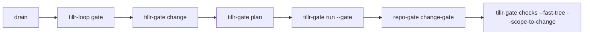

# The gate

**Status:** Source-verified 2026-11-25 against the tree. Four choices await the owner in
[`OQ-GR4`](#OQ-GR4), [`OQ-GR5`](#OQ-GR5), [`OQ-GR6`](#OQ-GR6) and [`OQ-GR7`](#OQ-GR7). In
[Why it's this way](#why-its-this-way), only rows quoting the owner's dated words are owner
rulings; every designer or operator-request decision may be overturned by the owner.
UNMEASURED: this reference was written by reading the code and the recorded decision ledger,
not by observing a gate run.

**The gate** decides whether a change may land and whether the trunk is sound. A **check** is
one command the gate runs: a build, a test suite or a guard over the tree. A **candidate** is a
commit range a lane (one worktree doing one piece of work) offers for landing on the **trunk**
(the `main` branch). The **drain** (`tillr-drain`) is the loop that dispatches lanes and lands
their candidates. Every check is declared in one file, and one program, `tillr-gate`, runs
them for three callers: a person running `just done`, the drain judging a candidate before
the merge, and the drain proving the trunk after it.

| Component | Lives in |
| :--- | :--- |
| Check declarations, each beside its program and tests | [`tools/gate/checks/`](../../tools/gate/checks/) |
| Loading and validating declarations | [`tools/tillr-gate`](../../tools/tillr-gate/) (`loadCheckDirectory`, `checkFile.validate`) |
| Planning and running checks, the verdict record | [`tools/tillr-gate`](../../tools/tillr-gate/) (`Plan`, `RunWith`, `VerdictPayload`) |
| Remembered results | [`tools/tillr-gate`](../../tools/tillr-gate/) (`treeFingerprint`, `resultStore`, `treeMemory`) |
| The stall watchdog | [`tools/tillr-gate`](../../tools/tillr-gate/) (`watchCommand`, `ExitStalled`) |
| Classifying a check result | [`tools/tillr/checkresult`](../../tools/tillr/checkresult/) (`Classify`, `Aggregate`), reached through `tillr-gate classify` and [`tools/gate`](../../tools/gate/) |
| The local gate | [`tools/gate/done.go`](../../tools/gate/done.go) (`tools/gate/repo-gate done`), started by the `done` recipe |
| The landing gate's judge | [`tools/gate/change_gate.go`](../../tools/gate/change_gate.go) (`tools/gate/repo-gate change-gate`), composed by [`tools/tillr-loop/`](../../tools/tillr-loop/) |
| Affected Go test packages, and whole Go suites | [`tools/gate/go_affected.py`](../../tools/gate/go_affected.py), [`tools/go-test-shards.py`](../../tools/go-test-shards.py) |
| The after-merge proof | [`tools/tillr-drain`](../../tools/tillr-drain/) ([After-merge heavy runs](../../tools/tillr-drain/README.md#after-merge-heavy-runs)) |
| Gate settings | [`config/tillr/gate-policy.json`](../../config/tillr/gate-policy.json), read by `ReadGatePolicy` in [`tools/tillr-drain/redcap`](../../tools/tillr-drain/redcap/) |

**Reads with:** [gate check rules](./gate-check-rules.md) (what a check may assert, and what
a red means), [landing principles](../design/landing-principles.md) (the rulings a change
to the gate is tested against), and [the escalation ladder](../design/escalation-ladder.md)
(the fence around the gate's own code).

---

## Invariants

- **The exit is the verdict, and "could not judge" is its own answer.** A check that could
  not start, crashed or stalled judged nothing. It is never reported as a failed check, and
  it outranks a failure elsewhere in the same run.
- **The caller names the range.** A check that judges a change is handed its base and head
  commits by the caller. No check reads a stored baseline to find out what changed.
- **A pass is remembered only for inputs that can be recomputed.** The key is a fingerprint
  of what the check declares it reads. A failure is recorded and never reused.
- **A budget is a target.** No check is ended for running long. Only a check that makes no
  progress is ended, and that result is not a verdict on the candidate.
- **One function classifies every check result.** A caller decides blocking and credit from
  the classified outcome, never from a raw exit code or word.
- **A verdict covers what it ran.** A check skipped because the change does not touch what
  it reads is recorded as skipped, not as a pass.
- **Gate code never lands on deferred proof ([`OQ-GR3`](#OQ-GR3), [`D-GR50`](#D-GR50)).** A
  wrong judge is the one failure a revert does not repair, because every landing it judged
  stays judged; whether the Python gate suites' current heavy-tree declarations meet that
  rule is open in [`OQ-GR6`](#OQ-GR6).

## A check is one declaration file

A check is one JSON object in a file directly under [`tools/gate/checks/`](../../tools/gate/checks/). Only filenames
ending in `.json` are declarations; programs and tests sit beside them. Adding a check adds
files and edits no shared list. The loader refuses an unknown field, validates every file
before anything is planned, and never emits a partial plan: a bad declaration names its file
and field and answers "could not judge".

| Field | Meaning |
| :--- | :--- |
| `id`, `label` | The stable name, and the sentence reports print. Both required; an id is declared once. |
| `command` | The argv to run, from the repository root. Required. |
| `scope` | `change` or `tree`. Required. See [change checks and tree checks](#change-checks-and-tree-checks). |
| `tier` | `fast` or `heavy`. Required. See [tiers](#tiers). |
| `budget_ms` | The time target. Required for `fast`. |
| `timeout_ms` | The time target of a `heavy` check, required there and refused on `fast`. Despite the name it stops nothing. |
| `reads` | Paths the check depends on; a directory ends in `/`, and `.` is the whole tree. Omitted or empty means the whole tree. |
| `tools` | Programs whose version output enters the fingerprint. |
| `needs` | Machine resources the check requires. See [machine needs](#machine-needs). |
| `remember` | `false` turns result memory off for the check. Default `true`. |
| `writes`, `exclusive` | Scheduling only: checks whose `writes` overlap, or an `exclusive` check, do not run at the same time as others. |

No field has a default that changes a verdict: scope, tier and the tier's cost are all
required.

### Change checks and tree checks

A **change check** (`scope: change`) judges a commit range, such as "every commit in the range
carries an allowed identity". The runner appends the base and head commits as the last two
arguments of its command. A **tree check** (`scope: tree`) judges one tree and gets no range.
A change check has no verdict on a single revision, so the faces that judge one revision
refuse it.

The `commit-identity` change check ([`tools/gate/checks/commit-identity.json`](../../tools/gate/checks/commit-identity.json))
and the standalone [`tools/tillr/cmd/git-identity`](../../tools/tillr/cmd/git-identity) (`tools/tillr/gitidentity`) enforce
this repository's own two-identity policy ([`D-GR18`](#D-GR18) and [`D-GR19`](#D-GR19)), not
a rule of the tillr programs ([refused pushes](./tillr-refused-push.md#OQ-RP4)): both check
author and committer against one tracked list of exact name and address pairs
([`tools/gate/allowed-commit-identities.json`](../../tools/gate/allowed-commit-identities.json))
and refuse repository-local or worktree Git identity overrides without changing how commits
are created.

### Tiers

The **fast tier** is the set of checks cheap enough to run on every candidate. The **heavy
tier** is the rest: whole test suites and anything else measured in minutes. Fast tree checks
and all change checks run before the merge; heavy tree checks run in the
[after-merge proof](#after-merge-proof-and-the-green-pointer) (including, today, the Python
gate suites asked about in [`OQ-GR6`](#OQ-GR6)). Two change checks are heavy
(`go-affected` and `workflows`): they still run before the merge, outside the fast budget,
and the landing gate runs them only when the change touches what they read.

## Remembered passes

A tree check's pass is remembered so an unchanged check does not run again. The key is a
**fingerprint**: a hash over the declaration's exact bytes, the planned command, the git blob
of every tracked file under the check's `reads`, the version output of each program in
`tools`, and the name and commit of every ref in `needs`.

- A remembered pass answers the check without running it. The verdict entry says so, and
  the summary counts remembered checks apart from fresh passes.
- A fail is recorded with its log and never reused: the check runs again.
- Nothing is remembered when a file under the check's `reads` differs on disk from the
  judged commit, when the checkout's `HEAD` is another tree, or when the fingerprint moved
  while the command ran.
- A change check is never remembered by this store. The `documents` check keeps its own
  per-document memory in the same store, keyed on each document's blob and everything the
  renderer reads for it.
- The store is local to a machine. It lives under the repository's git common directory,
  so every worktree of one repository shares it.

### A contradicted check is disabled

A fingerprint that holds both a pass and a fail is a contradiction: the same inputs gave two
answers, so the check is flaky. Such a check is **disabled**: reported as `disabled`, never as
passed, and it neither blocks a landing nor turns the trunk red. `tillr-gate` writes a marker
naming the episode (the fingerprint and both times) and copies both logs at the observation.
The drain files one repair item per disabled check, and `tillr-gate enable` clears the
episode once that repair lands. The full rule is in
[gate check rules](./gate-check-rules.md#a-check-set-aside-from-the-verdict-is-narrow-ticketed-and-counted).

### Machine needs

A `needs` entry beginning `ref:` names a local git ref, with at most one `*` wildcard. When no
such ref exists the check is `unavailable`: neither passed nor failed, listed with the
`git fetch` command that creates the ref, and not a reason for a non-zero exit. The runner
never fetches. Any other `needs` entry is a path that must exist, and a missing one is
`error`.

## Budgets and the stall watchdog

The landing gate's ten-second per-change target ([`D-GR1`](#D-GR1), amended as aspirational
by [`D-GR38`](#D-GR38)) applies to the checks every candidate runs. Every fast declaration
states a `budget_ms`. The `gate-budget` change check sums them and fails when the total
exceeds the fast-tier cap (`9,000` ms against `budget_ms: 10000` in
[`config/tillr/gate-policy.json`](../../config/tillr/gate-policy.json)), so admission is
arithmetic over declared costs and never a measurement of the machine. The cap bounds what
every candidate pays. A check planned only for some candidates, such as `go-affected` on a
tillr Go module change, is outside the sum and outside the ten-second target.

A check that runs past its target keeps its own verdict ([`D-GR15`](#D-GR15)). The overrun is
recorded (`over_budget_ms`) in the verdict, the log and the summary. Machine load therefore
cannot turn work that would have finished into a failure.

The **watchdog** is the progress observer that ends a stalled check ([`D-GR16`](#D-GR16)). It
samples each running check about once a second. A sample shows progress when the check's log
grew or its process group used CPU time. A minute of consecutive samples with neither is a
**stall**: the runner ends the process group and records `stalled` with the last output line,
the group's CPU time and the silent-sample count. A stall is exit 6, and is not pass, fail,
error or over-budget. When neither CPU source is readable the watchdog prints
`watchdog unavailable` and the check runs unobserved. The CPU sources and their fallback are
described in the
[`tillr-gate` README](../../tools/tillr-gate/README.md#declaration-directories).

The drain gates a stalled candidate's same head once more, when fewer gates are in flight,
and holds the item as `gate-stalled` on a second stall.

> [!WARNING]
> Do not add a deadline that kills a working check, and do not carry a check to a later
> tier at its budget ([`D-GR14`](#D-GR14)). `--tree-overrun` accepts only `keep`, and Go test
> commands run with Go's own deadline off, for the same reason.

## Result classification

`Classify` in [`tools/tillr/checkresult`](../../tools/tillr/checkresult/) turns one raw
observation (an exit code, a result word, a cached record, a span) into one of five outcomes:
`pass`, `fail`, `unknown`, `unavailable` and `disabled`, each with a detail word
([`D-GR23`](#D-GR23)). Its rules run in order:

1. A run proving a disabled check on its own repair candidate skips rules 2 and 3.
2. An active disabled marker answers `disabled` with the marker's evidence.
3. A contradicted fingerprint that matches no resolved episode answers `disabled`.
4. Otherwise the raw result is classified by the protocol that produced it. An observation
   with no raw result is `unknown`.

`Aggregate` folds a run's classified checks into one run result and exit code. In the
runner's order a check that could not run outranks a stall, which outranks a failure. To keep
classifier migrations outcome-preserving (`"No outcome changes for any input"`,
[`D-GR28`](#D-GR28)), `Classify` holds a named protocol per raw-result source and `Aggregate`
a named order per aggregate site, so each call site passes its protocol or order name and
compares nothing locally. A cached result is classified when used, and a replayed commit
supplies the check's declaration and command, never its classification.

Go callers call the package. Python callers hand yes-or-no facts about a check's output to
`tillr-gate classify` through [`tools/tillr/checkresult`](../../tools/tillr/checkresult/) and
decide nothing from them locally. Plain `tillr-gate classify` is pure and touches no disk;
`--aggregate <order>` folds a run's observations into one aggregate object and answers a
usage error with no output on an unknown order ([`D-GR33`](#D-GR33)); with `--repo` or
`--store`, `classify` resolves declarations, computes fingerprints and may write a disabled
marker ([`D-GR41`](#D-GR41)).

Because the landing gate runs the `tillr-gate` installed from `refs/tillr/green`, any new
face or flag of `tillr-gate` lands with its tests and no caller first, and callers move onto
it only after `refs/tillr/green` holds a proved commit containing it ([`D-GR32`](#D-GR32),
[`D-GR33`](#D-GR33); [landing principle 15](../design/landing-principles.md#15-land-the-smallest-functional-change)).
When an adapter moves onto `tillr-gate classify`, test assertions stay unchanged and any
stand-in executable a test writes for `tillr-gate` forwards `classify` unchanged to the next
`tillr-gate` on `PATH` and never classifies by itself ([`D-GR34`](#D-GR34)).

## The local gate: `just done`

`just done` judges the committed tree with every declared check, using a `tillr-gate` built
from the checkout. It refuses to judge a dirty working tree, writes no verdict record and
moves no ref. Two passes run in order:

1. Every change check and every fast tree check, over `BASE..HEAD`.
2. Every heavy tree check, on `HEAD`. A check whose fingerprint already passed is remembered
   and not run. This pass is skipped when the first could not judge.

`BASE` is `--since` when given; otherwise the green pointer when `HEAD` descends from it;
otherwise the upstream branch when `HEAD` descends from it; otherwise `HEAD`'s first parent.
`--fast` runs the first pass only. `--only <id>` runs exactly one heavy check.

## The landing gate

The drain judges each candidate before it merges, in the lane's worktree. Lanes run
independently, landings must outpace them at ten lanes and again at twenty, and nothing a
landing waits for may be shared between lanes except the squash itself ([`D-GR2`](#D-GR2),
[landing principle 3](../design/landing-principles.md#3-gate-what-will-be-the-tip-once),
pinned at ten and twenty lanes by `TestTenLanesLandWithoutWaitingOnEachOther` and
`TestTwentyLanesLandWithoutWaitingOnEachOther` in
[`tools/tillr-drain/drain/scale_test.go`](../../tools/tillr-drain/drain/scale_test.go)):



`tillr-gate change` derives the change record from the candidate, `plan` binds it to the
digest of the candidate's own declaration directory, and `run --gate` runs one named judge
and writes the `gate.verdict` record. The lander accepts a verdict only when it binds the
candidate's base commit and head tree. The judge,
[`change_gate.go`](../../tools/gate/change_gate.go) (`tools/gate/repo-gate change-gate`), refuses unless the named head is checked
out, then runs every change check and fast tree check through the `checks` face.

With `--scope-to-change`, a check whose declared `reads` are disjoint from the changed paths
is recorded as `skipped: no changed path is read`. A check with no declared `reads` always
runs and is not remembered in that run. The drain runs the gate in a detached child session
that survives an in-place restart of the loop and never blocks a sibling lane's gate
([`D-GR43`](#D-GR43)).

On the ordinary pre-merge path, each gate run writes a durable record in `gate.timing.jsonl`
in the run's directory ([`D-GR30`](#D-GR30)): total wall time, each check's elapsed time and
whether it ran, was reused or was not run, and for `go-affected` its selection time, slot
wait and per-package selection reason, elapsed time and whether Go answered from its cache.
The after-merge proof, relands, automatic-revert candidates, named replays and heavy-failure
counts are outside that record's scope.

### Affected Go tests before the merge

`go-affected` ([`tools/gate/checks/go-affected.json`](../../tools/gate/checks/go-affected.json),
[`tools/gate/go_affected.py`](../../tools/gate/go_affected.py)) is the change check that runs
Go tests before a landing ([`D-GR38`](#D-GR38), [`D-GR39`](#D-GR39), amended on 2026-11-25 by
[`D-GR53`](#D-GR53) and [`D-GR54`](#D-GR54)). Across all ten tillr Go
modules (`tools/tillr` and each `tools/tillr-*` directory holding a `go.mod`, excluding the
pack mirrors), it selects four sets:

- the changed Go packages;
- every test package whose imports reach a changed package (the Go import graph reversed
  across the modules);
- the test packages that [`tools/gate/go-test-edges.json`](../../tools/gate/go-test-edges.json)
  ties to a sibling program they build or run (`builds`) or to a non-Go file they read
  (`reads`);
- for a change in a module that the graph cannot place, every test package of that module and
  of the modules that `replace` it (the whole-module floor).

Where a package entry in [`tools/gate/go-test-edges.json`](../../tools/gate/go-test-edges.json)
carries `read_tests`, only the union of those named tests runs when read rules in `read_tests`
alone selected the package ([`D-GR44`](#D-GR44)). A counterpart `build_tests` map narrowing
`builds` edges to the tests that build a sibling program ([`D-GR51`](#D-GR51)) is designed
and not yet built (`rg -c 'build_tests' tools/gate/go-test-edges.json tools/gate/go_affected.py`
returns `0`).

**Deferring `tillr-drain/drain` integration tests to the after-merge proof ([`D-GR53`](#D-GR53),
[`D-GR54`](#D-GR54)).** Recorded `go-affected` timings from 2026-11-25 showed
`github.com/mschulkind-oss/tillr-drain/drain` accounting for `83.0%`–`99.99%` of total package
shard time across every gate run over twenty minutes: its `~2,000` subprocess-heavy integration
tests sum roughly `4,800 s` of test-wall time across shards (`3,674.67 s` recorded in
[`tools/go-test-durations.json`](../../tools/go-test-durations.json)), so no priority,
shard-count or single-test tuning meets the `90 s` median slow-gate alert threshold in
[`config/tillr/watch/fast-gate-slow.toml`](../../config/tillr/watch/fast-gate-slow.toml) while
they run before the merge. On 2026-11-25 the owner ruled `"sounds like a good idea. do it"`
([`D-GR53`](#D-GR53), amending [`D-GR38`](#D-GR38) and [`D-GR39`](#D-GR39)) in answer to
moving the `tillr-drain` integration tests out of pre-merge `go-affected` and proving them
after the merge, while keeping [`OQ-GR3`](#OQ-GR3), [`D-GR50`](#D-GR50) and [`I3`](#I3) in
force (`tools/tillr-gate` and `tools/gate` suites stay before the merge).

Choosing between moving `drain`'s integration tests into a separate Go package and amending
`go-affected` selection so `github.com/mschulkind-oss/tillr-drain/drain` is proved after the
merge — a designer decision from a filed request (`D-GR54`), not an owner ruling, which the
owner may overturn — is implemented as follows:

- **Why `go-affected` selection is amended rather than splitting `drain` (`D-GR54`).** Across
  the tillr Go modules (`39` Go test packages, `3,894` top-level `Test*` functions excluding
  `TestEdgeInputs`), `38` packages (`1,809` tests — including all `14` other Go test packages
  in `tools/tillr-drain` summing `126` tests across root `tools/tillr-drain` and leaf
  subpackages, plus `24` packages across `tools/tillr`, `tools/tillr-gate` and sibling modules)
  sit outside `github.com/mschulkind-oss/tillr-drain/drain`. Inside
  [`tools/tillr-drain/drain`](../../tools/tillr-drain/drain/) (`574` `*_test.go` files, `2,090`
  `Test*` functions), `535` files (`2,041` tests, `3,674.67 s` — `97.7%` of its tests and
  `99.95%` of its recorded duration) are subprocess, Git, SQLite or server integration tests
  and only `32` files (`49` tests, `1.83 s`) are pure in-memory unit tests; `436` of those
  `535` integration files (`1,687` tests, `2,901.94 s`, including four of the five slowest
  cases) are white-box `package drain` tests referencing `942` distinct unexported declarations
  of `package drain` across `457` files. Splitting `drain` into a separate integration-test
  package would have to export hundreds of `drain` internals, move `535` files, rewrite
  [`tools/gate/go-test-edges.json`](../../tools/gate/go-test-edges.json) and
  [`tools/go-test-durations.json`](../../tools/go-test-durations.json), and *still* exclude the
  new package in `go-affected` (because `select_affected_packages` selects any test package in
  `tools/tillr-drain` via reverse test imports, declared edges or the module floor) to retain
  only `49` unit tests (`1.83 s`, `1,858` vs. `1,809` pre-merge Go tests). Amending
  `go-affected` selection keeps `97.4%` of non-integration Go tests (`1,809` of `1,858` across
  `38` of `39` test packages) before the merge, keeps pre-merge compilation of all `574`
  `tools/tillr-drain/drain/*_test.go` files in fast check `go-build` (`go test -exec true ./...`
  in `tools/gate/checks/go-build.py`), touches zero
  files under `tools/tillr-drain/drain/`, and must be stated in the build commit body.
- **`DEFERRED_PROOF_PACKAGES` in `go-affected` ([`tools/gate/go_affected.py`](../../tools/gate/go_affected.py)).**
  Define `DEFERRED_PROOF_PACKAGES = frozenset({"github.com/mschulkind-oss/tillr-drain/drain"})`
  (in [`tools/gate/go_affected.py`](../../tools/gate/go_affected.py), or in the Go
  `go-affected` planner if `go_affected.py` has been ported to Go) and add
  `drop_packages: set[str] | None = None` to `select_affected_packages`, defaulting to
  `DEFERRED_PROOF_PACKAGES` when `None`. Non-test edits under `tools/tillr-drain/drain/` still
  add `"github.com/mschulkind-oss/tillr-drain/drain"` to `changed_pkgs` in Step 1 so reverse
  test-import consumers (root `github.com/mschulkind-oss/tillr-drain`,
  `github.com/mschulkind-oss/tillr-store`, `github.com/mschulkind-oss/tillr-watch`,
  `github.com/mschulkind-oss/tillr-view`) and `builds`/`reads` edges (including narrowed
  `github.com/mschulkind-oss/tillr/definition` and `github.com/mschulkind-oss/tillr/store`)
  still run before the merge, while `drop_packages` is excluded from `all_reads` (skipping
  `load_tillr_graph` when a diff touches only paths read exclusively by `tillr-drain/drain`)
  and omitted from `selected` across all four selection reasons (`changed`, `import`, `edge`
  and `floor`).
- **Edge retention and after-merge `reads` ([`tools/gate/go-test-edges.json`](../../tools/gate/go-test-edges.json),
  [`tools/gate/checks/go-test-tillr-drain.json`](../../tools/gate/checks/go-test-tillr-drain.json)).**
  Keep `github.com/mschulkind-oss/tillr-drain/drain` in
  [`tools/gate/go-test-edges.json`](../../tools/gate/go-test-edges.json) so `--cache` in
  [`tools/go-test-shards.py`](../../tools/go-test-shards.py) continues passing
  `TILLR_GATE_EDGE_INPUTS` digests for `drain`'s built sibling binaries and read files during
  the after-merge `go-test-tillr-drain` run. Expand `reads` in
  [`tools/gate/checks/go-test-tillr-drain.json`](../../tools/gate/checks/go-test-tillr-drain.json)
  to cover every `builds` module directory (plus transitive `replace` dependencies required by
  `missing_go_reads` in `tools/gate/checks/tree_checks_test.py`)
  and every `reads` rule declared for `DEFERRED_PROOF_PACKAGES` in
  [`tools/gate/go-test-edges.json`](../../tools/gate/go-test-edges.json), preventing
  `tillr-gate checks --heavy-tree` from reusing a stale remembered pass when a sibling binary
  or read config/pack file changes.
- **Selection and declaration tests ([`tests/go-affected.test.py`](../../tests/go-affected.test.py)).**
  Update `test_selection_rules`, `test_drain_subpackage_isolation` and
  `test_heavy_failures_replay` so default `select_affected_packages` asserts
  `"github.com/mschulkind-oss/tillr-drain/drain"` is absent from `selected` on direct, import,
  edge and `go.mod`-floor changes while non-deferred reverse importers and edge readers still
  select (passing `drop_packages=set()` or non-deferred packages where cases unit-test
  `read_tests`/`build_tests` narrowing algebra), and extend
  `test_check_declarations_cover_selection_inputs` to assert
  [`tools/gate/checks/go-test-tillr-drain.json`](../../tools/gate/checks/go-test-tillr-drain.json)'s
  `reads` covers every `builds` module directory and `reads` rule of `DEFERRED_PROOF_PACKAGES`
  in [`tools/gate/go-test-edges.json`](../../tools/gate/go-test-edges.json). Keep the
  `go-affected` selector, [`tools/gate/checks/go-test-tillr-drain.json`](../../tools/gate/checks/go-test-tillr-drain.json)
  and [`tests/go-affected.test.py`](../../tests/go-affected.test.py) in one writable fence so
  selection and declaration assertions update together. Process priorities and how the
  after-merge proof searches a range for a red landing are out of scope.

`go-affected` runs `go test` on the selected packages with Go's result cache on: no selected
package is ever run with `-count=1`, and `-count=1` is never used as a fallback
([`D-GR40`](#D-GR40)). To prevent stale cached passes on non-Go or built-program inputs, each
package with an entry in [`tools/gate/go-test-edges.json`](../../tools/gate/go-test-edges.json)
receives a digest of its declared inputs (scoped to the active subset's inputs when narrowed)
in `TILLR_GATE_EDGE_INPUTS`, which the package's tests read once so Go's test cache reruns
the package when an edge input changes and answers from cache when it does not.

**Failure triage and `SIGQUIT`-blocked test cases ([`D-GR52`](#D-GR52)).** This subsection
states a designer's decision made from an operator request; it is not an owner ruling, and
the owner may overturn it. Designed and not yet built (`rg 'SIGQUIT: quit'
tools/gate/go_affected.py` and `rg 'fork-check: triage' tools/gate/` return nothing). Commit
`cf31b7e8` added the binary stall watchdog (`_watch_go_test_binaries` in
[`tools/gate/go_affected.py`](../../tools/gate/go_affected.py)), which sends `SIGQUIT` to an
idle `.test` binary, and an operator can send `SIGQUIT` the same way. When a Go test binary
ends on `SIGQUIT`, Go writes `SIGQUIT: quit` and all goroutine stacks without emitting a
test-level `"Action": "fail"` event or `--- FAIL:` line for the running test. Commit
`11650445` retired `tools/fork-check.py` (which formerly built the failing-case list and
printed the `fork-check: triage --` block), while `gateFailingChecks` in
[`tools/tillr-drain/drain/returned.go`](../../tools/tillr-drain/drain/returned.go) already
calls `readTriageBlock`
([`tools/tillr-drain/drain/refusal_cases.go`](../../tools/tillr-drain/drain/refusal_cases.go))
directly on `go-affected`'s recorded check log (`change-logs/<NN>-go-affected.log`). To make
`drain.refusal` name blocked tests while changing only
[`tools/gate/go_affected.py`](../../tools/gate/go_affected.py) (and its unit tests in
[`tests/go-affected.test.py`](../../tests/go-affected.test.py)):

1. **`SIGQUIT` case extraction.** When `go_affected.py` reads a test binary's output
   (reconstructed in event order from `go test -json` `"Output"` chunks or plain lines) that
   contains `SIGQUIT: quit`, it adds one failing case per unique top-level test function
   named in that binary's goroutine stacks — a stack frame line of the form
   `<package>.Test<Name>(` (matching Go's top-level `Test*` naming rule as in
   `scan_package_tests` and excluding `TestMain`, closures such as `.Test<Name>.func1(`, and
   `created by` lines). Each case sets `name` to `Test<Name>`, `assertion` to
   `"blocked: the test binary was ended by SIGQUIT while this test was running"`, and
   `where` to the stack frame line immediately below the `<package>.Test<Name>(` frame line
   stripped of surrounding whitespace (or `"(no file named)"` on the printed `case:` line
   only if no line follows). When `<package>` ends in `_test` for an external test package,
   its Go package import path strips `_test` when matching the invocation's package so both
   `failed_tests` (in `go-affected: failing packages and tests:`, preserving
   `parse_go_test_json`'s `(results, readable)` return tuple) and the `one case:` command
   name the real import path.
2. **Ordering and bounded triage block.** On any failing run (`rc_all != 0`),
   `go_affected.py` builds a deduplicated failing-case list across all failed invocations in
   which **all `SIGQUIT` cases come first** (and `SIGQUIT` test names likewise come first in
   each package's `failed_tests` list), ahead of ordinary failing cases parsed from
   `--- FAIL:` blocks (carrying the first `<file>:<line>: <assertion>` line and
   `<package> (<file>:<line>)` or `<package>` as `where`) and any remaining `failed_tests`
   entries not already covered. Immediately before `format_failure_summary`
   (`go-affected: failing packages and tests:`, kept at the end of standard output so
   trailing-line excerpts keep the package summary), `go_affected.py` prints a bounded
   `fork-check: triage -- 1 failed check(s), diagnosed from this run's own output and never re-run:`
   block with header `  triage go-affected: Go test packages affected by the change pass`
   ([`tools/gate/checks/go-affected.json`](../../tools/gate/checks/go-affected.json)),
   keeping at most `TRIAGE_CASES = 10` cases (`       case: <name> -- <where>`,
   `       assertion: <assertion>`, and `       one case: go -C <module> test <pkg_rel> -run '^<name>$'`
   when the package resolves to a module directory, plus
   `       (<dropped> more failing case(s) not listed; the packet keeps <kept>)` when
   truncated, or
   `       no case named in the output; reproduce with: python3 tools/gate/go_affected.py`
   when no case was named). Placing `SIGQUIT` cases first ensures the 10-case triage bound
   and `failureSummary` in [`refusal_cases.go`](../../tools/tillr-drain/drain/refusal_cases.go)
   keep the blocked test in `drain.refusal` ahead of other failing tests.
3. **Scope boundary.** Only [`tools/gate/go_affected.py`](../../tools/gate/go_affected.py)
   and its unit test suite [`tests/go-affected.test.py`](../../tests/go-affected.test.py)
   change for that item; [`tools/tillr-drain/`](../../tools/tillr-drain/),
   [`tools/tillr-gate/`](../../tools/tillr-gate/),
   [`tools/go-test-shards.py`](../../tools/go-test-shards.py), `-timeout 0` and Go's
   `"panic: test timed out"` output, who sends `SIGQUIT`, and the blocked test itself stay
   untouched.

**Gate code never lands on deferred proof ([`OQ-GR3`](#OQ-GR3), [`D-GR50`](#D-GR50), and
[`I3`](#I3)).** Under either `landing_strategy` (`before-merge` or `after-merge`), a change
to the gate's own code (`tools/tillr-gate/` and `tools/gate/`, fenced as its own item by
[the escalation ladder](../design/escalation-ladder.md)) lands only after the gate's tests
pass before the merge, outside the ten-second fast budget, because **a wrong judge is the one
failure a revert does not repair: every landing it judged stays judged**. The drain records
the gate and landing time of such a change apart from ordinary candidates
(`runnerProofPaths` in
[`tools/tillr-drain/drain/runner_timing.go`](../../tools/tillr-drain/drain/runner_timing.go)).

[`D-GR50`](#D-GR50) (designer's decision from an operator request, 2026-11-23; the owner may
overturn it) narrowed how that pre-merge proof runs: it moved the whole-module `tools/tillr`
suite (`go-test-tillr`) to after the merge, brought `tools/tillr` and `tools/tillr-gate` into
`go-affected` so affected Go packages of all ten tillr Go modules run before the merge with
the cache on, split the gate runner's own check by tier so that before the merge it watches
`tools/tillr-gate/`, `tools/gate/` and the pack mirror of `tillr-gate` and runs the two
Python runner suites (never deferred) while after the merge `go-test-tillr-gate` and the
heavy tier run the whole `tools/tillr-gate` Go suite and both Python suites, and kept missing
`go` on the machine as a hard landing block on `tools/tillr-gate/` and `tools/tillr/` changes
rather than deferring those tests. `D-GR50` explicitly rejected moving the runner's Python
suites out of the pre-merge gate to after the merge (because dropping them before the merge
lets a broken adapter land unjudged, violating [`OQ-GR3`](#OQ-GR3)) and explicitly rejected
letting a `tools/tillr-gate/` Go edit land when `go` is missing because a pre-merge runner
check is Python-only.

**Current check declarations vs. `D-GR50` ([`OQ-GR6`](#OQ-GR6)).** In the tree today, missing
`go` still blocks any landing touching `tools/tillr-gate/` or `tools/tillr/` (`go-build`
declares `"go"` in `tools` and `go-affected` invokes `go`), and `go-affected` runs affected
Go packages before the merge. However, commit `11650445` (2026-11-24) declared the Python
gate suites ([`tools/gate/checks/gate-adapters-test.json`](../../tools/gate/checks/gate-adapters-test.json)
and [`tools/gate/checks/change-checks-test.json`](../../tools/gate/checks/change-checks-test.json))
as `scope: "tree", tier: "heavy"`. Before the merge, `repo-gate change-gate` invokes
`tillr-gate checks --fast-tree`, which in `checksFace`
([`tools/tillr-gate/checks.go`](../../tools/tillr-gate/checks.go)) selects only
`scope: "change"` and `scope: "tree", tier: "fast"` declarations; heavy tree checks run only
under `--heavy-tree` in the after-merge proof, and `go-affected` runs only Go packages
(`rg -n 'change-gate\.test\.py|classification-scan\.test\.py|done\.test\.py|change_checks_test\.py' tools/`
matches outside the test files themselves only `tools/gate/checks/*.json` and one fixture
string in `tools/tillr-drain/drain/replay_go_affected_test.go`). Whether to run the Python
gate suites before the merge on gate edits or amend `D-GR50` is open for the owner in
[`OQ-GR6`](#OQ-GR6).

### Measured `go-affected` timings (2026-11-25)

Measured on 2026-11-25 against the recorded runs under `.tillr/loop/` (101 `gate.timing.jsonl`
records, 52 over 20 minutes / 1,200,000 ms; `go-affected` ran in 68 of them, 63 starting before
the 07:43 ET priority change at `2026-11-25T12:43:20Z` in `.tillr/loop/backend-policy-changes.jsonl`
and 5 starting after). No program behavior changes in this measurement.

**Per-package and slowest-test breakdown across four >20-minute gates (2026-11-25).** Package
totals sum all shards (`go-affected: pass|fail <pkg> (<sec>s)`), and test times list the
slowest top-level tests (`<TestName>` without `/`), extracted with:

```sh
python3 - <<'EOF'
import glob, json, os, re
pkg_re = re.compile(r'^go-affected: (?:pass|fail) (\S+) \((\d+\.\d+)s\)$')
test_re = re.compile(r'^go-affected: (?:pass|fail) (\S+) (\S+) \((\d+\.\d+)s\)$')
for run in [
    "run-item-request-6dec440553-a4-n1",
    "run-item-request-da2e75c68f-a1-n1",
    "run-item-request-1e21846750-a1-n3",
    "run-item-request-5cd5946151-a2-n1",
]:
    t = json.loads(open(f".tillr/loop/{run}/gate.timing.jsonl").readline())
    log = glob.glob(f".tillr/loop/{run}/change-logs/*go-affected.log")[0]
    pkgs, tests = {}, []
    for line in open(log):
        line = line.strip()
        if m := pkg_re.match(line):
            pkgs[m.group(1)] = pkgs.get(m.group(1), 0.0) + float(m.group(2))
        elif m := test_re.match(line):
            if "/" not in m.group(2):
                tests.append((float(m.group(3)), m.group(1), m.group(2)))
    print(run, t["wall_ms"], t["checks"]["go-affected"]["wall_ms"], sorted(pkgs.items(), key=lambda x: -x[1]))
    print("  top5:", sorted(tests, reverse=True)[:5])
EOF
```

| Recorded gate (`run_id`) | Gate wall (ms) | `go-affected` wall (ms) | Package shard-time breakdown | Slowest top-level tests |
| :--- | :--- | :--- | :--- | :--- |
| `run-item-request-6dec440553-a4-n1` (8 pkgs, 2,286 tests; started 07:15:09 ET) | 1,869,571 (31.16 min) | 1,868,665 (31.14 min) | `tillr-drain/drain`: 21,153.68 s (16 shards, max 1,685.49 s); `tillr-watch`: 672.62 s (6 shards); `tillr-view`: 651.82 s (1); `tillr-store`: 236.69 s (1); `tillr-item`: 23.42 s (1); `tillr-drain`: 23.28 s (1); `tillr/definition`: 11.87 s (1); `tillr/store`: 3.57 s (1). Sum: 22,776.95 s. | `TestSiblingFastGateLandsWhileLaneOneGateBlocksAndRestartIsPending` (311.99 s; `concurrent_blocked_gate` 304.74 s), `TestRestartThroughTheShippedLauncherMovesOntoChangedSourceAndAnswersAlreadyCurrent` (233.74 s), `TestForkBuildCommandContracts` (217.55 s), `TestGateRefusalUsesExactTrunkProof` (176.05 s), `TestWorkflowEvaluatorJudgeClassesValidation` (155.59 s). |
| `run-item-request-da2e75c68f-a1-n1` (3 pkgs, 2,085 tests; started ~06:34 ET) | 1,782,822 (29.71 min) | 1,777,113 (29.62 min) | `tillr-drain/drain`: 24,208.50 s (16 shards, max 1,741.77 s); `tillr/definition`: 2.05 s (1); `tillr/store`: 1.23 s (1). Sum: 24,211.78 s. | `TestSiblingFastGateLandsWhileLaneOneGateBlocksAndRestartIsPending` (314.36 s), `TestTheComposedPipelineRunsEndToEndOnAFixture` (229.89 s), `TestRestartThroughTheShippedLauncherMovesOntoChangedSourceAndAnswersAlreadyCurrent` (229.42 s), `TestAcquittedTreeItemReturnsOnlyAfterItsFixerLands` (212.39 s), `TestVerifyMissingVerdictReturnsToVerify` (182.48 s). |
| `run-item-request-1e21846750-a1-n3` (8 pkgs, 2,891 tests; started ~06:27 ET) | 2,299,493 (38.32 min) | 2,297,014 (38.28 min) | `tillr-drain/drain`: 22,746.93 s (16 shards, max 1,599.12 s); `tillr-view`: 3,434.67 s (6 shards, max 815.07 s); `tillr-watch`: 495.76 s (6); `tillr-run/run`: 396.56 s (6); `tillr-gate`: 269.53 s (6); `tillr-drain/keep`: 46.78 s (1); `tillr/definition`: 3.31 s (1); `tillr/store`: 0.95 s (1). Sum: 27,394.49 s. | `TestSiblingFastGateLandsWhileLaneOneGateBlocksAndRestartIsPending` (321.85 s), `TestCommandWorkflowOutcomesAndPreservation` (162.79 s), `TestForkBuildCommandContracts` (152.12 s), `TestAcquittedTreeItemReturnsOnlyAfterItsFixerLands` (150.15 s), `TestTheComposedPipelineRunsEndToEndOnAFixture` (148.10 s). |
| `run-item-request-5cd5946151-a2-n1` (9 pkgs, 2,396 tests; started 07:27:28 ET) | 1,651,843 (27.53 min) | 1,650,581 (27.51 min) | `tillr-drain/drain`: 20,678.80 s (16 shards, max 1,380.80 s); `tillr-view`: 393.30 s (2); `tillr-run/run`: 209.46 s (6); `tillr-run`: 202.34 s (1); `tillr-store`: 103.17 s (1); `tillr-drain`: 32.70 s (1); `tillr-run/claude`: 20.22 s (1); `tillr/definition`: 1.36 s (1); `tillr/store`: 0.69 s (1). Sum: 21,642.04 s. | `TestSiblingFastGateLandsWhileLaneOneGateBlocksAndRestartIsPending` (330.55 s), `TestJudgeFailingDispositions` (278.41 s), `TestCommandWorkflowOutcomesAndPreservation` (241.92 s), `TestCommentRefusedAndAnswerOnly` (195.37 s), `TestObstacleCallRoutesEqualToFooterAndDeliversReplies` (183.26 s). |

In every >20-minute gate, `tillr-drain/drain` accounted for **83.0%–99.99%** of total package shard
time and ran across 16 concurrent shards (`ThreadPoolExecutor(max_workers=min(16, len(invocations)))`
in `tools/gate/go_affected.py`), with `slot_wait 0ms` reported in every log.

**Are gates after 07:43 ET faster?** Yes, for gates that *started* after the 07:43 ET priority
change (`gate` nice 5, `proof` nice 10, `worker` nice 15), checked by reading `started_at_ms` from
`change-logs/gate.checks.jsonl` and `wall_ms` from `gate.timing.jsonl`:

- Before 07:43 ET, the median across 63 `go-affected` gates was **1,606,590 ms** (26.78 min).
  Gates that started before 07:43 ET and finished after (`6dec440553-a4-n1`, `5cd5946151-a2-n1`,
  `9664864271-a2-n1-cfix-cfix`) still took 24.11–31.16 min.
- Among gates that started after 07:43 ET, `run-item-request-5ef3520666-a2` (same 8 packages as
  pre-07:43 `5ef3520666-a1`) dropped from **1,782,531 ms** (29.71 min) to **1,031,027 ms**
  (17.18 min), and `run-item-request-f781208475-a1-n1` (same 3 packages as pre-07:43
  `da2e75c68f-a1-n1`) dropped from **1,782,822 ms** (29.71 min) to **645,131 ms** (10.75 min;
  `tillr-drain/drain` shard sum dropped 4.30x from 24,208.50 s to 5,626.00 s).

**Waiting for processors vs. waiting on a clock.** Most of the 30-minute wall time went to
**waiting for processors** under multi-gate/proof/worker contention, while a smaller set of
**clock-waiting tests** imposes a ~302 s floor that does not shrink with more CPU:

- Comparing the 2,069 common top-level tests between pre-07:43 `da2e75c68f-a1-n1` (23,680.37 s
  total) and post-07:43 `f781208475-a1-n1` (5,468.07 s total), **18,212.30 s (76.9%)** vanished
  when processor contention dropped. CPU-bound integration tests sped up **5.2x–8.0x**
  (`TestRollingWithoutAVerdictStillDispatches` 82.24 s to 10.34 s;
  `TestTwentyLanesLandWithoutWaitingOnEachOther` 146.83 s to 24.61 s; `TestForkBuildCommandContracts`
  133.04 s to 24.22 s; `TestRestartThroughTheShippedLauncherMovesOntoChangedSourceAndAnswersAlreadyCurrent`
  229.42 s to 64.07 s, matching its standalone measurement via
  `cd tools/tillr-drain && time go test ./drain -run '^TestRestartThroughTheShippedLauncherMovesOntoChangedSourceAndAnswersAlreadyCurrent$' -count=1`
  at **67.59 s** wall / 57.18 s user + 9.19 s sys).
- Clock-waiting tests stayed at **0.99x–1.20x** across contention levels and standalone runs:
  - `cd tools/tillr-drain && time go test ./drain -run '^TestSiblingFastGateLandsWhileLaneOneGateBlocksAndRestartIsPending/concurrent_blocked_gate$' -count=1`:
    **302.43 s** wall vs. 50.72 s user + 3.40 s sys (304.74 s in `6dec440553-a4-n1`, 304.06 s in
    `f781208475-a1-n1`), dominated by a 300 s `hangGuard` (`5 * time.Minute`) wait.
  - `cd tools/tillr-drain && time go test ./drain -run '^TestWaitingDoesNotRepeatUnknownRollingChecksOnIdlePolls$' -count=1`:
    **112.09 s** wall vs. 3.32 s user + 1.14 s sys (109.19 s in `5ef3520666-a1`, 107.90 s in
    `f781208475-a1-n1`), waiting on real-clock idle-poll intervals across seven `l.pass` calls.
  - `TestAnOutOfRotationLaneIsQuietUntilItChangesOrTheSlowIntervalPasses`: 101.65 s in
    `da2e75c68f-a1-n1` vs. 92.79 s in `f781208475-a1-n1` (1.10x).

**Why no small tuning change brings the median under 90 seconds, and the smallest change that
would.** No priority, shard-count, or single-test fix can bring the median under the alert's 90 s
(`config/tillr/watch/fast-gate-slow.toml`) while every `tools/tillr-drain` candidate runs the
~2,093-test `tillr-drain/drain` package before the merge:

1. Even with zero processor contention, `TestSiblingFastGateLandsWhileLaneOneGateBlocksAndRestartIsPending`
   (302.43 s) and `TestWaitingDoesNotRepeatUnknownRollingChecksOnIdlePolls` (112.09 s) each exceed
   90 s on a single shard.
2. Even if every clock-waiting test used fake clocks, the remaining ~2,080 tests in
   `tillr-drain/drain` sum to ~4,800 s of test-wall time (~150 s minimum across 32 cores for a
   single gate in isolation, and longer whenever multiple gates run concurrently).

The smallest change that would bring the median under 90 s is to stop running `tillr-drain/drain`'s
~2,000 subprocess-heavy integration tests in pre-merge `go-affected` — either by moving those
integration tests into a separate package proven in the after-merge heavy tier (leaving fast unit
tests in `drain`) or by amending [`D-GR38`](#D-GR38) and [`D-GR39`](#D-GR39) to prove
`tillr-drain/drain` after the merge. Follow-up changes are separate requests:

- **Request 1:** Replace the 300 s `hangGuard` wait in
  `TestSiblingFastGateLandsWhileLaneOneGateBlocksAndRestartIsPending/concurrent_blocked_gate` and
  the real-clock idle-poll waits in `TestWaitingDoesNotRepeatUnknownRollingChecksOnIdlePolls` and
  `TestAnOutOfRotationLaneIsQuietUntilItChangesOrTheSlowIntervalPasses` with explicit synchronization
  and fake clocks.
- **Request 2:** Split `tillr-drain/drain`'s fast unit tests from its ~2,000 subprocess integration
  tests (or move `tillr-drain/drain` out of pre-merge `go-affected` into the after-merge proof) if
  the 90 s median target in `config/tillr/watch/fast-gate-slow.toml` is to hold.

## After-merge proof and the green pointer

`landing_strategy` in [`config/tillr/gate-policy.json`](../../config/tillr/gate-policy.json)
(`ReadGatePolicy` in [`tools/tillr-drain/redcap/policy.go`](../../tools/tillr-drain/redcap/policy.go))
is a per-repository setting with two values ([`D-GR3`](#D-GR3)): `before-merge` (heavy checks
run before the merge, keeping the trunk always green) and `after-merge` (heavy checks run
after the merge, so the trunk may be briefly red). When the file or key is absent, the
default is `before-merge`, the side that cannot leave a trunk red; an unknown or `null` value
is refused by name and the loop does not start. This repository sets `after-merge`
([`D-GR4`](#D-GR4)).

With `landing_strategy` set to `after-merge`, a candidate lands on the fast verdict and the
drain's **heavy runner** then **proves** the trunk: it runs `tillr-gate checks --heavy-tree`
in a detached checkout of the trunk tip, which selects every heavy tree declaration and lets
result memory decide which actually execute. Before removing and re-adding its proof
worktree, `unlockRegisteredWorktree` in
[`tools/tillr-drain/drain/worktree_registry.go`](../../tools/tillr-drain/drain/worktree_registry.go)
checks under the worktree registry lock whether that proof path's registration is left locked
(such as an `initializing` lock from an interrupted checkout with no directory on disk),
unlocks only its own path, logs the path, lock reason and lock file modification time, and
never runs `git worktree prune` or `git worktree add --force --force` ([`D-GR35`](#D-GR35)).

The **green pointer** is the ref `refs/tillr/green`, the newest trunk commit whose proof
passed. It moves only on a whole green run, and tillr builds and deploys only from it
([`D-GR5`](#D-GR5); [distribution](./tillr-distribution.md),
[restarting tillr](./tillr-restart.md)). One runner works at a time; landings that arrive
during a proof owe one further run on the newest tip, not one each.

The gate policy's `lane_base` defaults to `green` in the program (`ReadGatePolicy`): under
`green`, a new lane starts from the green pointer ([`D-GR24`](#D-GR24)), and an item whose
blocker has landed waits, with the reason `trunk-unproved` (not `blocked`, because the
blocker's work is finished and trunk proof is what is pending), until the pointer contains
that landing; reading `"the previous item"` in [`D-GR24`](#D-GR24) as the item's blocker
comes from an operator request of 2026-11-21 rather than the owner's words and may be
overturned by the owner. Five cases in
[`tools/tillr-drain/drain/lane_base.go`](../../tools/tillr-drain/drain/lane_base.go) where
the built `green` behavior differs from the literal words of [`D-GR24`](#D-GR24) — advancing
to an unproved item-block or design-answer commit, bootstrap before the first
`refs/tillr/green`, fork-branch blockers, and blockers with no recorded landing receipt —
stay as built until the owner rules in [`OQ-GR5`](#OQ-GR5) ([`D-GR25`](#D-GR25)).

This repository sets `lane_base: tip` ([`D-GR55`](#D-GR55)): new lanes start from the trunk
tip rather than waiting on `refs/tillr/green`, avoiding stale-base squash conflicts and gate
failures when the proof lags behind the tip. Whenever a non-fixer lane's dispatch base is
not the proved commit (`refs/tillr/green`), the worker's brief warns that the base is
unproved, that a failing test the change did not touch may already be red on the trunk, and
that such a failure is reported as a `trunk` obstacle rather than fixed inside the item. A
trunk fixer always starts from the tip, because the failure it repairs is not in the proved
commit.

### Measured proof vs. gate contention (2026-11-25)

Measured on 2026-11-25 against the recorded runs in `.tillr/state.db` (`drain.heavy-progress`,
`gate.started`, `gate.verdict`, `land.landing`), `.tillr/loop/*/gate.timing.jsonl`, and
`.tillr/lanes/.rolling/logs/` (17 completed proofs, 173 timed gates, 103 landings; no program
behavior changes). Priority `repair 0, gate 5, proof 10, worker 15` took effect at `07:43:20 ET`
(`2026-11-25T12:43:20Z` in `.tillr/loop/backend-policy-changes.jsonl`), and commit `5e728e5a`
([`D-GR54`](#D-GR54), deferring `tillr-drain/drain` from pre-merge `go-affected`) landed at
`12:52:59 ET`. All figures below were produced with:

```sh
python3 - <<'EOF'
import datetime, glob, json, os, sqlite3, statistics
con = sqlite3.connect("file:.tillr/state.db?mode=ro", uri=True)
PRIO_MS = int(datetime.datetime(2026, 11, 25, 12, 43, 20, tzinfo=datetime.timezone.utc).timestamp() * 1000)
DEFER_MS = next(
    ts for ts, p in con.execute("SELECT ts, payload FROM events WHERE kind='land.landing' ORDER BY seq")
    if json.loads(p).get("trunk_after", "").startswith("5e728e5a")
)
proofs, cur = [], None
for ts, p in con.execute("SELECT ts, payload FROM events WHERE kind='drain.heavy-progress' ORDER BY seq"):
    d = json.loads(p)
    if d.get("phase") == "started":
        cur = {"sha": d["tip_sha"], "start": ts, "events": []}
    elif d.get("phase") == "progress" and cur:
        cur["events"].append((ts, d.get("check_id"), d.get("outcome")))
    elif d.get("phase") == "ended" and cur:
        cur["end"], cur["outcome"] = ts, d.get("outcome")
        proofs.append(cur); cur = None

g_start = {(json.loads(p).get("run_id") or oid): ts for ts, oid, p in con.execute("SELECT ts, object_id, payload FROM events WHERE kind='gate.started'")}
g_end = {(json.loads(p).get("run_id") or oid): ts for ts, oid, p in con.execute("SELECT ts, object_id, payload FROM events WHERE kind='gate.verdict'")}
gates = []
for path in glob.glob(".tillr/loop/*/gate.timing.jsonl"):
    rid = os.path.basename(os.path.dirname(path))
    lines = [json.loads(l) for l in open(path) if l.strip()]
    if not lines:
        continue
    td = lines[-1]
    cpath = os.path.join(os.path.dirname(path), "change-logs", "gate.checks.jsonl")
    s0 = json.loads(open(cpath).readline()).get("started_at_ms") if os.path.exists(cpath) else None
    s, e = s0 or g_start.get(rid), g_end.get(rid)
    if s and e:
        ga = td.get("checks", {}).get("go-affected", {})
        gates.append({"start": s, "end": e, "wall_ms": td["wall_ms"], "ga_ran": ga.get("execution") == "ran", "checks": td.get("checks", {})})

for name, grp in [
    ("pre-0743", [p for p in proofs if p["start"] < PRIO_MS]),
    ("0743-1253", [p for p in proofs if PRIO_MS <= p["start"] < DEFER_MS]),
    ("post-1253", [p for p in proofs if p["start"] >= DEFER_MS]),
]:
    durs = [(p["end"] - p["start"]) / 60000.0 for p in grp]
    print("proof", name, len(grp), "green", sum(p["outcome"] == "green" for p in grp),
          f"med={statistics.median(durs):.2f}m min={min(durs):.2f}m max={max(durs):.2f}m")
EOF
```

**Proof wall time by check, low contention vs. high contention.** Under `conc < 2` (fewer than
two concurrent `go-affected` gates on average) vs. `conc >= 2`:

- **Whole-proof wall time:**
  - `00:35:50–07:43:04 ET` (pre-priority-change, 7 proofs): **32.60–101.75 min** (median
    **53.20 min**), 1 green (`95d7043eb6`, 101.75 min, publishing 47 landings).
  - `07:43:22–12:51:20 ET` (`gate 5, proof 10`, pre-`5e728e5a`, 7 proofs): median **53.57 min**
    (4 cancelled by loop restarts; completed proofs `c3d74d27e2` **104.30 min** at `conc=5.34`
    and `79bdcbbf72` **40.18 min** at `conc=3.77`, publishing 31 and 4 landings).
  - `12:53–14:40:55 ET` (post-`5e728e5a`, 3 proofs): **16.25–19.86 min** (median **16.56 min**;
    `43455fc4dd` green in **16.56 min** at `conc=0.58`, publishing 15 landings).
- **Contention share of proof time:** Comparing low-contention proofs (`conc < 2`: 16.25–19.86 min,
  median **16.56 min**) against high-contention uncached proofs (`conc = 4.53–6.50`:
  56.60–104.30 min, median **95.87 min**), **76%–83% (~40–85 min)** of high-contention proof
  wall time was CPU contention with `go-affected` gates.
- **Per-check proof wall time (executed checks only, excluding cached passes):**
  - `go-test-tillr-drain`: **393.2 s** (6.6 min) median at `conc < 2` (**268.6 s** / 4.5 min at
    `conc=0.58` in `43455fc4dd`) vs. **681.8 s** (11.4 min) median at `conc >= 2` and
    **35.6–38.9 min** at `conc = 5.16–6.50`.
  - `go-shard-helpers-test`: **152.6 s** (2.5 min) median at `conc < 2` vs. **550.6 s** (9.2 min)
    median at `conc >= 2` (up to **35.4 min** in `c3d74d27e2`).
  - `go-test-shards-test`: **194.2 s** (3.2 min) vs. **681.7 s** (11.4 min).
  - `change-checks-test`: **91.4 s** (1.5 min) vs. **352.1 s** (5.9 min).
  - `go-test-tillr-view`: **21.7 s** vs. **158.8 s**; `tillr-docs`: **25.6 s** vs. **150.0 s**;
    `go-test-tillr-land`: **28.9 s** vs. **145.8 s**; `tillr-backends`: **33.6 s** vs. **156.6 s**.

**Gate wall time by check (`gate.timing.jsonl`, 173 runs).**

- **Whole-gate wall time:** Fast-only gates (`go-affected` not run) took median **6.7 s**
  pre-07:43, **6.1 s** in `07:43–12:53`, and **3.8 s** (1.6–9.4 s) post-`5e728e5a`. `go-affected`
  gates took median **1,611.1 s** (pre-07:43) and **1,766.5 s** (`07:43–12:53`), dropping after
  `5e728e5a` (excluding 3 stale-base runs) to median **150.3 s** (21.0–236.7 s).
- **Per-check gate wall time (median across all executions):** `go-affected` **1,575.61 s**
  (**150.1 s** post-`5e728e5a` non-stale), `go-build` **58.89 s**, `workflows` **19.40 s**,
  `pack-sync` **6.19 s**, `documents` **2.92 s**, `scratch` **2.24 s**, `design-citations` **2.15 s**,
  `go-edges` **2.13 s**, `elapsed-time` **1.86 s**, `go-module-inventory` **1.73 s**,
  `citations` **1.70 s**, `file-size` **1.66 s**, `format` **1.59 s**, `commit-identity` **1.47 s**,
  `gate-budget` **1.46 s**.

**Estimated effect of swapping `gate` (5) and `proof` (10) on gate time and landings published per hour.**
Under Linux CFS `nice` weights (`nice 5` = 335, `nice 10` = 110, **3.05x** CPU share per runnable
thread), `gate 5, proof 10` starved proofs during `go-affected` bursts. Across the recorded
windows, landings merged at **9.29/h** (pre-07:43, 62 in 6.67 h), **4.46/h** (`07:43–12:53`,
23 in 5.16 h), and **9.70/h** (post-12:53, 18 in 1.86 h), while green proofs published batches of
47, 31, 4, and 15 landings (`0.24` green proofs/h pre-`D-GR54`, `1` green proof in 1.86 h
post-`D-GR54`). Under the post-`D-GR54` workload (where `tillr-drain/drain` no longer runs in
pre-merge `go-affected`):

| Priority order | `go-affected` gate wall | Fast-only gate wall | Proof wall (uncached) | Time between proved commits | Estimated landings published/h |
| :--- | :--- | :--- | :--- | :--- | :--- |
| **`gate 5, proof 10` (current)** | **~2.5 min** median | **~3.8 s** median | **~16–20 min** low contention; **~30–40+ min** in multi-gate bursts | **~20–45 min** | **~9.7/h** (larger batches during bursts) |
| **`proof 5, gate 10` (swapped)** | **~3.5–5 min** median (1.3x–2.0x during active proof shards) | **~4–8 s** | **~16–22 min** consistently | **~17–30 min** consistently | **~7–9/h** (smaller unproved tip gap) |

### A red proof

When a heavy check fails, the runner searches the landings since the green pointer for the
one that broke it by running that check alone (`--heavy-tree --only <id>`). A named Go test
whose first-proof output recorded Go's test-timeout panic (`panic: test timed out after ...`)
or Go's runtime deadlock line (`fatal error: all goroutines are asleep - deadlock!`) is not
replayed alone during that search, and one trunk fixer is filed against the tip
(`heavy_legacy_progress.go` in
[`tools/tillr-drain/heavyrun/`](../../tools/tillr-drain/heavyrun/), [`D-GR31`](#D-GR31)).

With `auto_revert` on ([`D-GR6`](#D-GR6)), the drain reverts the offending landing by itself
and returns the failure to the session that wrote it. A trunk fixer is filed only when the
revert is unsafe, does not repair the check, or the red cannot be attributed. Landings are
never held by a count of landings or elapsed time since the last green commit
([`OQ-GR1`](#OQ-GR1)).

`tillr view heavy-misses` ([`tools/tillr-view/heavy_misses.go`](../../tools/tillr-view/heavy_misses.go),
[`D-GR26`](#D-GR26)) reports from the store each landing in a requested time window that
passed its fast gate and was later named by a heavy failure, with its commit, item, time,
failing checks, revert or fixer outcome and changed paths, summarized by check and by changed
module. Each check carries an attribution (`confirmed`, `offered`, `disproved` or `named`),
and only `confirmed` and `offered` are counted as evidence rather than landings that merely
arrived on an already-red trunk.

`tillr-loop replay`, `rolling` and `fixer-gate` are the revision checks the drain calls:
`rolling` judges every heavy declaration on the checked-out revision, and `replay` and
`fixer-gate` judge the one tree declaration `--only` names.

## The trunk fixer's gate

A **trunk fixer** is the generated item `fixer-main-<sha>` that the drain files when a trunk
check is red and a revert does not settle it. It names the failing check ids. Its gate runs two
things in order and passes only when both pass (`settleFixerGate` in
[`tools/tillr-drain/drain/fixer_gate.go`](../../tools/tillr-drain/drain/fixer_gate.go)):

1. **The ordinary gate, unchanged**, over the fixer's own base and head: the change checks, the
   fast tree checks and the landing tier its diff selects.
2. **The named checks.** Every check the fixer's criterion names, run on the fixer's tree by the
   selectors the proof recorded for them (`fixer-gate --only <proof selector>`), including a
   heavy check the ordinary gate would leave to the proof. They run only after the ordinary
   gate passes.

The second part tests the fixer's claim. A fixer that lands without repairing leaves the trunk
red and is never reverted, so the claim is tested before the merge.

- **No range since the last green is read.** The fixer is rebased onto the tip and judged
  on its own diff. Other landings are judged by the proof after the merge, so the fixer's cost
  does not grow with how long the trunk has been red.
- **A fixer that names no check** runs the ordinary gate alone and is resolved only by a whole
  green proof.
- **A named check that fails** is a verdict: the refusal returns to the fixer's worker. A refusal
  that mixes named and unnamed checks is a verdict too, and nothing is acquitted.
- **A named check that could not judge** holds the fixer as a gate fault (`gate-harness-error`)
  naming the check. It never passes by omission, and no defect item is filed.
- **A named check that is an upstream reader** (a fork check declared not reusable) is dropped
  when the gate is composed, with a line saying so. A red there is the change's own failure or
  [upstream drift](#upstream-drift).
- **The fixer cannot choose its checks.** The list comes from the fixer's record, and the gate's
  own code stays outside a fixer's fence.

For a check the fixer does not name, red on its base and on the tip, the fixer is judged by the
inherited-failure rule as any candidate is, with one difference: **a fixer never waits on
itself.**

| The fixer's diff and the check's read paths | The fixer the ordinary rule would hold it behind | Outcome |
| :--- | :--- | :--- |
| Do not intersect | Not asked | The fixer lands with the failure recorded as inherited |
| Intersect | A different fixer, which does not wait on this one | The fixer is held behind that fixer |
| Intersect | This fixer itself, or a fixer that already waits on this one | The check is attached to this fixer and the refusal returns to its worker; no hold is recorded |

An attached check joins the fixer's list of red checks and its watched paths join the fence,
minus the gate's own code. From the next gate it is a named check. One fixer per red commit
stays the rule; no second fixer is filed for the same commit.

> [!WARNING]
> Do not make the fixer's gate pass by skipping fork checks by name. The repair is the scope: a
> fixer whose diff touches a fork's series is still judged on that series, like any change.

## Upstream drift

**Upstream drift** *(coined here)* is a `patch-branch-inv2` check that is red on a candidate, red
on the candidate's base with the same answer, on a candidate that does not touch that fork. It is
a question about what an upstream repository published, not a verdict about a commit, so it
refuses nobody whose change does not touch the fork. The rule applies to every candidate, not
only a fixer (`ForkDriftCheck` in
[`tools/tillr-drain/remotesync/fork_drift.go`](../../tools/tillr-drain/remotesync/fork_drift.go)).

| The check on the base | The candidate's diff and the fork's own paths | Outcome |
| :--- | :--- | :--- |
| Passes | Any | The candidate's own failure: an ordinary refusal |
| Red, same answer | Do not intersect | Drift. The candidate lands with the failure recorded as inherited, and one rebase request is filed |
| Red, same answer | Intersect | Drift on a fork the candidate changes. One rebase request is filed and the candidate waits on it by name, unless it is that request's own work |
| Could not judge | Any | Neither drift nor a verdict: "could not judge", named |

- **Only `patch-branch-inv2` can be drift**, selected by its kind name. It is planned once per
  fork with a fetch and asks whether that fork's delivery branch (`refs/heads/patch/<fork>`)
  merges the upstream it follows. `series`, `patch-branch-inv3`, `forks-check`, `build` and
  `fork-quality` answer about the tree or a build and are never drift.
- **"Same answer"** means both sides carry the fork driver's refusal phrase `conflicts with` and
  name the same target ref. A red without the phrase is a check that could not judge; a different
  ref on the two sides means the upstream moved between the runs, and the candidate is gated
  again.
- **The fork's own paths** are its pin file (the tracked three-line record of the delivered
  commit, its remote and the upstream commit the fork's changes sit on) and, for a fork that
  commits a series directory, the paths under it (`Touches`). The check's `watches` are not the
  test, because they name the whole pack.
- **A fork pinned to a commit is never drift.** Its check answers for a fixed commit.
- **No trunk fixer is filed for drift**, because no trunk commit is at fault and the proof does
  not judge these checks.

A **rebase request** *(coined here)* is one generated fork item per fork and release. It is filed
only for a fork that follows releases and is delivered as a delivery branch (`Requestable`). A
second observation attaches to the open request, and a newer release updates it in place. It holds
nothing but changes to that fork. It is a mixed item:

1. **Fork part.** The request's worker rebases the fork in its lane checkout with
   `git rebase --onto <release> <old base> main`, the fork's gate builds that head, and the lander
   delivers it to the delivery branch. The lander accepts a rewritten head only for a release
   (`releaseRebase` in [`tools/tillr-land/land/fork_rebase.go`](../../tools/tillr-land/land/fork_rebase.go))
   and never rebases. It then fetches the delivered commit into the gate's own copy of the fork,
   so the next gate needs no publication step.
2. **Repository part.** A second run, fenced to the pin file, rewrites the record to the delivered
   commit and the release's commit. `patch-branch-inv2` judges the record, not the delivery
   branch, so the check passes only when this part lands, and that landing closes the request.

When the delivered head already contains the release, the request has no fork part. The operator
takes no step; a conflict that needs a product decision is the worker's `owner` obstacle.

A fork that follows a branch head, and a fork that still commits a series directory, get the same
acquittal and no request: nothing in the drain could close one. The inherited record on the
candidate and one loop line per fork and upstream commit are the whole notice, a candidate that
touches such a fork is refused in the ordinary way, and the rebase stays the operator's step.

The owner is told of drift by the queue only: the rebase request appears in the queue and on the
waiting list like any item ([`OQ-FG1`](#OQ-FG1)). Drift has no owner-facing row and no hold
addressed to the owner.

## Go test execution

Whole Go suites and affected packages both run through
[`tools/go-test-shards.py`](../../tools/go-test-shards.py).

- **A test run does not outlive the command that started it ([`D-GR17`](#D-GR17)).** Every
  test process group is tied to the invoking command's lifetime, and the compiled binary
  directory stays valid until every shard exits.
- **No cross-run slot pool ([`D-GR20`](#D-GR20), [`D-GR48`](#D-GR48), deleted under [`OQ-GTC1`](../design/gate-test-capacity.md#OQ-GTC1)).**
  The cross-run file-lock slot pool and `ENFORCE_SLOT_LIMITS` in
  [`tools/go-test-shards.py`](../../tools/go-test-shards.py) were deleted under
  [`OQ-GTC1`](../design/gate-test-capacity.md#OQ-GTC1): each test invocation bounds only
  its own fan-out, and processor share among `repair`, `gate`, `proof`, and `worker`
  processes is weighted by the kernel via cgroup v2 `cpu.weight` subgroups or `nice`.
- **Unchanged packages are not re-run ([`D-GR49`](#D-GR49)).** With explicit `--cache` (the
  default mode stays uncached), a package under `100` top-level tests (`SHARD_THRESHOLD`)
  runs as one group and a larger one shards by the duration-balanced bucket formula without
  `-count=1`, putting a digest of declared non-Go inputs per package and per bucket in the
  cache key (`go_affected.py` caps shards at `2 * os.cpu_count()`, while `go-test-shards.py`
  keeps `MAX_SHARDS = 12`). `--cache` is refused on a repository or `.forks/` module when
  `TILLR_RUN_ID` is set (`_check_cached_worker_refusal`), so a lane worker cannot be answered
  by a cached pass; landing gates, replays and trunk proofs run outside a lane worker and use
  `--cache`.
- **Drain test and package boundaries ([`D-GR29`](#D-GR29), [`D-GR47`](#D-GR47)).** No drain
  test cleanup makes a blocking receive from the loop's completions channel after canceling
  the context its workers send under. Loop-free drain code lives in leaf subpackages
  (`workflow`, `remotesync`, `fixer`, `heavyrun`) that never import `drain` or the root
  `tools/tillr-drain` package in code or tests (while `heavy` stays the read-only status
  contract imported by the viewer), and package-selection isolation is asserted
  deterministically rather than by an elapsed-time threshold.

## `tillr-gate` faces

`tillr-gate --help` lists the faces and `tillr-gate <face> --help` prints one face's flags.

| Face | What it does |
| :--- | :--- |
| `change` | Derives a `gate.change` record from a candidate and its worktree. |
| `plan` | Plans a change against a declaration directory and writes a `gate.plan`. |
| `run` | Runs a plan, or one named judge with `--gate`, and writes the `gate.verdict`. |
| `checks` | Judges declarations over a caller's range: change checks, plus fast tree checks with `--fast-tree`; or heavy tree checks with `--heavy-tree`. |
| `classify` | Classifies observations read from standard input. |
| `enable` | Records a repaired disabling episode and clears its marker. |
| `shadow` | Runs a plan's checks as a measurement and writes a `gate.shadow`; it lands nothing and always answers 0 once its record is written. |

## Adding or running one check

To add a check, write `tools/gate/checks/<id>.json` and, beside it, the program it runs. A
fast check's `budget_ms` must fit under the cap with the others; `gate-budget` fails
otherwise. Declare `reads` as narrowly as the check truly reads: `reads` is what scopes the
check to a change and what bounds its fingerprint, so an input left out is an input whose
change does not re-run the check.

To run one fast tree check: `tools/gate/repo-gate tree-check --only <id> --base <commit>`,
with `tillr-gate` on `PATH`. To run one heavy check: `just done --only <id>`.

## Known gaps

- **The landing gate runs the installed `tillr-gate`, not the candidate's ([`D-GR45`](#D-GR45),
  [`OQ-GR4`](#OQ-GR4)).** The judge script comes from the candidate's worktree, but the
  runner is the binary on `PATH`. A fault in the installed binary can therefore refuse the
  change that repairs it, and nothing recovers from that without an operator. Which build
  judges a change to the binary's own source and how an installed-gate fault recovers await
  the owner in [`OQ-GR4`](#OQ-GR4). `just done` does not have this gap.
- **The Python gate runner suites are declared as heavy tree checks ([`OQ-GR6`](#OQ-GR6)).**
  [`tools/gate/checks/gate-adapters-test.json`](../../tools/gate/checks/gate-adapters-test.json)
  and [`tools/gate/checks/change-checks-test.json`](../../tools/gate/checks/change-checks-test.json)
  carry `scope: "tree", tier: "heavy"` and therefore run in the after-merge proof rather than
  before the merge when `tools/tillr-gate/` or `tools/gate/` changes, contradicting part 3 of
  [`D-GR50`](#D-GR50). [`OQ-GR6`](#OQ-GR6) puts the choice to the owner.
- **Built-program test narrowing (`build_tests`, [`D-GR51`](#D-GR51)) is not built.**
  [`tools/gate/go-test-edges.json`](../../tools/gate/go-test-edges.json) supports `read_tests`
  ([`D-GR44`](#D-GR44)) but not `build_tests`
  (`rg -c 'build_tests' tools/gate/go-test-edges.json tools/gate/go_affected.py` returns `0`),
  so a change to a built sibling binary still runs every test in each package whose `builds`
  list names it.
- **`SIGQUIT`-blocked test triage in `go-affected` ([`D-GR52`](#D-GR52)) is not built.**
  [`tools/gate/go_affected.py`](../../tools/gate/go_affected.py) neither extracts top-level
  `<package>.Test<Name>(` frames from `SIGQUIT: quit` goroutine stacks nor prints a bounded
  `fork-check: triage --` block for `readTriageBlock`
  (`rg 'SIGQUIT: quit' tools/gate/go_affected.py` and `rg 'fork-check: triage' tools/gate/`
  return nothing), so a test binary ended by `SIGQUIT` is not yet named as a blocked failing
  case in `drain.refusal`.
- **The drain's stall re-gate and `gate-stalled` hold are the only stall recovery.** A stalled
  check in `just done` is reported as "could not judge" and nothing re-runs it.
- **`reads` is trusted.** Nothing verifies that a check reads only what it declares, and
  git-ignored inputs are outside every fingerprint.
- **`shadow` reads only the tier names `landing` and `rolling`**, which no declaration file
  carries, so against a declaration directory it measures every planned check as one tier.
- **Single test cases cannot be set aside.** Only a whole check can be disabled.
- **No drift probe ([`D-GR12`](#D-GR12)).** [Upstream drift](#upstream-drift) belongs by
  design in a probe that files an item and never moves or holds `refs/tillr/green`, rather
  than in a commit check, but no probe exists: drift is seen only when a change reaches a
  fork's `patch-branch-inv2` check, and nothing looks for it at loop start or after a landing
  that changes a pack declaration (`rg -n 'drift.probe|driftProbe|DriftProbe' tools -g '*.go'`
  returns nothing). A fork that follows a branch head or commits a series directory has no
  queue route for its rebase.

## Current values

The prose above explains what each is for.

| Value | Setting | Defined in |
| :--- | :--- | :--- |
| Fast-tier admission cap | 9,000 ms | `FastTierCapMS` in [`tools/tillr-gate`](../../tools/tillr-gate/); `LimitMS` in [`tools/gate/gate_budget.go`](../../tools/gate/gate_budget.go) |
| Watchdog sample interval, and silent samples to a stall | 1,000 ms, 60 | `WatchdogSampleInterval`, `WatchdogSilentSamples` |
| Exit codes of `tillr-gate` | 0 pass, 1 fail, 2 usage, 3 unreadable input, 4 could not judge, 5 internal fault, 6 stalled | [`tools/tillr/record`](../../tools/tillr/record/) (`ExitOK` to `ExitInternal`), `ExitStalled` |
| Exit codes of `just done` | 0 passed, 1 a check failed, 4 could not judge | [`tools/gate/done.go`](../../tools/gate/done.go) |
| Exit codes of `tree-check` | 0, 1, 4 and 6, as `tillr-gate` | [`tools/gate/tree_check.go`](../../tools/gate/tree_check.go) |
| Result words in a verdict | `pass`, `fail`, `error`, `stalled`, `unavailable`, `disabled`, `skipped: no changed path is read`, `inherited`, `pass-inherited`, `over-budget` | [`tools/tillr-gate`](../../tools/tillr-gate/) (`ResultPass` and its siblings) |
| Result store | `<git-common-dir>/tillr-gate/results/` | `openResultStore` |
| `just done` logs | `<git-common-dir>/tillr-gate/done-logs/<head>/` | [`tools/gate/done.go`](../../tools/gate/done.go) |
| Gate policy (and absent-file defaults) | `landing_strategy: after-merge` (default `before-merge`), `auto_revert: true` (default `false`), `lane_base: tip` (default `green`), `budget_ms: 10000` (default `10000`) | [`config/tillr/gate-policy.json`](../../config/tillr/gate-policy.json), `ReadGatePolicy` in [`tools/tillr-drain/redcap/policy.go`](../../tools/tillr-drain/redcap/policy.go) |
| Go shard parameters | `SHARD_THRESHOLD = 100`; `MAX_SHARDS = 12` (`go-test-shards.py`) and `2 * os.cpu_count()` (`go_affected.py`) | [`tools/go-test-shards.py`](../../tools/go-test-shards.py), [`tools/gate/go_affected.py`](../../tools/gate/go_affected.py) |
| Slow-gate alert thresholds | one run over 60 s; median of 20 over 90 s | [`config/tillr/watch/fast-gate-slow.toml`](../../config/tillr/watch/fast-gate-slow.toml) |

## Open questions

1. 💬 **OQ-GR4: Which build of `tillr-gate` judges a change to `tillr-gate`'s own source, and how does an installed-gate fault that blocks its own fix recover without an operator (`D-GR45`)?**

   On 2026-11-22 a fix to the installed gate's stall watchdog could not land because the
   landing gate ran the installed `tillr-gate` on `PATH`, whose fault judged the fix's own
   test run stalled, while the Python gate scripts already ran from the lane's worktree
   ([Known gaps](#known-gaps)). Nothing is built until the owner rules.

   - **A — Candidate build always judges gate changes.** Simpler to run, and rejected in
     earlier drain notes because a buggy gate edit can certify itself ("a wrong judge is not
     repaired by revert").
   - **B — Installed green binary when healthy, with a verified candidate-build recovery path
     and non-gate acquittal (`D-GR45` recommendation).** Install `tillr-gate` only from
     `refs/tillr/green` ([`D-GR5`](#D-GR5)), never an unproved tip; keep the installed binary
     as the outer judge binding `gate.verdict` when healthy while the runner's suite also
     exercises a candidate-built binary; when the installed binary stalls, errors or has a
     wrapper discrepancy on a candidate whose fence permits the gate's source, let the
     candidate-built binary bind `gate.verdict` only after the drain runs every fast
     declaration and the landing checks directly with exit 0, runs the full gate under the
     candidate build with exit 0, and records a disclosure event carrying both binary
     digests; and on a second stall or repeatable error on any item where direct execution
     proves the installed binary at fault, acquit the item behind one deduplicated defect
     item fenced to the gate's source and clear the stall and harness-error holds when the
     installed binary's digest advances.
   - **C — Roll back to a prior green build only.** Fails when the fault is already latent in
     `refs/tillr/green`.
   - **D — Freeze the Python gate scripts to `refs/tillr/green` and duplicate a minimal
     runner in the drain.** Carries a second gate runner inside the drain.

   <!-- vantage: question id=OQ-GR4 leaning="B — keeps the proved green binary as outer judge in normal operation while letting a gate-fenced fix recover without an operator once direct checks and the candidate build both pass with a two-digest disclosure event." -->

   _Leaning:_ B — keeps the proved green binary as outer judge in normal operation while letting a gate-fenced fix recover without an operator once direct checks and the candidate build both pass with a two-digest disclosure event.

   **Answer:**

   > _(empty — fill in when decided)_

2. 💬 **OQ-GR5: How should `lane_base: green` treat the five cases where `tools/tillr-drain/drain/lane_base.go` differs from the literal words of `D-GR24` (`D-GR25`)?**

   In [`D-GR24`](#D-GR24) (2026-11-21) the owner ruled that a new item starts only if the
   previous item's trunk landing went green and is always based on `refs/tillr/green`, while
   a trunk fixer is based on the red tip ([After-merge proof and the green pointer](#after-merge-proof-and-the-green-pointer)).
   The built `green` mode in
   [`tools/tillr-drain/drain/lane_base.go`](../../tools/tillr-drain/drain/lane_base.go)
   differs from those literal words in five cases (`D-GR25`, each left as built until the
   owner rules):

   - When the item's own document block at the trunk tip is newer than `refs/tillr/green`,
     `blockBaseAt` cuts the lane from the oldest trunk commit after `refs/tillr/green` that
     carries the tip's block (an unproved base).
   - When the item's design answer landed after `refs/tillr/green`, `designAnswerLanded` cuts
     the returned worker's lane from the commit holding that answer (also unproved).
   - When no `refs/tillr/green` exists yet (`provedLaneBaseAt`), lanes are cut from the trunk
     tip and no item waits for a proof.
   - When a blocker is a fork item (`unprovedBlockersFromCommits`), the dependent item starts
     once `refs/heads/patch/<fork>` retains the blocker's landing, since `refs/tillr/green`
     on `main` cannot contain a fork commit.
   - When a blocker is marked landed with no recorded `landings` row, the dependent item
     waits as `trunk-unproved` (stricter than the literal words).

   The first two cases avoid handing a lane a tree older than its own definition or design
   answer — the fault that caused the 2026-11-17 overturn of [`OQ-GR2`](#OQ-GR2) — at the
   price of an unproved base.

   - **A — Keep all five built cases as standing amendments to `D-GR24`.** Advances no
     further past `refs/tillr/green` than the item's own block or design answer so workers do
     not start on stale definitions, while preserving bootstrap before the first proof, fork
     delivery branches and the stricter hold on missing landing receipts.
   - **B — Require `refs/tillr/green` in the first two cases, and keep the bootstrap,
     fork-blocker and missing-receipt rules.** Holds an item as `trunk-unproved` until
     `refs/tillr/green` catches up to its own block edit or landed design answer so no
     non-fixer lane ever starts on an unproved trunk commit.
   - **C — Enforce literal `D-GR24` everywhere except bootstrap before the first
     `refs/tillr/green`.** Removes the block, design-answer and fork-branch exceptions until
     each has its own proved-pointer rule.

   <!-- vantage: question id=OQ-GR5 leaning="A — keeps all five built rules: the first two advance no further than the item's own block or answer commit to prevent the stale-definition conflicts of 2026-11-17, and the other three handle bootstrap, fork branches outside main and missing landing receipts safely (choose B if no non-fixer lane may ever cut from an unproved commit)." -->

   _Leaning:_ A — keeps all five built rules: the first two advance no further than the item's own block or answer commit to prevent the stale-definition conflicts of 2026-11-17, and the other three handle bootstrap, fork branches outside `main` and missing landing receipts safely (choose B if no non-fixer lane may ever cut from an unproved commit).

   **Answer:**

   > _(empty — fill in when decided)_

3. 💬 **OQ-GR6: Should the Python gate runner suites (`gate-adapters-test` and `change-checks-test`) run before the merge when gate code changes as `D-GR50` required, or stay in the after-merge proof?**

   [`OQ-GR3`](#OQ-GR3) (2026-11-15) and [`D-GR50`](#D-GR50) (2026-11-23, designer's decision
   from an operator request) require the gate runner's Python suites to run before the merge
   whenever `tools/tillr-gate/`, `tools/gate/` or the pack mirror of `tillr-gate` changes,
   explicitly rejecting moving them to after the merge because a broken adapter could land
   unjudged ([Affected Go tests before the merge](#affected-go-tests-before-the-merge)).
   Commit `11650445` (2026-11-24) declared
   [`tools/gate/checks/gate-adapters-test.json`](../../tools/gate/checks/gate-adapters-test.json)
   and [`tools/gate/checks/change-checks-test.json`](../../tools/gate/checks/change-checks-test.json)
   with `scope: "tree", tier: "heavy"`, which `tillr-gate checks --fast-tree` skips before
   the merge and runs only in `--heavy-tree` during the after-merge proof, while
   `go-affected` runs only Go packages.

   - **A — Run the Python gate suites before the merge on gate edits, per [`OQ-GR3`](#OQ-GR3),
     [`D-GR50`](#D-GR50) and [`I3`](#I3).** Add or convert a `scope: "change"` check watching
     `tools/tillr-gate/`, `tools/gate/` and the pack mirror of `tillr-gate` (outside the
     9,000 ms fast-tier sum, alongside `go-affected`) so a broken Python gate adapter or
     change-check script is refused before it merges and judges other landings.
   - **B — Amend `D-GR50` so `go-build` and `go-affected` suffice before the merge and the
     Python gate suites stay in the after-merge proof.** Avoids running those Python suites
     in the landing gate on edits under `tools/gate/` or `tools/tillr-gate/`, accepting that
     a Python adapter regression is caught only by the after-merge proof and `auto_revert`.

   <!-- vantage: question id=OQ-GR6 leaning="A — a broken Python gate adapter can misjudge candidates that land before the after-merge proof finishes, and reverting the adapter does not re-judge landings it already passed (OQ-GR3, I3)." -->

   _Leaning:_ A — a broken Python gate adapter can misjudge candidates that land before the after-merge proof finishes, and reverting the adapter does not re-judge landings it already passed ([`OQ-GR3`](#OQ-GR3), [`I3`](#I3)).

   **Answer:**

   > _(empty — fill in when decided)_

4. 💬 **OQ-GR7: Should the trunk proof run at a higher priority (`nice 5`) than candidate gates (`nice 10`), or stay at `gate 5, proof 10`?**

   In [`Measured proof vs. gate contention (2026-11-25)`](#measured-proof-vs-gate-contention-2026-11-25),
   76%–83% of high-contention proof wall time (56.60–104.30 min vs. 16.25–19.86 min at low
   contention) came from CPU contention with `go-affected` gates under `gate 5, proof 10`
   (3.05x CFS weight per thread for gates over proofs). Commit `5e728e5a` ([`D-GR54`](#D-GR54))
   already cut `go-affected` median wall time from ~27–29 min to ~2.5 min, so swapping
   `proof` to `nice 5` and `gate` to `nice 10` only adds ~1–2.5 min to `go-affected` gates
   during active proof shards while keeping proof cycle time consistently ~16–22 min even
   during multi-gate bursts.

   - **A — Keep `repair 0, gate 5, proof 10, worker 15`.** Preserves the fastest pre-merge
     gate turnaround (~2.5 min median for `go-affected`, ~3.8 s for fast-only gates) and ~9.7
     landings/h, accepting slower proofs (~30–40+ min) and wider unproved-tip gaps during
     multi-gate bursts.
   - **B — Swap to `repair 0, proof 5, gate 10, worker 15`.** Gives the single trunk proof
     3.05x CFS weight over candidate gates so proofs finish consistently in ~16–22 min and
     publish smaller batches every ~17–30 min, at the cost of ~3.5–5 min `go-affected` gates
     during active proof shards (~7–9 landings/h).

   <!-- vantage: question id=OQ-GR7 leaning="B — now that D-GR54 cut go-affected gates to ~2.5 min, giving the single trunk proof nice 5 keeps proof time consistently ~16–22 min and shrinks the unproved-tip window while adding only ~1–2.5 min to contending go-affected gates." -->

   _Leaning:_ B — now that [`D-GR54`](#D-GR54) cut `go-affected` gates to ~2.5 min, giving the single trunk proof `nice 5` keeps proof time consistently ~16–22 min and shrinks the unproved-tip window while adding only ~1–2.5 min to contending `go-affected` gates.

   **Answer:**

   > _(empty — fill in when decided)_

## Why it's this way

Each row is a ruling or engineering decision a maintainer might otherwise undo. The ids are
cited from code comments and other documents. Rows `D-GR21` and `D-GR22` were briefly
numbered `D-GR18` and `D-GR19` when written on 2026-11-21 and were renumbered that day
because the 2026-11-20 commit-identity rows already held `D-GR18` and `D-GR19`; a record from
2026-11-21 citing `D-GR18` for a disabled check means `D-GR21`.

### Settled by the owner

Only rows in this table carry the owner's authority; quotes preserve the owner's dated words
and spelling verbatim.

| ID | Ruling | Date | Stated in | Built |
| :--- | :--- | :--- | :--- | :--- |
| <a id="D-GR1"></a>`D-GR1` | The landing gate targets ten seconds per change. Amended by the owner on 2026-11-21 ([`D-GR38`](#D-GR38)): `"10 seconds was apsirational"`. Ten seconds remains the arithmetic `gate-budget` target for the checks every candidate runs, not for a candidate that touches a tillr Go module and runs `go-affected` before the merge. | 2026-11-15; amended 2026-11-21 | [Budgets and the stall watchdog](#budgets-and-the-stall-watchdog) | Yes |
| <a id="D-GR2"></a>`D-GR2` | Lanes run independently, and landings must outpace them at ten lanes and again at twenty: nothing a landing waits for may be shared between lanes except the squash itself. | 2026-11-15 | [The landing gate](#the-landing-gate), [landing principle 3](../design/landing-principles.md#3-gate-what-will-be-the-tip-once) | Yes (`scale_test.go`) |
| <a id="D-GR3"></a>`D-GR3` | `landing_strategy` is a per-repository setting with two values: heavy checks before the merge (`before-merge`, trunk always green) or after it (`after-merge`, trunk briefly red). When absent, the default is `before-merge` (`"the side that cannot leave a trunk red"`); an unknown or `null` value is refused by name and the loop does not start. | 2026-11-15 | [After-merge proof and the green pointer](#after-merge-proof-and-the-green-pointer) | Yes |
| <a id="D-GR4"></a>`D-GR4` | This repository sets `landing_strategy` to `after-merge`: the trunk here may be red between a landing and its after-merge proof. | 2026-11-15 | [After-merge proof and the green pointer](#after-merge-proof-and-the-green-pointer), [Current values](#current-values) | Yes |
| <a id="D-GR5"></a>`D-GR5` | tillr deploys only from the last trunk commit whose after-merge checks passed (`refs/tillr/green`). | 2026-11-15 | [After-merge proof and the green pointer](#after-merge-proof-and-the-green-pointer), [distribution](./tillr-distribution.md) | Yes |
| <a id="D-GR6"></a>`D-GR6` | Automatic revert of an offending landing is a per-repository setting, initially off here and overturned on 2026-11-17 ([`OQ-GP1`](../design/tillr-graph-is-the-path.md#decision-ledger) in [the item graph design](../design/tillr-graph-is-the-path.md)): the drain reverts by itself when the proof shows a landing broke the trunk (`auto_revert: true` here since 2026-11-18), and files a fixer only when a revert is unsafe, does not repair, or the red is unattributed. | 2026-11-15; overturned 2026-11-17 | [A red proof](#a-red-proof) | Yes |
| <a id="D-GR15"></a>`D-GR15` | `"target budgets, watch for stalls, but don't let 'load is high' cause failures that would otherwise finish just fine."` Exceeding a budget is recorded (`over_budget_ms`) and is never by itself a failure, a fault or "could not judge"; only a stall seen by the watchdog ends a check early. Supersedes the ceiling-as-kill of [`D-GR13`](#D-GR13) and the per-check deadline of [`D-GR11`](#D-GR11). | 2026-11-17 | [Budgets and the stall watchdog](#budgets-and-the-stall-watchdog) | Yes |
| <a id="D-GR17"></a>`D-GR17` | `"Rule of this repository: a test that fails or hangs under load is a broken test; do not add a timeout, a retry or a longer wait as the fix"`, and a test run started by a worker must not outlive the command that started it. `tools/go-test-shards.py` ties every shard process group to the invoking command's lifetime and keeps the compiled binary directory valid until every shard exits. Rejected: timeouts, retries or longer sleeps to mask load hangs; detached test sessions outliving the runner. | 2026-11-19 and 2026-11-20 | [Go test execution](#go-test-execution) | Yes |
| <a id="D-GR18"></a>`D-GR18` | `"for this repository, I want a personal filter that says the commits may only be one of the two identities, my personal or professional identity. But that is for this repository, not for Tiller."` | 2026-11-20 | [Change checks and tree checks](#change-checks-and-tree-checks) | Yes |
| <a id="D-GR21"></a>`D-GR21` | Two statements on a check whose result store holds both a pass and a fail for one fingerprint: `"The correct move for a flaky test is disable it, file an item to fix it, and don't let it block anything. It is not considered green, but it also doesn't let you block other things."` and `"And the principle here is you make the trunk green by disabling the flaky test. The test is not green because it's flaky, but the trunk is green because the test is no longer included.And yes, the item that is filed should be to re-enable it correctly, the test that was flaky."` Replaces the `flaky` pass of [`D-GR8`](#D-GR8), the live re-run in [the evidence registry design](../design/tillr-evidence-registry-and-suite-guardrail.md#OQ-ER3), and a 2026-11-20 operator request for a red verdict. | 2026-11-21 | [A contradicted check is disabled](#a-contradicted-check-is-disabled), [landing principle 17](../design/landing-principles.md#17-disable-a-flaky-check-file-its-repair-and-count-it-neither-green-nor-blocking) | Yes |
| <a id="D-GR24"></a>`D-GR24` | `"So I think the real rule should be you can only start a new item if the previous item's trunk landing went green because you don't want to start it until the other one has landed on the trunk and it's okay and then you always just base an item on the most recent green on the trunk, and I think that satisfies everything."` and `"And yes, of course, a trunk fixer is meant to only be based on a red change, so of course it's based on a red one."` Replaces the 2026-11-17 overturn of [`OQ-GR2`](#OQ-GR2) for new work; superseded for this repository's `lane_base` setting on 2026-11-25 by [`D-GR55`](#D-GR55) while the program default remains `green`. Reading `"the previous item"` as the item's blocker (holding the dependent item as `trunk-unproved` under `lane_base: green`) comes from an operator request of 2026-11-21, not the owner's words, and may be overturned by the owner; five built exceptions await the owner in [`OQ-GR5`](#OQ-GR5). | 2026-11-21; superseded for this repository 2026-11-25 | [After-merge proof and the green pointer](#after-merge-proof-and-the-green-pointer) | Yes |
| <a id="D-GR38"></a>`D-GR38` | Carried in an operator request of 2026-11-21: `"if you think drain suite selected tests are 40 seconds, let's do that, and monitor how it goes, just make sure we have perf monitoring all over it. 10 seconds was apsirational"`. Amends [`D-GR1`](#D-GR1), overturns the designer's leaning in [`D-GR27`](#D-GR27) (which leaned against running tests before the merge), treats 40 seconds as a cost-table estimate rather than a limit, and makes performance monitoring ([`D-GR30`](#D-GR30)) a condition of acceptance so the check could not land without its timing record. Amended on 2026-11-25 by [`D-GR53`](#D-GR53) to move the `tillr-drain` integration tests out of pre-merge `go-affected` into the after-merge proof after measured `go-affected` timings showed `tillr-drain/drain` accounting for `83.0%`–`99.99%` of >20-minute gates. | 2026-11-21; amended 2026-11-25 | [Affected Go tests before the merge](#affected-go-tests-before-the-merge) | Yes |
| <a id="OQ-FG1"></a>[OQ-FG1](#OQ-FG1) | When an upstream release breaks a patch series, the owner is told by the queue only: no owner-facing row and no hold addressed to the owner. | 2026-11-24 | [Upstream drift](#upstream-drift) | Yes |
| <a id="D-GR53"></a>`D-GR53` | Carried in a filed request of 2026-11-25: `"sounds like a good idea. do it"`, in answer to moving the `tillr-drain` integration tests out of the pre-merge `go-affected` gate and proving them after the merge after 2026-11-25 `go-affected` timing measurements showed `tillr-drain/drain`'s `~2,000` subprocess-heavy integration tests (`~4,800 s` summed test-wall time) accounting for `83.0%`–`99.99%` of every >20-minute gate. Amends [`D-GR38`](#D-GR38) and [`D-GR39`](#D-GR39); leaves [`OQ-GR3`](#OQ-GR3), [`D-GR50`](#D-GR50) and [`I3`](#I3) in force (`tools/tillr-gate` and `tools/gate` suites never land on deferred proof). Mechanism chosen by the designer in [`D-GR54`](#D-GR54). | 2026-11-25 | [Affected Go tests before the merge](#affected-go-tests-before-the-merge) | Yes |
| <a id="D-GR55"></a>`D-GR55` | `"yes let's do it and warn there may be unrelated red tests"`, in answer to lanes starting at `refs/tillr/green` (29 landings behind the tip, causing 17 squash conflicts in ten hours and several gate failures on stale bases): this repository sets `lane_base: tip` in [`config/tillr/gate-policy.json`](../../config/tillr/gate-policy.json) while the program default for a repository with no setting stays `green`, and whenever a non-fixer lane's base is not the proved commit, the worker's brief warns that the base is unproved and may carry unrelated red tests to be reported as a `trunk` obstacle rather than fixed inside the item. Supersedes [`D-GR24`](#D-GR24) for this repository's `lane_base` setting. | 2026-11-25 | [After-merge proof and the green pointer](#after-merge-proof-and-the-green-pointer), [Current values](#current-values) | Yes |

### Answered open questions

[`OQ-GR1`](#OQ-GR1), [`OQ-GR2`](#OQ-GR2) and [`OQ-GR3`](#OQ-GR3) were first answered on
2026-11-15 by the designer on recorded principle at the owner's instruction of that day
(`"fill them in through principles"`). Each remained the owner's to overturn; the owner
overturned the first two and has not overturned [`OQ-GR3`](#OQ-GR3).

| ID | Answer and history | Date | Stated in | Built |
| :--- | :--- | :--- | :--- | :--- |
| <a id="OQ-GR1"></a>[OQ-GR1](#OQ-GR1) | **Designer's answer (overturned 2026-11-18):** a per-repository `red_cap` defaulting to 20 landings or 60 minutes past `refs/tillr/green` (rejecting no cap). **Overturned by the owner on 2026-11-18** ([`OQ-GP7`](../design/tillr-graph-is-the-path.md#decision-ledger) in [the item graph design](../design/tillr-graph-is-the-path.md)): under a red check, work lands if it does not touch what that check reads, and there is no landing count or time cap. | 2026-11-15; overturned 2026-11-18 | [A red proof](#a-red-proof) | Yes (cap removed) |
| <a id="OQ-GR2"></a>[OQ-GR2](#OQ-GR2) | **Designer's answer (overturned 2026-11-17, replaced 2026-11-21):** cut new lanes from `refs/tillr/green` by default (`lane_base: green`), rejecting always cutting from the tip. **Overturned by the owner on 2026-11-17** because cutting from `refs/tillr/green` handed lanes a tree older than their own item's definition and produced false conflicts (`lane_base: tip`). **Replaced on 2026-11-21 by [`D-GR24`](#D-GR24)** (`lane_base: green` again, with [`OQ-GR5`](#OQ-GR5) open on the five built exceptions), and **superseded for this repository on 2026-11-25 by [`D-GR55`](#D-GR55)** (`lane_base: tip` here, program default `green`). | 2026-11-15; overturned 2026-11-17; replaced 2026-11-21; superseded here 2026-11-25 | [After-merge proof and the green pointer](#after-merge-proof-and-the-green-pointer) | Yes |
| <a id="OQ-GR3"></a>[OQ-GR3](#OQ-GR3) | **Designer's answer (owner may overturn):** a change to the gate's own runner (`tools/tillr-gate/` and `tools/gate/`) never lands on deferred proof — it lands only after the runner's tests pass **before the merge, under either `landing_strategy`**, outside the ten-second budget, applying [the escalation ladder's fence](../design/escalation-ladder.md) and the 2026-11-05 ruling ([`I3`](#I3)) that **a wrong judge is the one failure a revert does not repair; every landing it judged stays judged**. Rejected: landing a runner change in ten seconds and re-running every landing's fast checks after a red suite. Amended on 2026-11-23 by [`D-GR50`](#D-GR50); see [`OQ-GR6`](#OQ-GR6) on the Python suites and [`OQ-GR4`](#OQ-GR4) on which binary runs the gate. | 2026-11-15; amended 2026-11-23 | [Affected Go tests before the merge](#affected-go-tests-before-the-merge) | Partly ([`OQ-GR6`](#OQ-GR6)) |

### The designer's decisions

Every row below is a designer's decision (or an implementer's decision where noted, or an
unruled list or proposal where linked to [Open questions](#open-questions)), and the owner
may overturn any of them.

| ID | Decision | Date | Stated in | Built |
| :--- | :--- | :--- | :--- | :--- |
| <a id="D-GR7"></a>`D-GR7` | A change check gets its base from the caller, runs once at landing, and never reads a remembered baseline commit. Rejected: repairing the remembered baseline's cold start. | 2026-11-15 | [Invariants](#invariants), [Change checks and tree checks](#change-checks-and-tree-checks) | Yes |
| <a id="D-GR8"></a>`D-GR8` | A tree check's pass is remembered in a machine-local store by a fingerprint of its declaration, read files, tool versions and needed refs; a fail is recorded and never reused. Rejected: remembering by commit, and publishing the store. Amended 2026-11-21 by [`D-GR21`](#D-GR21) (contradicted checks are `disabled`, not `flaky` passes). | 2026-11-15; amended 2026-11-21 | [Remembered passes](#remembered-passes) | Yes |
| <a id="D-GR9"></a>`D-GR9` | A check with an unmet `ref:` machine need is `unavailable`, named with its `git fetch` command, and neither fails nor passes. | 2026-11-15 | [Machine needs](#machine-needs) | Yes |
| <a id="D-GR10"></a>`D-GR10` | A check is one declaration file under `tools/gate/checks/` with no verdict-changing default, retiring the legacy gate program by attrition. Rejected: sharding a single shared test suite file. | 2026-11-15 | [A check is one declaration file](#a-check-is-one-declaration-file) | Yes |
| <a id="D-GR11"></a>`D-GR11` | The fast budget is enforced by an arithmetic test (`gate-budget`) over declared costs. Rejected: failing landings on measured wall time. Its original per-check carry deadline was amended by [`D-GR13`](#D-GR13) and [`D-GR14`](#D-GR14) and superseded in 2026-11-17 by [`D-GR15`](#D-GR15); the arithmetic test stays. | 2026-11-15; superseded in part 2026-11-17 | [Budgets and the stall watchdog](#budgets-and-the-stall-watchdog) | Yes |
| <a id="D-GR12"></a>`D-GR12` | A question about a moving upstream belongs in a drift probe that files an item and never moves or holds `refs/tillr/green`. Rejected: keeping it as a commit check. | 2026-11-15 | [Known gaps](#known-gaps), [Upstream drift](#upstream-drift) | No |
| <a id="D-GR13"></a>`D-GR13` | *(Implementer's decision.)* Recorded `over_budget_ms` while letting a fast check run past its budget; its outer ceiling kill was superseded on 2026-11-17 by [`D-GR15`](#D-GR15). Rejected: stopping or carrying a change check at its budget, or one ceiling for the whole fast run. | 2026-11-16; superseded in part 2026-11-17 | [Budgets and the stall watchdog](#budgets-and-the-stall-watchdog) | Yes (`over_budget_ms`) |
| <a id="D-GR14"></a>`D-GR14` | *(Implementer's decision.)* `--tree-overrun` defaults to and accepts only `keep`, first while no heavy runner existed and permanently under [`D-GR15`](#D-GR15) because carrying stops a working check at its budget. Rejected: carrying with nothing to judge it, or answering "could not judge" at the budget. | 2026-11-16; ruled permanent 2026-11-17 | [Budgets and the stall watchdog](#budgets-and-the-stall-watchdog) | Yes |
| <a id="D-GR16"></a>`D-GR16` | Progress is output growth or process-group CPU growth in a 1 s sample; 60 silent samples end the process group as `stalled` (exit 6). The drain re-gates the candidate once when fewer gates are in flight (or none are) and holds on the second stall (`gate-stalled`), keeping `gate-harness-error` for crashes and start failures. Rejected: a longer fixed timeout, or re-gating on the next pass with no named change. | 2026-11-17 | [Budgets and the stall watchdog](#budgets-and-the-stall-watchdog) | Yes |
| <a id="D-GR19"></a>`D-GR19` | Carries out [`D-GR18`](#D-GR18): apply one tracked list (`tools/gate/allowed-commit-identities.json`) of exact name and address pairs to author and committer in both `tools/tillr/cmd/git-identity` (`tools/tillr/gitidentity`) and the live `commit-identity` gate check, keeping their ranges and refusal of repo/worktree identity overrides without changing commit creation or tillr. | 2026-11-20 | [Change checks and tree checks](#change-checks-and-tree-checks) | Yes |
| <a id="D-GR20"></a>`D-GR20` | Bound aggregate Go test parallelism across runs rather than per run, excluding queue wait from shard timeouts; amended on 2026-11-22 by [`D-GR48`](#D-GR48) and deleted under [`OQ-GTC1`](../design/gate-test-capacity.md#OQ-GTC1) (replaced by four-class kernel scheduling). | 2026-11-20; amended 2026-11-22 | [Go test execution](#go-test-execution) | Deleted ([`OQ-GTC1`](../design/gate-test-capacity.md#OQ-GTC1)) |
| <a id="D-GR22"></a>`D-GR22` | Operator's reading of [`D-GR21`](#D-GR21) with the designer's mechanism: a `disabled` result counted apart from passes, a log reference on each stored record, a marker per check id so a new fingerprint does not re-arm an unrepaired check, one deduplicated `flaky-<check-id>` item filed from unfinished markers, and `tillr-gate enable` clearing the marker and contradicting pair once the repair's candidate passes the check. Rejected: a red verdict, a live re-run, disabling by fingerprint alone, or any retry, count or time window. | 2026-11-21; amended 2026-11-22 | [A contradicted check is disabled](#a-contradicted-check-is-disabled), [gate check rules](./gate-check-rules.md) | Yes |
| <a id="D-GR23"></a>`D-GR23` | Every check-result classification site calls `checkresult.Classify` (`pass`, `fail`, `unknown`, `unavailable`, `disabled`), reached from Python and store reads via `tillr-gate classify`; cached results are classified when used, a replayed commit supplies the declaration and command and never the classification, and repair items are filed by marker sweep without a document block. Rejected: per-site rules, per-program classifiers sharing a table, filing on every verdict exit path, or folding `unavailable` into `unknown`. | 2026-11-21 | [Result classification](#result-classification) | Yes |
| <a id="D-GR25"></a>`D-GR25` | *(Unruled list awaiting the owner in [`OQ-GR5`](#OQ-GR5).)* Lists the five cases where `lane_base.go` differs from the literal words of [`D-GR24`](#D-GR24); each stays as built until the owner rules. Rejected: changing them silently against the request that carried `D-GR24`. | 2026-11-21 | [After-merge proof and the green pointer](#after-merge-proof-and-the-green-pointer), [`OQ-GR5`](#OQ-GR5) | As built; awaiting owner |
| <a id="D-GR26"></a>`D-GR26` | Answers the owner's 2026-11-21 question — `"Can we tell from our records when an item passed the light gate and then failed the heavy gate? Because that's evidence we're going to want to look at and decide something. Probably just making the light tests better if possible."` — with the read-only `tillr view heavy-misses` face (`confirmed`, `offered`, `disproved`, `named`), counting only `confirmed` and `offered` as evidence without changing fast-tier selection. Rejected: counting every landing named on a fixer record, which included landings arriving on an already-red trunk. | 2026-11-21 | [A red proof](#a-red-proof) | Yes |
| <a id="D-GR27"></a>`D-GR27` | *(Closed proposal.)* Designer's proposal to run whole sharded drain and view suites fresh before the merge on drain edits, with a leaning against pre-merge tests; closed on 2026-11-21 by [`D-GR38`](#D-GR38) (which overturned the leaning) and replaced by [`D-GR39`](#D-GR39). | 2026-11-21 | [Affected Go tests before the merge](#affected-go-tests-before-the-merge) | Closed (`D-GR38`, `D-GR39`) |
| <a id="D-GR28"></a>`D-GR28` | Amends [`D-GR23`](#D-GR23) under the operator request's rule `"No outcome changes for any input"`: `Classify` holds a named protocol per raw-result source and `Aggregate` a named order per site, and Python adapters pass yes-or-no facts only. Rejected: allowing outcome changes by name, sending pass/fail words from Python, or merging site orders into the runner's. | 2026-11-21 | [Result classification](#result-classification) | Yes |
| <a id="D-GR29"></a>`D-GR29` | From an operator request on drain test cleanup: no test cleanup makes a blocking receive from the loop's completions channel after canceling the context its workers send under (three live-context test files named in the request were left untouched as slice bookkeeping). Rejected: receive timeouts or deadlock guards on fault-free receives. | 2026-11-21 | [Go test execution](#go-test-execution) | Yes |
| <a id="D-GR30"></a>`D-GR30` | Ordinary pre-merge gate runs record `gate.timing.jsonl` with wall time, per-check elapsed time and ran/reused/not-run state, and (as amended by [`D-GR39`](#D-GR39), [`D-GR49`](#D-GR49), [`D-GR50`](#D-GR50)) `go-affected` selection time, slot wait and per-package reason, elapsed time and cache hit; proofs, relands, auto-reverts, replays and heavy-failure counts are out of scope. Rejected: omitting the gate runner's check, a second `go list` only for the record, or running unsharded to get package lines. | 2026-11-21; amended 2026-11-23 | [The landing gate](#the-landing-gate) | Yes |
| <a id="D-GR31"></a>`D-GR31` | During red-proof culprit search, a named Go test whose first-proof output holds Go's test-timeout panic or Go's runtime deadlock line (`"fatal error: all goroutines are asleep - deadlock!"`) is not replayed alone, and one fixer is filed against the tip. Rejected: skipping replay for every Go fatal error, timing out focused replays, or never replaying named Go tests. | 2026-11-21 | [A red proof](#a-red-proof) | Yes |
| <a id="D-GR32"></a>`D-GR32` | Standing rollout rule for the installed `tillr-gate`, set from the operator's 2026-11-21 split answer (`"the installed tillr-gate cannot have the classify face until a change containing it lands and is proved green, so split here. Offer as this item's landing only the classify face in tillr-gate with its tests, and nothing that calls the installed face."`) and resting on the owner's 2026-11-21 `SP1` ruling in [the item-split design](../design/tillr-item-split.md) (`"part of desgins can absoutely land. this is generally MORE healthy. Remember, we're trying to mirror humans here. Humans desire to land the smallest functional change possible to make reviewing, testing, velocity, all this stuff easier, and it will also make it easier for us."`): a new face of `tillr-gate` lands with tests and no callers first, and callers land only after `refs/tillr/green` holds it. Rejected: landing the face and callers together, calling a candidate-built `tillr-gate` from Python adapters, or holding the face back. | 2026-11-21 | [Result classification](#result-classification), [landing principle 15](../design/landing-principles.md#15-land-the-smallest-functional-change) | Yes |
| <a id="D-GR33"></a>`D-GR33` | `tillr-gate classify` gains `--aggregate <order>` (unknown order is a usage error with no output; plain form unchanged) and follows [`D-GR32`](#D-GR32) by landing before any caller switches onto it. Rejected: holding adapters back, landing flag and callers together, ordering answers in Python, taking pre-classified inputs, or adding a separate `aggregate` face. | 2026-11-21 | [Result classification](#result-classification) | Yes |
| <a id="D-GR34"></a>`D-GR34` | When an adapter moves onto `tillr-gate classify`, test assertions are untouched, fixtures copy newly read shared files (`tools/gate/classify.py`), and any test stand-in executable for `tillr-gate` forwards `classify` unchanged to the next `tillr-gate` on `PATH` and never classifies by itself. Rejected: stand-ins that print classifications, classifier-path flags/env vars, or local adapter fallbacks. | 2026-11-21 | [Result classification](#result-classification) | Yes |
| <a id="D-GR35"></a>`D-GR35` | Under the worktree registry lock it holds, the heavy runner unlocks a stale locked registration of its own proof worktree (`unlockRegisteredWorktree`), logs the path, lock reason and lock mtime, and continues with remove and add, recording the original lock's cause as not established. Rejected: `git worktree prune` (touches other worktrees), `git worktree add --force --force` (overrides unrecorded), or blaming in-place restart against the code. | 2026-11-21 | [After-merge proof and the green pointer](#after-merge-proof-and-the-green-pointer) | Yes |
| <a id="D-GR36"></a>`D-GR36` | *(Build-slice bookkeeping.)* Applied [`D-GR34`](#D-GR34)'s fixture rule across Go, Python and loop tests while noting a source-built `tillr-gate` is the real binary, not a stand-in; its omission of a file list was overturned by [`D-GR37`](#D-GR37). | 2026-11-22 | [Result classification](#result-classification) | Yes |
| <a id="D-GR37"></a>`D-GR37` | *(Build-slice bookkeeping.)* Extended [`D-GR34`](#D-GR34) and [`D-GR36`](#D-GR36) to fixtures copying the retired gate script and listed the four copying test files in the slice plan. | 2026-11-22 | [Result classification](#result-classification) | Yes |
| <a id="D-GR39"></a>`D-GR39` | `go-affected` runs before the merge outside the 9,000 ms fast cap with Go's cache on and no time limit ([`D-GR15`](#D-GR15)), selecting changed packages, reverse test-import closures across modules, declared `builds`/`reads` edges in `tools/gate/go-test-edges.json`, and the whole-module (plus `replace`) floor when a change cannot be placed; also covers the `9,000` ms cap applying only to fast declarations every candidate runs. Amended on 2026-11-25 by [`D-GR53`](#D-GR53) and [`D-GR54`](#D-GR54) to defer `github.com/mschulkind-oss/tillr-drain/drain` from pre-merge `go-affected` execution to the after-merge `go-test-tillr-drain` proof while keeping `drain` in `changed_pkgs` so non-deferred reverse importers and declared-edge consumers still run before the merge. Rejected: fresh whole sharded suites ([`D-GR27`](#D-GR27)), a 40,000 ms fast check with a raised cap, edited-test-only selection, import graph without declared edges, unkeyed edge caching, `-count=1` everywhere, or a build system / coverage maps. | 2026-11-22; amended 2026-11-23, 2026-11-24 and 2026-11-25 | [Affected Go tests before the merge](#affected-go-tests-before-the-merge), [Budgets and the stall watchdog](#budgets-and-the-stall-watchdog) | Yes |
| <a id="D-GR40"></a>`D-GR40` | Amends [`D-GR39`](#D-GR39) to match the operator request (`"runs go test on the selected packages with Go's test cache left on (no -count=1)"`): `go-affected` never passes or falls back to `-count=1`, and passes a digest of declared edge inputs in `TILLR_GATE_EDGE_INPUTS` read once by tests so Go's cache hits on unchanged inputs and invalidates on changes. Rejected: `-count=1` on declared-edge packages, leaving edge inputs invisible to Go's cache, copying the drain's input helper into every module, or deleting cached results before running. | 2026-11-22; amended 2026-11-24 | [Affected Go tests before the merge](#affected-go-tests-before-the-merge) | Yes |
| <a id="D-GR41"></a>`D-GR41` | `tillr-gate` atomically writes the disabled marker and copies both logs at the contradicting observation before returning, and the drain sweeps markers at pass start and after every gate/replay/heavy step before live `disabled` emission turns on; plain `tillr-gate classify` touches no disk while `--repo`, `--store` and `--prove-disabled` opt into store access. Rejected: building all slices in one commit, emitting `disabled` before consumers land, or opening SQLite in `tillr-gate`. | 2026-11-22 | [Result classification](#result-classification) | Yes |
| <a id="D-GR42"></a>`D-GR42` | *(Build-slice bookkeeping.)* Scoped the drain rolling/heavy/proof classifier slice: excluded run-level settlements and booleans from dummy `Classify` calls, added function-keyed scan tests on shared files, and added named protocols for zero outcome change. | 2026-11-22 | [Result classification](#result-classification) | Yes |
| <a id="D-GR43"></a>`D-GR43` | Reconciles `go-affected` with [`D-GR2`](#D-GR2): the landing gate runs as a detached reattachable session surviving loop restarts without holding sibling gates, Go test slots gain a `gate` class, trimmed compilation warms once, shared scratch and scrubbed env keep Go's cache valid across worktrees, shards balance on recorded durations, and `drain` tests are slimmed and split ([`D-GR46`](#D-GR46), [`D-GR47`](#D-GR47)). Rejected: dropping `go-affected`, sharding or concurrency alone, parallel env-mutating fixtures, raising slow-gate alerts, or adding a kill/carry timeout. | 2026-11-22 | [The landing gate](#the-landing-gate), [Go test execution](#go-test-execution) | Yes |
| <a id="D-GR44"></a>`D-GR44` | From the operator request `"A change to the gate's Python planner should not run five minutes of Go tests"`: `tools/gate/go-test-edges.json` entries may carry `read_tests` mapping a read path to the tests that read it, running only their union (with subset-scoped edge digest and cache on) when narrowed read rules alone selected the package, verified deterministically without elapsed-time assertions. Rejected: dropping reading packages, moving white-box tests in the same item, timeouts or `-count=1`, or replacing string `reads` with objects. | 2026-11-22; amended 2026-11-24 | [Affected Go tests before the merge](#affected-go-tests-before-the-merge) | Yes |
| <a id="D-GR45"></a>`D-GR45` | *(Proposal awaiting the owner in [`OQ-GR4`](#OQ-GR4).)* Recommends Option B (green-installed outer judge when healthy, direct checks + full candidate-build gate + two-digest disclosure on a gate-fenced recovery, and non-gate acquittal behind one gate defect item) over Options A, C and D; nothing is built until the owner rules. | 2026-11-22 | [Known gaps](#known-gaps), [`OQ-GR4`](#OQ-GR4) | No; awaiting owner |
| <a id="D-GR46"></a>`D-GR46` | *(Build-slice bookkeeping.)* Slimmed root `tools/tillr-drain` tests by keeping fast CLI smoke tests in root and moving subprocess integration suites into `drain` (building the root binary once), updating edges, checks and Markdown links in the same commit. | 2026-11-22 | [Go test execution](#go-test-execution) | Yes |
| <a id="D-GR47"></a>`D-GR47` | Split loop-free drain code into leaf subpackages (`workflow`, `remotesync`, `fixer`, `heavyrun`) forbidden to import `drain` or root `tools/tillr-drain` in code or tests while keeping `heavy` as the viewer's read-only status contract; replaced an uncached 40 s timing check with deterministic selection-isolation and zero-dropped-test parity tests. Rejected: merging the runner into `heavy`, importing `drain` in leaf tests, a 50-method loop interface, or an elapsed-time pass/fail threshold. | 2026-11-22 | [Go test execution](#go-test-execution) | Yes |
| <a id="D-GR48"></a>`D-GR48` | Slot classes serve `repair`, `proof`, `gate`, `ordinary` (FIFO within class): `repair` takes any pool; `proof` takes shared then `proof`; `gate` takes shared then `gate`, never `proof` (capped at 8 slots per gate and 4 reserved `gate` slots); `ordinary` takes shared behind the rest. Physical capacity locks stay shared while wait locks/tickets live under `wait-rules/<SLOT_RULES_VERSION>`, verified deterministically without elapsed-time assertions. Rejected: splitting physical locks per version, unversioned wait locks, unpinned yield rules, or killing running processes. | 2026-11-22 | [Go test execution](#go-test-execution) | Yes (off by default) |
| <a id="D-GR49"></a>`D-GR49` | `tools/go-test-shards.py` gains explicit `--cache` (default stays uncached), running packages under 100 top-level tests as one group and sharding larger ones without `-count=1` with per-package and per-bucket edge digests and per-package cache-hit evidence, while refusing `--cache` inside a lane worker (`TILLR_RUN_ID` set); amended 2026-11-24 by `D-GTC4` in [gate test capacity](../design/gate-test-capacity.md) (`go_affected.py` shard ceiling `2 * os.cpu_count()`, `go-test-shards.py` at `12`). Rejected: unkeyed caching below 100 tests, replacing the suite runner, keeping large packages uncached, or making `--cache` the default. | 2026-11-23; amended 2026-11-24 | [Go test execution](#go-test-execution) | Yes |
| <a id="D-GR50"></a>`D-GR50` | Amends [`OQ-GR3`](#OQ-GR3), [`D-GR30`](#D-GR30), [`D-GR39`](#D-GR39), [`D-GR43`](#D-GR43) and [`D-GR49`](#D-GR49): moves whole-module `tools/tillr` (`go-test-tillr`) to after the merge; brings `tools/tillr` and `tools/tillr-gate` into `go-affected` so affected Go packages of all ten modules run before the merge with cache on; splits the gate runner's check so before the merge it watches `tools/tillr-gate/`, `tools/gate/` and the pack mirror of `tillr-gate` and runs the two Python runner suites (never deferred) while after the merge it runs the whole `tools/tillr-gate` Go suite plus both Python suites; and blocks `tools/tillr-gate/` or `tools/tillr/` landings when `go` is missing rather than deferring. **Rejected:** keeping the two modules excluded from `go-affected`; **moving the gate runner's Python suites out of the pre-merge gate to after the merge** (lets a broken adapter land unjudged, violating [`OQ-GR3`](#OQ-GR3)); renaming after-merge check ids; **allowing a `tools/tillr-gate/` Go edit to land when `go` is missing because a pre-merge check is Python-only**. See [`OQ-GR6`](#OQ-GR6) for the current check-declaration conflict. | 2026-11-23 | [Affected Go tests before the merge](#affected-go-tests-before-the-merge), [`OQ-GR6`](#OQ-GR6) | Partly ([`OQ-GR6`](#OQ-GR6)) |
| <a id="D-GR51"></a>`D-GR51` | Counterpart of [`D-GR44`](#D-GR44) for built sibling programs: optional `build_tests` in `tools/gate/go-test-edges.json` narrowing `builds` edges to named tests when all triggering edges are narrowed (widening to the whole package on any wider reason), with subset-scoped edge digests and deterministic tests. Rejected: keeping builds package-wide, dropping build edges, replacing string lists with objects, or editing the drain's input helper in the same item. | 2026-11-24 | [Affected Go tests before the merge](#affected-go-tests-before-the-merge), [Known gaps](#known-gaps) | No |
| <a id="D-GR52"></a>`D-GR52` | **From an operator request; the designer's decision, not an owner ruling (the owner may overturn it).** When `tools/gate/go_affected.py` reads a test binary's output containing `SIGQUIT: quit`, it extracts one failing case per unique top-level test function in that binary's goroutine stacks (`<package>.Test<Name>(`, matching Go's top-level `Test*` rule and excluding `TestMain` and closures), with `assertion` `"blocked: the test binary was ended by SIGQUIT while this test was running"` and the trimmed stack frame line immediately below `<package>.Test<Name>(` as `where`, prepending those tests first in both `failed_tests` and `go_affected.py`'s failing-case list (ahead of `--- FAIL:` and remaining `failed_tests` cases) and printing a `TRIAGE_CASES = 10` bounded `fork-check: triage --` block for `go-affected` immediately before `format_failure_summary` so `readTriageBlock` in `tools/tillr-drain/drain/refusal_cases.go` populates `drain.refusal` with no change outside `tools/gate/go_affected.py` and `tests/go-affected.test.py`. **Rejected:** editing `tools/tillr-drain/`, `tools/tillr-gate/` or `tools/go-test-shards.py` against the request's `"Change nothing else"` scope; appending `SIGQUIT` cases after ordinary `--- FAIL:` cases where bounded triage drops them; matching `TestMain` or `.funcN(` closures as top-level test cases; changing `parse_go_test_json`'s 2-tuple return signature. | 2026-11-25, designer, from an operator request | [Affected Go tests before the merge](#affected-go-tests-before-the-merge), [Known gaps](#known-gaps) | No |
| <a id="D-FG1"></a>`D-FG1` | A trunk fixer's gate is the ordinary gate over its own diff plus the checks it names, run on its tree. No range since the last green is read. Keeping an untiered range is rejected: its cost grows with the red range. | 2026-11-24 | [The trunk fixer's gate](#the-trunk-fixers-gate) | Yes |
| <a id="D-FG2"></a>`D-FG2` | A fixer stays excluded from acquittal only for the checks it names. For any other check it is judged as any candidate is, except that it is never held behind itself or behind a fixer that waits on it. A second fixer for the same commit is rejected. | 2026-11-24 | [The trunk fixer's gate](#the-trunk-fixers-gate) | Yes |
| <a id="D-FG3"></a>`D-FG3` | A `patch-branch-inv2` check red on a candidate and its base with the same refusal against the same target ref, on a candidate that does not touch the fork, is drift: the candidate lands with the failure inherited and one rebase request per fork and release is filed. The lander never rebases and never writes the pin file; the operator takes no step. | 2026-11-24 | [Upstream drift](#upstream-drift) | Yes |
| <a id="D-FG4"></a>`D-FG4` | A fork check that could not judge is neither drift nor a verdict, and no gate answer files a tooling-defect item. | 2026-11-24 | [Upstream drift](#upstream-drift) | Yes |
| <a id="D-FG5"></a>`D-FG5` | The queue, the affected candidates and the operator's surfaces are told of drift by the rebase request and one loop line. | 2026-11-24 | [Upstream drift](#upstream-drift) | Yes |
| <a id="D-GR54"></a>`D-GR54` | **From a filed request; the designer's decision, not an owner ruling (the owner may overturn it).** Implements [`D-GR53`](#D-GR53) by amending `go-affected` selection rather than splitting `tools/tillr-drain/drain` into a separate integration-test package (to be stated in the build commit body): `DEFERRED_PROOF_PACKAGES = frozenset({"github.com/mschulkind-oss/tillr-drain/drain"})` (default of `drop_packages` on `select_affected_packages` in `tools/gate/go_affected.py`, or its Go counterpart if ported) omits `github.com/mschulkind-oss/tillr-drain/drain` from `all_reads` and from `selected` across all four reasons (`changed`, `import`, `edge`, `floor`) while still recording `drain` in `changed_pkgs` so non-deferred reverse importers and declared-edge consumers run before the merge (`1,809` of `1,858` non-integration Go tests across `38` of `39` test packages stay pre-merge, plus compilation of all `574` `drain/*_test.go` files in `go-build`, with zero edits under `tools/tillr-drain/drain/`); `github.com/mschulkind-oss/tillr-drain/drain` stays in `tools/gate/go-test-edges.json` for `go-test-shards.py --cache` during after-merge `go-test-tillr-drain`; `tools/gate/checks/go-test-tillr-drain.json` `reads` expands to cover all `builds` modules (plus transitive `replace` dependencies) and `reads` rules of `DEFERRED_PROOF_PACKAGES`; and `tests/go-affected.test.py` updates selection and declaration-coverage assertions in the same fence. `tools/tillr-gate` and `tools/gate` suites stay pre-merge ([`OQ-GR3`](#OQ-GR3), [`D-GR50`](#D-GR50), [`I3`](#I3)); process priorities and red-range bisection are out of scope. Rejected: moving `drain` integration tests into a separate Go package (`436` of `535` integration files are white-box `package drain` tests touching `942` unexported declarations across `457` files and still require `go-affected` exclusion to save `49` unit tests / `1.83 s`); moving only the `99` `package drain_test` integration files (leaves `1,687` white-box integration tests / `2,901.94 s` before the merge); dropping the whole `tools/tillr-drain` module (`14` fast non-`drain` packages / `126` tests); omitting `drain` from `changed_pkgs` (drops reverse-import and `builds`-edge coverage); removing `drain` from `go-test-edges.json` or leaving `go-test-tillr-drain.json` `reads` incomplete (stale remembered heavy-tree passes); or deferring gate suites. | 2026-11-25, designer, from a filed request | [Affected Go tests before the merge](#affected-go-tests-before-the-merge) | Yes |

### Landing-velocity rulings (2026-11-05)

The gate rework design named the 2026-11-05 landing-velocity design (no longer in this tree)
as the two-tier design it amended — replacing thirty seconds per check with the `9,000` ms
fast-tier cap and `"every ten landings or twenty minutes"` with `"after each landing,
coalesced"` — without citing `D-LV-1`, `D-LV-3` or `I3` by id (leaning explicitly only on the
2026-11-05 wrong-judge ruling in [`OQ-GR3`](#OQ-GR3)). In the table below, the quoted first
column holds the owner's 2026-11-05 landing-velocity words verbatim, while **the
kept-or-overturned reading in the third column is the ledger extractor's own reading of the
gate rework rows above, not the owner's words, and the owner may overturn it**. (`D-LV-2`,
that the lander may revert a landed candidate by itself, survives as [`D-GR6`](#D-GR6).)

| ID | Owner ruling in the landing-velocity design (2026-11-05) | Kept or overturned (ledger extractor's reading, subject to owner overturn) | Rows showing it |
| :--- | :--- | :--- | :--- |
| <a id="D-LV-1"></a>`D-LV-1` | `"The trunk may move before its behavior suites have passed, inside a bounded window — the landing tier proves the tree safe to stand on, the rolling tier proves behavior on the trunk every 10 landings or 20 minutes, a verified watermark is published, and landing refuses when the watermark lags more than 20 landings or 60 minutes. The unproved range is visible on the queue surface and the bound is the kill switch"`. | **Kept in its core, overturned in its bound.** Kept: the trunk may move before behavior suites pass ([`D-GR3`](#D-GR3), [`D-GR4`](#D-GR4)), and a published marker names what is proved (the watermark became `refs/tillr/green`, [`D-GR5`](#D-GR5)). Replaced: the clock/count proof cadence becomes coalesced after each landing. Overturned: the 20-landing / 60-minute lag cap carried into [`OQ-GR1`](#OQ-GR1) was ruled out by the owner on 2026-11-18 ([`OQ-GP7`](../design/tillr-graph-is-the-path.md#decision-ledger)). | [`D-GR3`](#D-GR3), [`D-GR4`](#D-GR4), [`D-GR5`](#D-GR5), [`OQ-GR1`](#OQ-GR1) |
| <a id="D-LV-3"></a>`D-LV-3` | `"The 100-per-hour target is blended over the drain hour, not required of every class alone; a batch that changes the gate's own code is exempt and counted separately in the open. The figure is a directional, estimated goal — an operating direction, not a letter-by-letter contract"`. | **Target replaced; gate-code exemption and separate counting kept.** The per-hour figure is replaced by the ten-second fast-tier target ([`D-GR1`](#D-GR1), later aspirational under [`D-GR38`](#D-GR38)) and landings outpacing ten and twenty independent lanes ([`D-GR2`](#D-GR2)). Changes to the gate's own code stay exempt from the speed target ([`OQ-GR3`](#OQ-GR3)) and timed separately (`runnerProofPaths`). | [`D-GR1`](#D-GR1), [`D-GR2`](#D-GR2), [`D-GR38`](#D-GR38), [`OQ-GR3`](#OQ-GR3) |
| <a id="I3"></a>`I3` | `"Gate code never lands on deferred proof. A batch touching gate code is a batch of one and carries the gate's audit suite in its landing tier. The selector is the one component whose failure hides every other failure, so it is the one component this design refuses to speed up."` and `"The judge cannot break quietly (I3): gate code lands alone, fully audited."` | **Kept as [`OQ-GR3`](#OQ-GR3) and narrowed by [`D-GR50`](#D-GR50).** [`OQ-GR3`](#OQ-GR3) keeps pre-merge proof of gate code under both landing strategies; [`D-GR50`](#D-GR50) narrows the Go half to `go-affected` with Go's cache on while requiring the Python runner suites before the merge and blocking on missing `go` (see [`OQ-GR6`](#OQ-GR6) for the current heavy-tree declarations of the Python suites). | [`OQ-GR3`](#OQ-GR3), [`D-GR50`](#D-GR50), [`OQ-GR6`](#OQ-GR6) |
