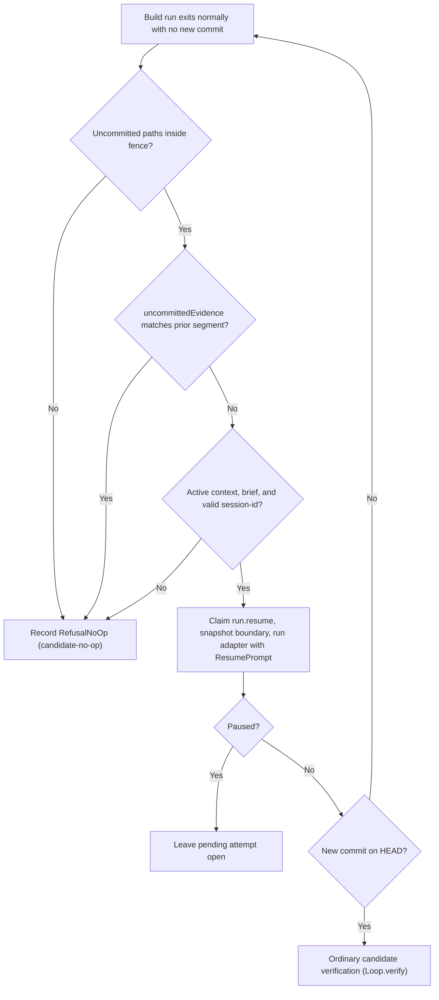

# Build-commit continuation — finishing uncommitted fenced work before settlement

**Status:** Verified 2026-11-20 against `bc8dda147`. UNMEASURED: verification
rests on the Go fixture suites; no live count of continued runs is recorded
here.

In a Git-landing store, a build worker's candidate is a commit on its lane
branch ahead of the run's base. When an eligible build run exits normally
without producing a new commit and leaves uncommitted changes inside its path
fence, `tillr-drain` continues the run in place on the same attempt — keeping
the run ID, lane, brief, and harness session — so the worker can finish
verification and make its single commit. Continuation repeats without a numeric
cap for as long as each segment changes the uncommitted work, and stops with a
no-commit refusal as soon as a segment leaves the worktree unchanged.

| Component | Lives in |
| :--- | :--- |
| Uncommitted-path, fence, and durable resume-claim checks | [`tools/tillr-drain/drain/commit_continuation.go`](../../tools/tillr-drain/drain/commit_continuation.go) (`uncommittedPaths`, `fencedUncommittedPaths`, `continuationStarted`) |
| Settlement gate, repeat guard, continuation launch, and refusal detail | [`tools/tillr-drain/drain/loop.go`](../../tools/tillr-drain/drain/loop.go) (`settle`, `segmentRepeated`, `forgetSegment`, `resumeAfterWall`, `runContinuation`, `fencePrefix`, `insideFence`) |
| Uncommitted-work content digest and worker-return routing | [`tools/tillr-drain/drain/returned.go`](../../tools/tillr-drain/drain/returned.go) (`uncommittedEvidence`, `endingEvidence`, `returnedCauses`) |
| Continuation prompt assembly and fresh-session fallback | [`tools/tillr-run/run/pause.go`](../../tools/tillr-run/run/pause.go) (`prepareContinuationSession`), [`tools/tillr-run/run/exec.go`](../../tools/tillr-run/run/exec.go) (`Exec`, `claimLane`) |

**Reads with:** [`tools/tillr-drain/README.md`](../../tools/tillr-drain/README.md)
(loop settlement, [refused-run return](../../tools/tillr-drain/README.md#a-refused-run-goes-back-to-its-worker),
and [preserved uncommitted work](../../tools/tillr-drain/README.md#earlier-uncommitted-work)),
[`tools/tillr-run/README.md`](../../tools/tillr-run/README.md)
([pausing and continuation](../../tools/tillr-run/README.md#pausing-a-live-run)
and [child environment](../../tools/tillr-run/README.md#child-environment)),
[judge and lifecycle](../design/tillr-judge-and-lifecycle.md#44-how-a-worker-runs-ending-moves-its-item-d-jl10)
(`D-JL10` uncounted worker endings and `ObstacleContract`),
[the run wall ruling](../design/run-wall-ruling.md#decision-ledger) (`D-RW3`
same-attempt wall continuation), and
[tillr item states](./tillr-item-states.md) (`in-queue` disposition and frozen
criteria).

---

## Terms

- **Attempt** — one dispatched execution of an item or workflow node under a
  single `run_id` and attempt number. Not a retry (which starts a new `run_id`
  on a subsequent pass) and not a backend failover (which resets the lane and
  moves to the next backend after an infrastructure failure).
- **Continuation segment** — an additional adapter invocation under the same
  `run_id`, recorded by a `run.resume` event rather than a new `runs` row,
  reusing the staged lane, brief, and (where the adapter supports resume)
  harness session.
- **Fence** — the list of repository-relative path prefixes staged for the run
  from the item's `allowed_paths`. Not the cross-lane write-boundary snapshot,
  which separately checks that a run did not modify sibling lanes or forbidden
  paths outside its worktree.
- **No-commit refusal** (`RefusalNoOp` / `candidate-no-op`) — the settlement
  refusal recorded when an answered worker run produces no new commit on its
  lane branch. Not a failing gate verdict (no acceptance criterion is judged)
  and not an infrastructure error.

---

## Invariants

1. **Same attempt, warm session, zero retry spend.** Continuation keeps the
   run's `run_id`, `item_id`, `lane_id`, staged brief, and session handle. It
   spends no retry authorization, triggers no backend failover, and does not
   increment `LoopResult.Candidates` unless a segment produces a commit that
   reaches `Loop.verify`.
2. **Only fenced uncommitted work qualifies.** At least one uncommitted path in
   the lane's target checkout must match the run's staged fence. Clean exits and
   exits whose uncommitted paths lie entirely outside the fence never continue.
3. **Uncounted progress, bounded by identical-repeat evidence.** There is no
   numeric cap on build-commit continuations. A run continues again after every
   dirty exit that changes its uncommitted paths or file bytes, and ends on the
   first continuation whose uncommitted paths and content digest match the state
   recorded before that segment ran (`Loop.segmentRepeated`).
4. **No verification rule is waived.** A commit produced on a continuation
   enters the exact same fence, workflow-evaluator, `tillr-gate`, and
   `tillr-land` path as a first-turn commit.
5. **Inspection errors fail closed.** Git query failures, unreadable fence
   files, and malformed session files surface as explicit errors rather than
   treating the checkout as clean or inventing a replacement session.

---

## Eligibility and exclusions

Build-commit continuation is evaluated inside `Loop.settle`
([`tools/tillr-drain/drain/loop.go`](../../tools/tillr-drain/drain/loop.go))
after the adapter process has exited. (Inside the `pi` adapter,
[`keep-going.ts`](../../tools/tillr-run/backends/pi/keep-going.ts) and
[`land.ts`](../../tools/tillr-run/backends/pi/land.ts) nudge or refuse
incomplete turns before the process exits; `Loop.settle` is the
adapter-independent supervisor check after exit.)

A run enters build-commit continuation only when all of the following hold:

- **Git-landing settlement (`!l.nonLanding`):** Hook-completed stores settle
  through `settleNode` or `settleHook` and never require a Git commit.
- **Candidate-producing build execution:** Single-worker runs
  (`decision.Workflow == nil`, including `single-worker@v1` and generated
  repairs) and final `commit_required` workflow runs that fall through
  `settleNode` / `finishWorkflow` reach this check, provided `decision.Seat` is
  `""` (the default build seat) or `"build"` and the item is not a review
  comment (`!item.IsCommentItem`).
- **No new commit (`noNewCommit`):** The target checkout's `HEAD` equals the
  lane's settlement base (`settleBase`), `decision.DesignContinuationHead`, or,
  for a turn returned to a retained worker session,
  `decision.Returned.WorkerSession.HeadSHA`.
- **Normal answered exit (`AttemptAnswered`):** `ClassifyAttempt` classifies the
  run as `AttemptAnswered` with `record.State == run.StateExited` and
  `record.EndCause == run.EndNormalExit`, and the run did not already route as a
  valid obstacle report (`routeObstacle` or `reportedBlock`). If a build worker
  writes prose without a valid `RESULT:` footer — or writes `RESULT: blocked`
  with missing `OBSTACLE:` fields (`workerEndingProblem`) — `Loop.settle`
  records `endingNote`, skips the blocked route, and still evaluates
  build-commit continuation when fenced uncommitted edits exist.
- **At least one fenced uncommitted path:** `uncommittedPaths` and
  `fencedUncommittedPaths` are both non-empty, and `segmentRepeated` is `false`.

| Case | Outcome instead of build-commit continuation |
| :--- | :--- |
| Clean normal exit with no new commit | Immediate `RefusalNoOp` (`candidate-no-op`) |
| Uncommitted edits exclusively outside the fence | Immediate `RefusalNoOp` naming all uncommitted paths |
| Design, plan, scout, review, verify, docs, edit, or test seats | Handled by seat-specific conflict, node, or `no-op` rules |
| Review-comment items (`item.IsCommentItem`) | Handled by `answerCommentWithoutCommit` or comment gate refusal |
| Read-only or `command` workflow stages leaving dirty files | Refused in `settleNode` as `RefusalFence` |
| Intermediate workflow stages (`next >= 0`) | Advanced to the next node by `settleNode` |
| Valid `RESULT: blocked` / `obstacle` tool report | Routed by `routeObstacle` or `reportedBlock` before `noNewCommit` |
| Wall-clock timeout with no commit (`AttemptUnjudged`) | Uses `resumeAfterWall` without `ResumePrompt` (capped at one continuation by `record.Resumed`) |
| Quota pause or quota window refusal | Handled by `resumeQuotaRun` or held as `StatePaused` |
| Signal interruption, orphan run, infrastructure failure, or `repeating-call` | Preserved and abandoned, failed over across backends, or restarted fresh |

---

## Worktree and fence inspection

`Loop.uncommittedPaths`
([`tools/tillr-drain/drain/commit_continuation.go`](../../tools/tillr-drain/drain/commit_continuation.go))
collects every uncommitted path in the lane's target directory (`laneTarget`) by
combining two NUL-delimited Git commands:

1. `git ls-files --modified --deleted --others --exclude-standard -z` — unstaged
   tracked edits, unstaged deletions, and individual untracked files (including
   files nested inside untracked directories), while omitting ignored build
   outputs.
2. `git diff --cached --no-renames --name-only -z` — staged index additions,
   modifications, deletions, and both the source and destination paths of staged
   renames.

NUL delimiting preserves whitespace and unusual characters in paths; the combined
slice is sorted and deduplicated.

`Loop.fencedUncommittedPaths` reads the lane's staged fence file (`FenceFile`)
into non-empty prefix entries (`fenceEntries`), prepends `Loop.fencePrefix`, and
retains paths matching `insideFence`:

- **Ordinary lane worktrees:** An ordinary worktree shares its resolved
  `--git-common-dir` with the loop's root (`sharesRepository` is `true`), so
  `fencePrefix` is empty and paths from Git are already repository-relative.
- **Fork checkouts:** A fork lane checkout sits under the repository root (for
  example under `.forks/lanes/<lane>/<fork>/`) with its own separate Git
  repository (`sharesRepository` is `false`). `fencePrefix` returns that
  checkout's slash-normalized relative prefix so `insideFence` compares against
  the repository-relative fence prefix staging wrote. If either repository's
  common directory cannot be resolved, `fencePrefix` returns `""`, which fails
  closed rather than matching fork paths against root prefixes by accident.
- **Prefix matching (`insideFence`):** Each fence entry matches the exact path
  or any file beneath `<entry>/`, whether or not the staged entry carries a
  trailing slash.

---

## Continuation loop, adapter handoff, and crash recovery

### Repeat detection

Before starting each continuation, `Loop.uncommittedEvidence`
([`tools/tillr-drain/drain/returned.go`](../../tools/tillr-drain/drain/returned.go))
computes a SHA-256 digest over `git diff HEAD --binary` followed by every
readable uncommitted file's `path + "\x00" + bytes`, formatted alongside the
sorted path list. `Loop.segmentRepeated` stores that string in the in-memory map
`Loop.segmentEvidence[runID]` and compares it against the value recorded right
before the previous continuation of `runID`:

- First dirty exit (`!seen`) or changed work (`previous != evidence`): stores the
  new evidence and returns `false` so continuation proceeds.
- Identical work (`seen && previous == evidence`): returns `true`, ending the
  continuation loop with `RefusalNoOp`. `Loop.forgetSegment` removes the
  `segmentEvidence[runID]` entry when settlement finishes.

> [!WARNING]
> Do not simplify `uncommittedEvidence` to `git diff HEAD` alone. `git diff HEAD`
> omits untracked files, so hashing only the tracked diff would treat a worker
> revising a new untracked file across turns as an identical repeat and cut off
> active work.

### Prompt, boundary bracket, and adapter modes

When continuation proceeds, `Loop.settle` sets `request.ResumePrompt` naming the
comma-separated fenced uncommitted paths, instructing the worker to preserve the
work, finish applicable verification (waiting for any checks still running),
make the one requested commit without bypassing failed checks or committing
outside the fence, and appending `ObstacleContract`
([`tools/tillr-drain/drain/obstacle.go`](../../tools/tillr-drain/drain/obstacle.go)).

`Loop.resumeAfterWall` delegates to `Loop.runContinuation`:

> [!WARNING]
> `resumeAfterWall` checks `record.Resumed` only when `request.ResumePrompt` is
> empty (`if record.Resumed && record.State != run.StatePaused && request.ResumePrompt == ""`).
> `runContinuation` sets `record.Resumed = true` after every resumed segment so
> wall-timeout continuations remain capped at one per `run_id`; gating a
> non-empty `ResumePrompt` on `record.Resumed` would reintroduce the retired
> one-continuation cap.

`runContinuation` verifies that the loop context is not cancelled, the staged
brief exists on disk, and `ReadSessionID` returns a non-empty valid UUID (an
absent file returns without resuming; a malformed file returns an error). It
takes a fresh write-boundary snapshot (`Loop.snapshot`) over the worktree and
watched sibling lanes, executes `runRestartable` with `Resume: true`, records
spend (`countSpend`, `recordSettlementSpend`), closes the async boundary bracket
(`closeAsyncBracket`), and calls `Loop.settle` recursively on the resumed
segment's `run.Record`.

Inside `run.Exec` ([`tools/tillr-run/run/exec.go`](../../tools/tillr-run/run/exec.go)
and [`pause.go`](../../tools/tillr-run/run/pause.go)):

- **Append-only transcript:** `openRunLog` opens `<lane-dir>/<run-id>.log` in
  append mode so earlier output and the resumed turn share one log.
- **Durable resume claim:** `claimLane` appends `run.resume` (`ResumeKind`) in
  the same store transaction that re-acquires the lane lease, before starting
  the child process.
- **Adapter prompt delivery (`prepareContinuationSession`):** Writes the prompt
  file passed in `TILLR_RESUME_PROMPT_FILE` and sets `TILLR_SESSION_MODE`:
  - **Resumable adapters** (default `pause-kind`, such as `pi`, `claude`, and
    `muse`): run with `TILLR_SESSION_MODE=resume` under the existing
    `session-id`, receiving `ResumePrompt`.
  - **Non-resumable adapters** (`pause-kind` set to `cannot-resume`, such as
    `agy`, or `req.FreshSession`): run with `TILLR_SESSION_MODE=new` under a
    newly minted v4 UUID written to `session-id` after `claimLane` succeeds,
    receiving `ResumePrompt`, the prior transcript path, `Worktree:`, any
    per-run `report.md` path, and the full staged `brief.md`.

### Pause, stop, and crash recovery

- **Paused continuation:** If a continuation exits in `run.StatePaused` (for
  example during a rolling restart or quota pause), `Loop.settle` leaves the
  pending attempt open rather than recording a refusal.
- **Pending state reconstruction (`readPendingHistory` in [`pass.go`](../../tools/tillr-drain/drain/pass.go)):**
  Each valid `run.resume` event on an unjudged run clears prior `Done`,
  `Orphaned`, and `Examining` flags in the folded pending state so a restarted
  loop settles the latest segment rather than dispatching a replacement run.
- **Killed continuation across loop restarts:** `Loop.continuationStarted` scans
  durable `run.resume` events matching `run_id`, `item_id`, `lane_id`,
  `backend`, a valid UUID `session_id`, and non-empty `resumed_at` even when the
  process died before writing `run.finish`. Because a replacement loop starts
  with an empty in-memory `segmentEvidence` map, it continues a killed
  continuation once more on recovery; `continuationStarted` still sets
  `record.Resumed = true` from durable history, and `segmentRepeated` ends the
  run if that recovered continuation leaves the worktree unchanged.

---

## Settlement after commit or refusal

- **When a continuation commits:** Recursive `Loop.settle` observes a changed
  `HEAD`, clears `segmentEvidence` on return, and hands the candidate to
  ordinary admission (`attachWorkflowJudge`, deferred `candidate.ready`, or
  `Loop.verify` through fence checking, `tillr-gate`, `tillr-land`, and
  `RecordVerdict`).
- **When no commit is produced:** `Loop.settle` emits a `drain.refusal` event at
  step `no-op` (`RefusalNoOp`, projected by the planner as `candidate-no-op`).
  Whenever `uncommittedPaths` is non-empty, `RefusalDetail` lists **all**
  uncommitted paths — both inside and outside the fence — followed by the exact
  reason continuation ended or did not run:
  - `repeated`: `"; the last continuation of its session left this work exactly as the one before it did, and no commit was produced"`
  - `record.Resumed` without `repeated`: `"; a continuation was started, but no commit was produced"`
  - No continuation started: `"; no commit continuation was available (requires an eligible build exit, brief and session, and no operator stop)"`
- **Preservation and worker return:** On `RefusalNoOp`, `endingEvidence` keys
  the refusal by `uncommittedEvidence`. `Loop.abandon` snapshots uncommitted
  working-tree and staged index bytes under `refs/tillr/preserved/<run-id>` via
  `Loop.preserveWork` ([`tools/tillr-drain/drain/preserved.go`](../../tools/tillr-drain/drain/preserved.go);
  retaining the lane via `retainUnpreserved` if preservation fails) before
  resetting the lane. Because `RefusalNoOp` is in `returnedCauses`
  ([`returned.go`](../../tools/tillr-drain/drain/returned.go)), the item keeps
  its unjudged criteria, stays `in-queue`, and returns to its worker on the next
  pass (`ReasonReturned`) with the refusal detail and preserved ref in its brief
  — escalating to the design seat only if two runs of the item produce the same
  ending key.

---

## What this does not do

- **Does not synthesize commits:** Only the worker commits; the drain never runs
  `git commit` on uncommitted worker edits.
- **Does not guard inside a live turn:** In-session turn nudges before adapter
  exit belong to harness extensions such as `pi`'s
  [`keep-going.ts`](../../tools/tillr-run/backends/pi/keep-going.ts).
- **Does not continue non-build or outside-fence work:** Design runs, evaluator
  or scout nodes, review-comment turns, and edits strictly outside the fence do
  not continue here.
- **Does not cold-start a missing session:** If `brief.md` or `session-id` is
  missing when settlement inspects the lane, `runContinuation` returns without
  launching a cold replacement build.

---

## Verification anchors

| Mechanism | Regression tests |
| :--- | :--- |
| Continuation commit landing vs unchanged-work `no-op` refusal and worker return | [`commit_continuation_test.go`](../../tools/tillr-drain/drain/commit_continuation_test.go), `TestDirtyExitContinuesBeforeNoCommitRefusal` |
| Uncounted multi-segment continuation while fenced work keeps changing | [`commit_continuation_test.go`](../../tools/tillr-drain/drain/commit_continuation_test.go), `TestDirtyExitContinuesForAsLongAsEachContinuationChangesTheWork` |
| Crash after `run.resume` before `run.finish` continued by replacement loop | [`commit_continuation_test.go`](../../tools/tillr-drain/drain/commit_continuation_test.go), `TestDirtyExitContinuesAKilledContinuationAgain` |
| Clean exit and missing `session-id` negative controls | [`commit_continuation_test.go`](../../tools/tillr-drain/drain/commit_continuation_test.go), `TestCleanExitDoesNotContinue`, `TestDirtyExitWithoutSessionNamesWork` |
| Staged renames, deletions, nested untracked files, whitespace paths, and outside-fence-only edits | [`commit_paths_test.go`](../../tools/tillr-drain/drain/commit_paths_test.go), `TestUncommittedPathsIncludesIndexWorktreeAndNestedUntracked`, `TestOutsideFenceDirtyExitDoesNotContinue` |
| Delivery of `ResumePrompt` to resumable and `cannot-resume` fresh-session adapters | [`pause_prompt_test.go`](../../tools/tillr-run/run/pause_prompt_test.go), `TestContinuationUsesOnlyThisRunsReportAndConsumesRestartNotice`; [`build_continuation_test.go`](../../tools/tillr-drain/drain/build_continuation_test.go), `TestBuildRestartContinuesCannotResumeBackendInFreshSessionAndJudgesOnce` |

---

## Current values

Verified at `bc8dda147`. The prose above explains how these identifiers and
files behave; this table is the single place their literal values are stated.

| Value | Setting | Defined in |
| :--- | :--- | :--- |
| Resume claim event kind | `"run.resume"` | `ResumeKind` in [`tools/tillr-run/run/schema.go`](../../tools/tillr-run/run/schema.go) |
| Pre-gate refusal event kind and no-commit step | `"drain.refusal"`, step `"no-op"` | `RefusalKind` in [`events.go`](../../tools/tillr-drain/drain/events.go), `RefusalNoOp` in [`refusal.go`](../../tools/tillr-drain/drain/refusal.go) |
| Planner hold / return reason for no commit | `"candidate-no-op"` | `ReasonCandidateNoOp` in [`schema.go`](../../tools/tillr-drain/drain/schema.go) |
| Eligible seats | `""` (default build) and `"build"` | `Loop.settle` in [`tools/tillr-drain/drain/loop.go`](../../tools/tillr-drain/drain/loop.go) |
| Staged lane files required to continue | `"brief.md"`, `"fence.txt"`, `"session-id"` (`0600` on rewrite) | `BriefFile`, `FenceFile` in [`stage.go`](../../tools/tillr-drain/drain/stage.go); `SessionIDFile` in [`exec.go`](../../tools/tillr-run/run/exec.go) |
| Non-resumable adapter capability value | `"cannot-resume"` in adapter `pause-kind` | `PauseCannotResume` in [`tools/tillr-run/run/pause.go`](../../tools/tillr-run/run/pause.go) |
| Continuation prompt file and mode (`0600`) | `<lane-dir>/durable/<run-id>/resume-prompt` | `prepareContinuationSession` in [`tools/tillr-run/run/pause.go`](../../tools/tillr-run/run/pause.go) |
| Child continuation environment variables | `TILLR_SESSION_MODE` (`"resume"` or `"new"`), `TILLR_RESUME_PROMPT_FILE` | `Exec` in [`tools/tillr-run/run/exec.go`](../../tools/tillr-run/run/exec.go) |
| Preserved uncommitted-work ref prefix | `"refs/tillr/preserved/"` | `Prefix` in [`tools/tillr-drain/preserved/record.go`](../../tools/tillr-drain/preserved/record.go) |

---

## Why it's this way

Each row preserves a design or owner decision that a maintainer reading only the
normative behavior above might otherwise undo.

| Decision | Why it stays |
| :--- | :--- |
| Continue immediately in `Loop.settle` on the same attempt *(designer's decision, 2026-11-17; open to owner overturn)* | Brief wording alone cannot force a worker to commit before ending; a deferred pause state would add scheduling states for an exited process; keeping the decision in `tillr-drain` settlement rather than `tillr-run` reuses the write-boundary bracket and spend accounting while keeping read-only, design, and comment runs out of build recovery. |
| Bound continuations by identical-repeat work evidence, never a count *(owner ruling, 2026-11-17, audit finding F-09; aligned with `D-JL10` in [judge and lifecycle](../design/tillr-judge-and-lifecycle.md#44-how-a-worker-runs-ending-moves-its-item-d-jl10))* | A fixed one-continuation cap discarded real multi-step progress when a worker needed one turn to finish edits and another to fix a failing test before committing; stopping only when a segment leaves paths and bytes unchanged prevents infinite loops without arbitrary cutoffs. |
| Read durable `run.resume` claims (`continuationStarted`, `readPendingHistory`) in addition to `run.finish` | A continued process can be killed after claiming its lane lease and before writing `run.finish`, leaving the initial exit as the latest terminal record; folding `run.resume` keeps pending attempt state and refusal diagnostics accurate across crashes. |
| Require a fenced path to continue, but list every uncommitted path on `no-op` refusal | Continuing for outside-fence-only edits would ask the worker to commit changes the fence check must reject, whereas omitting outside-fence paths from the `no-op` refusal detail would hide dirty worktree state from the returning worker and operator. |
