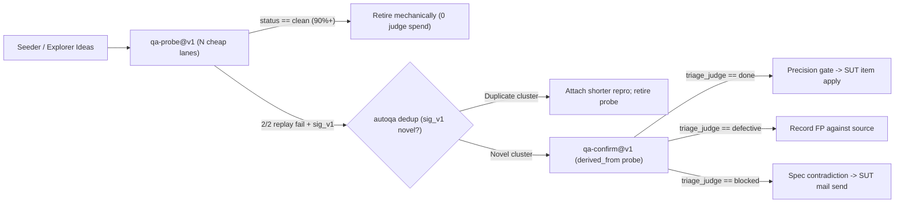

# Standalone AutoQA on the Tillr Contracts

> **Delivered copy.** This is `docs/design/tillr-autoqa.md` from this repository at commit `0cd2582789` (2026-11-17), copied into the tillr pack by `just pack-docs`. The [source](https://github.com/mschulkind-oss/tillr/blob/main/docs/design/tillr-autoqa.md) is authoritative and may be newer. Links to documents that were not delivered point at the repository, and the queue item directives in this copy are inert.

**Status:** 2026-11-14. Design in review, verified against `tools/tillr*`, [yolo-packs/tillr/pack.json](https://github.com/mschulkind-oss/tillr/blob/main/yolo-packs/tillr/pack.json), [config/tillr/seed-items.json](https://github.com/mschulkind-oss/tillr/blob/main/config/tillr/seed-items.json), and [tests/tillr-docs.test.py](https://github.com/mschulkind-oss/tillr/blob/main/tests/tillr-docs.test.py) at `HEAD` (`6851b49015`). Tree measurement confirms zero executable AutoQA code exists yet, while the general standalone CLI contracts from [autoqa-tillr-seams.md](https://github.com/mschulkind-oss/tillr/blob/main/docs/design/autoqa-tillr-seams.md) (`D-AQA2` in `2050271d4a`; `D-AQA3` and `D-AQA4` in `defecac1de`) are already built.

> **In short.** Do not embed AutoQA inside `tillr` and do not rewrite a second queue, runner, or UI beside `tillr`. Build AutoQA as a standalone, self-gated tool (`autoqa`) that runs its **own** isolated `tillr` store and lane pool over pre-approved [tillr-item-graphs.md](tillr-item-graphs.md) templates and [tillr-judge-and-lifecycle.md](tillr-judge-and-lifecycle.md) verdicts, banging cheap floor-model agents against read-only snapshots of any System Under Test (SUT) — starting with `tillr` itself — and exporting only deduplicated, deterministically reproducible, independently judged bugs under a hard false-positive precision governor.

**Why it matters.** Turning cheap agents loose against a system under test only pays off if three failure modes are structurally impossible:
- **Core debt leak:** QA-specific actors, claim classes, and prompts leaking into `tools/tillr*` and `yolo-packs/tillr` (which already happened once between `4fa6dbe36c` and `472440341c`).
- **Self-licking queue noise:** Explorer agents refilling the queue endlessly with trivial flag permutations or touching a live repository while `tillr-drain` holds `TakeBoundary`.
- **False-positive flooding:** Treating *"an agent said it found a bug"* as a bug, filing duplicate crashes from concurrent lanes, or burning expensive build lanes on hallucinated expectations.

**The shape.** A standalone `autoqa` CLI and optional pack (`yolo-packs/autoqa`) with zero reverse dependencies from `tools/tillr*`; dual-store isolation (AutoQA's private `tillr` store + `autoqa.db` dedup/precision ledger vs the SUT's untouched work board); a two-graph funnel (`qa-probe@v1` for cheap fan-out + mechanical replay, promoting unique hits into `qa-confirm@v1` for minimization + grant-backed W2 `evaluator_slot` triage); surface-saturation refill hysteresis; and a closed-loop precision circuit breaker.

**Cost.** One standalone Go module and optional pack for AutoQA, two pre-approved W1 graph templates (`qa-probe@v1`, `qa-confirm@v1`), one SUT target adapter for `tillr`, and one cleanup commit removing the accidental AutoQA surface from `tools/tillr-item/`, `yolo-packs/tillr/`, and the eight module READMEs. **Zero** new states, DAG primitives, or judge/grant rules inside `tillr` core.

**Needs your ruling:** [OQ-AQ2](#OQ-AQ2).

**Reads with:** [tillr-item-graphs.md](tillr-item-graphs.md) ([§3.1](tillr-item-graphs.md#31-named-versioned-graph-templates)–[§3.3](tillr-item-graphs.md#33-producer-bound-artifacts-exit-conditions-and-the-evaluator-slot), fixed upstream graph and `evaluator_slot` contract), [tillr-judge-and-lifecycle.md](tillr-judge-and-lifecycle.md) ([§2.1](tillr-judge-and-lifecycle.md#21-topology-relative-to-gate-and-land-d-jl1) and [§5](tillr-judge-and-lifecycle.md#5-core-boundary-for-external-autoqa-d-jl7), fixed upstream judge contract and `D-JL7` retirement of `ActorAutoQA`), [board-utilities.md](board-utilities.md) ([§5](board-utilities.md#5-independent-use-the-boundary-made-concrete), standalone utility boundaries), [tillr-distribution.md](tillr-distribution.md) ([§3](tillr-distribution.md#3-documentation-split-and-the-honesty-rule) and [§5](tillr-distribution.md#5-the-autoqa-handoff-through-the-pack)), and [tillr-idea-pipeline.md](tillr-idea-pipeline.md) ([§1](tillr-idea-pipeline.md#1-item-kinds-states-and-edges)–[§2](tillr-idea-pipeline.md#2-the-pipeline-and-one-writer-rules), `derived_from` lineage).

---

## 1. Existing Machinery and the Accidental Leak

### 1.1 What Already Exists at HEAD

Surveying the repository at `6851b49015` establishes what is already built and working versus what does not exist:

| Capability | Existing code or document | Measured status at `6851b49015` |
| :--- | :--- | :--- |
| **Standalone queue, runner, and read UI** | `tools/tillr-{store,item,run,drain,gate,land,view}` ([board-utilities.md](board-utilities.md) [§5](board-utilities.md#5-independent-use-the-boundary-made-concrete)) | **Built.** Every binary takes explicit `--store` / `--lane-root` / record inputs with zero global board coupling; AutoQA can drive its own private `tillr` instance directly over `PATH`. |
| **Standalone seams (`D-AQA2`–`D-AQA4`)** | [events.go](../../tillr-drain/drain/events.go) (`2050271d4a`); [tools/tillr-run/main.go](../../tillr-run/main.go) & [change.go](../../tillr-gate/change.go) (`defecac1de`) | **Built.** `ProcessSteps` publishes `boundary.check`, `gate.plan`, and `gate.verdict`; `tillr-run exec` propagates child exit codes while reserving `2/3/4/5`; `tillr-gate change` and `tillr-run request` exist as CLI faces. |
| **Fresh-store DDL registration** | [tools/tillr-store/main.go](../../tillr-store/main.go) ([autoqa-tillr-seams.md](https://github.com/mschulkind-oss/tillr/blob/main/docs/design/autoqa-tillr-seams.md) [§1.3](https://github.com/mschulkind-oss/tillr/blob/main/docs/design/autoqa-tillr-seams.md#13-the-real-coupling-the-stores-schema-is-a-function-of-who-opened-it)) | **Unchanged by design.** `tillr-store init` creates only `{meta, schema_migrations, events}`; read-only faces fail with missing-table errors until each owning utility opens the store in write mode. |
| **Pre-approved graphs & `evaluator_slot`** | [tillr-item-graphs.md](tillr-item-graphs.md), [tillr-judge-and-lifecycle.md](tillr-judge-and-lifecycle.md) | **Upstream W1/W2 contracts.** Supply `no_commit` read-only leaves, `command` leaves, typed run artifacts, and grant-backed `evaluator_slot` judging. |
| **AutoQA runner, idea refill, or bug dedup** | *(none across `tools/`, `yolo-packs/`, `config/`)* | **Absent.** Every current `autoqa` match in the tree is prose, doc comments, one stale seed row, or the retired store enums below. |

### 1.2 Why Embedding AutoQA in Tillr Failed

AutoQA entered [tillr-distribution.md](tillr-distribution.md) (`4fa6dbe36c`, 2026-11-12) as an *external* reviewer inspecting early binaries. Within forty-eight hours it leaked across `tillr` itself:

- [autoqa-handoff.md](https://github.com/mschulkind-oss/tillr/blob/main/yolo-packs/tillr/tasks/autoqa-handoff.md) first shipped as a pack `briefing`, instructing every agent in every workspace selecting `yolo-packs/tillr` to return design comments instead of doing its job, before being moved to `tasks/`.
- Post-hoc seam rulings added client-specific store enums directly into `tools/tillr-item/`: `ActorAutoQA` and `ClaimQAVerification` (`defecac1de`, from fanout commit `745b559ccd` `[unlanded]`, hardened in `761884b0bd`) plus `DecidedByAutoQA` (`472440341c` in [decision.go](../../tillr-item/item/decision.go) and [schema.go](../../tillr-item/item/schema.go)), while [seed-items.json](https://github.com/mschulkind-oss/tillr/blob/main/config/tillr/seed-items.json) still carries `item-decided-by-autoqa` as `in-queue` (`rank: "g"`) despite `472440341c` having already landed.
- All eight `tools/tillr-*/README.md` banners (pinned byte-identical by [tests/tillr-docs.test.py](https://github.com/mschulkind-oss/tillr/blob/main/tests/tillr-docs.test.py) at `04957a8a83`) warn that an unbuilt `tillr-autoqa` skill is missing, contradicting [tillr-distribution.md](tillr-distribution.md)'s still-unanswered [OQ-TD2](tillr-distribution.md#open-questions).

Per [tillr-judge-and-lifecycle.md](tillr-judge-and-lifecycle.md) ([§5](tillr-judge-and-lifecycle.md#5-core-boundary-for-external-autoqa-d-jl7), `D-JL7`), `ActorAutoQA`, `qa-verification`, and `DecidedByAutoQA` are retired. AutoQA is sectioned off completely below (`D-AQ1`).

---

## 2. The Sectioned-Off Boundary

### 2.1 Own Code, Own Pack, Own Gate, Zero Reverse Dependencies

AutoQA obeys a strict one-way dependency rule (`D-AQ1`): **AutoQA knows how to invoke `tillr` binaries on `PATH`; `tools/tillr*` and `yolo-packs/tillr` contain zero imports, enums, prompts, flags, or tests mentioning AutoQA.**

```text
yolo-packs/autoqa/                 (optional pack — never bundled into yolo-packs/tillr)
  pack.json                        (declares program `autoqa` + skill `autoqa-operating`)
  programs/autoqa/run              (digest-cached Go source launcher, same pattern as mq/tillr)
tools/autoqa/                      (own go.mod — ZERO `replace` links into ../tillr*)
  cmd/autoqa/                      (faces: init, seed, campaign, refill, dedup, export, status)
  graphs/                          (qa-probe@v1.json, qa-confirm@v1.json)
  targets/tillr/                   (first SUT target config + sandbox preparer)
  registry.json                    (AutoQA's own tillr-gate check registry)
```

- **Lives by itself ([OQ-AQ1](#61-decision-ledger)):** `tools/autoqa/go.mod` has no `replace` edge into `tools/tillr*`. Every interaction with `tillr` crosses documented CLI faces (`tillr-store`, `tillr-item`, `tillr-drain`, `tillr-run`, `tillr-view`) and versioned JSON envelopes. Extracting `tools/autoqa/` + `yolo-packs/autoqa/` into a standalone git repository at any point is a zero-code-change `git subtree split`.
- **Gated by itself:** When incubating in this repository, [tools/fork-check.py](https://github.com/mschulkind-oss/tillr/blob/main/tools/fork-check.py) plans `Check("autoqa", ...)` watching only `tools/autoqa/**` and `yolo-packs/autoqa/**`, while `PACK_SYNC_WATCHES` and `TILLR_DOCS_WATCHES` ignore both directories. Inside `tools/autoqa/`, `tillr-gate plan` + `tillr-gate run` over `tools/autoqa/registry.json` gates AutoQA's own changes (`go test ./...`, graph-template validation, and `yolo pack lint yolo-packs/autoqa`) with no store required ([OQ-AQA2](https://github.com/mschulkind-oss/tillr/blob/main/docs/design/autoqa-tillr-seams.md#OQ-AQA2) settled: `tillr-gate` stays store-free).
- **No core changes:** AutoQA adds **zero** item states, DAG node kinds, or judge/grant exceptions to `tillr`.

### 2.2 Two Stores and Sandboxed SUT Snapshots

AutoQA never shares a SQLite database, lane pool, or working tree with the System Under Test (`D-AQ2`):

| Surface | AutoQA's private runtime (`$XDG_STATE_HOME/autoqa/<campaign>/`) | SUT's live workspace (e.g. `/workspace`) |
| :--- | :--- | :--- |
| **Queue & execution store** | `state.db` (`tillr` store holding `qa-probe` and `qa-confirm` items, runs, and local QA judge grants) + `autoqa.db` (dedup signatures, surface saturation, precision ledger) | `/workspace/.tillr/state.db` — untouched during probing; written **only** on confirmed-bug export via `tillr item` |
| **Working tree & git refs** | Read-only SUT snapshot `<state_dir>/sut/<sut_sha>/` + throwaway per-probe scratch dirs | Live `/workspace` + `refs/heads/main` — **zero** reads/writes by QA lanes; `TakeBoundary` ([boundary.go](../../tillr-drain/drain/boundary.go)) never trips |
| **Observability** | Separate `tillr view serve --store <state_dir>/state.db` instance showing active probes and confirmations | Owner's main `tillr view serve` remains clean of unconfirmed QA noise |

**Deterministic store bootstrap (handling [autoqa-tillr-seams.md](https://github.com/mschulkind-oss/tillr/blob/main/docs/design/autoqa-tillr-seams.md) [§1.3](https://github.com/mschulkind-oss/tillr/blob/main/docs/design/autoqa-tillr-seams.md#13-the-real-coupling-the-stores-schema-is-a-function-of-who-opened-it) without modifying `tillr-store`).** Because `tillr-store init` registers only `{meta, schema_migrations, events}` and read-only faces (`show`, `lanes`, `list`) open `store.OpenReadOnly` without migrating, `autoqa init` initializes `<state_dir>/state.db` through owning write faces in sequence:
1. `tillr-store init` creates the substrate tables;
2. `tillr-item grant` issues AutoQA's local `verification-only` judge grant in `<state_dir>/state.db` (migrating `tillr-item`'s tables); and
3. `tillr-drain once` over an empty tick (plus a `/bin/true` smoke `tillr-run exec`) migrates `dispatches`, `lanes`, and `runs` before any probe dispatches.

**Dogfooding against `tools/tillr*` safely.** `autoqa target prepare --sut tillr --rev <sut_sha>` exports `<sut_sha>` via `git archive` and compiles all eight `tillr*` binaries once into `<state_dir>/sut-bin/<sut_sha>/` (digest-cached). Every cheap probe receives `PATH=<state_dir>/sut-bin/<sut_sha>:$PATH`, `BOARD_DB=""`, and a fresh empty `XDG_STATE_HOME` inside its probe sandbox, letting agents corrupt scratch SQLite files, kill leases mid-transaction, and fuzz CLI envelopes with zero path to `/workspace` or `/workspace/.tillr/state.db`.

**Crossing into the SUT board.** Per [tillr-judge-and-lifecycle.md](tillr-judge-and-lifecycle.md) `D-JL7`, AutoQA crosses into the SUT's `tillr` store exclusively through four standard faces:
- `tillr item apply` (`item.record`) to file a confirmed, deduplicated bug item;
- `tillr item verdict record` (`actor_kind: "mechanical"`, `actor: "autoqa/replay"`, `claim_class: "verification-only"`) when re-running a stored reproducer against a landed fix;
- `tillr item verdict record` (`actor_kind: "agent"`, `actor: "autoqa/triage"`, `judged_actor: "<producer>"`, `claim_class: "verification-only"`, backed by an unexpired `grant_id` in the SUT's `item_grants`) when delegated QA sign-off is explicitly granted; and
- `tillr item mail send` to escalate genuine spec contradictions to the owner or whale.

---

## 3. Queue, Fan-Out, and Refill Policy

### 3.1 Test-Idea Items and the Two-Graph Funnel

If every cheap probe ran an expensive minimizer and independent LLM judge inside one graph, AutoQA would waste judge tokens on the `90%+` of probes that find no bug and pay `K` times whenever `K` concurrent lanes hit the same panic. Instead, AutoQA runs **two pre-approved [tillr-item-graphs.md](tillr-item-graphs.md) templates** inside `<state_dir>/state.db` (`D-AQ3`), both using `requires_candidate: "no_commit"` so all `--lanes N` workers fan out concurrently without git fence contention:



1. **`qa-probe@v1` (cheap exploration + zero-token replay, `evaluator_slot: nil`):**
   - **`probe` (`agent`, cheap floor route, `access: "read_only"`, `timeout_ms: 300000`):** Exercises one falsifiable hypothesis against a named `(sut_module, sut_face, contract_ref)` inside the isolated SUT sandbox. Writes typed outputs under `.tillr/loop/<run_id>/artifacts/` ([tillr-item-graphs.md](tillr-item-graphs.md) [§3.3](tillr-item-graphs.md#33-producer-bound-artifacts-exit-conditions-and-the-evaluator-slot)): `probe_result.json` (`clean | suspect`, plus `<= 3` optional `proposed_ideas[]`) and, when `suspect`, a self-contained regression script `repro.sh`.
   - **`verify_repro` (`command`, `command_ref: "autoqa-replay"`, `access: "read_only"`, `timeout_ms: 60000`):** Zero model spend. If `clean`, exits `0` immediately. If `suspect`, executes `repro.sh` twice in fresh clean directories against `<sut_sha>`, extracts deterministic failure signature `sig_v1`, and records the outcome in `autoqa.db`. Only novel `2/2` deterministic reproducers spawn a child `qa-confirm@v1` item linked via `derived_from` ([tillr-idea-pipeline.md](tillr-idea-pipeline.md) [§1](tillr-idea-pipeline.md#1-item-kinds-states-and-edges)).
2. **`qa-confirm@v1` (minimization + independent W2 contract judge, `evaluator_slot: "triage_judge"`):**
   - **`minimize` (`agent`, `access: "read_only"`):** Shrinks `repro.sh` and fixture inputs to the smallest failing command sequence while preserving `sig_v1`.
   - **`replay_check` (`command`, `access: "read_only"`):** Verifies the minimized `repro.sh` fails `3/3` times deterministically with scrubbed environment and injected `--now` clock.
   - **`triage_judge` (`agent`, `role: "evaluator"`, `access: "read_only"`, `evaluator_slot`):** Fresh session on an independent judge route, backed by `<state_dir>/state.db`'s `verification-only` `item.grant` (`checkIndependence` enforced per [tillr-judge-and-lifecycle.md](tillr-judge-and-lifecycle.md) [§2.1](tillr-judge-and-lifecycle.md#21-topology-relative-to-gate-and-land-d-jl1)). Emits `eval.output` (`done` = confirmed contract violation; `defective` = false positive / valid refusal; `blocked` = spec contradiction).

Notice that both templates use pure static flattening (`D-IG4`), so AutoQA requires neither cycles nor Slice-2 in-fog `refine` ([OQ-IG2](tillr-item-graphs.md#71-decision-ledger)) to ship.

### 3.2 Seeding, Explorer Proposals, and Refill Throttling

Test ideas enter `<state_dir>/state.db` from two sources under strict **saturation hysteresis** *(coined here)* — a refill rule that bounds queue depth, lineage depth, and per-surface probe count relative to SUT code movement (`D-AQ4`):

- **Source A — Contract & Diff Seeder (`autoqa seed`):** Inspects SUT design docs, `--help` outputs, state schemas, and `git diff <last_tested_sha>..<sut_sha>`, seeding concrete hypotheses ranked `a..m` (prioritizing surfaces touched since `last_tested_sha`).
- **Source B — Explorer Side-Proposals (`proposed_ideas[]`):** Adjacent edge cases noticed during `probe` runs, admitted at lower rank `n..z` only after passing four mechanical filters in `autoqa refill`:
  1. **Watermark bounds:** Refill runs only when dispatchable `qa-probe@v1` items drop below `low_watermark = 2 * lanes` and caps admissions at `high_watermark = 6 * lanes`.
  2. **Tuple dedup & source mix:** Normalizes `(sut_module, sut_face, perturbation_class, hypothesis_tokens)` against `autoqa.db` to drop near-duplicates, and caps explorer proposals at `<= 50%` of any refill batch and `generation <= 2` (preventing multi-hop prompt drift).
  3. **Surface-saturation cooldown:** Once `(sut_module, sut_face)` accumulates `K = 15` consecutive `clean` probes at `<sut_sha>` with zero confirmed bugs, that surface enters **cooldown** until a new SUT commit modifies its watched paths.
  4. **Explicit campaign ceiling ([OQ-AQ3](#61-decision-ledger)):** Unlike an engineering backlog where the item pile is the sole throttle ([tools/tillr-drain/README.md](../../tillr-drain/README.md)), `autoqa campaign` enforces explicit `max_probes` and `max_wall_minutes` bounds (stopping early with `sut-saturated` when all target surfaces are in cooldown).

---

## 4. Confirmed Bugs, Deduplication, and False-Positive Economics

### 4.1 Four Gates Before a Finding Is a Confirmed Bug

An agent claiming *"I found a bug"* in prose has zero weight (`D-AQ5`). Cheap models routinely mistake documented negative-decision exits (`exit 1` rejection, `exit 2` usage error, `exit 3` schema incompatibility per [board-utilities.md](board-utilities.md) [§5.1](board-utilities.md#51-the-common-contract)) for defects, or violate stated preconditions such as `tillr-store init`'s three-table store. A finding becomes a **confirmed bug** only after clearing four gates:

1. **Regression-polarity executable reproducer:** `repro.sh` runs hermetically (no LLM calls, no network, fixed `--now` clock, throwaway dir), exiting `1` when the bug is present on `<sut_sha>`, `0` once the SUT satisfies its contract, and `125` on harness setup error. When exported to the SUT board, `repro.sh` **is** the ready-made negative control for the eventual fix.
2. **Deterministic `3/3` replay (`replay_check`):** Any `0` exit, `125` setup error, wall timeout, or shifting failure locus across three fresh runs rejects the finding mechanically as `flaky-or-unreproduced`.
3. **Novel cluster check (`autoqa dedup`):** Must not match any open, confirmed, or previously rejected false-positive cluster in `autoqa.db` or the SUT store.
4. **Independent W2 contract triage (`triage_judge`):** Verifies that `repro.sh` respected all documented preconditions of the SUT face and violated an explicit invariant in code, `--help`, or an accepted design doc. Valid refusals and invented expectations are ruled `defective`; genuine doc-vs-binary contradictions are ruled `blocked` and routed to `tillr item mail send` rather than filed as code bugs.

### 4.2 Two-Stage Cross-Agent Deduplication

Concurrent cheap agents frequently trigger the same underlying defect via different inputs. `autoqa.db` deduplicates at two points before touching the SUT board (`D-AQ5`):

- **Stage 1 — Pre-confirmation mechanical signature (`sig_v1` in `verify_repro`):** Hashes `(sut_binary, sut_face, failure_kind, locus_key)` after stripping dynamic values, temp paths, timestamps, UUIDs, and commit SHAs:
  - *Go panic / crash (`exit 2` runtime panic or `exit 5`):* top three in-repo stack frames (`pkg.Func` + file basename, line numbers stripped).
  - *Structured `tillr` refusal/envelope defect:* `(record.kind, payload.rule, exit_code)` or normalized first stderr template line.
  - *Store/view invariant mismatch:* `(invariant_name, table_or_field)`.
  Concurrent hits sharing `sig_v1` collapse into **one** cluster before `qa-confirm@v1` spawns, retaining the shortest `repro.sh` by byte length.
- **Stage 2 — Post-minimization locus & tombstone check (`autoqa export`):** After `minimize` and `triage_judge`, `autoqa.db` keys the cluster by `(sut_module, implicated_symbol_or_rule)` alongside `sig_v1`, checks both active exports and **false-positive tombstones** (so a rejected non-bug is never re-filed by a later campaign at the same `<sut_sha>`), and queries the SUT store (`tillr view status`) to guarantee **at most one SUT item per root defect**.

### 4.3 Precision Accounting and the Throttling Ladder

Every false positive exported onto `/workspace/.tillr/state.db` costs human triage or wastes a `15–30m` build lane plus a full `just done` cycle. AutoQA therefore governs itself by **board precision** *(coined here)* — the rolling fraction of exported AutoQA items on the SUT board that resolve as real fixes rather than `defective` closures (`D-AQ6`):

$$P_{\text{board}} = \frac{N_{\text{landed}} + N_{\text{resolved-elsewhere}}}{N_{\text{landed}} + N_{\text{resolved-elsewhere}} + N_{\text{closed-defective}}}$$

`autoqa status` polls exported `item_id`s on the SUT store over a rolling window of the last `20` resolved items (alongside internal judge pass rate $P_{\text{internal}}$ per seeder/prompt template) and enforces a three-rung automatic throttle:

| Rung | Condition on SUT outcomes | Automatic mechanical action |
| :--- | :--- | :--- |
| **1. Normal** | $P_{\text{board}} \ge 0.80$ (and $< 2$ consecutive `FP` closures) | Refill and export proceed under [OQ-AQ2](#OQ-AQ2)'s configured target state (`not-started` during bootstrap; `in-queue` at rank `z..` once calibrated). |
| **2. Tighten** | $0.60 \le P_{\text{board}} < 0.80$ **or** `2` consecutive `FP` closures | Disables explorer-generated refill (Source B off), forces all new exports to `state: "not-started"`, and injects the rejected `FP` cases as negative examples into `triage_judge`'s brief. |
| **3. Circuit-Breaker Halt** | $P_{\text{board}} < 0.60$ (over $\ge 5$ resolved exports) **or** `3` consecutive `FP` closures | Halts SUT exports and pauses `autoqa campaign` (`autoqa-precision-halt`), sending **one** `tillr item mail send` summary naming the rejected items until recalibrated. |

---

## 5. Disposition of Existing AutoQA Artifacts

### 5.1 Artifact Disposition Ledger

Every accidental AutoQA artifact currently in this repository receives an explicit `keep`, `migrate-into-autoqa`, or `delete / retire` ruling (`D-AQ7`):

| Artifact / Symbol | Current location | Ruling | Exact action & gate impact |
| :--- | :--- | :--- | :--- |
| **Pack handoff brief** | [yolo-packs/tillr/tasks/autoqa-handoff.md](https://github.com/mschulkind-oss/tillr/blob/main/yolo-packs/tillr/tasks/autoqa-handoff.md) | **Delete** | Delete file; its one-time seam review completed on 2026-11-13 in [autoqa-tillr-seams.md](https://github.com/mschulkind-oss/tillr/blob/main/docs/design/autoqa-tillr-seams.md). |
| **Pack manifest description** | [yolo-packs/tillr/pack.json](https://github.com/mschulkind-oss/tillr/blob/main/yolo-packs/tillr/pack.json) | **Keep pack; delete AutoQA text** | Trim `"and the AutoQA design-review handoff"` from `description`; keep the 8 `program` entries, `files`, and `skills` untouched. |
| **Unbuilt `tillr-autoqa` skill** | [tillr-distribution.md](tillr-distribution.md) [§5](tillr-distribution.md#5-the-autoqa-handoff-through-the-pack), [OQ-TD2](tillr-distribution.md#open-questions) | **Delete / supersede** | Resolve [OQ-TD2](tillr-distribution.md#open-questions) as superseded: `yolo-packs/tillr` ships only [SKILL.md](https://github.com/mschulkind-oss/tillr/blob/main/yolo-packs/tillr/skills/tillr-operating/SKILL.md) (`tillr-operating`); AutoQA ships in `yolo-packs/autoqa`. |
| **Known Gap #1 in all 8 module READMEs** | [tools/tillr-drain/README.md](../../tillr-drain/README.md) + 7 sibling `tools/tillr-*/README.md`s + `yolo-packs/tillr/files/` mirror | **Delete Gap #1** | Remove bullet #1 (*"The AutoQA handoff skill is not shipped"*), re-stamp all 8 banners identically so [tests/tillr-docs.test.py](https://github.com/mschulkind-oss/tillr/blob/main/tests/tillr-docs.test.py) (`case_callout`) passes, and run `just pack-sync` for [tests/pack-sync.test.py](https://github.com/mschulkind-oss/tillr/blob/main/tests/pack-sync.test.py). |
| **Seam doc & `D-AQA1`** | [autoqa-tillr-seams.md](https://github.com/mschulkind-oss/tillr/blob/main/docs/design/autoqa-tillr-seams.md) (`D-AQA1`, [OQ-AQA1](https://github.com/mschulkind-oss/tillr/blob/main/docs/design/autoqa-tillr-seams.md#OQ-AQA1)) | **Supersede doc; retire `D-AQA1`** | Mark [autoqa-tillr-seams.md](https://github.com/mschulkind-oss/tillr/blob/main/docs/design/autoqa-tillr-seams.md) `stage: SUPERSEDED` (`superseded-by: tillr-autoqa.md`); `D-AQA1` is superseded by `D-JL7` and this document. |
| **Standalone seams `D-AQA2`–`D-AQA4`** | [events.go](../../tillr-drain/drain/events.go) (`2050271d4a`), [tools/tillr-run/main.go](../../tillr-run/main.go) & [change.go](../../tillr-gate/change.go) (`defecac1de`), [tillr-loop](https://github.com/mschulkind-oss/tillr/blob/main/tools/tillr-loop/tillr-loop) | **Keep in `tillr` core** | Already built and general-purpose: loop-emitted `gate.*` events (`tillr-gate` stays store-free, settling [OQ-AQA2](https://github.com/mschulkind-oss/tillr/blob/main/docs/design/autoqa-tillr-seams.md#OQ-AQA2)), `run exec` exit propagation, and `gate change` / `run request` faces stay in `tillr`. |
| **General trace & land-attempt seed items** | [seed-items.json](https://github.com/mschulkind-oss/tillr/blob/main/config/tillr/seed-items.json) (`item-trace-correlation` rank `6`, `item-land-attempt-event` rank `7`) | **Keep in `tillr` queue** | General observability improvements for `tillr-view events`, not AutoQA couplings; repoint `design_doc` when superseding [autoqa-tillr-seams.md](https://github.com/mschulkind-oss/tillr/blob/main/docs/design/autoqa-tillr-seams.md). |
| **`ActorAutoQA`, `qa-verification`, `DecidedByAutoQA`** | [verdict.go](../../tillr-item/item/verdict.go), [grant.go](../../tillr-item/item/grant.go), [decision.go](../../tillr-item/item/decision.go), [schema.go](../../tillr-item/item/schema.go) + pack mirror (`472440341c`) | **Retire from writable sets** | Per [tillr-judge-and-lifecycle.md](tillr-judge-and-lifecycle.md) `D-JL7`, refuse on new writes (`actor-retired`) while keeping legacy rows readable; update `verdict_test.go` / `decision_test.go` and run `just pack-sync`. |
| **Stale `item-decided-by-autoqa` seed row** | [seed-items.json](https://github.com/mschulkind-oss/tillr/blob/main/config/tillr/seed-items.json) (`in-queue`, `rank: "g"`) | **Close** | Close in seed and store (`close_reason: "superseded by D-JL7 and tillr-autoqa.md; DecidedByAutoQA retired"`). |

### 5.2 Dogfood Rollout Against Tillr

1. **Slice 1 — Core cleanup (`tools/tillr*`, `yolo-packs/tillr/`, `config/tillr/`):** Execute the retirements and README/pack-sync cleanup in [§5.1](#51-artifact-disposition-ledger) alongside W2's `D-JL7` commit, leaving `tools/tillr*` with zero AutoQA-specific writable vocabulary.
2. **Slice 2 — Standalone `autoqa` skeleton & self-gate (`tools/autoqa/`, `yolo-packs/autoqa/`):** Land `autoqa init`, `autoqa target prepare --sut tillr`, `autoqa-replay`, `sig_v1` deduplication in `autoqa.db`, `qa-probe@v1` / `qa-confirm@v1` templates, and `tools/autoqa/registry.json`.
3. **Slice 3 — First bounded campaign against `tools/tillr*`:** Seed 25 contract hypotheses across `tillr-{store,item,land,drain,run,gate,view}` (carrying carry-conflict, lease-expiry, rank, and malformed-envelope probes), run one `50`-probe campaign against a pinned `<sut_sha>` snapshot, and review exported `not-started` findings in Vantage / Observatory.
4. **Slice 4 — Precision graduation:** Once `20` judged findings sustain $P_{\text{board}} \ge 0.85$ ([OQ-AQ2](#OQ-AQ2)), enable autonomous `in-queue` filing at back-of-queue rank `z..`.

---

## 6. Decisions, Open Questions, and Amendments Owed

### 6.1 Decision Ledger

| ID | Ruling | Why |
| :--- | :--- | :--- |
| `D-AQ1` | Build AutoQA as a standalone CLI and optional pack (`yolo-packs/autoqa`) with zero Go `replace` imports, zero schema/enum couplings, and disjoint gate `watches` from `tools/tillr*` and `yolo-packs/tillr`. | Satisfies *"lives by itself, gated by itself, develops by itself"* and makes later repository extraction a zero-code-change move ([OQ-AQ1](#61-decision-ledger)). |
| `D-AQ2` | Run AutoQA over its own private `tillr` store and `autoqa.db` ledger against read-only, digest-cached SUT snapshots, crossing into the SUT's `tillr` store solely via `item apply`, `mechanical` or grant-backed `agent` `verdict record`, and `mail send`. | Reuses `tillr`'s queue, runner, and observatory without polluting the SUT's `QueueRail` or tripping `TakeBoundary`, honoring [tillr-judge-and-lifecycle.md](tillr-judge-and-lifecycle.md) `D-JL7`. |
| `D-AQ3` | Split execution into two static `no_commit` W1 graphs in AutoQA's store: `qa-probe@v1` (cheap fan-out + zero-token `2/2` replay + `sig_v1` dedup) promoting novel reproducers via `derived_from` into `qa-confirm@v1` (minimization + `3/3` replay + W2 `evaluator_slot` `triage_judge`). | Eliminates judge/minimizer token spend on clean probes (`90%+`) and concurrent duplicate crashes while working immediately on W1 Slice-1 static flattening. |
| `D-AQ4` | Govern queue refill by low/high watermarks (`2 * lanes` / `6 * lanes`), tuple dedup, explorer caps (`<= 50%` batch share, `generation <= 2`), per-surface saturation cooldown (`15` clean probes until SUT paths move), and explicit campaign ceilings. | Prevents cheap explorer agents from turning the test-idea queue into an unbounded self-licking token sink ([OQ-AQ3](#61-decision-ledger)). |
| `D-AQ5` | Require four gates for a confirmed bug — regression-polarity `repro.sh`, `3/3` hermetic replay, two-stage signature/locus deduplication (`sig_v1` + post-minimization tombstone check), and an independent grant-backed `triage_judge` ruling — routing spec contradictions to `mail send`. | Rejects prose-only claims, flaky failures, valid exit-`1/2/3` refusals, and duplicate multi-lane hits before any item reaches the SUT board. |
| `D-AQ6` | Track rolling SUT board precision $P_{\text{board}}$ in `autoqa.db` and enforce a three-rung throttle (`>= 0.80` normal; `0.60..0.80` or `2` FPs pause explorer refill + force `not-started`; `< 0.60` or `3` FPs halt exports and campaign). | Protects expensive SUT build lanes and human attention from miscalibrated prompts without manual babysitting ([OQ-AQ2](#OQ-AQ2)). |
| `D-AQ7` | Delete [autoqa-handoff.md](https://github.com/mschulkind-oss/tillr/blob/main/yolo-packs/tillr/tasks/autoqa-handoff.md), the unbuilt `tillr-autoqa` skill ([OQ-TD2](tillr-distribution.md#open-questions)), and README Known Gap #1; supersede [autoqa-tillr-seams.md](https://github.com/mschulkind-oss/tillr/blob/main/docs/design/autoqa-tillr-seams.md) while keeping `D-AQA2`–`D-AQA4` in `tillr` core; retire `ActorAutoQA` / `qa-verification` / `DecidedByAutoQA`; and close `item-decided-by-autoqa`. | Disposes of every accidental AutoQA artifact in `tillr` while preserving the general standalone CLI contracts already built at `6851b49015`. |
| OQ-AQ1 | AutoQA starts in this repository, in its own tool and pack directories with no shared Go module, and is split out once dogfooding settles. **Rejected:** a separate repository from the first commit. | The owner builds tools for one user but shaped so they could be shared; tillr itself was incubated here the same way. Settled on 2026-11-15 by the session's designer on recorded principle, at the owner's request to answer what principle can answer; the owner may overturn it. |
| OQ-AQ3 | A campaign is a bounded pass by default: it stops at its probe count, its time limit, or when the surfaces are saturated. Running continuously is an option a repository turns on. **Rejected:** a daemon that wakes on every trunk move by default. | The drain has no spend ceiling yet, and every tillr option that spends or publishes unasked is off by default ([the restart design](tillr-restart.md#the-settings-file)). Settled on 2026-11-15 by the session's designer on recorded principle, at the owner's request to answer what principle can answer; the owner may overturn it. |

### 6.2 Open Questions

2. 💬 **[OQ-AQ2](#OQ-AQ2): When AutoQA confirms a bug against `tillr`, should it file the item on `/workspace/.tillr/state.db` in `not-started` first or directly in `in-queue`?**

   Autonomous `in-queue` filing dispatches real `/workspace` build lanes (`15–30m` + `just done`), whereas `not-started` holds confirmed reproducers for one-command whale/owner promotion ([§4.3](#43-precision-accounting-and-the-throttling-ladder)).

   - **Option A — File as `not-started` until `20` judged findings sustain $P_{\text{board}} \ge 0.85$, then graduate to `in-queue` at rank `z..`:** Earns autonomous build-lane spend empirically.
   - **Option B — File directly as `in-queue` at back-of-queue rank `z..` from day one:** Fully unattended bug-to-fix loop immediately, relying on the $P_{\text{board}} < 0.80$ throttle to demote to `not-started` if false positives appear.

   <!-- vantage: question id=OQ-AQ2 leaning="Option A — stage confirmed bugs as not-started until 20 triaged findings sustain >= 85% board precision, then unlock autonomous in-queue filing at rank z.." -->

   _Leaning:_ Option A — calibrates `triage_judge` on real `tillr` findings before spending unattended `/workspace` build lanes.

   **Answer:**

   > _(empty — fill in when decided)_

### 6.3 Amendments Owed

Once this document reaches `stage: DECIDED`, three tracked documents owe targeted updates alongside Slice 1 ([§5.2](#52-dogfood-rollout-against-tillr)):

1. **[autoqa-tillr-seams.md](https://github.com/mschulkind-oss/tillr/blob/main/docs/design/autoqa-tillr-seams.md):** Transition frontmatter to `stage: SUPERSEDED` and `superseded-by: tillr-autoqa.md`, noting `D-AQA1` retired by `D-JL7` / `D-AQ7`, [OQ-AQA2](https://github.com/mschulkind-oss/tillr/blob/main/docs/design/autoqa-tillr-seams.md#OQ-AQA2)'s designer review settled in favor of keeping `tillr-gate` store-free, and `D-AQA2`–`D-AQA4` graduated into built `tillr` contracts.
2. **[tillr-distribution.md](tillr-distribution.md) ([§5](tillr-distribution.md#5-the-autoqa-handoff-through-the-pack) and [OQ-TD2](tillr-distribution.md#open-questions)):** Record [OQ-TD2](tillr-distribution.md#open-questions) superseded by `D-AQ1` / `D-AQ7` (`yolo-packs/tillr` ships only `tillr-operating`; AutoQA lives in `yolo-packs/autoqa`).
3. **Eight `tools/tillr-*/README.md` banners (and `yolo-packs/tillr/files/` via `just pack-sync`):** Remove Known Gap #1 under one shared verification stamp so [tests/tillr-docs.test.py](https://github.com/mschulkind-oss/tillr/blob/main/tests/tillr-docs.test.py) and [tests/pack-sync.test.py](https://github.com/mschulkind-oss/tillr/blob/main/tests/pack-sync.test.py) remain green.

## Queue item

This design is on [the tillr roadmap](../tillr/roadmap.md), so it has an item in the queue. While
a question above is open the item is held and names that question as what it waits on, which is
how the design shows up beside the rest of the work instead of only on the roadmap page.

### Cut the AutoQA design into build items

<!-- inert copy of a tillr directive: item id="item-design-autoqa-slices" seat="design" paths="docs/design/tillr-autoqa.md,docs/tillr/roadmap.md" -->

- **c1:** Every question in this document is answered and folded into its body and decision ledger, its frontmatter says `status: accepted` and `stage: DECIDED`, and `uvx vantage-check` on it reports nothing.
- **c2:** The document ends with a build order of item blocks, each small enough for one run inside one path fence, each with criteria a test can check, and each naming the items it waits on in `blocked_by`.
- **c3:** The first block proves the smallest end-to-end slice of the design and waits on nothing in this document.
- **c4:** [The tillr roadmap](../tillr/roadmap.md) no longer lists this design as waiting on a ruling.

