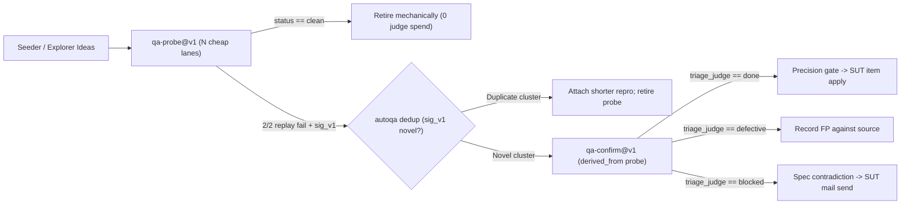

# Standalone AutoQA on the Tillr Contracts

> **Delivered copy.** This is `docs/design/tillr-autoqa.md` from this repository at commit `0275c51d52` (2026-11-24), copied into the tillr pack by `just pack-docs`. The [source](https://github.com/mschulkind-oss/tillr/blob/main/docs/design/tillr-autoqa.md) is authoritative and may be newer. Links to documents that were not delivered point at the repository, and the queue item directives in this copy are inert.

**Status:** Iceboxed by the owner: the design is parked on [the tillr roadmap's Icebox](../tillr/roadmap.md#icebox), neither abandoned nor accepted, and nothing below is being built. No AutoQA code exists: `rg -il autoqa tools -g '*.go'` finds only the code and tests that refuse the retired store vocabulary. The owner has ruled on nothing in this document: every row of its [ledger](#decision-ledger) is a designer's decision.

> **In short.** Do not embed AutoQA inside `tillr` and do not write a second queue, runner, or UI beside `tillr`. Build AutoQA as a standalone, self-gated tool (`autoqa`) that runs its **own** isolated `tillr` store and lane pool, bangs cheap agents against read-only snapshots of a System Under Test (SUT), starting with `tillr` itself, and exports only deduplicated, deterministically reproducible, independently judged bugs under a hard false-positive governor.

**Why it matters.** Turning cheap agents loose against a system under test only pays off if three failure modes are structurally impossible:

- **Core debt leak:** QA-specific actors, claim classes, and prompts inside `tools/tillr*` and `yolo-packs/tillr`.
- **Self-licking queue noise:** explorer agents refilling the queue endlessly with trivial flag permutations, or touching a live repository while `tillr-drain` holds its take boundary.
- **False-positive flooding:** treating "an agent said it found a bug" as a bug, filing duplicate crashes from concurrent lanes, or spending build lanes on hallucinated expectations.

**The shape.** A standalone `autoqa` CLI and optional pack (`yolo-packs/autoqa`) with zero reverse dependencies from `tools/tillr*`; two stores (AutoQA's private `tillr` store plus an `autoqa.db` ledger, and the SUT's untouched `tillr` store); a two-workflow funnel (`qa-probe@v1` for cheap fan-out and mechanical replay, promoting unique hits into `qa-confirm@v1` for minimization and triage by a judge); refill bounded by surface saturation; and a precision circuit breaker.

**Cost.** A second tillr store and a second tool to keep working, and the cleanup of what refers to AutoQA inside tillr ([§5](#5-disposition-of-existing-autoqa-artifacts)). It adds no state, no graph primitive and no judge rule to tillr itself.

**Needs your ruling:** None while the design is iceboxed. [OQ-AQ2](#OQ-AQ2) is blocked until the owner picks the design up.

**Reads with:** [item graphs](../reference/tillr-item-graphs.md) ([workflows](../reference/tillr-item-graphs.md#workflows-selection-and-expansion), [producer-bound artifacts](../reference/tillr-item-graphs.md#producer-bound-artifacts) and [the workflow evaluator](../reference/tillr-item-graphs.md#workflow-evaluator)), [the judge and lifecycle](tillr-judge-and-lifecycle.md) (the judge contract, and `D-JL7`, which keeps AutoQA vocabulary out of the store), [board utilities](board-utilities.md) (the standalone utility boundaries), [tillr distribution](tillr-distribution.md) (the pack), and [the idea pipeline](tillr-idea-pipeline.md) (`derived_from` lineage).

**Words.** A **System Under Test (SUT)** is the program AutoQA probes; the first is tillr. A **workflow** is a tracked graph of nodes an item runs through, defined by [item graphs](../reference/tillr-item-graphs.md). An **evaluator slot** is the place in a workflow where a judge node sits. [The vocabulary](https://github.com/mschulkind-oss/tillr/blob/main/docs/design/tillr-vocabulary.md#5-the-words) defines item, node, judge, gate and lane.

---

## 1. Existing Machinery

### 1.1 What Already Exists at HEAD

| Capability | Where | Status |
| :--- | :--- | :--- |
| **Standalone queue, runner, and read UI** | `tools/tillr-{store,item,run,drain,gate,land,view}` ([board utilities](board-utilities.md)) | **Built.** Every binary takes explicit store, lane-root and record inputs, so AutoQA can drive a private `tillr` instance over `PATH`. |
| **Gate events and CLI faces** | [events.go](../../tillr-drain/drain/events.go), [tools/tillr-run/main.go](../../tillr-run/main.go), [change.go](../../tillr-gate/change.go) | **Built.** The drain publishes `boundary.check`, `gate.plan` and `gate.verdict`; `tillr-run exec` propagates the child's exit code; `tillr-gate change` and `tillr-run request` exist as CLI faces. |
| **Fresh-store schema** | [tools/tillr-store/main.go](../../tillr-store/main.go) | **Built.** `tillr-store init` creates the full schema (`tools/tillr-store/init_schema_test.go`), so read-only faces exit `0` on a freshly initialized store. |
| **Workflows and the evaluator slot** | [item graphs](../reference/tillr-item-graphs.md), [the judge and lifecycle](tillr-judge-and-lifecycle.md) | **Built.** Workflows supply `no_commit` read-only agent nodes, `command` nodes, typed run artifacts, and an evaluator step that declares the criterion classes it can judge in `judge_classes`. |
| **AutoQA runner, idea refill, or bug dedup** | none | **Absent.** Every `autoqa` match under `tools/` is prose, a doc comment, or the code and tests that refuse the retired store vocabulary. |

### 1.2 What Refers to AutoQA Inside Tillr

Three things in tillr name AutoQA, and each is a coupling this design removes ([§5.1](#51-artifact-disposition-ledger)):

- **A handoff brief in the tillr pack,** [autoqa-handoff.md](https://github.com/mschulkind-oss/tillr/blob/main/yolo-packs/tillr/tasks/autoqa-handoff.md), under `tasks/`.
- **Retired vocabulary in the item store.** An `autoqa` actor kind, a `qa-verification` claim class and an `autoqa` decider are refused on new writes and stay readable in old rows.
- **A warning in each of the eight module READMEs** that an AutoQA handoff skill is not shipped.

---

## 2. The Sectioned-Off Boundary

### 2.1 Own Code, Own Pack, Own Gate, Zero Reverse Dependencies

AutoQA obeys a strict one-way dependency rule (`D-AQ1`): **AutoQA knows how to invoke `tillr` binaries on `PATH`; `tools/tillr*` and `yolo-packs/tillr` contain zero imports, enums, prompts, flags, or tests mentioning AutoQA.**

```text
yolo-packs/autoqa/                 (optional pack — never bundled into yolo-packs/tillr)
  pack.json                        (declares program `autoqa` + skill `autoqa-operating`)
  programs/autoqa/run              (digest-cached Go source launcher, same pattern as tillr)
tools/autoqa/                      (own go.mod — ZERO `replace` links into ../tillr*)
  cmd/autoqa/                      (faces: init, seed, campaign, refill, dedup, export, status)
  workflows/                       (qa-probe@v1.json, qa-confirm@v1.json)
  targets/tillr/                   (first SUT target config + sandbox preparer)
  registry.json                    (AutoQA's own tillr-gate check registry)
```

- **Lives by itself ([OQ-AQ1](#decision-ledger)):** `tools/autoqa/go.mod` has no `replace` edge into `tools/tillr*`. Every interaction with `tillr` crosses documented CLI faces and versioned JSON envelopes, so moving the two directories into a repository of their own changes no code.
- **Gated by itself:** While it lives in this repository, the repository gate plans one `autoqa` check watching only `tools/autoqa/**` and `yolo-packs/autoqa/**`, and the pack-sync and tillr-docs checks ignore both directories. Inside `tools/autoqa/`, `tillr-gate plan` and `tillr-gate run` over `tools/autoqa/registry.json` gate AutoQA's own changes with no store required.
- **No core changes:** AutoQA adds **zero** item states, graph node kinds, or judge exceptions to `tillr`.

### 2.2 Two Stores and Sandboxed SUT Snapshots

AutoQA never shares a SQLite database, lane pool, or working tree with the System Under Test (`D-AQ2`):

| Surface | AutoQA's private runtime (`$XDG_STATE_HOME/autoqa/<campaign>/`) | The SUT's live workspace |
| :--- | :--- | :--- |
| **Queue and execution store** | `state.db` (a `tillr` store holding `qa-probe` and `qa-confirm` items, selected workflows, and runs) plus `autoqa.db` (dedup signatures, surface saturation, precision ledger) | The SUT's `.tillr/state.db`: untouched during probing; written **only** when a confirmed bug is exported |
| **Working tree and git refs** | Read-only SUT snapshot `<state_dir>/sut/<sut_sha>/` plus throwaway per-probe scratch directories | The live checkout and its trunk: **zero** reads or writes by QA lanes, so the drain's take boundary ([boundary.go](../../tillr-drain/drain/boundary.go)) never trips |
| **Observability** | A separate `tillr view serve --store <state_dir>/state.db` instance showing probes and confirmations | The owner's `tillr view serve` stays clean of unconfirmed QA noise |

**Store initialization.** `autoqa init` initializes `<state_dir>/state.db` with `tillr-store init`, which creates every table the read-only faces need.

**Testing tillr with tillr, safely.** `autoqa target prepare --sut tillr --rev <sut_sha>` exports `<sut_sha>` with `git archive` and compiles the `tillr*` binaries once into `<state_dir>/sut-bin/<sut_sha>/` (digest-cached). Every probe receives that directory first on `PATH` and a fresh empty `XDG_STATE_HOME` inside its sandbox, so agents can corrupt scratch SQLite files, kill leases mid-transaction, and fuzz CLI envelopes with no path to the live checkout or its store.

**Crossing into the SUT's store.** AutoQA is an ordinary client of the SUT's `tillr` store (`D-JL7` in [the judge and lifecycle](tillr-judge-and-lifecycle.md#decision-ledger)) and crosses through four faces:

- `tillr item apply` to file a confirmed, deduplicated bug item. In the tree as built, sync from landed document blocks is the only intake for a repository's store, so whether a finding is filed by `tillr item apply` or as a document block is open as [OQ-FQ8](tillr-separable-parts.md#OQ-FQ8);
- `tillr item verdict record` with `actor_kind: "mechanical"`, `actor: "autoqa/replay"` and `claim_class: "verification-only"`, when re-running a stored reproducer against a landed fix;
- `tillr item verdict record` with `actor_kind: "agent"` and `actor: "autoqa/triage"`, only when the SUT item has a selected workflow whose independent evaluator lists `verification-only` in `judge_classes`, with the verdict bound to that graph and node; and
- `tillr item mail send` to escalate a genuine contradiction between a specification and a binary to the owner.

---

## 3. Queue, Fan-Out, and Refill Policy

### 3.1 Test-Idea Items and the Two-Workflow Funnel

If every cheap probe ran a minimizer and an independent judge inside one workflow, AutoQA would spend judge tokens on the probes that find no bug, which the design expects to be most of them, and pay `K` times whenever `K` concurrent lanes hit the same panic. Instead AutoQA runs **two workflows** inside `<state_dir>/state.db` (`D-AQ3`), both `no_commit` so all `--lanes N` workers fan out without git fence contention.



1. **`qa-probe@v1` (cheap exploration and zero-token replay, no evaluator slot):**
   - **`probe` (`agent`, cheapest route, `access: "read_only"`, `timeout_ms: 300000`):** Exercises one falsifiable hypothesis against a named `(sut_module, sut_face, contract_ref)` inside the SUT sandbox. Writes typed outputs as [producer-bound artifacts](../reference/tillr-item-graphs.md#producer-bound-artifacts): `probe_result.json` (`clean | suspect`, plus up to three optional `proposed_ideas[]`) and, when `suspect`, a self-contained regression script `repro.sh`.
   - **`verify_repro` (`command`, `command_ref: "autoqa-replay"`, `access: "read_only"`, `timeout_ms: 60000`):** Zero model spend. If `clean`, exits `0` at once. If `suspect`, runs `repro.sh` twice in fresh directories against `<sut_sha>`, extracts the deterministic failure signature `sig_v1`, and records the outcome in `autoqa.db`. Only a novel reproducer that fails both times spawns a child `qa-confirm@v1` item linked by `derived_from`.
2. **`qa-confirm@v1` (minimization and an independent judge, `evaluator_slot: "triage_judge"`):**
   - **`minimize` (`agent`, `access: "read_only"`):** Shrinks `repro.sh` and its fixture inputs to the smallest failing command sequence that preserves `sig_v1`.
   - **`replay_check` (`command`, `access: "read_only"`):** Verifies the minimized `repro.sh` fails three times out of three with a scrubbed environment and an injected `--now` clock.
   - **`triage_judge` (`agent`, `seat: "review"`, `access: "read_only"`):** A fresh session on an independent route, with `judge_classes: ["verification-only"]` declared on the evaluator step. Emits `done` for a confirmed contract violation, `defective` for a false positive or a valid refusal, and `blocked` for a contradiction in the specification.

**Two parts of the funnel rest on things tillr does not have:**

- **Child creation.** Neither `derived_from` edges nor creating a child item from a `no_commit` workflow is built; [the idea pipeline](tillr-idea-pipeline.md) designs the edge.
- **A judge on a `no_commit` workflow.** The built evaluator route requires a workflow that completes on landing. This design asks for no exception to [the workflow rulebook](tillr-judge-and-lifecycle.md#rulebook-and-its-enforcement); how `qa-confirm@v1` meets it is unsettled.

Both workflows are static: AutoQA needs neither cycles nor graph proposals.

### 3.2 Seeding, Explorer Proposals, and Refill Throttling

Test ideas enter `<state_dir>/state.db` from two sources under **saturation hysteresis** *(coined here)*: a refill rule that bounds queue depth, lineage depth, and per-surface probe count relative to how much the SUT's code has moved (`D-AQ4`).

- **Source A — the contract and diff seeder (`autoqa seed`):** Inspects SUT design docs, `--help` outputs, state schemas, and `git diff <last_tested_sha>..<sut_sha>`, and seeds concrete hypotheses ranked `a..m`, surfaces touched since `last_tested_sha` first.
- **Source B — explorer side-proposals (`proposed_ideas[]`):** Adjacent edge cases noticed during `probe` runs, admitted at lower rank `n..z` only after four mechanical filters in `autoqa refill`:
  1. **Watermark bounds:** Refill runs only when dispatchable `qa-probe@v1` items drop below `low_watermark = 2 * lanes`, and caps admissions at `high_watermark = 6 * lanes`.
  2. **Tuple dedup and source mix:** Normalizes `(sut_module, sut_face, perturbation_class, hypothesis_tokens)` against `autoqa.db` to drop near-duplicates, and caps explorer proposals at half of any refill batch and at `generation <= 2`.
  3. **Surface-saturation cooldown:** Once `(sut_module, sut_face)` accumulates `K = 15` consecutive `clean` probes at `<sut_sha>` with no confirmed bug, that surface enters **cooldown** until a new SUT commit modifies its watched paths.
  4. **Explicit campaign ceiling ([OQ-AQ3](#decision-ledger)):** `autoqa campaign` enforces `max_probes` and `max_wall_minutes`, and stops early with `sut-saturated` when every target surface is in cooldown.

---

## 4. Confirmed Bugs, Deduplication, and False-Positive Economics

### 4.1 Four Gates Before a Finding Is a Confirmed Bug

An agent claiming "I found a bug" in prose has zero weight (`D-AQ5`). Cheap models routinely mistake a documented refusal or usage error for a defect, or violate a stated precondition. A finding becomes a **confirmed bug** only after clearing four gates:

1. **An executable reproducer with regression polarity:** `repro.sh` runs hermetically (no model calls, no network, fixed `--now` clock, throwaway directory), exiting `1` when the bug is present on `<sut_sha>`, `0` once the SUT satisfies its contract, and `125` on a harness setup error. When exported to the SUT's store, `repro.sh` **is** the negative control for the eventual fix.
2. **Deterministic replay, three out of three (`replay_check`):** Any `0` exit, `125` setup error, wall timeout, or shifting failure locus across three fresh runs rejects the finding mechanically as `flaky-or-unreproduced`.
3. **Novel cluster check (`autoqa dedup`):** It must not match any open, confirmed, or rejected false-positive cluster in `autoqa.db` or the SUT store.
4. **Independent triage (`triage_judge`):** Verifies that `repro.sh` respected every documented precondition of the SUT face and violated an explicit invariant in code, `--help`, or an accepted design doc. Valid refusals and invented expectations are ruled `defective`; a genuine contradiction between a document and a binary is ruled `blocked` and goes to `tillr item mail send`, not filed as a code bug.

### 4.2 Two-Stage Cross-Agent Deduplication

Concurrent cheap agents often trigger the same defect through different inputs. `autoqa.db` deduplicates at two points before touching the SUT's store (`D-AQ5`):

- **Stage 1 — mechanical signature before confirmation (`sig_v1` in `verify_repro`):** Hashes `(sut_binary, sut_face, failure_kind, locus_key)` after stripping dynamic values, temp paths, timestamps, UUIDs, and commit SHAs. The locus key is:
  - for a Go panic or crash, the top three in-repo stack frames (`pkg.Func` plus file basename, line numbers stripped);
  - for a structured `tillr` refusal or envelope defect, `(record.kind, payload.rule, exit_code)` or the normalized first stderr line;
  - for a store or view invariant mismatch, `(invariant_name, table_or_field)`.

  Concurrent hits sharing `sig_v1` collapse into **one** cluster before `qa-confirm@v1` spawns, keeping the shortest `repro.sh`.
- **Stage 2 — locus and tombstone check after minimization (`autoqa export`):** `autoqa.db` keys the cluster by `(sut_module, implicated_symbol_or_rule)` alongside `sig_v1`, checks both active exports and **false-positive tombstones** (so a rejected non-bug is never re-filed at the same `<sut_sha>`), and queries the SUT store (`tillr view status`) to guarantee **at most one SUT item per root defect**.

### 4.3 Precision Accounting and the Throttling Ladder

Every false positive exported into the SUT's store costs human triage or a build lane and a full gate. AutoQA therefore governs itself by **export precision** *(coined here)*: the rolling fraction of exported AutoQA items in the SUT's store that resolve as real fixes and not as `defective` closures (`D-AQ6`).

$$P_{\text{export}} = \frac{N_{\text{landed}} + N_{\text{resolved-elsewhere}}}{N_{\text{landed}} + N_{\text{resolved-elsewhere}} + N_{\text{closed-defective}}}$$

`autoqa status` polls exported item ids on the SUT store over a rolling window of the last `20` resolved items and enforces a three-rung throttle:

| Rung | Condition on SUT outcomes | Automatic action |
| :--- | :--- | :--- |
| **1. Normal** | $P_{\text{export}} \ge 0.80$ and fewer than two consecutive false-positive closures | Refill and export proceed under the target state of the moment: `not-started` while AutoQA is unproven, `in-queue` at the back of the queue once its precision is established ([OQ-AQ2](#OQ-AQ2)). |
| **2. Tighten** | $0.60 \le P_{\text{export}} < 0.80$ **or** two consecutive false-positive closures | Turns Source B off, forces all new exports to `not-started`, and gives the rejected cases to `triage_judge` as negative examples. |
| **3. Halt** | $P_{\text{export}} < 0.60$ over at least five resolved exports **or** three consecutive false-positive closures | Halts SUT exports and pauses `autoqa campaign` (`autoqa-precision-halt`), sending **one** `tillr item mail send` summary naming the rejected items. |

**Every number in this section and in [§3.2](#32-seeding-explorer-proposals-and-refill-throttling) is a designer's starting guess.** None is measured, because no finding has been exported. They must be read again against two owner rulings when the design is picked up: no count or time limit fails work, and there is no spend target. A throttle on what AutoQA files is not a count that fails an item, but the campaign's wall-time ceiling and the halts after consecutive false positives are the ones to argue again.

---

## 5. Disposition of Existing AutoQA Artifacts

### 5.1 Artifact Disposition Ledger

Every AutoQA reference inside tillr gets a ruling (`D-AQ7`). The last column is read from the tree.

| Artifact | Ruling | Done |
| :--- | :--- | :--- |
| The pack handoff brief, [autoqa-handoff.md](https://github.com/mschulkind-oss/tillr/blob/main/yolo-packs/tillr/tasks/autoqa-handoff.md) | **Delete.** | No: the file is in `yolo-packs/tillr/tasks/`. |
| The tillr pack's description in [pack.json](https://github.com/mschulkind-oss/tillr/blob/main/yolo-packs/tillr/pack.json) | **Keep the pack; delete the AutoQA text.** | No. |
| The `tillr-autoqa` skill that [tillr distribution](tillr-distribution.md) proposes | **Supersede.** The tillr pack ships only its operating skill; AutoQA ships in a pack of its own. | The skill is not built; that document still describes it. |
| The AutoQA gap in the eight module READMEs | **Delete it** in one change that keeps [tests/tillr-docs.test.py](https://github.com/mschulkind-oss/tillr/blob/main/tests/tillr-docs.test.py) passing, and regenerate the pack copy. | No: `rg -c 'AutoQA handoff skill is not shipped' tools/*/README.md` answers 1 for each of the eight. |
| The general-purpose seams: gate events from the drain, exit-code propagation, `gate change` and `run request` | **Keep in tillr.** | Yes. |
| The store's `autoqa` actor kind, `qa-verification` claim class and `autoqa` decider | **Retire from what can be written**, keeping old rows readable. | Yes: new writes are refused with the rule `actor-retired`. |

### 5.2 Dogfood Rollout Against Tillr

1. **Slice 1 — core cleanup:** Finish the rows of [§5.1](#51-artifact-disposition-ledger) that are not done.
2. **Slice 2 — the standalone `autoqa` skeleton and its own gate (`tools/autoqa/`, `yolo-packs/autoqa/`):** `autoqa init`, `autoqa target prepare --sut tillr`, `autoqa-replay`, `sig_v1` deduplication in `autoqa.db`, the two workflows, and `tools/autoqa/registry.json`.
3. **Slice 3 — a first bounded campaign against `tools/tillr*`:** Seed 25 contract hypotheses across the tillr binaries, run one 50-probe campaign against a pinned `<sut_sha>` snapshot, and review the exported `not-started` findings.
4. **Slice 4 — precision graduation:** Once `20` judged findings sustain $P_{\text{export}} \ge 0.85$ ([OQ-AQ2](#OQ-AQ2)), enable `in-queue` filing at the back of the queue.

---

## 6. Decisions, Open Questions, and Amendments Owed

<a id="61-decision-ledger"></a>

### Decision Ledger

Every row is a designer's decision; the owner has ruled on none of them and may overturn any.

| ID | Ruling / Decision | Date | Settled in | Built |
| :--- | :--- | :--- | :--- | :--- |
| `D-AQ1` | Build AutoQA as a standalone CLI and optional pack (`yolo-packs/autoqa`) with zero Go `replace` imports, zero schema or enum couplings, and gate watches disjoint from `tools/tillr*` and `yolo-packs/tillr`. Reason: it lives, is gated and develops by itself, and moving it to its own repository changes no code ([OQ-AQ1](#decision-ledger)). | 2026-11-14, designer | [§2.1](#21-own-code-own-pack-own-gate-zero-reverse-dependencies) | — |
| `D-AQ2` | Run AutoQA over its own private `tillr` store and `autoqa.db` ledger against read-only, digest-cached SUT snapshots, crossing into the SUT's `tillr` store solely through `item apply`, a `mechanical` or evaluator-bound `agent` `verdict record`, and `mail send`. Reason: reuses `tillr`'s queue, runner, and view without polluting the SUT's queue or tripping its take boundary. Whether a finding is filed by `item apply` or as a document block is [OQ-FQ8](tillr-separable-parts.md#OQ-FQ8). | 2026-11-14, designer | [§2.2](#22-two-stores-and-sandboxed-sut-snapshots) | — |
| `D-AQ3` | Split execution into two static `no_commit` workflows in AutoQA's store: `qa-probe@v1` (cheap fan-out, zero-token replay, `sig_v1` dedup) promoting novel reproducers by `derived_from` into `qa-confirm@v1` (minimization, three-of-three replay, `triage_judge`). Reason: no judge or minimizer spend on clean probes or on concurrent duplicates. The command-node, artifact, `no_commit` and evaluator contracts are built; `derived_from` and child creation from a `no_commit` workflow are not. | 2026-11-14, designer | [§3.1](#31-test-idea-items-and-the-two-workflow-funnel) | — |
| `D-AQ4` | Govern queue refill by low and high watermarks (`2 * lanes` and `6 * lanes`), tuple dedup, explorer caps (half a batch, `generation <= 2`), per-surface saturation cooldown (`15` clean probes until SUT paths move), and explicit campaign ceilings. Reason: keeps explorer agents from turning the test-idea queue into an unbounded token sink ([OQ-AQ3](#decision-ledger)). | 2026-11-14, designer | [§3.2](#32-seeding-explorer-proposals-and-refill-throttling) | — |
| `D-AQ5` | Require four gates for a confirmed bug: a regression-polarity `repro.sh`, three-of-three hermetic replay, two-stage signature and locus deduplication, and an independent `triage_judge` ruling; contradictions in a specification go to `mail send`. Reason: rejects prose-only claims, flaky failures, valid refusals, and duplicate hits before any item reaches the SUT's store. | 2026-11-14, designer | [§4.1](#41-four-gates-before-a-finding-is-a-confirmed-bug) | — |
| `D-AQ6` | Track rolling precision $P_{\text{export}}$ in `autoqa.db` and enforce a three-rung throttle (`>= 0.80` normal; `0.60..0.80` or two false positives turn explorer refill off and force `not-started`; `< 0.60` or three false positives halt exports and the campaign). Reason: protects SUT build lanes and human attention from miscalibrated prompts ([OQ-AQ2](#OQ-AQ2)). | 2026-11-14, designer | [§4.3](#43-precision-accounting-and-the-throttling-ladder) | — |
| `D-AQ7` | Delete [autoqa-handoff.md](https://github.com/mschulkind-oss/tillr/blob/main/yolo-packs/tillr/tasks/autoqa-handoff.md), the proposed `tillr-autoqa` skill, and the README gap; keep the general-purpose seams in `tillr`; keep the store's AutoQA vocabulary retired. | 2026-11-14, designer | [§5.1](#51-artifact-disposition-ledger) | Partly: see [§5.1](#51-artifact-disposition-ledger) |
| OQ-AQ1 | AutoQA starts in this repository, in its own tool and pack directories with no shared Go module, and moves out once testing tillr with it settles. **Rejected:** a separate repository from the first commit. Reason: tools here are built for one user but shaped so they could be shared. | 2026-11-15, designer | [§2.1](#21-own-code-own-pack-own-gate-zero-reverse-dependencies) | — |
| OQ-AQ3 | A campaign is a bounded pass by default: it stops at its probe count, its time limit, or when the surfaces are saturated. Running continuously is an option a repository turns on. **Rejected:** a daemon that wakes on every trunk move by default. Reason: every tillr option that spends or publishes unasked is off by default ([the restart reference](../reference/tillr-restart.md#the-settings-file)). | 2026-11-15, designer | [§3.2](#32-seeding-explorer-proposals-and-refill-throttling) | — |

### 6.2 Open Questions

1. 🔒 **OQ-AQ2: May AutoQA put a bug it has confirmed straight into the build queue, or must a person admit it first?**

   <!-- vantage: question id=OQ-AQ2 blocked-on="the owner taking this design out of the Icebox" leaning="A — a person admits each finding until AutoQA's findings have proved accurate, because a wrong finding filed as admitted costs a build run and a full gate before anyone has looked at it." -->

   Blocked on the owner picking this design up. No AutoQA code exists, and nothing can file a finding. It becomes a question to answer when the design leaves [the Icebox](../tillr/roadmap.md#icebox).

   What it will ask: AutoQA confirms a bug in tillr and files an item for it in this repository's queue. Filed as admitted, the drain starts a build run on it unasked, and a wrong finding costs that run and a full gate. Filed as a draft, it waits until a person admits it with one command.

   - **A — A person admits each finding at first.** You see confirmed bugs listed as drafts and admit the ones you believe. Once enough have proved real, new ones are admitted automatically at the back of the queue. The design's starting figure, a guess, is 20 judged findings of which 85% were real.
   - **B — Admitted from the first finding.** Bugs are fixed with nobody in the loop from day one. If too many prove false, AutoQA falls back to filing drafts.

   _Leaning:_ A — a person admits each finding until AutoQA's findings have proved accurate, because a wrong finding filed as admitted costs a build run and a full gate before anyone has looked at it.

   **Answer:**

   > _(empty — fill in when decided)_

### 6.3 Amendments Owed

- **[tillr distribution](tillr-distribution.md)** still describes a `tillr-autoqa` skill in the tillr pack; `D-AQ1` and `D-AQ7` supersede it.
- **The eight `tools/tillr-*/README.md` files** carry the AutoQA gap; it is removed, with the pack copy regenerated, in Slice 1 ([§5.2](#52-dogfood-rollout-against-tillr)).

## Queue item

This design is in [the tillr roadmap's Icebox](../tillr/roadmap.md#icebox), and it keeps one item for
the work of cutting it into build items. The item is `not-started`: it has not been admitted to the
queue, so the drain never dispatches it. Picking the design up means admitting the item; its first
criterion then requires [OQ-AQ2](#OQ-AQ2) to be answered, which only the owner can do.

### Add a build order for AutoQA

The AutoQA design needs a clear handoff before implementation can begin. When the
owner resumes the design, settle its remaining questions and turn the agreed
behavior into small, testable build items. Start with the smallest working path
through the system so later items can build on something that has already been
proved, and make each item's dependencies explicit so workers know what must land
first. This work prepares the build order; it does not implement AutoQA or resume
the parked design on its own.

**Outcomes:**

- Settle the design's questions and record the decisions for future workers.
- Order small, testable build items around a working end-to-end starting point.
- Update the roadmap so it no longer holds the design for a ruling.

**Agent Details:**

- **Ref:** [Decisions and open questions](#6-decisions-open-questions-and-amendments-owed)
  and [dogfood rollout](#52-dogfood-rollout-against-tillr).
- **Where:** This document's frontmatter, decision ledger, and closing item blocks;
  [the tillr roadmap](../tillr/roadmap.md).
- **Verify:** Check the four criteria below, including each build item's path fence,
  testable criteria, and `blocked_by` dependencies. Run `uvx vantage-check` on this
  document after settling the questions.

<!-- inert copy of a tillr directive: item id="item-design-autoqa-slices" seat="design" paths="docs/design/tillr-autoqa.md,docs/tillr/roadmap.md" prose="2" -->

- **c1:** Every question in this document is answered and folded into its body and decision ledger, its frontmatter says `status: accepted` and `stage: DECIDED`, and `uvx vantage-check` on it reports nothing.
- **c2:** The document ends with a build order of item blocks, each small enough for one run inside one path fence, each with criteria a test can check, and each naming the items it waits on in `blocked_by`.
- **c3:** The first block proves the smallest end-to-end slice of the design and waits on nothing in this document.
- **c4:** [The tillr roadmap](../tillr/roadmap.md) no longer lists this design as waiting on a ruling.

