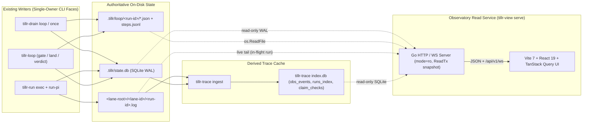

# Tillr Observatory — First-Class Introspection and Web Front End Over a Drain

> **Delivered copy.** This is `docs/design/tillr-observatory.md` from this repository at commit `3e13e0da80` (2026-11-16), copied into the tillr pack by `just pack-docs`. The [source](https://github.com/mschulkind-oss/tillr/blob/main/docs/design/tillr-observatory.md) is authoritative and may be newer. Links to documents that were not delivered point at the repository, and the queue item directives in this copy are inert.

**Status:** Draft (`in-review`) · **2026-11-15** · Owner: Matt Schulkind. Store crash recovery and failed-open retry amended; the remaining design scope is unchanged.

> **In short.** Introspection is a first-class contract over the existing store and run artifacts, not a dashboard bolted onto logs: every stage a drained item passes through, every tool it touches, and every inter-tool record exchange is exposed through a read-only Go HTTP API (`tillr-view serve`) and rendered in a Vite 7 + React 19 + TanStack Query web front end that marks missing recording seams as explicit gaps rather than false greens.

**Why it matters.** An operator watching a two-item drain needs to compare what the loop is doing against a mental model (`Observe -> Compare -> Correct`); today [`tools/tillr-drain/`](../../tillr-drain/), [`tools/tillr-loop/tillr-loop`](https://github.com/mschulkind-oss/tillr/blob/main/tools/tillr-loop/tillr-loop), and [`tools/tillr-trace/`](../../tillr-trace/) scatter evidence across `.tillr/state.db`, `.tillr/loop/<run-id>/*.json`, and `<lane-dir>/<run-id>.log`, overwrite `<lane-dir>/brief.md` on the next tick, and leave subprocess exchanges unrecorded until Slice 2 lands.

**The shape.** Five independently landable slices (`OBS-1`..`OBS-5`): preserve per-run staging inputs and step spans in `.tillr/loop/<run-id>/` (`OBS-1`), add a read-only SQLite + artifact query server in [`tools/tillr-view/`](../../tillr-view/) (`OBS-2`), build the Vite 7 + React 19 + TanStack Query two-item drain inspector (`OBS-3`, the first end-to-end milestone), wire [`docs/design/session-recording.md`](session-recording.md)'s `BASH_ENV` and `GIT_TRACE2_EVENT` emitters (`OBS-4`), and attach WebSocket invalidation frames (`/api/v1/ws`) to the normalized client cache (`OBS-5`).

**Cost.** `ESTIMATE`: ~1,330 LoC across `OBS-1`..`OBS-3` to reach the two-item drain milestone (~180 LoC in `OBS-1`, ~450 LoC Go + ~300 LoC tests in `OBS-2`, ~700 LoC TypeScript/TSX in `OBS-3`), plus ~390 LoC across `OBS-4` and `OBS-5`; zero added seconds on unrelated `just done` runs via path-scoped frontend checks in [`tools/fork-check.py`](https://github.com/mschulkind-oss/tillr/blob/main/tools/fork-check.py).

**Start at** [§1](#1-principles-and-the-guild-era-import-audit) for the governing principles, [§2](#2-the-introspection-contract-and-the-honesty-line) for the introspection contract and what today's data can and cannot answer, [§6](#6-the-first-screen-two-item-drain-acceptance-walkthrough) for the concrete two-item drain screen, and [§10](#10-open-questions) for the four rulings needed: **[OQ-OBS1](#10-open-questions)**, **[OQ-OBS2](#10-open-questions)**, **[OQ-OBS3](#10-open-questions)**, and **[OQ-OBS4](#10-open-questions)**.

**Reads with:** [`docs/design/session-recording.md`](session-recording.md), [`docs/design/tillr-day2.md`](https://github.com/mschulkind-oss/tillr/blob/main/docs/design/tillr-day2.md), [`docs/design/tillr-loop-readiness.md`](https://github.com/mschulkind-oss/tillr/blob/main/docs/design/tillr-loop-readiness.md), [`docs/design/board-item-state-model.md`](https://github.com/mschulkind-oss/tillr/blob/main/docs/design/board-item-state-model.md), [`docs/design/board-utilities.md`](board-utilities.md), [`docs/design/landing-principles.md`](landing-principles.md), and [`tools/tillr-trace/README.md`](../../tillr-trace/README.md).

**Terms.**
- **The board** — the observatory's queue screen this document designs: the header, the queue rail, the item pane and the evidence pane. Never the retired work board, deleted 2026-11-11; see [observatory-design.md §1.3](https://github.com/mschulkind-oss/tillr/blob/main/docs/design/observatory-design.md#13-non-purposes) and [the document retirement](https://github.com/mschulkind-oss/tillr/blob/main/docs/design/board-docs-retirement.md).
- **Introspection contract** *(coined here)* — the closed set of operator questions (`what is it doing now`, `what did it do`, `what went between tools`, `why did it stop`, `what did it cost`, `what changed and is the claim true`) and the exact store columns, record envelopes, and epistemic badges that answer each.
- **Inter-tool exchange** *(coined here)* — one causal hand-off between two distinct programs in a drain tick, either at **Layer A** (supervisor-to-utility: `tillr-drain` -> `tillr-run`, `tillr-loop` -> `tillr-gate` / `fork-check.py` / `tillr-land` / `tillr-item`) or **Layer B** (harness-to-tool inside a run: `pi` -> `tool.call` -> `bash` subprocess `proc.exec` -> `git.trace2`).
- **Epistemic badge** *(coined here)* — the four-state provenance marker (`OBSERVED`, `DERIVED CLOCK`, `UNOBSERVED SEAM`, `UNREADABLE`) attached to every timeline span, tool exchange, and verification claim so partial data never renders as a clean pass.
- **Snapshot cursor** *(coined here)* — the tuple `(schema_version, event_head_seq, trace_watermark, generated_at)` returned on every API response and WebSocket invalidation frame to pin the exact store transaction and trace-index state a view was derived from.
- **Not in scope for v1:** mutating board or loop state from the browser (every write remains a `tillr-*` CLI face), multi-repository aggregation, and interpolating sub-turn timestamps that no emitter recorded.

---

## 1. Principles and the Guild-Era Import Audit

The owner's ask names the core loop of human-in-the-loop engineering:

> *"Humans should be able to observe the state of a system in process so that I can apply my mental model to what's going on and then verify things are moving according to my mental model. And to do that, we need introspection. And introspection needs to be first class."*

Four active reference cards in the `engineering-principles` skill (`/ctx/packs/mschulkind-oss_2fmatt-craft/skills/engineering-principles/`) bind this design directly:

1. **The Three-Step Operator Loop** (`three-step-operator-loop`): every autonomous mechanism must support **Observe** (inspect live and historical state without side effects), **Compare** (test observed execution against the operator's mental model of stages, fences, and invariants), and **Correct** (halt or steer through explicit control faces when reality diverges from the model).
2. **Truthful, Observable State** (`truthful-observable-state`): *"the record says what happened."* Write-through or don't display; state transitions must be observable; failures are reported with their specific class and cause; status reflects the mechanism rather than an optimistic projection.
3. **Visibility Travels With Behavior** (`visibility-with-behavior`): a behavior whose execution cannot be inspected is unfinished. Introspection is part of the system's contract, not a debugging script written after an incident.
4. **Human-Operable Automation** (`human-operable-automation`): automation bounds its own authority (no hidden retries, no self-healing past a failed gate) and leaves a forensic trail an operator can audit at rest or in flight.

### 1.1 Audit against the guild-era `matt-craft` pack

`MEASURED` (`diff -ru /ctx/packs/mschulkind-oss_2fmatt-craft/skills/engineering-principles /home/agent/.gemini/config/skills/engineering-principles`, exit `0`, 0 differing lines): the `engineering-principles` skill mounted into the agent home is byte-for-byte identical to the guild-era pack in `/ctx/packs/mschulkind-oss_2fmatt-craft/`.

However, reading `/ctx/packs/mschulkind-oss_2fmatt-craft/skills/engineering-principles/` alongside `/ctx/packs/mschulkind-oss_2fmatt-craft/docs/reference/document-lifecycle.md` exposes **two gaps that did not survive the guild-era import as full reference documents**:

1. **Ten guild-era principles sit in the `## Deferred — named, not yet written` table of the `engineering-principles` skill index as one-line unlinked stubs with no reference card.** Three of those stubs are the exact rules this observatory depends on:
   - **Runtime evidence is human-reviewable** — *"Traces are inspectable and causally linked; a narrative never invents a fact."*
   - **Missing measurements are not zero** — *"Absent data stays absent; failed work is not throughput."*
   - **Scale-invariant loops** — *"The same observe–compare–correct loop applies at a turn, a task, a feature, and a roadmap."*
2. **The guild-era `document-lifecycle` reference defines the graduation loop** (how a `DESIGN` doc's settled decisions and invariants graduate into a living `SYSTEM` reference doc once implemented so operators do not read historical design prose to learn how a shipped tool works). That lifecycle document was not imported into `docs/reference/` in this repository (its rules exist only inside skill instructions such as `system-doc` and `design-convergence`).

**Ruling for this design:**
- **Runtime evidence is human-reviewable** and **Missing measurements are not zero** should graduate from the `Deferred` stub table in the `engineering-principles` skill into full reference cards in `matt-craft`.
- Even before those cards are written in `matt-craft`, `tillr-observatory` enforces both as structural laws of its API and UI ([§2.2](#22-the-honesty-line-what-exists-today-what-needs-slice-2-and-what-needs-new-design) and [§2.3](#23-rendering-a-gap-as-a-gap-epistemic-badges)): **a UI that renders a plausible timeline from partial data is the stale-green trap with a stylesheet.** When an emitter did not run, the UI renders an explicit `UNOBSERVED SEAM` gap; it never renders `0 sub-processes failed` or a green check.

---

## 2. The Introspection Contract and the Honesty Line

The introspection contract is the first-class surface of the `tillr` runtime. The web front end is one consumer of it; CLI JSON faces (`tillr-view`) and automated audits read the same underlying structures.

### 2.1 The six operator questions in the owner's voice

Every screen and API payload in the observatory exists to answer one of six questions in the owner's mental model:

| # | Question in the owner's voice | What the mental model compares | Authoritative data sources | Surface that shows it |
|---|---|---|---|---|
| **Q1** | *"What is it doing right now?"* | Which items are in the queue vs. actively running, which lane holds a live lease, and which stage (`Stage`, `Run`, `Boundary`, `Gate`, `Land`, `Verdict`) is executing right now. | `.tillr/state.db` tables `items`, `lanes` (`state`, `run_id`, `leased_until`), `runs` (`state = 'running'`), `candidates` (`state = 'enqueued'`); active `<lane-dir>/<run-id>.log` tail; `.tillr/loop/<run-id>/steps.jsonl` (`OBS-1`). | `ObservatoryHeaderBar`, `DrainCohortRail`, and `StagePipelineStrip` ([§6.1](#61-screen-layout-and-component-tree)). |
| **Q2** | *"What did it do?"* | Every stage each item passed through, in order, with start/end timestamps, attempt classification (`answered`, `infrastructure`, `unjudged`), and whether a failover (`-f1`) fired. | `.tillr/state.db` tables `dispatches`, `runs`, `candidates`, `landing_attempts`, `events` (`seq`, `ts`, `kind`); `.tillr/loop/<run-id>/{gate.change,gate.plan,gate.verdict,land.candidate,item.verdict.*}.json`. | `DrainCohortRail`, `StagePipelineStrip`, and `TimelineWaterfall` ([§6.2](#62-component-to-data-source-contract)). |
| **Q3** | *"What tools did it touch, and what went back and forth between them?"* | Every supervisor-to-utility call (**Layer A**) and every model-to-tool / bash-to-subprocess / git call (**Layer B**), including `argv`, input records, stdout records, exit codes, and durations. | **Layer A:** `<lane-root>/.requests/<run-id>.request.json`, `.tillr/loop/<run-id>/*.json`, `.tillr/loop/<run-id>/logs/*`, `.tillr/loop/<run-id>/steps.jsonl` (`OBS-1`). **Layer B:** `<lane-dir>/<run-id>.log` (`llm.turn`, `tool.call`) and `tillr-trace` `index.db` (`obs_events` for `proc.exec` and `git.trace2`). | `InterToolExchangeView` (`ExchangeGraphTable`) + `PayloadInspectorDrawer` ([§6.3](#63-inter-tool-exchanges-rendered-on-the-first-screen)). |
| **Q4** | *"Why did it stop (or why was this item held)?"* | Whether the loop stopped cleanly (`queue-drained`, `max-ticks-reached`, `operator-stop`) or on a hard wall (`host-boundary-violation`, `infra-circuit-breaker`, `gate-harness-error`), and why any item was held (`blocked`, `not-ready`, `run-infra-exhausted`, `run-link-missing`, `no-policy`, `capacity`, `no-lane`) or rejected (`boundary-scope-escape`, `candidate-no-op`, `gate:fail`, `land:refused`). | `.tillr/state.db` `dispatches` (`action`, `reason`), `runs` (`state`, `exit_code`), `landing_attempts` (`result`, `reason`); `.tillr/loop/<run-id>/gate.verdict.json`; `.tillr/loop/drain-<stamp>.json` (`OBS-1` `LoopResult`). | `ObservatoryHeaderBar` stop banner, `DrainCohortRail` hold chips, and `StagePipelineStrip` refusal card. |
| **Q5** | *"What did it cost?"* | Tokens (`input`, `output`, `cacheRead`, `cacheWrite`), USD spend (`cost.total`), and wall time per turn, per run, per item, and across the drain — separating productive runs from `infrastructure` failover waste. | `.tillr/state.db` `runs` (`usage_tokens`, `usage_cost_usd`, plus `run.usage` events when spend extraction failed in [`tools/tillr-run/run/schema.go`](../../tillr-run/run/schema.go)); `tillr-trace` `index.db` `runs_index` (`turn_count`, `input_tokens`, `output_tokens`, `cache_read_tokens`, `cache_write_tokens`, `cost_total_usd`) and `obs_events` (`kind = 'llm.turn'`). | `ObservatoryHeaderBar` cost pill, `CostBreakdownCard`, and per-turn bars in `TimelineWaterfall`. |
| **Q6** | *"What changed — and did the agent tell the truth?"* | The exact diff (`base_sha..head_sha`), whether all touched paths stayed inside `allowed_paths` (`fence.txt`), whether the trunk carry succeeded (`gated_tree` vs `landed_tree`), and whether the adapter's `RESULT: done` claim is corroborated by independent evidence (`commit_exists`, `worktree_clean`, `tests_passed`, `tests_fresh_after_last_edit`). | `.tillr/state.db` `candidates` (`base_sha`, `head_sha`, `tree_sha`), `landing_attempts` (`trunk_before`, `trunk_after`, `gated_tree`, `landed_tree`, `carried`); `.tillr/loop/<run-id>/gate.change.json`; `tillr-trace` `index.db` `claim_checks`. | `ClaimAuditBanner` and `PayloadInspectorDrawer` (`diff` and `claim_checks` tabs). |

### 2.2 The honesty line: what exists today, what needs Slice 2, and what needs new design

`MEASURED` (`python3 tools/tillr-trace/test.py`, exit `0`, 6/6 cases passing; `wc -l tools/tillr-trace/tillr_trace.py tools/tillr-view/*.go tools/tillr-loop/tillr-loop`, 4,070 total lines): [`tools/tillr-trace/tillr_trace.py`](../../tillr-trace/tillr_trace.py) (1,264 lines) is already built and verified against a real canary log (`7 turns / $0.004746410 / 6 tool calls`), while [`tools/tillr-view/status.go`](../../tillr-view/status.go) is 89 lines whose `--store` mode still returns null components pending `VIEW-2`.

Measuring the owner's ask (*"every single stage they passed through, every tool they touched, every communication between two different tools, the timestamps of them, the timelines, everything"*) against the codebase divides every datum into three honest buckets:

| Datum / Exchange | Bucket 1: Answerable from Today's Data | Bucket 2: Needs [`session-recording.md`](session-recording.md) Slice 2 Emitters (Designed, Unbuilt) | Bucket 3: Needs New Design (`OBS-1` in This Doc) |
|---|---|---|---|
| **Item state & criteria verdicts** | **Yes.** `.tillr/state.db` holds `items`, `item_criteria`, `item_edges`, and `events` (`item.add`, `item.update`, `item.verdict`). | — | — |
| **Tick decisions (`dispatch` vs `hold` + `reason`)** | **Partial.** `tillr-drain once` writes `dispatches` ([`tools/tillr-drain/drain/dispatches.go`](../../tillr-drain/drain/dispatches.go)), but `tillr-drain loop`'s `planTick` ([`tools/tillr-drain/drain/loop.go`](../../tillr-drain/drain/loop.go)) computes decisions in memory without inserting rows into `dispatches`! | — | **`OBS-1`:** `planTick` in `loop.go` must record its tick decisions (or write `.tillr/loop/drain-<stamp>.json` + `dispatches` rows) so `loop` leaves the same decision trail `once` does. |
| **Staging inputs (`brief.md`, `fence.txt`, `base_sha`)** | **Only for the last run on a lane.** [`tools/tillr-drain/drain/stage.go`](../../tillr-drain/drain/stage.go) writes `<lane-dir>/{brief.md,fence.txt,base_sha}` and overwrites them on the next tick when `<lane-id>` is reused. | [`docs/design/session-recording.md`](session-recording.md) Slice 1 Step 1 specifies copying `brief.md`, `fence.txt`, and `manifest.json` per run. | **`OBS-1`:** `LaneStager.Stage` writes a per-run copy into `<root>/.tillr/loop/<run-id>/{brief.md,fence.txt,base_sha}` at stage time so tick 2 never clobbers tick 1's evidence. |
| **`tillr-drain` -> `tillr-run exec` exchange** | **Yes.** Request is saved at `<lane-root>/.requests/<run-id>.request.json` ([`tools/tillr-drain/drain/steps.go`](../../tillr-drain/drain/steps.go)); response is materialized into `runs` (`started_at`, `finished_at`, `exit_code`, `artifact_refs`) and `events` (`run.allocate`, `run.finish`). | — | — |
| **Model turns (`llm.turn`), tokens, and USD cost** | **Yes.** `.tillr/state.db` `runs` stores run-level `usage_tokens` and `usage_cost_usd` (nullable when a backend reports no price, with `run.usage` appended on extraction failure), and `<lane-dir>/<run-id>.log` (`pi --mode json`) records per-turn `message_start`/`message_end` with millisecond timestamps, token counts, and `cost.total`, which [`tools/tillr-trace/tillr_trace.py`](../../tillr-trace/tillr_trace.py) indexes into `obs_events` and `runs_index`. | — | — |
| **Model tool invocations (`tool.call`: `bash`, `read`, `edit`, `write`)** | **Yes for arguments & output; derived for clock.** `<run-id>.log` carries `tool_execution_start` and `tool_execution_end` with full `args` and `result`. Because `pi --mode json` puts no wall clock on `tool_execution_*`, `tillr-trace` stamps `ts_source = "derived_from_preceding_clock"`. | — | Optional upstream `pi-fork` patch to stamp `timestamp` on `tool_execution_start`/`end` (not required for v1; UI displays `DERIVED CLOCK`). |
| **Subprocess executions inside `bash` (`proc.exec`: `pytest`, `go test`, etc.)** | **No.** `runs_index.proc_state` is `"missing"` today. We see the shell string the model passed to `bash`, not the child processes `bash` spawned or their individual exit codes and timestamps. | **Needs Slice 2 (`OBS-4`):** Wire `BASH_ENV` shim (`bash-shim.sh`) in [`tools/tillr-run/backends/pi/run-pi`](../../tillr-run/backends/pi/run-pi) to emit `proc-exec.jsonl`. `tillr_trace.py` already parses `proc-exec.jsonl`! | — |
| **Git child operations inside a run (`git.trace2`: `commit`, `reset`, `checkout`)** | **No.** `runs_index.git_state` is `"missing"` today. | **Needs Slice 2 (`OBS-4`):** Export `GIT_TRACE2_EVENT` in `run-pi` to emit `git-trace2.jsonl`. `tillr_trace.py` already parses `git-trace2.jsonl`! | — |
| **Supervisor -> `tillr-loop` (`gate`, `land`, `verdict`) -> (`fork-check.py`, `tillr-gate`, `tillr-land`, `tillr-item`) exchanges** | **Records yes; step spans & stderr no.** [`tools/tillr-loop/tillr-loop`](https://github.com/mschulkind-oss/tillr/blob/main/tools/tillr-loop/tillr-loop) writes `.tillr/loop/<run-id>/{registry.json,gate.change.json,gate.plan.json,gate.verdict.json,land.candidate.json,item.verdict.*.json}` and `logs/*`. However, `tillr-loop` records no start/end timestamps per `Step`, and [`tools/tillr-drain/drain/steps.go`](../../tillr-drain/drain/steps.go) (`ProcessSteps.program`) discards `stderr` whenever the subprocess starts! | — | **`OBS-1`:** `tillr-loop` and `ProcessSteps` append one JSONL line per step invocation to `.tillr/loop/<run-id>/steps.jsonl` (`step`, `argv`, `cwd`, `started_at_ms`, `finished_at_ms`, `exit_code`, `input_ref`, `output_ref`, `stderr_tail`). |
| **Boundary bracket (`TakeBoundary` / `Compare`) & fence check (`fenceViolation`)** | **Only on failure (via `Report` text).** [`tools/tillr-drain/drain/loop.go`](../../tillr-drain/drain/loop.go) runs `checkBoundary` and `fenceViolation` in memory; a passing check leaves no record on disk, and a failing check prints only to `l.cfg.Report`. | — | **`OBS-1`:** Record `boundary.check` and `fence.check` spans in `.tillr/loop/<run-id>/steps.jsonl` with target paths, duration, and violations. |
| **Claim verification (`commit_exists`, `worktree_clean`, `tests_passed`, `tests_fresh_after_last_edit`)** | **Partial.** [`tools/tillr-trace/tillr_trace.py`](../../tillr-trace/tillr_trace.py) computes all four in `claim_checks`, but without `proc-exec.jsonl` and `git-trace2.jsonl` (Slice 2), predicates that depend on missing streams evaluate to `unverified`. | **Needs Slice 2 (`OBS-4`)** to turn `unverified` into `verified` or `disproved` on live runs. | — |

### 2.3 Rendering a gap as a gap: epistemic badges

To prevent the UI from ever rendering a plausible-looking lie when an emitter is missing or a file was overwritten, every timeline span, exchange row, and claim badge carries an explicit `epistemic_state` field computed by the Go backend:

1. **`observed` (`OBSERVED` badge — solid border, exact timestamp):** The event's existence, payload, and millisecond clock come directly from an authoritative record (`events.ts`, `runs.started_at`, `llm.turn` `message_start.timestamp`, or `steps.jsonl`).
2. **`derived_clock` (`DERIVED CLOCK` badge — dashed border, `~` timestamp prefix):** The event and payload were observed (`tool.call` in `<run-id>.log`), but its timestamp carry `ts_source: "derived_from_preceding_clock"` from [`tools/tillr-trace/tillr_trace.py`](../../tillr-trace/tillr_trace.py). The waterfall renders the bar anchored to the enclosing `llm.turn` with a hatched right edge rather than inventing a fake millisecond duration.
3. **`unobserved_seam` (`UNOBSERVED SEAM` badge — amber hatched slot):** A stage or exchange seam is structurally part of the pipeline, but the emitter that records it was not active for this run. Examples:
   - `runs_index.proc_state == "missing"`: inside every `bash` `tool.call`, the exchange drawer renders an explicit amber slot: `UNOBSERVED SEAM: OS subprocesses (proc-exec.jsonl missing — Slice 2 BASH_ENV shim was not active for this run)`.
   - `runs_index.git_state == "missing"`: renders `UNOBSERVED SEAM: Git trace2 events (git-trace2.jsonl missing)`.
   - Legacy run with no `.tillr/loop/<run-id>/brief.md` where `<lane-dir>/brief.md` has `mtime > runs.finished_at`: renders `UNOBSERVED SEAM: Staged brief was overwritten by a later run on <lane-id> (mtime <t_mtime> > finished_at <t_fin>)` instead of displaying the wrong item's brief!
4. **`unreadable` (`UNREADABLE` badge — crimson error card):** The file existed or was referenced, but failed to parse or was truncated mid-line (`obs_events.kind == "unreadable"` in [`tools/tillr-trace/tillr_trace.py`](../../tillr-trace/tillr_trace.py)). Renders the file path, byte/line offset, and error string verbatim.

---

## 3. State Projection and the Read Model

### 3.1 Item state projection: enforcing the board item state model

Per [`docs/design/board-item-state-model.md`](https://github.com/mschulkind-oss/tillr/blob/main/docs/design/board-item-state-model.md) ([§2](https://github.com/mschulkind-oss/tillr/blob/main/docs/design/board-item-state-model.md#2-classification-of-every-status-the-board-can-show) and [§3](https://github.com/mschulkind-oss/tillr/blob/main/docs/design/board-item-state-model.md#3-where-the-internal-machinery-lives)), the observatory must **never** display raw internal machinery strings (`completed`, `in-progress`, `running`, `terminal`, `CandidateReady`, `GateFailed`) as an item's status badge. The Go backend exposes one closed projector function `ProjectItemState(item, activeQueueEntry, activeRun)` that maps every item to the seven human states:

```
NotStarted | Working | Blocked(underlying, waitingOn) | InQueue | Landed | ResolvedElsewhere | Closed
```

- An item with a live candidate in `candidates` (`state = 'enqueued'` with no terminal `landing_attempts` row) projects to **`InQueue`** (*"In the merge queue"*).
- An item whose stored state is `landed` (or legacy `completed` with a passing `landing_attempts` row) projects to **`Landed`** (*"Landed"*).
- An item with `state = 'blocked'` or an unresolved `item_edges.blocked_by` target projects to **`Blocked(underlying, waitingOn)`**, naming the blocking item IDs.
- All run-level and candidate-level machinery (`run_id`, `lane_id`, `AttemptClass`, `gate.verdict`, `landing_attempts`) renders **subordinately** inside the item's attempt history and stage pipeline — never as a competing top-level item state.

### 3.2 Hybrid read model: `.tillr/state.db` + `.tillr/loop/` + `tillr-trace` `index.db`

The Go backend (`tillr-view serve`) is a **pure reader** of the board store. It combines three read sources:



1. **What is queried directly per request from `.tillr/state.db`:**
   - `events` (`MAX(seq)` as `event_head_seq`, plus recent events), `items`, `item_criteria`, `item_edges`, `decisions`, `lanes`, `runs`, `dispatches`, `candidates`, and `landing_attempts`.
   - Why computed per request: a two-item drain produces `< 50` rows across all tables in `.tillr/state.db`, and even a 500-item board query completes in `< 2 ms` (`ESTIMATE`) inside a single SQLite read transaction. Materializing a second copy of `items` or `runs` would create cache-invalidation drift for zero latency gain.
2. **What is read directly per request from `.tillr/loop/<run-id>/` and `<lane-root>/`:**
   - Per-run envelope files (`gate.change.json`, `gate.plan.json`, `gate.verdict.json`, `land.candidate.json`, `item.verdict.*.json`, `steps.jsonl`, `brief.md`, `fence.txt`, `base_sha`) and `<lane-root>/.requests/<run-id>.request.json`.
   - These are small, immutable once written for a `run_id` (`< 32 KB` each), and keyed directly by `<run-id>`.
3. **What is materialized in `tillr-trace`'s `index.db`:**
   - Multi-megabyte JSONL streams (`<lane-dir>/<run-id>.log`, `proc-exec.jsonl`, `git-trace2.jsonl`), token/cost rollups (`runs_index`), and the four temporal verification predicates (`claim_checks`).
   - **Who builds it:** [`tools/tillr-trace/tillr_trace.py`](../../tillr-trace/tillr_trace.py) **already** maintains `ingested_files (path, size, mtime_ns, run_id, sha256)` and incrementally re-ingests only changed files (`ingest_all` in [`tools/tillr-trace/tillr_trace.py`](../../tillr-trace/tillr_trace.py)).
   - When `tillr-view serve` handles a request for a completed run whose `<run-id>.log` `(size, mtime_ns)` is newer than `ingested_files` in `index.db`, the Go server serializes an in-process mutex and invokes `tillr-trace ingest --store <state.db> --lane-root <lane-root> --index <index.db>` (taking `~40 ms` per run log, `MEASURED` via `python3 tools/tillr-trace/test.py` running 6 full ingest+query test cases in `180 ms`), then queries `index.db` read-only.
   - **In-flight (`running`) runs:** When `runs.state == 'running'`, the Go server does not wait for `run.finish`; it tails `<lane-dir>/<run-id>.log` up to the last complete `\n`-terminated JSON line so the operator sees live model turns and tool calls while the agent is still working.

### 3.3 Live drain concurrency: SQLite WAL and point-in-time request snapshots

When a live `tillr-drain loop` is writing to `.tillr/state.db` while the operator refreshes the browser:

- **Read-only connection:** `tillr-view serve` opens `.tillr/state.db` exclusively through [`tools/tillr/store/open.go`](../../tillr/store/open.go)'s `store.OpenRead(ctx, path)` (`mode=ro`, `PRAGMA busy_timeout = 5000`, using pure-Go `modernc.org/sqlite`). It never changes journal mode or repairs the database. The existing `every_route_answers_a_read_only_store` case in [`tools/tillr-view/serve_internal_test.go`](../../tillr-view/serve_internal_test.go) keeps a handle open before making its directory read-only; [`tools/tillr-trace/test.py`](../../tillr-trace/test.py)'s `readonly` case separately verifies a read-only copy. WAL readers need existing readable `-wal` and `-shm` files, or permission to create those SQLite coordination files: a bare database in an unwritable directory is not promised to open. Those sidecars belong with the live database, not to a second logical writer.
- **WAL non-blocking reads:** WAL (SQLite's write-ahead log, which separates committed changes from the main database file) is selected and verified with `PRAGMA journal_mode = WAL` by every writable `store.Open`, including an existing store opened without migration. `OpenRead` preserves the mode it finds. [`tools/tillr/store/crash_test.go`](../../tillr/store/crash_test.go) checks both writer-open variants and the reader's mode. WAL read transactions do not block ordinary writer commits, and an uncommitted transaction from a killed writer remains invisible. Changing an existing rollback-mode store to WAL requires SQLite's exclusive lock; a busy conversion fails explicitly rather than silently keeping the old mode.
- **Existing rollback journals:** A legacy store may still carry SQLite's hot rollback journal: the saved pages needed to undo an interrupted, uncommitted write. `SQLITE_READONLY_ROLLBACK` (extended code 776) means that repair needs a writable connection, not that the reader lacks file permissions. The API answers 503 `store-unreadable`, names the uncommitted transaction, and directs the operator to `tillr-store recover --store <path>`. That command lets SQLite recover under its locks without migrating or changing journal mode, reports `journal_found` and the last committed `event_head_seq`, and opens read-only without writing when no rollback journal exists. Never delete a journal by hand. The next normal writable open selects WAL.
- **Retry after repair:** Failed opens are retried on each API GET, serialized across simultaneous requests. Once an open succeeds, the server retains that read-only handle and clears the refusal. **Read it again** therefore reaches a repaired or newly created store in the same process; a healthy handle continues to see new commits through fresh request transactions.
- **Single-transaction snapshot per HTTP request:** Every HTTP handler wraps its `.tillr/state.db` queries in a single `r.ReadTx(ctx, func(reader *store.Reader) error { ... })` call (`BEGIN DEFERRED` in SQLite WAL). The first query inside `ReadTx` reads `SELECT COALESCE(MAX(seq), 0) FROM events` (`event_head_seq`); every subsequent `SELECT` on `items`, `lanes`, `runs`, `dispatches`, `candidates`, and `landing_attempts` in that handler sees the database frozen at that exact `event_head_seq`.

---

## 4. The HTTP and Live-Update API

### 4.1 Endpoints and response shapes

Every HTTP endpoint is a read-only `GET` under `/api/v1/` and wraps its payload in a common snapshot envelope:

```json
{
  "snapshot": {
    "store_path": "/workspace/.tillr/state.db",
    "schema_version": 4,
    "event_head_seq": 48,
    "trace_watermark_ns": 1763001120000000000,
    "generated_at": "2026-11-12T20:35:00Z"
  },
  "data": { ... }
}
```

| Endpoint | Purpose | Key fields in `data` |
|---|---|---|
| `GET /api/v1/snapshot` | Initial screen load & manual refresh payload. | `drain_summary` (`active`, `last_stop_reason`, `last_stop_detail`, `ticks`, `dispatched`, `landed`, `rejected`, `infra_failures`, `total_cost_usd`), `lanes[]` (`lane_id`, `state`, `run_id`, `leased_until_ms`), `items[]` (with `projected_state` from [§3.1](#31-item-state-projection-enforcing-the-board-item-state-model), latest `decision`, latest `run_summary`, and `cost_usd`), `recent_runs[]`. |
| `GET /api/v1/items/:item_id` | Full item dossier across all ticks and attempts. | `item` (`item_id`, `title`, `body_ref`, `design_doc`, `allowed_paths`, `projected_state`, `raw_state`), `criteria[]` (`criterion_id`, `text`, `state`, `latest_verdict`), `blocked_by[]`, `open_questions[]` (parsed from `design_doc` via [`tools/tillr-view/questions.go`](../../tillr-view/questions.go)), `decisions[]` (from `dispatches`), `attempts[]` (ordered runs + candidate + gate + land + verdict). |
| `GET /api/v1/runs/:run_id` | Single run attempt header, 7-stage pipeline status, claims, and cost. | `run` (`run_id`, `item_id`, `lane_id`, `backend`, `state`, `exit_code`, `attempt_class`, `started_at_ms`, `finished_at_ms`), `stages[]` (`stage`, ` run`, `boundary`, `fence`, `gate`, `land`, `verdict`, each with `status`, `started_at_ms`, `finished_at_ms`, `epistemic_state`, `summary`, `record_ref`), `claim_checks[]` (`claim`, `status`, `evidence_json`, `epistemic_state`), `cost` (`turns`, `input_tokens`, `output_tokens`, `cache_read_tokens`, `cache_write_tokens`, `cost_total_usd`), `completeness` (`log_state`, `proc_state`, `git_state`, `brief_state`). |
| `GET /api/v1/runs/:run_id/exchanges` | Ordered inter-tool communication edges (**Layer A** + **Layer B**) for one run. | `exchanges[]`: `{exchange_id, seq, layer: "supervisor" \| "harness", caller, callee, channel: "argv" \| "file_record" \| "stdout_record" \| "sqlite_tx" \| "jsonl_turn" \| "jsonl_tool" \| "subprocess" \| "git_trace2", started_at_ms, finished_at_ms, ts_source, epistemic_state, exit_code, summary, request_ref, response_ref, inline_preview}`. Includes explicit `unobserved_seam` rows when `proc_state` or `git_state` is `"missing"`. |
| `GET /api/v1/runs/:run_id/timeline` | Unified chronological spans for the waterfall view. | `spans[]`: `{span_id, parent_span_id, lane_id, category: "stage" \| "llm_turn" \| "tool_call" \| "proc_exec" \| "git_trace2" \| "gate_check" \| "gap", label, started_at_ms, finished_at_ms, ts_source, epistemic_state, cost_usd, status, exchange_id}`. |
| `GET /api/v1/runs/:run_id/artifacts/:kind` | Raw content & provenance for the right-hand inspector drawer. | `kind` $\in$ `brief \| fence \| base_sha \| request \| gate.change \| gate.plan \| gate.verdict \| gate.log \| land.candidate \| land.attempt \| item.verdict \| diff \| turn \| tool`. Returns `{kind, path, sha256, size_bytes, mtime_ms, epistemic_state, clobber_warning, content_type, body}`. |

### 4.2 Live updates: why WebSockets (`/api/v1/ws`) wins, and what v1 does first

The brief asks us to choose between Server-Sent Events (SSE) and WebSockets for live updates, explain why, and specify what v1 does instead.

**Decision: WebSockets (`GET /api/v1/ws`) is the live transport; v1 uses manual refresh (`[Refresh Snapshot]`) over the exact same normalized cache keys.**

Why WebSockets over SSE:
1. **Owner alignment and Vite precedent:** The owner explicitly asked to *"use something like React and models and whatever so that we can eventually hook up WebSockets without too much difficulty"*, and this repository's existing Vite tool ([`tools/roster-storybook/vite.config.mjs`](https://github.com/mschulkind-oss/tillr/blob/main/tools/roster-storybook/vite.config.mjs)) already pushes live updates over a WebSocket channel (`server.ws.send`).
2. **Scoped stream subscriptions without reconnecting:** Watching a board-level summary needs low-frequency invalidations (`event_head_seq` advances on SQLite commits), whereas drilling into a live `running` run needs high-frequency line deltas from `<lane-dir>/<run-id>.log`. With a single WebSocket connection, clicking into `run-item-seed-02-20261112T200000Z` sends `{"type": "subscribe.run", "run_id": "..."}` over the open socket without tearing down and re-opening HTTP streams.
3. **Zero-rewrite transition from v1 (refresh) to `OBS-5` (live WebSockets):**
   - In **v1 (`OBS-2` + `OBS-3`)**, the UI renders a header bar showing `Snapshot seq #48 · Read 12s ago` and a **`[Refresh Snapshot]`** button (`r` keyboard shortcut) that calls TanStack Query's `queryClient.invalidateQueries()` (plus an optional `Poll every 2s while drain active` toggle).
   - Every response carries `snapshot.event_head_seq`. When **`OBS-5`** turns on `/api/v1/ws`, the Go server polls SQLite `PRAGMA data_version` + `MAX(events.seq)` every `250 ms` and watches active `<run-id>.log` files; whenever `event_head_seq` advances or a new JSONL line lands, it pushes:
     ```json
     {
       "type": "snapshot.invalidated",
       "event_head_seq": 49,
       "changed": ["snapshot", "items:item-seed-02", "runs:run-item-seed-02-20261112T200000Z"]
     }
     ```
   - A 40-line `useObservatorySocket()` hook calls `queryClient.invalidateQueries({ queryKey: ... })` on receipt. **Not a single React component changes.**

---

## 5. The Frontend Stack, Decided

### 5.1 Evaluating late-2026 options: Vite 7 + React 19 vs. Svelte 5 vs. Solid

Clarifying the owner's question (*"I don't know if React is not the thing anymore. Maybe Vite has its own thing"*):
- **Vite does not have its own UI component framework.** Vite (`^7.0.0`, already installed in this repository at [`tools/roster-storybook/package.json`](https://github.com/mschulkind-oss/tillr/blob/main/tools/roster-storybook/package.json)) is the build tool, module bundler, and Hot Module Replacement (HMR) dev server. It pairs with a UI library (React, Svelte, Solid, or Vue).

| Stack Option | Strengths for Tillr Observatory | Weaknesses / Risks |
|---|---|---|
| **Vite 7 + React 19 + TypeScript + TanStack Query v5** *(Selected)* | Normalized model cache (`QueryClient`) keyed by entity ID and `event_head_seq` makes manual refresh and WebSocket push identical to components; mature virtualization (`@tanstack/react-virtual`) for 5,000-line JSONL streams; zero custom reactive primitives to explain; matches the owner's mental model of *"React and models"*. | Slightly larger bundle (~65 KB gzipped) than Svelte/Solid — irrelevant for a local operator tool. |
| **Vite 7 + Svelte 5 (Runes) + TypeScript** | Concise compiler-driven reactivity (`$state`, `$derived`); small bundle. | Requires hand-rolling or adapting the normalized query-cache + WebSocket invalidation layer that TanStack Query gives React out of the box; different mental model from the owner's ask. |
| **Vite 7 + SolidJS + TypeScript** | Fine-grained signals without a virtual DOM; JSX syntax. | Smaller ecosystem for virtualized waterfall tables and inspector trees; subtle destructuring traps in JSX props. |

**Decision:** **Vite 7 + React 19 + TypeScript + TanStack Query v5**, with **URL search parameters (`?item=<id>&run=<run_id>&tab=exchanges|timeline|claims&exchange=<seq>`)** as the router and selection state.

### 5.2 Model layer and URL-driven routing

- **Typed domain models (`tools/tillr-view/web/src/models/types.ts`):** Mirrors the Go API structs 1:1 (`SnapshotEnvelope<T>`, `ItemSummary`, `AttemptDossier`, `StageSpan`, `ToolExchange`, `TimelineSpan`, `ClaimCheck`, `EpistemicState`).
- **Normalized cache (`tools/tillr-view/web/src/models/queries.ts`):**
  - `useSnapshotQuery()` -> `["snapshot"]`
  - `useItemDossierQuery(itemId)` -> `["items", itemId]`
  - `useRunDossierQuery(runId)` -> `["runs", runId]`
  - `useRunExchangesQuery(runId)` -> `["runs", runId, "exchanges"]`
  - `useRunTimelineQuery(runId)` -> `["runs", runId, "timeline"]`
  - `useRunArtifactQuery(runId, kind)` -> `["runs", runId, "artifacts", kind]`
- **URL as single source of UI navigation state:** Every click (selecting item `item-seed-02`, selecting attempt `run-1`, switching between `Exchanges` and `Timeline`, opening `gate.verdict.json` in the drawer) updates the URL query string via `history.pushState`. Refreshing the browser (`F5`) or pasting a URL into a design note re-opens the exact item, run, stage, and inter-tool exchange payload.

### 5.3 Live-reload-for-code setup

During development (`just observatory-dev`):
1. `tillr-view serve --store .tillr/state.db --root . --listen 127.0.0.1:4318` runs the Go API server.
2. `vite --config tools/tillr-view/web/vite.config.ts --port 5173` runs Vite 7 with `@vitejs/plugin-react` and proxies `/api` (including `/api/v1/ws`) to `http://127.0.0.1:4318`.
3. Editing any `.tsx` or `.css` file under `tools/tillr-view/web/src/` triggers Vite HMR (React Fast Refresh) in `< 50 ms` without losing the currently inspected item, scroll position, or open payload drawer.

For normal operation (`just observatory`):
- `tillr-view serve` serves the pre-built `tools/tillr-view/web/dist/` directory directly from the Go binary (via `go:embed` or `--web-dist`), so the operator starts one process on one port with zero Node runtime required to view a drain.

---

## 6. The First Screen: Two-Item Drain Acceptance Walkthrough

The acceptance test is the owner's two-item drain experiment: run `tillr-drain loop` over two queued items (such as `item-seed-02` and `item-seed-04` from [`docs/design/tillr-loop-readiness.md`](https://github.com/mschulkind-oss/tillr/blob/main/docs/design/tillr-loop-readiness.md)), open the web view, and inspect every stage, tool call, inter-tool communication, timestamp, and cost. A dated record of one run of it is in [Section 6.5](#65-the-dated-record-two-items-drained-2026-11-14).

### 6.1 Screen layout and component tree

```text
+------------------------------------------------------------------------------------------------------------------+
| ObservatoryHeaderBar                                                                                             |
| Store: .tillr/state.db (v3 · seq #48) | Drain: queue-drained (2 ticks · 2 landed · 0 rejected) | Cost: $0.0094   |
| Lanes: lane-1 [idle] · lane-2 [idle]  | Snapshot: 2026-11-12 20:31:14Z                  [Refresh Snapshot (r)]   |
+---------------------------+--------------------------------------------------------------+-----------------------+
| DrainCohortRail (Left)    | Main Workspace (Center)                                      | PayloadInspectorDrawer|
|                           |                                                              | (Right)               |
| > DRAIN ITEMS (2)         | StagePipelineStrip (run-item-seed-02-20261112T202900Z)       |                       |
|                           | [1.Stage] -> [2.Run] -> [3.Boundary] -> [4.Fence]            | Exchange #14          |
| * item-seed-02   [Landed] |   0.2s        18.4s        0.1s          0.04s               | tillr-loop gate       |
|   Tick 1 · lane-1 · pi    |   PASS        PASS         PASS          PASS                |  -> tillr-gate run    |
|   7 turns · 6 tools       |      -> [5.Gate] -> [6.Land] -> [7.Verdict & State]          |                       |
|   24.8s · $0.0047         |           5.2s       0.6s            0.3s                    | Channel: file_record  |
|                           |           PASS       PASS            PASS                    | Exit: 0 (5,180 ms)    |
| o item-seed-04   [Landed] +--------------------------------------------------------------+ Clock: OBSERVED       |
|   Tick 2 · lane-1 · pi    | ClaimAuditBanner (Adapter footer: RESULT: done)              |                       |
|   6 turns · 5 tools       | [commit_exists: VERIFIED] [worktree_clean: VERIFIED]         | Input:                |
|   21.1s · $0.0047         | [tests_passed: UNVERIFIED (proc-exec.jsonl missing)]         | .tillr/loop/<run>/    |
|                           | [tests_fresh_after_edit: UNVERIFIED (Slice 2 shim absent)]   |   gate.plan.json      |
| > HELD IN LAST TICK (0)   +--------------------------------------------------------------+ Output:               |
|   None (queue-drained)    | [Tab: Inter-Tool Exchanges (19)] [Tab: Timeline Waterfall]   | .tillr/loop/<run>/    |
|                           |                                                              |   gate.verdict.json   |
| > TICK LOG                | #  Time (UTC)     Caller -> Callee         Channel    Status |                       |
|   Tick 1 (20:29:00Z):     | 1  20:29:00.010   drain -> item show       stdout_rec  0 OK  | {                     |
|    dispatch item-seed-02  | 2  20:29:00.120   drain -> lane-1/brief.md file_write  OK    |   "kind":             |
|    hold item-seed-04      | 3  20:29:00.210   drain -> run exec        file_rec    0 OK  |     "gate.verdict",   |
|      (reason: no-lane)    | 4  20:29:00.250   run exec -> run-pi       argv+jsonl  0 OK  |   "payload": {        |
|   Tick 2 (20:29:25Z):     | 5  20:29:01.100     pi -> llm.turn #1      api_stream  $0.0007|    "outcome": "pass",|
|    dispatch item-seed-04  | 6 ~20:29:03.400     pi -> tool:read        jsonl_tool  OK    |     "tree_sha":       |
|   Tick 3 (20:29:47Z):     | 7 ~20:29:06.800     pi -> tool:edit        jsonl_tool  OK    |       "8f3a...c12"    |
|    stop: queue-drained    | 8 ~20:29:09.100     pi -> tool:bash        jsonl_tool  0 OK  |   }                   |
|                           | 9  [GAP]            bash -> subprocesses   UNOBSERVED SEAM   | }                     |
|                           | 12 20:29:18.650   drain -> tillr-loop gate argv        0 OK  | [View Gate Log (4KB)] |
|                           | 14 20:29:19.020     loop -> tillr-gate run file_rec    0 OK  | [View Git Diff]       |
|                           | 16 20:29:24.210   drain -> tillr-loop land argv        0 OK  |                       |
|                           | 18 20:29:24.810   drain -> tillr-loop verd argv        0 OK  |                       |
+---------------------------+--------------------------------------------------------------+-----------------------+
```

### 6.2 Component-to-data-source contract

Every field shown on the first screen is derived from a named column or record — nothing is synthesized:

| Component | Field rendered | Exact source (table.column or artifact path) | Epistemic handling when absent |
|---|---|---|---|
| `ObservatoryHeaderBar` | Store version & event cursor | `.tillr/state.db` -> `meta.schema_version`, `MAX(events.seq)` | Refuses with HTTP 503 if `.tillr/state.db` is missing or unreadable. |
| `ObservatoryHeaderBar` | Drain stop reason & counts | `.tillr/loop/drain-<stamp>.json` (`OBS-1` `LoopResult`) + `runs`, `candidates`, `landing_attempts` | If drain was run before `OBS-1`, derives `dispatched`/`landed` counts from `runs` + `landing_attempts` and marks `stop_reason` as `UNOBSERVED SEAM`. |
| `DrainCohortRail` | Item title & human status badge | `items.{item_id,title,state}`, `item_edges`, `candidates`, `landing_attempts` -> projected via [§3.1](#31-item-state-projection-enforcing-the-board-item-state-model) | Never renders raw `completed` or `in-progress`; uses closed projector. |
| `DrainCohortRail` | Tick hold reason (`no-lane`, `blocked`, etc.) | `.tillr/state.db` -> `dispatches.{decision_id,action,reason,dispatched_at}` | If `dispatches` has no row for a legacy `loop` run, marks `UNOBSERVED SEAM (planTick in-memory)`. |
| `StagePipelineStrip` | Stage 1 (`Stage`) | `.tillr/loop/<run-id>/{brief.md,fence.txt,base_sha}` + `steps.jsonl` (`step="stage"`) | Falls back to `<lane-dir>/{brief.md,fence.txt,base_sha}` only if `mtime <= runs.finished_at`; otherwise badges `UNOBSERVED SEAM (clobbered by later tick)`. |
| `StagePipelineStrip` | Stage 2 (`Dispatch & Run`) | `runs.{backend,state,exit_code,started_at,finished_at}` + [`tools/tillr-drain/drain/failover.go`](../../tillr-drain/drain/failover.go) `ClassifyAttempt` | Always present in `.tillr/state.db` once `run.allocate` commits. |
| `StagePipelineStrip` | Stage 3 (`Boundary`) & Stage 4 (`Fence`) | `.tillr/loop/<run-id>/steps.jsonl` (`step="boundary"`, `step="fence"`) | For pre-`OBS-1` runs, inferred as passed only up to `gate.change.json` existence, with timestamp marked `UNOBSERVED SEAM`. |
| `StagePipelineStrip` | Stage 5 (`Gate`) | `.tillr/loop/<run-id>/{registry.json,gate.change.json,gate.plan.json,gate.verdict.json,logs/*}` | Renders `gate.verdict.json` `created_at` and per-check results; if missing after an `answered` commit, shows why the gate did not run (`candidate-no-op` or `boundary-scope-escape`). |
| `StagePipelineStrip` | Stage 6 (`Land`) | `.tillr/loop/<run-id>/land.candidate.json` + `.tillr/state.db` `candidates` & `landing_attempts` (`result`, `reason`, `trunk_before`, `trunk_after`, `gated_tree`, `landed_tree`, `carried`) | Exact SQLite `events.ts` (`land.enqueue`, `land.land`) + tree hashes. |
| `StagePipelineStrip` | Stage 7 (`Verdict & Item State`) | `.tillr/loop/<run-id>/item.verdict.<criterion_id>.json` + `.tillr/state.db` `item_criteria.state` & `events` (`item.verdict`, `item.update`) | Exact SQLite `events.ts` and mechanical `evidence` array. |
| `ClaimAuditBanner` | `commit_exists`, `worktree_clean`, `tests_passed`, `tests_fresh_after_last_edit` | `tillr-trace` `index.db` -> `claim_checks.{claim,status,evidence_json}` | Renders `VERIFIED` (green), `DISPROVED` (red — the stale-green trap caught!), or `UNVERIFIED` (amber hatched — when `proc-exec.jsonl` is missing). |
| `CostBreakdownCard` | Tokens & USD spend per turn and per run | `.tillr/state.db` `runs.{usage_tokens,usage_cost_usd}` (`run.usage` event on parse failure) + `tillr-trace` `index.db` `runs_index` & `obs_events` (`kind='llm.turn'`) | When `runs.usage_cost_usd IS NULL` (e.g., `muse` or `agy`), renders token counts and badges USD cost as `UNOBSERVED (backend reports no USD price)` — never `$0.0000`! |

### 6.3 Inter-tool exchanges rendered on the first screen

When the owner clicks into `item-seed-02`, the `Inter-Tool Exchanges` tab lists every boundary crossing between two tools in chronological order:

1. **`tillr-drain` -> `tillr-item show`** (Staging read: reads item title, criteria, `allowed_paths`).
2. **`tillr-drain` -> `.tillr/loop/<run-id>/{brief.md,fence.txt,base_sha}`** (Staging write: renders [`tools/tillr-run/backends/brief-template.md`](../../tillr-run/backends/brief-template.md) and pins `base_sha`).
3. **`tillr-drain` -> `tillr-run exec`** (Supervisor-to-runner: writes `<lane-root>/.requests/<run-id>.request.json`, invokes `tillr-run exec`, receives `run.record` on stdout and commits `run.allocate` / `run.finish` in `.tillr/state.db`).
4. **`tillr-run exec` -> `run-pi` -> `pi --mode json`** (Runner-to-adapter: streams `<lane-dir>/<run-id>.log`).
5. **Inside `pi`: `pi` -> Model API (`llm.turn` #1..#N)** and **`pi` -> Tool (`tool.call`: `read`, `edit`, `write`, `bash`)** (Each expandable to see the exact prompt context, assistant thinking/text, tool arguments JSON, and tool result stdout/stderr).
6. **Inside `tool:bash`: `bash` -> OS Subprocesses (`proc.exec`) & `git` (`git.trace2`)**:
   - When Slice 2 (`OBS-4`) is active: lists every child `execve` (`python3 -m unittest`, `git commit`, etc.) from `proc-exec.jsonl` and `git-trace2.jsonl` with exact millisecond start/end clocks and exit codes.
   - Before Slice 2 (`OBS-4`) is active: renders an unmistakable **`UNOBSERVED SEAM` row** directly under each `tool:bash` call so the operator sees that `bash` ran a shell command string whose internal child processes were not independently traced.
7. **`tillr-drain` -> `tillr-loop gate`** ([`tools/tillr-loop/tillr-loop`](https://github.com/mschulkind-oss/tillr/blob/main/tools/tillr-loop/tillr-loop) `compose_gate`), which expands into its three child tool exchanges:
   - `tillr-loop gate` -> `python3 tools/fork-check.py --registry-json` (stdout -> `.tillr/loop/<run-id>/registry.json`).
   - `tillr-loop gate` -> `tillr-gate plan` (reads `registry.json` + `gate.change.json` -> writes `gate.plan.json`).
   - `tillr-loop gate` -> `tillr-gate run --gate python3 --gate-arg tools/fork-check.py --gate-arg --since --gate-arg <base> --gate-arg --no-wait` (reads `gate.plan.json` -> writes `gate.verdict.json` and `.tillr/loop/<run-id>/logs/*`).
8. **`tillr-drain` -> `tillr-loop land`** (`compose_land`), which expands into:
   - `tillr-loop land` -> `tillr-land enqueue` (reads `land.candidate.json` -> writes `candidates` + `land.enqueue` event in `.tillr/state.db`).
   - `tillr-loop land` -> `tillr-land pass` (reads `gate.verdict.json` -> verifies tree/carry -> advances trunk ref `main` -> writes `landing_attempts` + `land.land` event).
9. **`tillr-drain` -> `tillr-loop verdict`** (`compose_verdict`), which expands into:
   - `tillr-loop verdict` -> `tillr-item show` (reads frozen `criteria`).
   - `tillr-loop verdict` -> `tillr-item verdict record` (one call per criterion, reading `item.verdict.<criterion_id>.json` -> writes `item_criteria.state` + `item.verdict` event).
10. **`tillr-drain` -> `tillr-item state`** (moves `items.state` to `landed` after `VerdictPassed`, or `in-progress` after `VerdictFailed`).

### 6.4 What is deliberately absent in v1

- **No write buttons or control endpoints:** The browser cannot enqueue, retry, edit, or abort a run. Any future control action must invoke a `tillr-*` CLI writer face, never a direct SQLite write from the web server.
- **No synthetic sub-turn timelines:** Tool calls whose clock is `derived_from_preceding_clock` are grouped under their parent turn and badged `DERIVED CLOCK` rather than given fabricated proportional widths.
- **No cross-repo dashboard:** One `tillr-view serve` instance inspects one repository `--root` and its `--store`.

### 6.5 The dated record: two items drained 2026-11-14

The experiment above was run on 2026-11-14 against the live store, and this is
what the served snapshot said. The loop was `tillr drain loop --root /workspace
--lanes 1` (started 05:21Z, still running when the record was taken); the
observatory was `just observatory`, which builds the front end with the
`observatory` tag and serves the same `.tillr/state.db` the loop writes. The
recipe's default store is `.tillr/state.db` relative to the working directory,
so a lane worktree, which has no `.tillr` of its own, has to name it: `just
observatory 4318 --store /workspace/.tillr/state.db --root /workspace`. Without
that the server answers 503 `store-absent` while the UI still loads, which reads
as a broken store rather than a wrong path. The two
items are `item-drain-2a` and `item-drain-2b`, the pair the loop drained in the
hours before the record. They were drained in two ticks about ninety minutes
apart, not in one tick: the loop dispatches one item per tick, so "two items"
is two ticks, not one tick with two lanes.

| Read | Value |
|---|---|
| Store | `.tillr/state.db`, schema 5, event head 297 |
| Drain | `active` (the loop had not stopped), 27 ticks, 26 dispatched, 16 landed, 0 rejected, $1.7938 |
| Lanes | `lane-1` leased, `lane-2` idle |
| Items | `item-drain-2a` and `item-drain-2b`, both projected `landed` |
| Snapshot | 2026-11-14T12:28:28Z |

The header bar's tick count was wrong when this record was taken, and taking the
record is what found it: the snapshot answered `ticks: 1548`, which is the
`dispatches` row count (26 `dispatch` + 1522 `hold`), so the bar drew "1548
ticks" for a store that had held 27. The count is now the distinct
`dispatched_at` (`countTicks` in [`tools/tillr-view/serveread.go`](../../tillr-view/serveread.go)),
and the same store answers 27. The same read found the run's cost field labelled
`output_tokens` while carrying the store's *total* tokens; it is now `tokens`.

#### 6.5.1 The two runs

| Read | `item-drain-2a` | `item-drain-2b` |
|---|---|---|
| `run_id` | `run-item-drain-2a-20261114T102716Z` | `run-item-drain-2b-20261114T120440Z` |
| Lane / backend | `lane-1` / `pi` | `lane-1` / `pi` |
| Route | `null` | `openrouter/deepseek/deepseek-v4.1-flash-1017:floor` |
| Started | 2026-11-14T10:27:17Z | 2026-11-14T12:04:41Z |
| Finished | 2026-11-14T10:32:40Z | 2026-11-14T12:08:20Z |
| Exit | 0 | 0 |
| Tokens | 4,482,036 | 4,915,185 |
| USD | $0.026916 | $0.028434 |
| Fence | `tools/tillr-run/`, `tools/tillr-store/`, `tools/tillr-drain/`, and their three pack mirrors | `tools/tillr-drain/`, `tools/tillr-run/backends/`, and their two pack mirrors |

The route is `null` for `item-drain-2a` and named for `item-drain-2b`, which is
the item's own subject: 2a is the run that added route recording, and it predates
the column. The observatory renders the absence as `null` rather than `$0.0000`
or a guessed route, which is the rule [Section 6.2](#62-component-to-data-source-contract)
sets for a cost the backend did not report.

#### 6.5.2 The seven stages, answered one at a time

`GET /api/v1/runs/<run-id>` answers all seven for both runs. The `epistemic_state`
is the value the API returns; the badge is the one [§2.3](#23-rendering-a-gap-as-a-gap-epistemic-badges) assigns it.

| Stage | Served status | Badge | What the record holds, and what it does not |
|---|---|---|---|
| 1 Stage | `derived_clock` | `DERIVED CLOCK` | `brief.md`, `fence.txt` and `base_sha` are under `.tillr/loop/<run-id>/` for both runs. `steps.jsonl` has no `step="stage"` line, so the clock is the files' mtime, not a recorded start. |
| 2 Run | `exited` | `OBSERVED` | The `runs` row: backend, exit 0, `started_at`/`finished_at` from the store. The tick's own `dispatch_ms` is 323,548 ms (2a) and 219,295 ms (2b). |
| 3 Boundary | `unobserved` | `UNOBSERVED SEAM` | The tick wrote a `boundary.check` event (seq 179 for 2a, seq 279 for 2b; `clean: true`, target `.tillr/lanes/lane-1/worktree`), but no per-run record. The stage reads `steps.jsonl` and finds none. |
| 4 Fence | `derived_clock` | `DERIVED CLOCK` | `fence.txt` is present for both; the clock is its mtime. |
| 5 Gate | `recorded` | `DERIVED CLOCK` | `gate.verdict.json` is present for both: `pass`, one check `gate:python3` (9,132 ms for 2a, 51,318 ms for 2b). `gate.plan.json` and `logs/` are present. The clock is the file's, not a step span. |
| 6 Land | `landed` | `OBSERVED` | `landing_attempts` row plus the `land.land` event: 2a moved trunk `0fe01ea` -> `beb1865`, 2b moved `8610db2` -> `4838baa`. |
| 7 Verdict | `recorded` | `DERIVED CLOCK` | `item.verdict.c1.json` and `c2.json` are present for both; `item_criteria` reads `done` for all four, actor `mechanical`, class `verification-only`. The clock is the file's mtime. |

#### 6.5.3 The Layer A exchanges, answered one at a time

`GET /api/v1/runs/<run-id>/exchanges` answers five file-record exchanges for
each run, and `steps.jsonl` holds five argv steps. Neither list is the whole of
[Section 6.3](#63-inter-tool-exchanges-rendered-on-the-first-screen)'s ten, and
the two lists are different: the endpoint reads the record files, not the step
log, so the argv calls the loop wrote are not in the exchange list. The table
answers each of the ten and says which list the evidence is in.

| # | Exchange | Evidence | Badge |
|---|---|---|---|
| 1 | `tillr-drain` -> `tillr-item show` | No record: `steps.jsonl` has no staging step, and the endpoint has no row. | `UNOBSERVED SEAM` |
| 2 | `tillr-drain` -> `brief.md`/`fence.txt`/`base_sha` | The three files are present under `.tillr/loop/<run-id>/`; no exchange row is served. | `DERIVED CLOCK` |
| 3 | `tillr-drain` -> `tillr-run exec` | `steps.jsonl` `step="run"`: argv, cwd, 1794652037473 -> 1794652361006 (2a), 1794657881424 -> 1794658100714 (2b), exit 0. Not served by the endpoint. | `OBSERVED` |
| 4 | `tillr-run exec` -> `run-pi` -> `pi` | The run's log is named in the store's `artifact_refs`; the trace index has not indexed it. | `UNOBSERVED SEAM` |
| 5 | `pi` -> `llm.turn` / `tool.call` | The trace index holds no run and no `obs_events` for either run. | `UNOBSERVED SEAM` |
| 6 | `bash` -> OS subprocesses | `proc-exec.jsonl` and `git-trace2.jsonl` exist on disk (the OBS-4 shim is active), but neither is indexed; the API reports `proc_state: "unindexed"`. | `UNOBSERVED SEAM` |
| 7 | `tillr-drain` -> `tillr-loop gate` | `steps.jsonl` `step="gate"` (11,292 ms / 53,229 ms, exit 0); the three files it wrote (`gate.change`, `gate.plan`, `gate.verdict`) are served, all `derived_clock`. | `OBSERVED` for the step |
| 8 | `tillr-drain` -> `tillr-loop land` | `steps.jsonl` `step="land"` (613 ms / 468 ms, exit 0); `land.candidate.json` is served (`derived_clock`). | `OBSERVED` for the step |
| 9 | `tillr-drain` -> `tillr-loop verdict` | `steps.jsonl` `step="verdict"` (168 ms / 186 ms, exit 0); `item.verdict.c2.json` is served (`derived_clock`). | `OBSERVED` for the step |
| 10 | `tillr-drain` -> `tillr-item state` | `steps.jsonl` `step="item-state"` (12 ms / 20 ms, exit 0). Not served by the endpoint. | `OBSERVED` |

#### 6.5.4 The costs

| Run | Tokens | USD | Route |
|---|---|---|---|
| `item-drain-2a` | 4,482,036 | $0.026916 | `null` |
| `item-drain-2b` | 4,915,185 | $0.028434 | `openrouter/deepseek/deepseek-v4.1-flash-1017:floor` |
| Drain, 26 dispatched | — | $1.7938 | — |

The per-run numbers are the store's `runs.usage_tokens` and `runs.usage_cost_usd`,
which is the run's total, not a per-turn split: the per-turn split is a Layer B
row (`obs_events.kind='llm.turn'`) and the index is empty, so the turn count is
`0` and the card says a turn count comes from the trace index. The card's token
field is the total; before this record it was labelled `output_tokens`, which was
wrong for a number that includes input.

#### 6.5.5 The gaps, written as gaps

The walkthrough's answer is not a green. Four things the design expects are not
observable in this store, and each is recorded with the badge that says why:

- **Layer B is unindexed.** The trace index the snapshot reports at
  `sources.trace_index` holds 0 runs and 0 `claim_checks`, so the agent's
  transcript, its `llm.turn`s, its `tool.call`s and the four claim checks are
  `UNOBSERVED SEAM`, not "empty". The run's own log and the `proc-exec.jsonl`
  and `git-trace2.jsonl` the OBS-4 shim wrote are on disk; the indexer has not
  read them. The board says `present` about the index file, which is true of the
  file and not of the evidence: a present index with no rows has the same shape
  as a missing one, and the honest word is `unindexed`.
- **The boundary is a tick-level event, not a per-run record.** The event exists
  (`boundary.check`, `clean: true`), but the stage reads `steps.jsonl`, which has
  no `boundary` line, so the per-run stage is `UNOBSERVED SEAM`.
- **The exchange list is the file records, not the argv calls.** The endpoint
  answers five exchanges, all `derived_clock`; the five argv steps in
  `steps.jsonl` are `OBSERVED` and are not read. A reader who wants the
  supervisor's own calls reads the step log, not the drawer.
- **The stage, fence, gate and verdict clocks are file mtimes.** They are
  `DERIVED CLOCK`: the record exists and its clock is the file's, not a span the
  loop wrote.

Two of the four are the observatory's own projection rather than the store's
evidence, and the tick count and the token label were two more of the same kind.
The tick count and the label are fixed here; the exchange list and the per-run
boundary are not, and they are the next slice of work. The store's record is
complete for the seven stages the loop writes; the surface is not yet complete
for the four it reads from the trace index.

---

## 7. Where the Code Lives, How It Is Built and Run, and Gate Cost

### 7.1 Repository layout and utility ownership

[`docs/design/board-utilities.md`](board-utilities.md) ([§2](board-utilities.md#2-the-seam-analysis) *"Readers consolidate; writers separate"* and [§4](board-utilities.md#4-the-proposed-suite-seven-utilities)) fixes the suite at seven utilities and assigns **R8 (Reporting)** and **R11 (Serve — long-running read/serving faces)** to **`view`** ([`tools/tillr-view/`](../../tillr-view/)). Putting the HTTP server inside `tillr-view` as `tillr-view serve` honors that boundary without introducing an eighth utility (see **[OQ-OBS1](#10-open-questions)**):

```text
tools/tillr-view/
  main.go                 # Existing status / events / questions faces + new `serve` subcommand
  serve/
    server.go             # Read-only HTTP + /api/v1/ws handler registration
    snapshot.go           # Single-ReadTx store reader + board-item-state-model projector
    dossier.go            # Per-item and per-run stage, exchange, timeline, and artifact assembly
    trace.go              # Read-only reader over tillr-trace index.db + incremental ingest trigger
    server_test.go        # Go unit + integration tests over seeded SQLite & canary fixtures
  web/                    # Vite 7 + React 19 + TypeScript frontend
    package.json
    tsconfig.json
    vite.config.ts
    index.html
    src/
      main.tsx
      models/             # TypeScript contracts + TanStack Query hooks
      components/         # Header, DrainCohortRail, StagePipelineStrip, ExchangeGraphTable, etc.
```

- **Does it ship in a `yolo-pack` or `rcm`?** **No.** Per [`AGENTS.md`](https://github.com/mschulkind-oss/tillr/blob/main/AGENTS.md) and [`rcrc`](https://github.com/mschulkind-oss/tillr/blob/main/rcrc) (`EXCLUDES="... tools ..."`), `tools/` is repository-scoped tooling, not host home configuration. Nothing under `tools/tillr-view/` is linked by `rcup` or rendered by `yolo host apply --assert`.

### 7.2 Running in a `podman-self` jail vs. on the host

Per [`config/yolo-jail/config.toml`](https://github.com/mschulkind-oss/tillr/blob/main/config/yolo-jail/config.toml) and the jail environment rules:
- `MEASURED`: the tracked jail config carries neither key, and this jail's own port forwarding is a launch setting (`forward_host_ports: [8080]`) rather than a key in that file. In `yolo`, `forward_host_ports` forwards connections **from inside the jail out to a service on the host** (`localhost:8080` in jail -> host `8080`), whereas publishing a port **from inside the jail to the host's browser** requires `"ports": ["<host>:<jail>"]` in the jail's config.
- Because `/workspace` inside `podman-self` is a **live bind mount** of `/home/user/code/tillr` on the host, there are two clean ways to run the observatory:
  1. **Host-direct (works immediately with zero jail restart):** Run `just observatory` in any host terminal in `~/code/tillr` while `tillr-drain` runs either in the jail or on the host. Both processes read the exact same live `.tillr/state.db` and `.tillr/loop/` files on the host filesystem.
  2. **In-jail server:** Add `"ports": ["4318:4318", "5173:5173"]` to the jail's config (applied on the host via `yolo config apply` and a jail relaunch) so `just observatory` or `just observatory-dev` run inside the jail answers on `http://localhost:4318` / `http://localhost:5173` in the host browser.
- **`.justfile` recipes** (following [`tools/roster-storybook/dev.sh`](https://github.com/mschulkind-oss/tillr/blob/main/tools/roster-storybook/dev.sh) at `.justfile` `dev`):
  - `just observatory *args`: builds/runs `tillr-view serve` on port `4318` serving the UI and API.
  - `just observatory-dev *args`: starts Vite on the port you name and `tillr-view serve` one port above it, with HMR live-reload for frontend code. The two processes are declared in [`tools/tillr-view/Procfile.dev`](../../tillr-view/Procfile.dev) and run under `hivemind` (`mise.toml` pins it), so they are one supervised tree: a dead child stops the other, and an interrupt tears down both process groups. That is the property the recipe lacked while it backgrounded the API and then `exec`'d Vite — the `EXIT` trap was discarded by the `exec`, so an API could outlive its UI, keep the port, and answer the next run with a board it cached at its own startup (2026-11-15). The recipe now also refuses an API port that is already answering, before it builds anything.

### 7.3 Gate cost in `just done` (`tools/fork-check.py`)

Per [`docs/design/landing-principles.md`](landing-principles.md), **a gate step whose cost rises on every unrelated commit is pointed the wrong way**. Running `npm ci` or `vite build` on every `just done` invocation is unacceptable.

1. **Go backend tests run inside the existing `tillr-conformance` check:** [`tools/fork-check.py`](https://github.com/mschulkind-oss/tillr/blob/main/tools/fork-check.py) already runs `CGO_ENABLED=0 go test ./...` across [`tools/tillr-view/`](../../tillr-view/). `tools/tillr-view/serve/server_test.go` tests every `/api/v1/*` endpoint against an in-memory/temp `.tillr/state.db` and [`tools/tillr-trace/testdata/canary-run.log`](../../tillr-trace/testdata/canary-run.log) using an injected `fs.FS` stub for static assets, adding `< 0.5s` (`ESTIMATE`) and zero Node dependency to `tillr-conformance`.
2. **Frontend typecheck and unit tests are strictly path-scoped in [`tools/fork-check.py`](https://github.com/mschulkind-oss/tillr/blob/main/tools/fork-check.py):** A new check `tillr-observatory-web` in [`tools/fork-check.py`](https://github.com/mschulkind-oss/tillr/blob/main/tools/fork-check.py) runs **only when the candidate's changed paths intersect `tools/tillr-view/web/**`** (using `fork-check.py`'s existing path-scoping registry). When triggered, it runs `tsc --noEmit` and `vitest run` (`ESTIMATE: 2–4s`). Commits that do not touch `tools/tillr-view/web/` pay `0 ms`.
3. **Dev-process supervision is strictly path-scoped:** `observatory-dev` runs `python3 tests/observatory-dev.test.py` only when a changed path is [`.justfile`](https://github.com/mschulkind-oss/tillr/blob/main/.justfile), [`tools/tillr-view/Procfile.dev`](../../tillr-view/Procfile.dev), [`mise.toml`](https://github.com/mschulkind-oss/tillr/blob/main/mise.toml), or [`tests/observatory-dev.test.py`](https://github.com/mschulkind-oss/tillr/blob/main/tests/observatory-dev.test.py). The suite checks interruption, either process dying, held-port refusal, and cleanup of its test processes after gate cancellation, with real `just` and `hivemind` supervising stub API and UI processes. It is required before landing because it checks the recipe's correctness. The declared cost uses the original 15-case baseline measured alone on 2026-11-15: `0.9s` wall. With the cancellation regression, 18 cases took `1.1s` that day; both are below the gate's `10.0s` cheap-check threshold. Missing `python3`, `just`, or `hivemind` leaves the step unavailable, not a verdict about the tree. Commits that touch none of these four paths pay `0 ms`.

---

## 8. Order of Work, Estimates, and First Three Actions

### 8.1 Independently landable slices

Every slice below is scoped to a single lane fence and leaves the tree green:

| Slice | Scope & Deliverables | Fence (`allowed_paths`) | Size & Effort (`ESTIMATE`) |
|---|---|---|---|
| **`OBS-1`** | **Loop step-span & staging preservation:** (1) In [`tools/tillr-drain/drain/stage.go`](../../tillr-drain/drain/stage.go), copy rendered `brief.md`, `fence.txt`, and `base_sha` into `<root>/.tillr/loop/<run-id>/` so lane reuse never overwrites prior run inputs. (2) In [`tools/tillr-drain/drain/loop.go`](../../tillr-drain/drain/loop.go), persist `planTick` decisions to `dispatches` and write `.tillr/loop/drain-<stamp>.json` (`LoopResult`). (3) In [`tools/tillr-loop/tillr-loop`](https://github.com/mschulkind-oss/tillr/blob/main/tools/tillr-loop/tillr-loop) and [`tools/tillr-drain/drain/steps.go`](../../tillr-drain/drain/steps.go), append `.tillr/loop/<run-id>/steps.jsonl` with start/end ms, argv, cwd, exit code, and stderr tail for every step. | `tools/tillr-drain/`, `tools/tillr-loop/` | `~180 LoC`, 1 lane (`~35 min`) |
| **`OBS-2`** | **Read-only Go HTTP API (`tillr-view serve`):** Add `serve` face to [`tools/tillr-view/`](../../tillr-view/) (and route `tillr view serve` in [`tools/tillr-cli/main.go`](../../tillr-cli/main.go)) implementing `/api/v1/snapshot`, `/api/v1/items/:id`, `/api/v1/runs/:id`, `/api/v1/runs/:id/exchanges`, `/api/v1/runs/:id/timeline`, and `/api/v1/runs/:id/artifacts/:kind` over read-only `.tillr/state.db` (`ReadTx`), `.tillr/loop/<run-id>/`, and `tillr-trace` `index.db`. Also completes `VIEW-2` (`tillr-view status --store`). | `tools/tillr-view/`, `tools/tillr-cli/` | `~450 LoC Go + ~300 LoC tests`, 1 lane (`~60 min`) |
| **`OBS-3`** | **Vite 7 + React 19 + TanStack Query Two-Item Drain Screen (Milestone 1):** Create `tools/tillr-view/web/` with `ObservatoryHeaderBar`, `DrainCohortRail`, `StagePipelineStrip`, `ClaimAuditBanner`, `InterToolExchangeView`, `TimelineWaterfall`, and `PayloadInspectorDrawer`, plus `.justfile` `observatory` / `observatory-dev` recipes and path-scoped check in [`tools/fork-check.py`](https://github.com/mschulkind-oss/tillr/blob/main/tools/fork-check.py). | `tools/tillr-view/`, `.justfile`, `tools/fork-check.py` | `~700 LoC TS/TSX`, 1 lane (`~75 min`) |
| **`OBS-4`** | **Slice 2 Subprocess & Git Emitters (`BASH_ENV` + `GIT_TRACE2_EVENT`):** Wire [`docs/design/session-recording.md`](session-recording.md)'s `bash-shim.sh` and `GIT_TRACE2_EVENT` in [`tools/tillr-run/backends/pi/run-pi`](../../tillr-run/backends/pi/run-pi) and index `.tillr/loop/<run-id>/gate.*.json` in [`tools/tillr-trace/tillr_trace.py`](../../tillr-trace/tillr_trace.py), turning the UI's subprocess `UNOBSERVED SEAM` slots into `OBSERVED` rows and activating `tests_passed` / `tests_fresh_after_last_edit` verification. | `tools/tillr-run/`, `tools/tillr-trace/` | `~150 LoC shell/Python`, 1 lane (`~40 min`) |
| **`OBS-5`** | **Live WebSocket Invalidations (`/api/v1/ws`):** Add WebSocket upgrade handler to `tillr-view serve` watching `PRAGMA data_version` / `MAX(events.seq)` and active `<run-id>.log` tails, and connect `useObservatorySocket()` to TanStack Query's cache in `tools/tillr-view/web/`. | `tools/tillr-view/` | `~180 LoC Go + ~60 LoC TS`, 1 lane (`~35 min`) |

### 8.2 Smallest end-to-end version of the two-item drain milestone

**Slices `OBS-1` + `OBS-2` + `OBS-3`** are the smallest honest end-to-end milestone:
- The coordinator runs a two-item drain (`item-seed-02` and `item-seed-04`) through `tillr-drain loop`.
- The owner opens `http://localhost:4318` (or `5173`), sees both items projected as `Landed`, clicks into each item, and inspects all 7 stages (`Stage -> Run -> Boundary -> Fence -> Gate -> Land -> Verdict`), every Layer A utility-to-utility record exchange (`request.json`, `gate.change.json`, `gate.plan.json`, `gate.verdict.json`, `land.candidate.json`, `item.verdict.*.json`), every Layer B `llm.turn` and `tool.call` from `<run-id>.log`, exact timestamps and token/USD costs, and explicit `UNOBSERVED SEAM` badges for inside-`bash` subprocesses until `OBS-4` lands.

### 8.3 First three actions

1. **Dispatch `OBS-1`** on [`tools/tillr-drain/`](../../tillr-drain/) and [`tools/tillr-loop/tillr-loop`](https://github.com/mschulkind-oss/tillr/blob/main/tools/tillr-loop/tillr-loop) to preserve per-run `brief.md`/`fence.txt`/`base_sha` under `.tillr/loop/<run-id>/`, record `planTick` decisions in `dispatches`, and emit `.tillr/loop/<run-id>/steps.jsonl`.
2. **Dispatch `OBS-2`** on [`tools/tillr-view/`](../../tillr-view/) to land `tillr-view serve` with read-only SQLite snapshot queries, `tillr-trace` `index.db` integration, and full Go HTTP handler tests against a two-item drain fixture.
3. **Dispatch `OBS-3`** on `tools/tillr-view/web/` to land the Vite 7 + React 19 + TanStack Query frontend, run a two-item drain experiment (`item-seed-02`, `item-seed-04`), and verify the rendered view with the owner.

---

## 9. What Makes This Fail

| Failure mode | How it happens | Structural prevention in this design |
|---|---|---|
| **1. Invented or smoothed data (stale-green with a stylesheet)** | The UI shows a green "Tests Passed" badge when `proc-exec.jsonl` is absent, or draws proportional millisecond bars for `tool.call` rows whose clock was copied from the parent turn, or displays tick 2's `<lane-dir>/brief.md` as if it were tick 1's brief. | Every timeline span, exchange, and claim carries `epistemic_state` (`observed`, `derived_clock`, `unobserved_seam`, `unreadable`). Missing `proc-exec.jsonl` forces `tests_passed` to render as amber `UNVERIFIED`; `OBS-1` saves `brief.md` per `<run-id>` and `OBS-2` flags any fallback whose `mtime > runs.finished_at`. |
| **2. A second writer to `.tillr/state.db`** | The Go web server opens `.tillr/state.db` with `store.Open(..., create=true)`, runs DDL migrations, or holds a write lock while `tillr-drain loop` is executing a tick, causing `SQLITE_BUSY` failures in the drain. | `tillr-view serve` opens `.tillr/state.db` exclusively via `store.OpenRead` (`mode=ro`, `PRAGMA query_only = ON`). A unit test in `server_test.go` `chmod 0555`s the store directory and verifies that every `/api/v1/*` route returns `200 OK`. |
| **3. A frontend that needs a rewrite to go live** | React components fetch `/api/v1/*` directly inside `useEffect` into local `useState` hooks, so adding WebSockets later requires rewriting every component's state management. | Every component reads exclusively from TanStack Query v5 hooks keyed by `["snapshot"]`, `["items", id]`, and `["runs", runId]`. Manual refresh in `OBS-3` and `/api/v1/ws` frames in `OBS-5` both call `queryClient.invalidateQueries()` on those keys. |
| **4. A frontend build that slows `just done`** | Adding an unconditional `npm ci && npm run build` step to [`tools/fork-check.py`](https://github.com/mschulkind-oss/tillr/blob/main/tools/fork-check.py) adds 5–15 seconds to every unrelated Go or Markdown commit's gate run. | Go API tests run with an injected `fs.FS` under `CGO_ENABLED=0 go test ./...` in `< 0.5s`; the `tillr-observatory-web` check in [`tools/fork-check.py`](https://github.com/mschulkind-oss/tillr/blob/main/tools/fork-check.py) is path-scoped to `tools/tillr-view/web/**` so unrelated commits pay `0 ms`. |
| **5. Answering "what is it doing" only after the run ends** | The server reads only completed `runs` rows or waits for `tillr-trace` post-run ingestion, showing a blank screen for the 20–120 seconds a model run or `fork-check.py` gate is in flight. | `runs` writes `state = 'running'` at `run.allocate` before the adapter starts; `tillr-view serve` tails `<lane-dir>/<run-id>.log` live up to the last `\n` while `state == 'running'`, and `OBS-1` writes `step.start` lines to `.tillr/loop/<run-id>/steps.jsonl` before each utility subprocess begins. |
| **6. Contradicting [`board-item-state-model.md`](https://github.com/mschulkind-oss/tillr/blob/main/docs/design/board-item-state-model.md)** | The UI renders `items.state` (`in-progress`, `completed`) or `runs.state` (`running`, `exited`) as the item's badge, re-introducing the terminology split [`docs/design/board-item-state-model.md`](https://github.com/mschulkind-oss/tillr/blob/main/docs/design/board-item-state-model.md) retired. | One server-side projector function ([§3.1](#31-item-state-projection-enforcing-the-board-item-state-model)) computes `projected_state` (`NotStarted \| Working \| Blocked \| InQueue \| Landed \| ResolvedElsewhere \| Closed`); run and candidate states are nested strictly inside attempt history. |
| **7. Silently dropped utility `stderr` on step failures** | Today [`tools/tillr-drain/drain/steps.go`](../../tillr-drain/drain/steps.go) (`ProcessSteps.program`) captures `stderr` into a buffer and discards it whenever `cmd.ProcessState != nil`! An operator sees `land: refused` or `gate: error` in the UI with zero diagnostic text. | `OBS-1` persists the bounded `stderr` tail and exit code of every `ProcessSteps` and `tillr-loop` invocation into `.tillr/loop/<run-id>/steps.jsonl`, surfaced directly in `PayloadInspectorDrawer`. |

---

## 10. Open Questions

- ✅ **[OQ-OBS1](#10-open-questions) — Should the Go backend and `web/` tree live inside [`tools/tillr-view/`](../../tillr-view/) as `tillr-view serve`, or in a separate `tools/tillr-observatory/` directory?**

  [`docs/design/board-utilities.md`](board-utilities.md) ([§2](board-utilities.md#2-the-seam-analysis) and [§4](board-utilities.md#4-the-proposed-suite-seven-utilities)) caps the suite at seven utilities and assigns R11 (`Serve`) to `view` so readers consolidate rather than proliferate.

  - **A — Inside [`tools/tillr-view/`](../../tillr-view/) as `tillr-view serve` (with `tools/tillr-view/web/`).** Honors the seven-utility cap in [`docs/design/board-utilities.md`](board-utilities.md), shares the store/record assembly types with `tillr-view status` (`VIEW-2`), and routes cleanly as `tillr view serve`.
  - **B — A new `tools/tillr-observatory/` directory.** Keeps the Vite `web/` tree out of `tools/tillr-view/`, at the cost of creating an eighth utility directory that duplicates `tillr-view`'s store readers and question parser.

  _Settled:_ option A, by what was built: `tools/tillr-view/serve.go` and its `web/` tree.

  _Leaning:_ **A (`tools/tillr-view/` as `tillr-view serve`).** [`docs/design/board-utilities.md`](board-utilities.md) [§2](board-utilities.md#2-the-seam-analysis) and [§4](board-utilities.md#4-the-proposed-suite-seven-utilities) already anticipated a long-running read server (`R11: Serve`) and assigned it to `view` so the CLI and web read surfaces cannot drift on state projection.

  **Answer:**
  > _(empty — fill in when decided)_

- ✅ **[OQ-OBS2](#10-open-questions) — Should `OBS-1` (loop step-span logging + per-run `brief.md`/`fence.txt` preservation) land before the UI (`OBS-3`), or should `OBS-3` ship first over today's clobber-prone files?**

  Without `OBS-1`, running a two-item drain on one lane (`lane-1`) overwrites `<lane-dir>/brief.md`, `fence.txt`, and `base_sha` when item 2 stages, drops `planTick` decisions in `tillr-drain loop`, and discards `ProcessSteps.program`'s `stderr`.

  - **A — Land `OBS-1` first (~180 LoC), before `OBS-2` and `OBS-3`.** The very first two-item drain the owner clicks through in the browser has both items' real briefs, fences, tick decisions, and utility step timestamps/stderr intact.
  - **B — Build `OBS-2` and `OBS-3` first against today's files, and render `UNOBSERVED SEAM` badges for item 1's overwritten brief and unrecorded loop step timestamps.** Reaches a browser window ~35 minutes sooner (`ESTIMATE`), but item 1 of a single-lane two-item drain will show a clobbered-brief gap on day one.

  _Settled:_ option A: the first slice landed first.

  _Leaning:_ **A (land `OBS-1` first).** `OBS-1` is ~180 LoC and fixes a real data-destruction bug during multi-tick drains on a reused lane (clobbering `brief.md` and `fence.txt`, plus dropping `planTick` decisions and step `stderr`).

  **Answer:**
  > _(empty — fill in when decided)_

- ✅ **[OQ-OBS3](#10-open-questions) — How should `tillr-view serve` invoke `tillr-trace`'s JSONL indexer (`index.db`)?**

  [`tools/tillr-trace/tillr_trace.py`](../../tillr-trace/tillr_trace.py) (1,264 lines of Python) already implements the JSONL stream parser, token/cost rollup, and four `claim_checks` predicates into SQLite (`index.db`).

  - **A — Keep [`tools/tillr-trace/tillr_trace.py`](../../tillr-trace/tillr_trace.py) as the single indexer of `index.db`; `tillr-view serve` checks `ingested_files` `(size, mtime_ns)` and runs `tillr-trace ingest` on demand, then queries `index.db` read-only from Go.** Zero duplicated parser or claim-verification logic; ~40 ms (`MEASURED`) ingest latency when a new run finishes.
  - **B — Port `tillr_trace.py`'s parser and `claim_checks` into Go inside `tools/tillr-view/serve/`.** Single binary with no Python subprocess on ingest, but creates two copies of the 13 `obs.event` schemas and 4 claim predicates until `tillr_trace.py` is deleted.

  _Settled:_ by what was built, in a variant: the loop runs the indexer after each pass and `tillr-view serve` reads the index.

  _Leaning:_ **A (invoke `tillr-trace ingest` on watermark change and read `index.db` from Go).** Re-implementing 1,264 lines of tested Python parsing and claim verification in Go before the first screen is even viewed violates the "smaller honest system" constraint and risks parser drift.

  **Answer:**
  > _(empty — fill in when decided)_

- ✅ **[OQ-OBS4](#10-open-questions) — Should the two guild-era deferred principles (`Runtime evidence is human-reviewable` and `Missing measurements are not zero`) be promoted from the `Deferred` table in the `engineering-principles` skill to full reference cards now?**

  Our audit in [§1.1](#11-audit-against-the-guild-era-matt-craft-pack) found both principles sitting as one-line unlinked stubs in the `Deferred` table of `/ctx/packs/mschulkind-oss_2fmatt-craft/skills/engineering-principles/`. Note that [`AGENTS.md`](https://github.com/mschulkind-oss/tillr/blob/main/AGENTS.md) states external skills are synced from **host-config** / `matt-craft`.

  - **A — Yes; author the two cards in `matt-craft` / host-config so they ship in `engineering-principles/references/`.** Gives every agent and judge the explicit reference cards for trace causal linking and non-zero missing measurements.
  - **B — Keep them enforced locally in this design doc ([§2.3](#23-rendering-a-gap-as-a-gap-epistemic-badges)) for now, and defer the upstream skill edit.** Avoids a cross-repo skill sync during the `tillr-observatory` implementation lanes.

  _Settled:_ A. Both principles are promoted to full cards: the observatory redesign already enforces them as its six distinct marks for zero, unrecorded and derived values. The edit belongs to the skill's source outside this repository and is listed on the repository roadmap as owed there. Settled on 2026-11-16 by the session's designer on recorded principle, at the owner's request; the owner may overturn it.

  _Leaning:_ **A (promote both in `matt-craft`, without blocking `OBS-1`..`OBS-3`).** Both principles are load-bearing across `tillr-trace` and `tillr-observatory`, and promoting them in `matt-craft` makes them permanent house rules.

  **Answer:**
  > _(empty — fill in when decided)_
