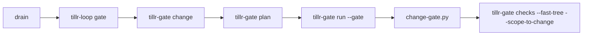

# The gate

> **Delivered copy.** This is `docs/reference/gate.md` from this repository at commit `2fa55241a8` (2026-11-24), copied into the tillr pack by `just pack-docs`. The [source](https://github.com/mschulkind-oss/tillr/blob/main/docs/reference/gate.md) is authoritative and may be newer. Links to documents that were not delivered point at the repository, and the queue item directives in this copy are inert.

**Status:** Source-verified 2026-11-24 against `c9ccb4a18bad26d6f599374cee8686c86fec8710`.
UNMEASURED: this reference was written by reading the code, not by observing a gate run.

**The gate** decides whether a change may land and whether the trunk is sound. A **check** is
one command the gate runs: a build, a test suite or a guard over the tree. A **candidate** is a
commit range a lane (one worktree doing one piece of work) offers for landing on the **trunk**
(the `main` branch). The **drain** (`tillr-drain`) is the loop that dispatches lanes and lands
their candidates. Every check is declared in one file, and one program, `tillr-gate`, runs
them for three callers: a person running `just done`, the drain judging a candidate before
the merge, and the drain proving the trunk after it.

| Component | Lives in |
| :--- | :--- |
| Check declarations, each beside its program and tests | `tools/gate/checks/` |
| Loading and validating declarations | `tools/tillr-gate` (`loadCheckDirectory`, `checkFile.validate`) |
| Planning and running checks, the verdict record | `tools/tillr-gate` (`Plan`, `RunWith`, `VerdictPayload`) |
| Remembered results | `tools/tillr-gate` (`treeFingerprint`, `resultStore`, `treeMemory`) |
| The stall watchdog | `tools/tillr-gate` (`watchCommand`, `ExitStalled`) |
| Classifying a check result | `tools/tillr/checkresult` (`Classify`, `Aggregate`), reached through `tillr-gate classify` and `tools/gate/classify.py` |
| The local gate | `tools/gate/done.py`, started by the `done` recipe |
| The landing gate's judge | `tools/gate/change-gate.py`, composed by `tools/tillr-loop/tillr-loop` |
| Affected Go test packages, and whole Go suites | `tools/gate/go_affected.py`, `tools/go-test-shards.py` |
| The after-merge proof | `tools/tillr-drain` ([After-merge heavy runs](../../tillr-drain/README.md#after-merge-heavy-runs)) |
| Gate settings | `config/tillr/gate-policy.json`, read by `ReadGatePolicy` in `tools/tillr-drain/redcap` |

**Reads with:** [gate check rules](https://github.com/mschulkind-oss/tillr/blob/main/docs/reference/gate-check-rules.md) (what a check may assert, and what
a red means) and [landing principles](../design/landing-principles.md) (the rulings a change
to the gate is tested against).

---

## Invariants

- **The exit is the verdict, and "could not judge" is its own answer.** A check that could
  not start, crashed or stalled judged nothing. It is never reported as a failed check, and
  it outranks a failure elsewhere in the same run.
- **The caller names the range.** A check that judges a change is handed its base and head
  commits by the caller. No check reads a stored baseline to find out what changed.
- **A pass is remembered only for inputs that can be recomputed.** The key is a fingerprint
  of what the check declares it reads. A failure is recorded and never reused.
- **A budget is a target.** No check is ended for running long. Only a check that makes no
  progress is ended, and that result is not a verdict on the candidate.
- **One function classifies every check result.** A caller decides blocking and credit from
  the classified outcome, never from a raw exit code or word.
- **A verdict covers what it ran.** A check skipped because the change does not touch what
  it reads is recorded as skipped, not as a pass.

## A check is one declaration file

A check is one JSON object in a file directly under `tools/gate/checks/`. Only filenames
ending in `.json` are declarations; programs and tests sit beside them. Adding a check adds
files and edits no shared list. The loader refuses an unknown field, validates every file
before anything is planned, and never emits a partial plan: a bad declaration names its file
and field and answers "could not judge".

| Field | Meaning |
| :--- | :--- |
| `id`, `label` | The stable name, and the sentence reports print. Both required; an id is declared once. |
| `command` | The argv to run, from the repository root. Required. |
| `scope` | `change` or `tree`. Required. See [change checks and tree checks](#change-checks-and-tree-checks). |
| `tier` | `fast` or `heavy`. Required. See [tiers](#tiers). |
| `budget_ms` | The time target. Required for `fast`. |
| `timeout_ms` | The time target of a `heavy` check, required there and refused on `fast`. Despite the name it stops nothing. |
| `reads` | Paths the check depends on; a directory ends in `/`, and `.` is the whole tree. Omitted or empty means the whole tree. |
| `tools` | Programs whose version output enters the fingerprint. |
| `needs` | Machine resources the check requires. See [machine needs](#machine-needs). |
| `remember` | `false` turns result memory off for the check. Default `true`. |
| `writes`, `exclusive` | Scheduling only: checks whose `writes` overlap, or an `exclusive` check, do not run at the same time as others. |

No field has a default that changes a verdict: scope, tier and the tier's cost are all
required.

### Change checks and tree checks

A **change check** (`scope: change`) judges a commit range, such as "every commit in the range
carries an allowed identity". The runner appends the base and head commits as the last two
arguments of its command. A **tree check** (`scope: tree`) judges one tree and gets no range.
A change check has no verdict on a single revision, so the faces that judge one revision
refuse it.

### Tiers

The **fast tier** is the set of checks cheap enough to run on every candidate. The **heavy
tier** is the rest: whole test suites and anything else measured in minutes. Fast tree checks
and all change checks run before the merge; heavy tree checks run in the
[after-merge proof](#after-merge-proof-and-the-green-pointer). Two change checks are heavy
(`go-affected` and `workflows`): they still run before the merge, outside the fast budget,
and the landing gate runs them only when the change touches what they read.

## Remembered passes

A tree check's pass is remembered so an unchanged check does not run again. The key is a
**fingerprint**: a hash over the declaration's exact bytes, the planned command, the git blob
of every tracked file under the check's `reads`, the version output of each program in
`tools`, and the name and commit of every ref in `needs`.

- A remembered pass answers the check without running it. The verdict entry says so, and
  the summary counts remembered checks apart from fresh passes.
- A fail is recorded with its log and never reused: the check runs again.
- Nothing is remembered when a file under the check's `reads` differs on disk from the
  judged commit, when the checkout's `HEAD` is another tree, or when the fingerprint moved
  while the command ran.
- A change check is never remembered by this store. The `documents` check keeps its own
  per-document memory in the same store, keyed on each document's blob and everything the
  renderer reads for it.
- The store is local to a machine. It lives under the repository's git common directory,
  so every worktree of one repository shares it.

### A contradicted check is disabled

A fingerprint that holds both a pass and a fail is a contradiction: the same inputs gave two
answers, so the check is flaky. Such a check is **disabled**: reported as `disabled`, never as
passed, and it neither blocks a landing nor turns the trunk red. `tillr-gate` writes a marker
naming the episode (the fingerprint and both times) and copies both logs at the observation.
The drain files one repair item per disabled check, and `tillr-gate enable` clears the
episode once that repair lands. The full rule is in
[gate check rules](https://github.com/mschulkind-oss/tillr/blob/main/docs/reference/gate-check-rules.md#a-check-set-aside-from-the-verdict-is-narrow-ticketed-and-counted).

### Machine needs

A `needs` entry beginning `ref:` names a local git ref, with at most one `*` wildcard. When no
such ref exists the check is `unavailable`: neither passed nor failed, listed with the
`git fetch` command that creates the ref, and not a reason for a non-zero exit. The runner
never fetches. Any other `needs` entry is a path that must exist, and a missing one is
`error`.

## Budgets and the stall watchdog

Every fast declaration states a `budget_ms`. The `gate-budget` change check sums them and
fails when the total exceeds the fast-tier cap, so admission is arithmetic over declared
costs and never a measurement of the machine. The cap bounds what every candidate pays. A
check planned only for some candidates, such as `go-affected`, is outside the sum.

A check that runs past its target keeps its own verdict. The overrun is recorded
(`over_budget_ms`) in the verdict, the log and the summary. Machine load therefore cannot
turn work that would have finished into a failure.

The **watchdog** is the progress observer that ends a stalled check. It samples each running
check about once a second. A sample shows progress when the check's log grew or its process
group used CPU time. A minute of consecutive samples with neither is a **stall**: the runner
ends the process group and records `stalled` with the last output line, the group's CPU time
and the silent-sample count. A stall is exit 6, and is not pass, fail, error or over-budget.
When neither CPU source is readable the watchdog prints `watchdog unavailable` and the check
runs unobserved. The CPU sources and their fallback are described in the
[`tillr-gate` README](../../tillr-gate/README.md#declaration-directories).

The drain gates a stalled candidate's same head once more, when fewer gates are in flight,
and holds the item as `gate-stalled` on a second stall.

> [!WARNING]
> Do not add a deadline that kills a working check, and do not carry a check to a later
> tier at its budget. `--tree-overrun` accepts only `keep`, and Go test commands run with
> Go's own deadline off, for the same reason.

## Result classification

`Classify` in `tools/tillr/checkresult` turns one raw observation (an exit code, a result
word, a cached record, a span) into one of five outcomes: `pass`, `fail`, `unknown`,
`unavailable` and `disabled`, each with a detail word. Its rules run in order:

1. A run proving a disabled check on its own repair candidate skips rules 2 and 3.
2. An active disabled marker answers `disabled` with the marker's evidence.
3. A contradicted fingerprint that matches no resolved episode answers `disabled`.
4. Otherwise the raw result is classified by the protocol that produced it. An observation
   with no raw result is `unknown`.

`Aggregate` folds a run's classified checks into one run result and exit code. In the
runner's order a check that could not run outranks a stall, which outranks a failure.

Go callers call the package. Python callers pipe observations to `tillr-gate classify`
through `tools/gate/classify.py`. Plain `tillr-gate classify` is pure and touches no disk;
with `--repo` or `--store` it resolves declarations, computes fingerprints and may write a
disabled marker.

## The local gate: `just done`

`just done` judges the committed tree with every declared check, using a `tillr-gate` built
from the checkout. It refuses to judge a dirty working tree, writes no verdict record and
moves no ref. Two passes run in order:

1. Every change check and every fast tree check, over `BASE..HEAD`.
2. Every heavy tree check, on `HEAD`. A check whose fingerprint already passed is remembered
   and not run. This pass is skipped when the first could not judge.

`BASE` is `--since` when given; otherwise the green pointer when `HEAD` descends from it;
otherwise the upstream branch when `HEAD` descends from it; otherwise `HEAD`'s first parent.
`--fast` runs the first pass only. `--only <id>` runs exactly one heavy check.

## The landing gate

The drain judges each candidate before it merges, in the lane's worktree:

`tillr-gate change` derives the change record from the candidate, `plan` binds it to the
digest of the candidate's own declaration directory, and `run --gate` runs one named judge
and writes the `gate.verdict` record. The lander accepts a verdict only when it binds the
candidate's base commit and head tree. The judge, `change-gate.py`, refuses unless the named
head is checked out, then runs every change check and fast tree check through the `checks`
face.

With `--scope-to-change`, a check whose declared `reads` are disjoint from the changed paths
is recorded as `skipped: no changed path is read`. A check with no declared `reads` always
runs and is not remembered in that run. The drain runs the gate in a detached child session
that survives an in-place restart of the loop, and records each ordinary gate run's time in
`gate.timing.jsonl` in the run's directory.

### Affected Go tests before the merge

`go-affected` is the change check that runs Go tests before a landing. It maps the changed
paths to test packages through `tools/gate/go-test-edges.json`, which lists for each package
the non-Go files it reads and the sibling programs it builds, and runs only the selected
packages with Go's result cache on. Where a package entry names `read_tests` for a file,
only those tests run when that file alone selected the package. This is how a change to the
gate's own code proves itself before the merge: `tools/tillr-gate/` and `tools/gate/` are
among its `reads`. The drain records the gate and landing time of such a change apart from
ordinary candidates.

## After-merge proof and the green pointer

With `landing_strategy` set to `after-merge`, a candidate lands on the fast verdict and the
drain's **heavy runner** then **proves** the trunk: it runs `tillr-gate checks --heavy-tree`
in a detached checkout of the trunk tip, which selects every heavy tree declaration and lets
result memory decide which actually execute. The **green pointer** is the ref
`refs/tillr/green`, the newest trunk commit whose proof passed. It moves only on a whole
green run. One runner works at a time; landings that arrive during a proof owe one further
run on the newest tip, not one each.

A new lane starts from the green pointer (`lane_base: green`), and an item whose blocker has
landed waits, with the reason `trunk-unproved`, until the pointer contains that landing. A
trunk fixer starts from the tip, because the failure it repairs is not in the proved commit.

### A red proof

When a heavy check fails, the runner searches the landings since the green pointer for the
one that broke it by running that check alone (`--heavy-tree --only <id>`). With
`auto_revert` on, the drain reverts the offending landing by itself and returns the failure
to the session that wrote it. A trunk fixer is filed only when the revert is unsafe, does not
repair the check, or the red cannot be attributed. Landings are never held by a count of
landings or elapsed time since the last green commit.

`tillr-loop replay`, `rolling` and `fixer-gate` are the revision checks the drain calls:
`rolling` judges every heavy declaration on the checked-out revision, and `replay` and
`fixer-gate` judge the one tree declaration `--only` names.

## The trunk fixer's gate

A **trunk fixer** is the generated item `fixer-main-<sha>` that the drain files when a trunk
check is red and a revert does not settle it. It names the failing check ids. Its gate runs two
things in order and passes only when both pass (`settleFixerGate` in `tools/tillr-drain/drain`):

1. **The ordinary gate, unchanged**, over the fixer's own base and head: the change checks, the
   fast tree checks and the landing tier its diff selects.
2. **The named checks.** Every check the fixer's criterion names, run on the fixer's tree by the
   selectors the proof recorded for them (`fixer-gate --only <proof selector>`), including a
   heavy check the ordinary gate would leave to the proof. They run only after the ordinary
   gate passes.

The second part tests the fixer's claim. A fixer that lands without repairing leaves the trunk
red and is never reverted, so the claim is tested before the merge.

- **No range since the last green commit is read.** The fixer is rebased onto the tip and judged
  on its own diff. Other landings are judged by the proof after the merge, so the fixer's cost
  does not grow with how long the trunk has been red.
- **A fixer that names no check** runs the ordinary gate alone and is resolved only by a whole
  green proof.
- **A named check that fails** is a verdict: the refusal returns to the fixer's worker. A refusal
  that mixes named and unnamed checks is a verdict too, and nothing is acquitted.
- **A named check that could not judge** holds the fixer as a gate fault (`gate-harness-error`)
  naming the check. It never passes by omission, and no defect item is filed.
- **A named check that is an upstream reader** (a fork check declared not reusable) is dropped
  when the gate is composed, with a line saying so. A red there is the change's own failure or
  [upstream drift](#upstream-drift).
- **The fixer cannot choose its checks.** The list comes from the fixer's record, and the gate's
  own code stays outside a fixer's fence.

For a check the fixer does not name, red on its base and on the tip, the fixer is judged by the
inherited-failure rule as any candidate is, with one difference: **a fixer never waits on
itself.**

| The fixer's diff and the check's read paths | The fixer the ordinary rule would hold it behind | Outcome |
| :--- | :--- | :--- |
| Do not intersect | Not asked | The fixer lands with the failure recorded as inherited |
| Intersect | A different fixer, which does not wait on this one | The fixer is held behind that fixer |
| Intersect | This fixer itself, or a fixer that already waits on this one | The check is attached to this fixer and the refusal returns to its worker; no hold is recorded |

An attached check joins the fixer's list of red checks and its watched paths join the fence,
minus the gate's own code. From the next gate it is a named check. One fixer per red commit
stays the rule; no second fixer is filed for the same commit.

> [!WARNING]
> Do not make the fixer's gate pass by skipping fork checks by name. The repair is the scope: a
> fixer whose diff touches a fork's series is still judged on that series, like any change.

## Upstream drift

**Upstream drift** *(coined here)* is a `patch-branch-inv2` check that is red on a candidate, red
on the candidate's base with the same answer, on a candidate that does not touch that fork. It is
a question about what an upstream repository published, not a verdict about a commit, so it
refuses nobody whose change does not touch the fork. The rule applies to every candidate, not
only a fixer (`ForkDriftCheck` in `tools/tillr-drain/remotesync`).

| The check on the base | The candidate's diff and the fork's own paths | Outcome |
| :--- | :--- | :--- |
| Passes | Any | The candidate's own failure: an ordinary refusal |
| Red, same answer | Do not intersect | Drift. The candidate lands with the failure recorded as inherited, and one rebase request is filed |
| Red, same answer | Intersect | Drift on a fork the candidate changes. One rebase request is filed and the candidate waits on it by name, unless it is that request's own work |
| Could not judge | Any | Neither drift nor a verdict: "could not judge", named |

- **Only `patch-branch-inv2` can be drift**, selected by its kind name. It is planned once per
  fork with a fetch and asks whether that fork's delivery branch (`refs/heads/patch/<fork>`)
  merges the upstream it follows. `series`, `patch-branch-inv3`, `forks-check`, `build` and
  `fork-quality` answer about the tree or a build and are never drift.
- **"Same answer"** means both sides carry the fork driver's refusal phrase `conflicts with` and
  name the same target ref. A red without the phrase is a check that could not judge; a different
  ref on the two sides means the upstream moved between the runs, and the candidate is gated
  again.
- **The fork's own paths** are its pin file (the tracked three-line record of the delivered
  commit, its remote and the upstream commit the fork's changes sit on) and, for a fork that
  commits a series directory, the paths under it (`Touches`). The check's `watches` are not the
  test, because they name the whole pack.
- **A fork pinned to a commit is never drift.** Its check answers for a fixed commit.
- **No trunk fixer is filed for drift**, because no trunk commit is at fault and the proof does
  not judge these checks.

A **rebase request** *(coined here)* is one generated fork item per fork and release. It is filed
only for a fork that follows releases and is delivered as a delivery branch (`Requestable`). A
second observation attaches to the open request, and a newer release updates it in place. It holds
nothing but changes to that fork. It is a mixed item:

1. **Fork part.** The request's worker rebases the fork in its lane checkout with
   `git rebase --onto <release> <old base> main`, the fork's gate builds that head, and the lander
   delivers it to the delivery branch. The lander accepts a rewritten head only for a release
   (`releaseRebase` in `tools/tillr-land/land`) and never rebases. It then fetches the delivered
   commit into the gate's own copy of the fork, so the next gate needs no publication step.
2. **Repository part.** A second run, fenced to the pin file, rewrites the record to the delivered
   commit and the release's commit. `patch-branch-inv2` judges the record, not the delivery
   branch, so the check passes only when this part lands, and that landing closes the request.

When the delivered head already contains the release, the request has no fork part. The operator
takes no step; a conflict that needs a product decision is the worker's `owner` obstacle.

A fork that follows a branch head, and a fork that still commits a series directory, get the same
acquittal and no request: nothing in the drain could close one. The inherited record on the
candidate and one loop line per fork and upstream commit are the whole notice, a candidate that
touches such a fork is refused in the ordinary way, and the rebase stays the operator's step.

The owner is told of drift by the queue only: the rebase request appears in the queue and on the
waiting list like any item. Drift has no owner-facing row and no hold addressed to the owner.

## Go test execution

Whole Go suites and affected packages both run through `tools/go-test-shards.py`.

- **A test run does not outlive the command that started it.** Every test process group is
  tied to the invoking command's lifetime.
- **Concurrent test binaries are bounded across the machine**, by slots held as file locks
  that every run shares. A run takes slots in its class, and classes are served in the
  order `repair`, `proof`, `gate`, `ordinary`, first come first served within a class. The
  waiting queue is namespaced by a rules version, so processes on different rules never
  yield to each other.
- **Unchanged packages are not re-run.** With `--cache`, packages run under Go's result
  cache, and a digest of each package's declared non-Go inputs is part of the cache key.

## `tillr-gate` faces

`tillr-gate --help` lists the faces and `tillr-gate <face> --help` prints one face's flags.

| Face | What it does |
| :--- | :--- |
| `change` | Derives a `gate.change` record from a candidate and its worktree. |
| `plan` | Plans a change against a declaration directory and writes a `gate.plan`. |
| `run` | Runs a plan, or one named judge with `--gate`, and writes the `gate.verdict`. |
| `checks` | Judges declarations over a caller's range: change checks, plus fast tree checks with `--fast-tree`; or heavy tree checks with `--heavy-tree`. |
| `classify` | Classifies observations read from standard input. |
| `enable` | Records a repaired disabling episode and clears its marker. |
| `shadow` | Runs a plan's checks as a measurement and writes a `gate.shadow`; it lands nothing and always answers 0 once its record is written. |

## Adding or running one check

To add a check, write `tools/gate/checks/<id>.json` and, beside it, the program it runs. A
fast check's `budget_ms` must fit under the cap with the others; `gate-budget` fails
otherwise. Declare `reads` as narrowly as the check truly reads: `reads` is what scopes the
check to a change and what bounds its fingerprint, so an input left out is an input whose
change does not re-run the check.

To run one fast tree check: `python3 tools/gate/tree-check.py --only <id> --base <commit>`,
with `tillr-gate` on `PATH`. To run one heavy check: `just done --only <id>`.

## Known gaps

- **The landing gate runs the installed `tillr-gate`, not the candidate's (`D-GR45`).** The
  judge script comes from the candidate's worktree, but the runner is the binary on `PATH`.
  A fault in the installed binary can therefore refuse the change that repairs it, and
  nothing recovers from that without an operator. No ruling settles which build judges a
  change to the binary's own source. `just done` does not have this gap.
- **The drain's stall re-gate and `gate-stalled` hold are the only stall recovery.** A stalled
  check in `just done` is reported as "could not judge" and nothing re-runs it.
- **`reads` is trusted.** Nothing verifies that a check reads only what it declares, and
  git-ignored inputs are outside every fingerprint.
- **`shadow` reads only the tier names `landing` and `rolling`**, which no declaration file
  carries, so against a declaration directory it measures every planned check as one tier.
- **Single test cases cannot be set aside.** Only a whole check can be disabled.
- **No drift probe.** [Upstream drift](#upstream-drift) is seen only when a change reaches a
  fork's `patch-branch-inv2` check; nothing looks for it at loop start or after a landing that
  changes a pack declaration (`rg -n 'drift.probe|driftProbe|DriftProbe' tools -g '*.go'` returns
  nothing). A fork that follows a branch head or commits a series directory has no queue route
  for its rebase.

## Current values

Verified at `c9ccb4a18bad`. The prose above explains what each is for.

| Value | Setting | Defined in |
| :--- | :--- | :--- |
| Fast-tier admission cap | 9,000 ms | `FastTierCapMS` in `tools/tillr-gate`; `LIMIT_MS` in `tools/gate/checks/gate-budget.py` |
| Watchdog sample interval, and silent samples to a stall | 1,000 ms, 60 | `WatchdogSampleInterval`, `WatchdogSilentSamples` |
| Exit codes of `tillr-gate` | 0 pass, 1 fail, 2 usage, 3 unreadable input, 4 could not judge, 5 internal fault, 6 stalled | `tools/tillr/record` (`ExitOK` to `ExitInternal`), `ExitStalled` |
| Exit codes of `just done` | 0 passed, 1 a check failed, 4 could not judge | `tools/gate/done.py` |
| Exit codes of `tree-check.py` | 0, 1, 4 and 6, as `tillr-gate` | `tools/gate/tree-check.py` |
| Result words in a verdict | `pass`, `fail`, `error`, `stalled`, `unavailable`, `disabled`, `skipped: no changed path is read`, `inherited`, `pass-inherited`, `over-budget` | `tools/tillr-gate` (`ResultPass` and its siblings) |
| Result store | `<git-common-dir>/tillr-gate/results/` | `openResultStore` |
| `just done` logs | `<git-common-dir>/tillr-gate/done-logs/<head>/` | `tools/gate/done.py` |
| Gate policy | `landing_strategy: after-merge`, `auto_revert: true`, `lane_base: green`, `budget_ms: 10000` | `config/tillr/gate-policy.json` |
| Slow-gate alert thresholds | one run over 60 s; median of 20 over 90 s | `config/tillr/watch/fast-gate-slow.toml` |

## Why it's this way

Each row is a ruling a maintainer might otherwise undo. The ids are cited from code comments
and other documents.

| ID | Ruling | Stated in |
| :--- | :--- | :--- |
| D-GR6 | The drain reverts a landing by itself when the proof shows it broke the trunk; a fixer is filed only when a revert is unsafe, does not repair, or the red is unattributed. | [A red proof](#a-red-proof) |
| D-GR8 | A tree check's pass is remembered by a fingerprint of its declaration, the files it reads and the tools it names. A fail is never reused. The store is local to a machine and is not published. Remembering by commit is rejected. | [Remembered passes](#remembered-passes) |
| D-GR9 | A check with an unmet machine need is `unavailable`, named with the command that provides it, and neither fails nor passes. | [Machine needs](#machine-needs) |
| D-GR10 | A check is one declaration file with no verdict-changing default. | [A check is one declaration file](#a-check-is-one-declaration-file) |
| D-GR11 | The fast budget is enforced by arithmetic over declared costs. Failing a landing on measured wall time is rejected. | [Budgets and the stall watchdog](#budgets-and-the-stall-watchdog) |
| D-GR15 | Owner: "target budgets, watch for stalls, but don't let 'load is high' cause failures that would otherwise finish just fine." Exceeding a budget is never by itself a failure, a fault or "could not judge". | [Budgets and the stall watchdog](#budgets-and-the-stall-watchdog) |
| D-GR16 | Progress is output growth or CPU time in a sample; a run of silent samples is a stall, recorded as `stalled`. The drain re-gates once on a named change (fewer gates in flight), never on time passing, and holds on the second stall. A longer fixed timeout is rejected. | [Budgets and the stall watchdog](#budgets-and-the-stall-watchdog) |
| D-GR17 | Owner: "a test that fails or hangs under load is a broken test; do not add a timeout, a retry or a longer wait as the fix". A test run started by a worker does not outlive the command that started it. | [Go test execution](#go-test-execution) |
| D-GR20 | Aggregate test parallelism is bounded across runs, not per run. | [Go test execution](#go-test-execution) |
| D-GR21 | Owner: "The correct move for a flaky test is disable it, file an item to fix it, and don't let it block anything. It is not considered green, but it also doesn't let you block other things." The trunk is green because the check is no longer included; the filed item is to re-enable it correctly. | [A contradicted check is disabled](#a-contradicted-check-is-disabled) |
| D-GR22 | A disabled check is counted apart from passes, has a marker per check id, gets one deduplicated repair item with both times and both logs, and is enabled again when the repair lands. A red verdict, a live re-run, and any retry, count or time window are rejected. | [A contradicted check is disabled](#a-contradicted-check-is-disabled) |
| D-GR23 | Every site that classifies a check result calls one function with five outcomes; a site decides blocking and credit from the outcome alone. A classifier per program is rejected. | [Result classification](#result-classification) |
| D-GR24 | Owner: "you can only start a new item if the previous item's trunk landing went green ... and then you always just base an item on the most recent green on the trunk", and a trunk fixer "is based on a red one". | [After-merge proof and the green pointer](#after-merge-proof-and-the-green-pointer) |
| D-GR38 | Owner: "if you think drain suite selected tests are 40 seconds, let's do that, and monitor how it goes, just make sure we have perf monitoring all over it. 10 seconds was apsirational". The 40 seconds is an estimate, not a limit. | [Affected Go tests before the merge](#affected-go-tests-before-the-merge) |
| D-GR41 | The disabled marker and both logs are written at the contradicting observation, before the face returns. Plain `tillr-gate classify` touches no disk. | [Result classification](#result-classification) |
| D-GR43 | The landing gate runs detached so it survives a loop restart and never holds a sibling's gate. Dropping `go-affected`, and adding a kill timeout, are rejected. | [The landing gate](#the-landing-gate) |
| D-GR44 | A non-Go file in a package's `reads` may name the tests that read it (`read_tests`); no reading package is dropped. | [Affected Go tests before the merge](#affected-go-tests-before-the-merge) |
| D-GR48 | Slot classes are served `repair`, `proof`, `gate`, `ordinary`; wait state is scoped by a rules version. | [Go test execution](#go-test-execution) |
| D-GR49 | Proofs and suite checks reuse Go's result cache, with a digest of declared non-Go inputs in the key. | [Go test execution](#go-test-execution) |
| D-FG1 | A trunk fixer's gate is the ordinary gate over its own diff plus the checks it names, run on its tree. No range since the last green is read. Keeping an untiered range is rejected: its cost grows with the red range. (Designer's decision.) | [The trunk fixer's gate](#the-trunk-fixers-gate) |
| D-FG2 | A fixer stays excluded from acquittal only for the checks it names. For any other check it is judged as any candidate is, except that it is never held behind itself or behind a fixer that waits on it. A second fixer for the same commit is rejected. (Designer's decision.) | [The trunk fixer's gate](#the-trunk-fixers-gate) |
| D-FG3 | A `patch-branch-inv2` check red on a candidate and its base with the same refusal against the same target ref, on a candidate that does not touch the fork, is drift: the candidate lands with the failure inherited and one rebase request per fork and release is filed. The lander never rebases and never writes the pin file; the operator takes no step. (Designer's decision.) | [Upstream drift](#upstream-drift) |
| D-FG4 | A fork check that could not judge is neither drift nor a verdict, and no gate answer files a tooling-defect item. (Designer's decision.) | [Upstream drift](#upstream-drift) |
| D-FG5 | The queue, the affected candidates and the operator's surfaces are told of drift by the rebase request and one loop line. (Designer's decision.) | [Upstream drift](#upstream-drift) |
| OQ-FG1 | Owner: when an upstream release breaks a patch series the owner is told by the queue only. No owner-facing row and no hold. | [Upstream drift](#upstream-drift) |
| OQ-GR1 | There is no cap on landings while a trunk check is red. | [A red proof](#a-red-proof) |
| OQ-GR2 | New work starts from the green pointer; see `D-GR24`. | [After-merge proof and the green pointer](#after-merge-proof-and-the-green-pointer) |
| OQ-GR3 | A change to the gate's own code runs its affected test packages before the merge. | [Affected Go tests before the merge](#affected-go-tests-before-the-merge) |
